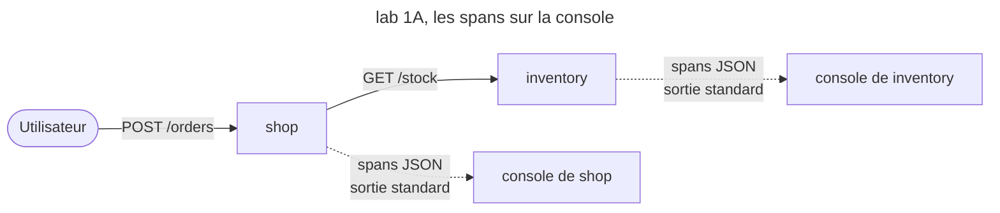

# Lab 1A : Lecture de la télémétrie en console

Ce premier lab du lab 1 se déroule sur `clt-N`, dans le dossier `~/lab01` préparé lors de la [mise en place](Lab_01_Socle.md#mise-en-place). L'application s'exécute ici sans **collector** ni backend, en écrivant directement sa télémétrie sur sa sortie standard.

# Objectifs

À la fin du lab, vous saurez :

- lire les spans émis par une application instrumentée sur sa sortie standard ;
- identifier le span racine et ses enfants pour reconstituer une trace avec `jq` ;
- localiser une panne et un ralentissement à partir des données brutes en console.

# Contenu

- [Environnement](#environnement)
- [1. Démarrer l'application](#1-démarrer-lapplication)
- [2. Une commande, une trace](#2-une-commande-une-trace)
- [3. Une panne franche](#3-une-panne-franche)
- [4. Une lenteur](#4-une-lenteur)
- [Limites de l'export console](#limites-de-lexport-console)

# Détail

## Environnement

L'application se compose de deux services Python situés dans le dossier `app/` : `shop`, qui gère les commandes (`POST /orders`), et `inventory`, qui fournit l'état des stocks (`GET /stock/<sku>`). Les deux services intègrent le SDK OpenTelemetry configuré pour afficher chaque span sous forme de ligne JSON sur la sortie standard des conteneurs. Aucune configuration OpenTelemetry n'est demandée dans ce lab : l'objectif est d'examiner directement les données produites par l'instrumentation.

Le schéma suivant illustre le flux : lors d'une commande, les requêtes traversent `shop` et `inventory`, et chaque service émet ses spans dans ses propres journaux.



## 1. Démarrer l'application

Sur `clt-N`, depuis `~/lab01`, démarrez les deux services :

```bash
docker compose up -d
docker compose ps --format '{{.Service}} {{.State}}'
```

On obtient :

```text
inventory running
shop running
```

En l'absence de fichier `.env`, le SDK utilise l'export console par défaut. La configuration d'export OTLP sera mise en place [au lab 1B](Lab_01B_Collector_vers_Jaeger.md#2-lapplication-parle-au-collector).

Passez une commande avec `order.sh`, qui appelle `shop` et affiche la réponse suivie du code HTTP. Articles connus : `coffee` (stock 12), `tea` (stock 0), `mug` (stock 3) :

```bash
./order.sh coffee 2 alice
```

On obtient :

```text
{"status":"accepted","total":9.0}
 [201]
```

Affichez les journaux des deux conteneurs :

```bash
docker compose logs --no-log-prefix --since 1m shop inventory
```

La sortie regroupe les logs applicatifs horodatés et les spans émis au format JSON :

```text
2026-11-22 05:09:22,235 INFO shop.orders [6bfdff188ca025b3179e4f0aacb62cac] order received sku=coffee qty=2 customer=alice
{"name": "GET inventory", "service": "shop", "trace_id": "6bfdff188ca025b3179e4f0aacb62cac", "span_id": "eb79c26250533f39", "parent_span_id": "cd3cd18b4c336ea4", "duration_ms": 48.86, "status": "UNSET", "attributes": {"http.request.method": "GET", "server.address": "inventory", "http.response.status_code": 200}, "events": []}
2026-11-22 05:09:22,284 INFO shop.orders [6bfdff188ca025b3179e4f0aacb62cac] order accepted sku=coffee total=9.0
{"name": "handle_request", "service": "shop", "trace_id": "6bfdff188ca025b3179e4f0aacb62cac", "span_id": "cd3cd18b4c336ea4", "parent_span_id": null, "duration_ms": 49.54, "status": "UNSET", "attributes": {"http.request.method": "POST", "http.route": "/orders", "url.path": "/orders/39211", "order.sku": "coffee", "order.qty": 2, "user.email": "alice@example.com", "http.response.status_code": 201, "order.total": 9.0}, "events": []}
{"name": "load_stock", "service": "inventory", "trace_id": "6bfdff188ca025b3179e4f0aacb62cac", "span_id": "e7b35943b10c6480", "parent_span_id": "cd3cd18b4c336ea4", "duration_ms": 44.39, "status": "UNSET", "attributes": {"http.request.method": "GET", "http.route": "/stock/coffee", "inventory.sku": "coffee", "inventory.stock": 12}, "events": []}
```

La commande a généré trois spans distincts :

- `handle_request` sur `shop` correspond au traitement de la requête HTTP entrante. Il ne possède pas de parent (`parent_span_id` vaut `null`).
- `GET inventory` sur `shop` représente l'appel HTTP client vers le service de stock, rattaché à `handle_request`.
- `load_stock` sur `inventory` correspond à la lecture du stock en base par le second service, rattaché au même span parent.

Ces trois spans partagent la même valeur de `trace_id`, ce qui permet de reconstituer l'ensemble du parcours à travers les deux services. Les lignes de log applicatif intègrent également cet identifiant entre crochets, assurant la corrélation entre logs et traces.

> [!NOTE]
>
> L'écriture des spans en JSON sur la sortie standard permet de les analyser facilement avec `jq`. En environnement de production, les spans sont généralement transmis directement à un **collector** via OTLP plutôt qu'écrits dans les journaux locaux.

## 2. Une commande, une trace

Pour isoler les spans dans ces journaux, utilisez `jq` : l'option `-R` traite l'entrée ligne par ligne, et la fonction `fromjson?` convertit les lignes JSON valides en ignorant les entrées textuelles.

Listez les spans, avec leur nom, leur service, leur parent, leur durée et leur statut :

```bash
docker compose logs --no-log-prefix shop inventory \
  | jq -cR 'fromjson? | select(.name) | {name, service, parent_span_id, duration_ms, status}'
```

On obtient, dans l'ordre d'écriture :

```text
{"name":"handle_request","service":"shop","parent_span_id":null,"duration_ms":49.54,"status":"UNSET"}
{"name":"GET inventory","service":"shop","parent_span_id":"cd3cd18b4c336ea4","duration_ms":48.86,"status":"UNSET"}
{"name":"load_stock","service":"inventory","parent_span_id":"cd3cd18b4c336ea4","duration_ms":44.39,"status":"UNSET"}
```

Le span `handle_request` ne possède pas de parent : il constitue la racine de la trace. Les deux autres spans référencent son identifiant dans leur champ `parent_span_id`. On retrouve ainsi la chronologie de l'appel : `shop` a reçu la requête entrante puis a sollicité `inventory` pour vérifier la disponibilité de l'article.

Reconstituez maintenant la trace complète de la dernière commande. D'abord son identifiant, puis tous les spans qui le portent :

```bash
TRACE=$(docker compose logs --no-log-prefix shop \
  | jq -rR 'fromjson? | select(.name=="handle_request") | .trace_id' | tail -1)
echo "trace_id=$TRACE"
docker compose logs --no-log-prefix shop inventory \
  | jq -cR "fromjson? | select(.trace_id==\"$TRACE\") | {name, service, parent_span_id, duration_ms}"
```

On obtient l'identifiant, puis les trois spans de la trace :

```text
trace_id=6bfdff188ca025b3179e4f0aacb62cac
{"name":"load_stock","service":"inventory","parent_span_id":"cd3cd18b4c336ea4","duration_ms":44.39}
{"name":"GET inventory","service":"shop","parent_span_id":"cd3cd18b4c336ea4","duration_ms":48.86}
{"name":"handle_request","service":"shop","parent_span_id":null,"duration_ms":49.54}
```

La durée totale de la requête dans `shop` (49,54 ms) englobe l'appel réseau vers `inventory` (48,86 ms), qui contient lui-même l'exécution de la requête de stock (44,39 ms). L'écart entre le span racine et le span client correspond au temps de traitement propre au service `shop`.

Testez à présent une commande dont la quantité demandée dépasse le stock disponible :

```bash
./order.sh mug 5 bob
```

On obtient :

```text
{"error":"insufficient stock","stock":3}
 [409]
```

Le span racine de cette commande porte un événement `stock.insufficient` et un statut d'erreur :

```bash
TRACE=$(docker compose logs --no-log-prefix shop \
  | jq -rR 'fromjson? | select(.name=="handle_request") | .trace_id' | tail -1)
docker compose logs --no-log-prefix shop \
  | jq -cR "fromjson? | select(.trace_id==\"$TRACE\") | {status, events}"
```

```text
{"status":"ERROR","events":[{"name":"stock.insufficient","attributes":{"stock":3}}]}
```

La trace indique un statut `ERROR`, et l'événement `stock.insufficient` précise le niveau de stock disponible (`3`), complétant l'information fournie par le code HTTP 409 renvoyé au client.

## 3. Une panne franche

Pour observer le comportement de l'instrumentation lors d'une indisponibilité de service, arrêtez le conteneur `inventory` avant d'envoyer une nouvelle commande :

```bash
docker compose stop inventory
./order.sh coffee 1 alice
```

Le service `shop` renvoie une erreur HTTP 502 :

```text
{"error":"inventory unavailable"}
 [502]
```

Pour identifier l'origine du problème à partir de la télémétrie, extrayez les spans marqués en erreur :

```bash
docker compose logs --no-log-prefix shop inventory \
  | jq -cR 'fromjson? | select(.status=="ERROR") | {name, service, attributes}'
```

On obtient :

```text
{"name":"GET inventory","service":"shop","attributes":{"http.request.method":"GET","server.address":"inventory"}}
{"name":"handle_request","service":"shop","attributes":{"http.request.method":"POST","http.route":"/orders","url.path":"/orders/52561","order.sku":"coffee","order.qty":1,"user.email":"alice@example.com","http.response.status_code":502}}
```

Deux spans sont en erreur : la racine `handle_request` et l'appel client `GET inventory`. Le code 502 correspond à la réponse formulée par `shop`, tandis que la cause technique réside dans l'échec de liaison vers `inventory`.

Retrouvez la ligne de log correspondante grâce à l'identifiant de trace. Le filtre `' (INFO|ERROR) '` sélectionne les lignes de log applicatif portant leur niveau de gravité entouré d'espaces et écarte les lignes JSON, où le statut est écrit `"ERROR"` entre guillemets :

```bash
TRACE=$(docker compose logs --no-log-prefix shop \
  | jq -rR 'fromjson? | select(.status=="ERROR") | .trace_id' | tail -1)
docker compose logs --no-log-prefix shop inventory | grep "$TRACE" | grep -E ' (INFO|ERROR) '
```

On obtient :

```text
2026-11-22 18:43:32,062 INFO shop.orders [cf7348e901f1da10aefca980be88e73d] order received sku=coffee qty=1 customer=alice
2026-11-22 18:43:32,077 ERROR shop.orders [cf7348e901f1da10aefca980be88e73d] inventory unavailable: HTTPConnectionPool(host='inventory', port=8081): Max retries exceeded with url: /stock/coffee (Caused by NameResolutionError("HTTPConnection(host='inventory', port=8081): Failed to resolve 'inventory' ([Errno -3] Temporary failure in name resolution)"))
```

Le journal applicatif fournit le détail de l'exception réseau : `shop` n'a pas pu résoudre le nom d'hôte `inventory`. La trace et le log permettent ainsi de distinguer une panne d'infrastructure d'une erreur de saisie ou de traitement de commande.

Redémarrez `inventory` pour la suite :

```bash
docker compose start inventory
```

## 4. Une lenteur

Le service `inventory` permet de simuler un temps de traitement élevé via la variable d'environnement `INVENTORY_DELAY_MS`. Lorsqu'elle est définie, le service introduit une pause artificielle avant de répondre, à l'intérieur de son span.

Configurez un délai de trois secondes sur `inventory` :

```bash
INVENTORY_DELAY_MS=3000 docker compose up -d inventory
```

Compose recrée le conteneur avec la nouvelle variable. Attendez quelques secondes que le service soit prêt, puis passez une commande :

```bash
sleep 5
./order.sh coffee 1 alice
```

Exécutez la requête suivante pour trier les spans par durée décroissante :

```bash
docker compose logs --no-log-prefix shop inventory \
  | jq -Rs 'split("\n") | map(fromjson? // empty) | sort_by(-.duration_ms) | .[0:3] | map({name, service, duration_ms})'
```

On obtient :

```text
[
  {
    "name": "handle_request",
    "service": "shop",
    "duration_ms": 3062.61
  },
  {
    "name": "GET inventory",
    "service": "shop",
    "duration_ms": 3061.4
  },
  {
    "name": "load_stock",
    "service": "inventory",
    "duration_ms": 3050.06
  }
]
```

Le span racine `handle_request` affiche la durée totale la plus élevée (environ 3 062 ms), mais la décomposition montre que l'essentiel de ce temps est consommé par `load_stock` dans `inventory` (environ 3 050 ms). L'analyse de l'imbrication des durées permet ainsi de localiser le service responsable du ralentissement.

Remettez le service dans son état initial en supprimant la variable :

```bash
docker compose up -d inventory
```

## Limites de l'export console

L'affichage des spans dans les journaux suffit pour tester une application locale à faible trafic. En environnement partagé ou en production, cette approche présente plusieurs limites :

- Les journaux sont volatils et disparaissent avec les conteneurs.
- La recherche d'une trace spécifique parmi des flux concurrents devient complexe et coûteuse en ressources.
- L'analyse textuelle avec des outils comme `jq` ne remplace pas une interface dédiée capable de représenter graphiquement la hiérarchie des spans et de filtrer par attributs, durées ou statuts.

Pour répondre à ces besoins, l'architecture OpenTelemetry sépare l'émission de la télémétrie de son stockage : un **collector** reçoit les données des applications et les achemine vers un backend d'observabilité. Cette mise en œuvre fait l'objet du [lab 1B](Lab_01B_Collector_vers_Jaeger.md).
