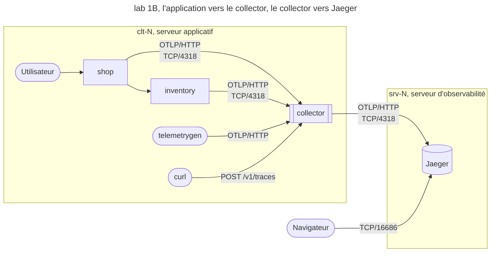
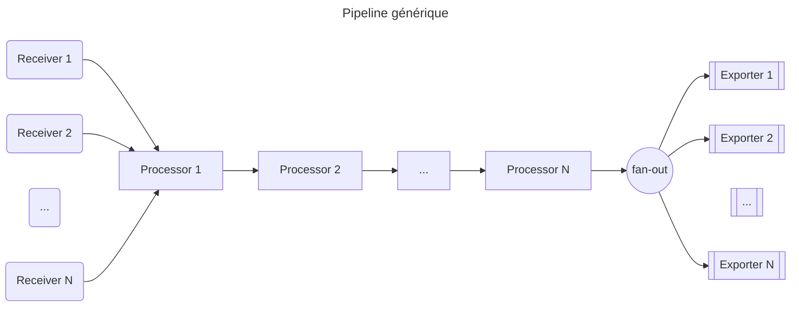
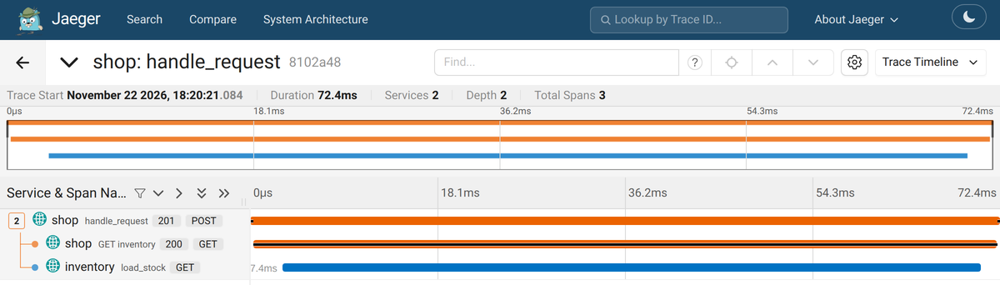
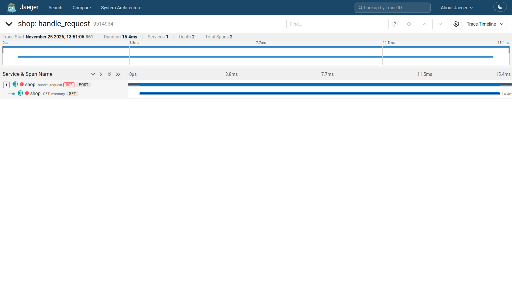
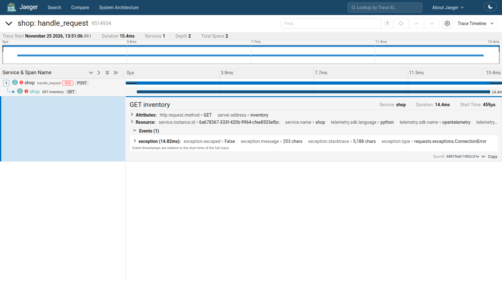

# Lab 1B : Configurer un premier **collector** et exporter vers Jaeger

Ce deuxième lab du lab 1 se déroule dans le terminal web de `clt-N`, dans le dossier `~/lab01` utilisé lors du [lab 1A](Lab_01A_Voir_la_valeur.md). Jaeger s'exécute sur `srv-N`, démarré depuis `clt-N` par SSH.

# Objectifs

À la fin du lab, vous saurez :

- configurer un **collector** de base (receiver OTLP, exporter, pipeline de traces) et valider sa configuration avant démarrage ;
- basculer l'export de l'application vers le **collector** via une variable d'environnement ;
- émettre un span OTLP manuellement via une requête HTTP directe ;
- acheminer les traces vers un backend Jaeger distant et visualiser leur hiérarchie ;
- exploiter les filtres de recherche et la vue en cascade de Jaeger pour analyser des erreurs et des temps de réponse.

# Contenu

- [Environnement](#environnement)
- [1. Un premier **collector**](#1-un-premier-collector)
- [2. L'application parle au **collector**](#2-lapplication-parle-au-collector)
- [3. Un span sans SDK](#3-un-span-sans-sdk)
- [4. Jaeger, sur la machine d'observabilité](#4-jaeger-sur-la-machine-dobservabilité)
- [5. Diagnostiquer à distance](#5-diagnostiquer-à-distance)

# Détail

## Environnement

L'environnement de travail reste identique à celui du [lab 1A](Lab_01A_Voir_la_valeur.md). L'application continue de fonctionner et ses traces sont pour le moment dirigées vers la console des conteneurs.

Le schéma ci-dessous illustre l'architecture cible : un **collector** local reçoit les traces applicatives sur `clt-N` et les relaie vers Jaeger sur `srv-N`. L'interface de Jaeger est consultée depuis un navigateur.



Le **collector** s'exécute sur le même hôte que l'application afin de recevoir les données localement et de les relayer vers le backend d'observabilité, déployé sur un serveur dédié.

## 1. Un premier **collector**

Un **collector** se décrit en YAML.

Les **receivers** reçoivent les données, les **exporters** les envoient ailleurs, et la section `service.pipelines` relie les deux pour chaque type de signal. Un composant déclaré mais absent d'un pipeline n'est pas utilisé.

Le schéma suivant, tiré de [la documentation officielle du **collector**](https://opentelemetry.io/docs/collector/architecture/), représente un pipeline générique : les données entrent par un ou plusieurs receivers, traversent une série de processors, et le dernier processor les copie vers chaque exporter via un fan-out :



Dans cette partie, le pipeline `traces` ne compte qu'un receiver (`otlp`) et un exporter (`debug`) ; les processors arrivent [au lab 1C](Lab_01C_Affiner_le_pipeline.md#2-les-premiers-processors).

Le **collector** reçoit sa configuration en quatre fichiers, un par section, passés avec quatre options `--config` : il les fusionne en une seule configuration. Ce découpage permet d'ajouter des éléments au fil du lab sans réécrire un fichier entier. Les fichiers sont montés depuis le dossier `otelcol/` par le service `otelcol` du compose, que vous démarrierez à la fin de cette partie.

Pour retrouver les options de chaque composant, consultez son README dans le dépôt [opentelemetry-collector-contrib](https://github.com/open-telemetry/opentelemetry-collector-contrib). L'exporter `debug` est documenté dans le dépôt [opentelemetry-collector](https://github.com/open-telemetry/opentelemetry-collector).

Depuis `~/lab01`, créez le receiver `otlp`, qui accepte le HTTP (port 4318) sur toutes les interfaces du conteneur :

```bash
mkdir -p otelcol
cat > otelcol/receivers.yaml <<'EOF'
receivers:
  otlp:
    protocols:
      http:
        endpoint: 0.0.0.0:4318
EOF
```

> [!NOTE]
>
> Ce lab n'utilise que le transport HTTP de l'OTLP. Il est plus facile à déboguer : une simple requête `curl` suffit, comme [à la partie 3](#3-un-span-sans-sdk), et il passe mieux à travers les proxys. Le transport gRPC reste le plus fréquent dans les configurations de production et dans les exemples de la documentation : vous le croiserez souvent (`protocols: grpc` sur le receiver, exporter `otlp_grpc`).

Créez l'exporter `debug`, avec le niveau de détail `detailed`, qui écrit les données reçues dans les logs du **collector** :

```bash
cat > otelcol/exporters.yaml <<'EOF'
exporters:
  debug:
    verbosity: detailed
EOF
```

Le fichier des processors reste vide pour l'instant (vous le remplirez [au lab 1C](Lab_01C_Affiner_le_pipeline.md#2-les-premiers-processors)), mais le **collector** attend quand même les quatre fichiers :

```bash
cat > otelcol/processors.yaml <<'EOF'
processors: {}
EOF
```

Définissez enfin un pipeline `traces` qui relie le receiver à l'exporter :

```bash
cat > otelcol/service.yaml <<'EOF'
service:
  pipelines:
    traces:
      receivers: [otlp]
      exporters: [debug]
EOF
```

Validez la configuration avant de démarrer. Le script `check.sh` lance la commande `validate` du **collector** sur les quatre fichiers :

```bash
./check.sh
```

La commande n'affiche rien et se termine sans erreur si la configuration est correcte. En cas d'erreur, le message cite le fichier et la clé en cause.

Démarrez le **collector** et lisez ses logs :

```bash
docker compose --profile otelcol up -d
docker compose logs --no-log-prefix otelcol | tail -n 1
```

Le dernier message doit se terminer par :

```text
Everything is ready. Begin running and processing data.
```

Envoyez cinq traces avec `./tg.sh`, un script fourni qui lance [telemetrygen](https://github.com/open-telemetry/opentelemetry-collector-contrib/tree/main/cmd/telemetrygen) vers le **collector**. Ce générateur produit des spans sans application, pratique pour tester un pipeline :

```bash
./tg.sh traces --traces 5
```

Chaque trace contient deux spans : un span parent `lets-go` et un span enfant `okey-dokey-0`. Le **collector** a donc affiché dix spans :

```bash
docker compose logs --no-log-prefix otelcol | grep -c 'Span #'
```

On obtient :

```text
10
```

> [!TIP]
>
> Deux erreurs courantes, à lire dans les logs du **collector** :
>
> - `connection refused` vers Jaeger : l'exporter vise une adresse qui n'héberge pas Jaeger. Dans ce lab, Jaeger n'est pas sur la même machine que le **collector** : l'exporter doit viser `$SRV_HOST`, pas `localhost` ni un nom de service du compose.
> - un émetteur qui ne se connecte pas : vérifiez que le **collector** tourne (`docker compose ps`) et que son receiver écoute sur `0.0.0.0`, sinon il n'accepte que les connexions venant de son propre conteneur.

## 2. L'application parle au **collector**

Dans le lab précédent, l'application exportait ses spans sur la console car aucune variable de destination n'était configurée. Dès que `OTEL_EXPORTER_OTLP_ENDPOINT` est définie, le SDK bascule automatiquement ses exports vers le protocole OTLP/HTTP à l'adresse indiquée.

Le compose lit cette variable dans le fichier `.env` du dossier. Créez-le, puis relancez les services avec le profil du **collector** :

```bash
echo 'OTEL_EXPORTER_OTLP_ENDPOINT=http://otelcol:4318' > .env
docker compose --profile otelcol up -d
```

Compose recrée les conteneurs de l'application avec la variable, et démarre le **collector** s'il ne tourne pas. Vérifiez que la console ne reçoit plus de spans et que le **collector**, lui, en reçoit :

```bash
./order.sh coffee 1 alice
sleep 2
echo "spans sur la console : $(docker compose logs --no-log-prefix --since 30s shop | jq -cR 'fromjson? | select(.name)' | wc -l)"
echo "spans dans le collector : $(docker compose logs --no-log-prefix --since 30s otelcol | grep -c 'Span #' || true)"
```

On obtient :

```text
{"status":"accepted","total":4.5}
 [201]
spans sur la console : 0
spans dans le collector : 3
```

On retrouve les trois spans `handle_request`, `GET inventory` et `load_stock`. Les données produites par l'application restent identiques, seul le canal de transmission a changé.

> [!NOTE]
>
> Les données visibles dans les journaux du **collector** ont déjà quitté l'application. Les processors abordés dans le [lab 1C](Lab_01C_Affiner_le_pipeline.md#2-les-premiers-processors) permettront d'agir sur ce flux au niveau de `clt-N` avant son expédition vers le serveur d'observabilité.

## 3. Un span sans SDK

Dans les étapes précédentes, les spans étaient générés par le SDK OpenTelemetry intégré dans le code Python. Le format OTLP reposant sur des structures standardisées en JSON ou Protobuf, il est également possible d'envoyer un span manuellement via une requête HTTP directe vers le port 4318 du **collector**.

```bash
NOW=$(date +%s%N)
curl -s -o /dev/null -w '%{http_code}\n' -X POST http://localhost:4318/v1/traces \
  -H 'Content-Type: application/json' -d '{
  "resourceSpans": [{
    "resource": {"attributes": [{"key": "service.name", "value": {"stringValue": "manuel"}}]},
    "scopeSpans": [{
      "scope": {"name": "curl"},
      "spans": [{
        "traceId": "5b8efff798038103d269b633813fc60c",
        "spanId": "eee19b7ec3c1b174",
        "name": "hello",
        "kind": 1,
        "startTimeUnixNano": "'"$NOW"'",
        "endTimeUnixNano": "'"$NOW"'"
      }]
    }]
  }]
}'
```

On obtient `200`. Le span est arrivé dans le **collector**, qui l'affiche dans ses logs avec les autres :

```bash
docker compose logs --no-log-prefix --since 1m otelcol | grep -c 'manuel'
```

On obtient :

```text
1
```

Cette requête illustre le format sous-jacent de l'OTLP : le SDK applicatif automatise la création de cette structure JSON (identifiants, horodatages, attributs) pour chaque opération instrumentée. Ce span apparaîtra dans Jaeger [à la partie 4](#4-jaeger-sur-la-machine-dobservabilité).

## 4. Jaeger, sur la machine d'observabilité

L'exporter `debug` utilisé jusqu'ici affiche les spans reçus dans les logs du **collector**, sans persistance. Pour stocker et indexer ces traces, il est nécessaire de raccorder le **collector** à un backend d'observabilité.

Jaeger est déployé avec une persistance en mémoire à l'aide du fichier `compose-srv.yaml` sur `srv-N`. Démarrez-le depuis `clt-N` par SSH :

```bash
ssh root@$SRV_HOST 'mkdir -p ~/lab01 && cp /root/opentelemetry-labs/config/lab01/compose-srv.yaml ~/lab01/ && cd ~/lab01 && docker compose -f compose-srv.yaml up -d'
```

Vérifiez que `clt-N` le joint sur ses deux ports : l'interface sur 16686, l'OTLP sur 4318.

```bash
curl -s -o /dev/null -w '%{http_code}\n' http://$SRV_HOST:16686/
curl -s -o /dev/null -w '%{http_code}\n' -X POST http://$SRV_HOST:4318/v1/traces \
  -H 'Content-Type: application/x-protobuf' --data-binary ''
```

Les deux requêtes renvoient le code HTTP 200, confirmant que le port web (16686) et le port de réception OTLP (4318) sont accessibles.

> [!NOTE]
>
> Jaeger est déployé ici dans une configuration simplifiée, adaptée à un lab : sans authentification, sans chiffrement TLS et avec stockage volatil en mémoire vive. En production, le backend est sécurisé et s'appuie sur une base de données persistante.

Branchez le **collector** sur ce backend. Toujours sur `clt-N`, ajoutez un exporter `otlp_http/jaeger` à la fin de `exporters.yaml`, avec `>>` à la place de `>` :

```bash
cat >> otelcol/exporters.yaml <<EOF
  otlp_http/jaeger:
    endpoint: http://$SRV_HOST:4318
EOF
```

> [!NOTE]
>
> Le délimiteur `EOF` n'est pas entre guillemets ici, volontairement : le shell remplace `$SRV_HOST` par le nom de votre machine d'observabilité pendant la création du fichier. Le **collector**, lui, reçoit l'adresse écrite en clair.
>
> `otlp_http` est le type actuel de l'exporter, l'ancien nom `otlphttp` n'est conservé que comme alias déprécié. Vous le rencontrerez encore dans beaucoup de configurations trouvées sur Internet.

Ajoutez cet exporter au pipeline `traces`, à côté du `debug` :

```bash
cat > otelcol/service.yaml <<'EOF'
service:
  pipelines:
    traces:
      receivers: [otlp]
      exporters: [debug, otlp_http/jaeger]
EOF
```

Validez, redémarrez le **collector**, puis générez du trafic :

```bash
./check.sh
docker compose restart otelcol
./order.sh coffee 1 alice
./tg.sh traces --traces 5
NOW=$(date +%s%N)
curl -s -o /dev/null -w '%{http_code}\n' -X POST http://localhost:4318/v1/traces \
  -H 'Content-Type: application/json' -d '{
  "resourceSpans": [{
    "resource": {"attributes": [{"key": "service.name", "value": {"stringValue": "manuel"}}]},
    "scopeSpans": [{
      "scope": {"name": "curl"},
      "spans": [{
        "traceId": "5b8efff798038103d269b633813fc60c",
        "spanId": "eee19b7ec3c1b174",
        "name": "hello",
        "kind": 1,
        "startTimeUnixNano": "'"$NOW"'",
        "endTimeUnixNano": "'"$NOW"'"
      }]
    }]
  }]
}'
```

Les traces de l'application, les traces de test émises par `telemetrygen` et le span manuel sont désormais stockés dans Jaeger. Ouvrez l'interface depuis votre poste, dans le navigateur, sur `http://$SRV_HOST:16686` : sélectionnez le service `shop`, cliquez sur **Find Traces**, puis ouvrez une trace pour afficher sa vue en cascade. On y retrouve les trois spans avec leurs relations hiérarchiques et leurs durées respectives.



En ligne de commande, les mêmes vérifications passent par l'API v3 de Jaeger, appelée depuis `clt-N`. Le nombre de traces du service `shop`, puis le nom du span envoyé avec `curl` :

```bash
curl -s "http://$SRV_HOST:16686/api/v3/traces?query.service_name=shop&query.startTimeMin=2020-01-01T00:00:00Z&query.startTimeMax=2030-01-01T00:00:00Z" \
  | jq '[.result.resourceSpans[].scopeSpans[].spans[].traceId] | unique | length'
curl -s "http://$SRV_HOST:16686/api/v3/traces?query.service_name=manuel&query.startTimeMin=2020-01-01T00:00:00Z&query.startTimeMax=2030-01-01T00:00:00Z" \
  | jq -r '.result.resourceSpans[0].scopeSpans[0].spans[0].name'
```

On obtient :

```text
1
hello
```

> [!TIP]
>
> Jaeger 2.x n'a plus l'API v1 (`/api/traces`, `/api/services`) : seule l'API v3 (`/api/v3/...`) répond, et sa recherche de traces exige une fenêtre temporelle explicite (`startTimeMin` et `startTimeMax`).

## 5. Diagnostiquer à distance

Reprenez les deux scénarios du [lab 1A](Lab_01A_Voir_la_valeur.md) en vous appuyant cette fois sur l'interface web de Jaeger (`http://$SRV_HOST:16686`), sans consulter les journaux des conteneurs.

Les commandes exécutées sur `clt-N` simulent des incidents en production (panne de service ou latence anormale). L'analyse s'effectue ensuite exclusivement depuis l'interface web de Jaeger sur votre poste, sans consulter les journaux des serveurs applicatifs.

### La panne

Arrêtez le service `inventory`, puis envoyez une commande :

```bash
docker compose stop inventory
./order.sh coffee 1 alice
sleep 5
```

La requête échoue avec un code HTTP 502. Dans l'interface de Jaeger, recherchez les traces du service `shop` sur les deux dernières minutes. La trace en échec se signale par un marqueur d'erreur. En l'ouvrant, on constate que le span client `GET inventory` est en erreur, ce qui a propagé le statut d'erreur sur le span parent `handle_request`.



Le détail du span client `GET inventory` montre le statut `ERROR`, le code HTTP 502 et l'exception levée :



En ligne de commande, la même trace s'obtient via l'API de Jaeger :

```bash
curl -s "http://$SRV_HOST:16686/api/v3/traces?query.service_name=shop&query.startTimeMin=$(date -u -d '5 minutes ago' +%Y-%m-%dT%H:%M:%SZ)&query.startTimeMax=$(date -u -d '+1 minute' +%Y-%m-%dT%H:%M:%SZ)" \
  | jq -r '.result.resourceSpans[] | select([.scopeSpans[].spans[].status.code] | contains([2])) | .scopeSpans[0].spans[0].name'
```

Le statut d'erreur se propageant au span parent, la requête renvoie les deux spans en erreur de la trace. Le span fautif est le premier, `GET inventory` :

```text
GET inventory
handle_request
```

### La lenteur

Redémarrez `inventory`, puis activez son mode lent :

```bash
docker compose start inventory
sleep 5
INVENTORY_DELAY_MS=3000 docker compose up -d inventory
sleep 5
./order.sh coffee 1 alice
sleep 5
```

Dans Jaeger, la trace correspondant à cette commande affiche une durée supérieure à trois secondes. Le diagramme en cascade met en évidence la répartition du temps : l'attente se concentre dans l'opération `load_stock` sur le service `inventory`.

En ligne de commande, la recherche de Jaeger permet d'isoler cette trace par durée minimale. La commande suivante place la durée en début de ligne pour trier facilement le résultat :

```bash
curl -s "http://$SRV_HOST:16686/api/v3/traces?query.service_name=shop&query.startTimeMin=$(date -u -d '5 minutes ago' +%Y-%m-%dT%H:%M:%SZ)&query.startTimeMax=$(date -u -d '+1 minute' +%Y-%m-%dT%H:%M:%SZ)&query.minDuration=2s" \
  | jq -r '.result.resourceSpans[] | .scopeSpans[].spans[] | "\(((.endTimeUnixNano|tonumber) - (.startTimeUnixNano|tonumber))/1000000 | round)ms \(.name)"' \
  | sort -rn | head -3
```

On obtient :

```text
3022ms handle_request
3022ms GET inventory
3016ms load_stock
```

La racine et l'appel HTTP affichent la même durée arrondie : l'un contient l'autre, et ce qui les sépare se compte en microsecondes. La cause est `load_stock`, sur `inventory`. Remettez le service rapide :

```bash
docker compose up -d inventory
```

### Bilan de l'acheminement des traces

L'utilisation conjointe du **collector** et d'un backend dédié répond aux limites de l'analyse en console observées dans le [lab 1A](Lab_01A_Voir_la_valeur.md#limites-de-lexport-console) :

- Les traces sont conservées et indexées indépendamment de l'état des conteneurs applicatifs.
- Les requêtes d'analyse permettent de filtrer rapidement par service, durée d'exécution ou statut d'erreur.
- La visualisation en cascade restitue la chronologie et les relations parent-enfant sans manipulation manuelle de données textuelles.
- Le diagnostic s'opère à distance sans accès direct à l'environnement d'exécution applicatif.

De plus, l'application reste découplée du backend d'observabilité : elle communique uniquement avec son **collector** local. Une modification d'infrastructure ou de backend de stockage s'effectue dans la configuration du **collector**, sans impacter le code ni le déploiement applicatif.

Le [lab 1C](Lab_01C_Affiner_le_pipeline.md) aborde la suite de ce traitement : l'application de filtres et de transformations sur les données en transit dans le **collector**.
