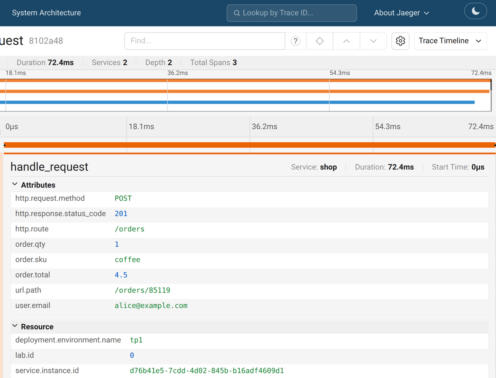
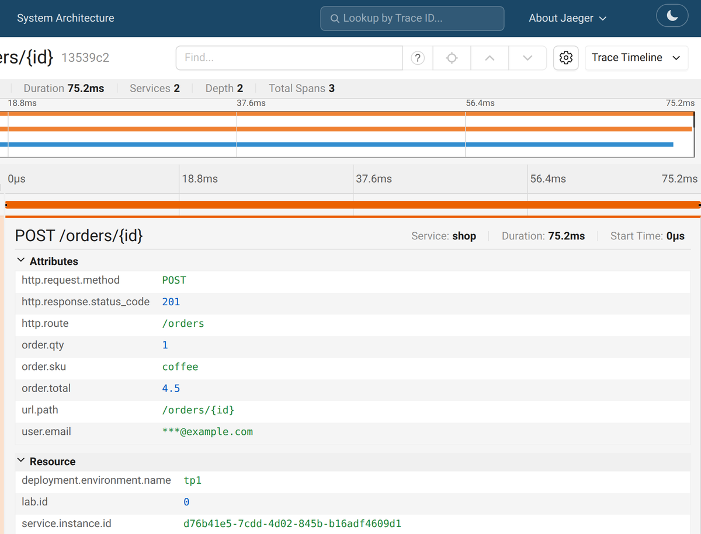
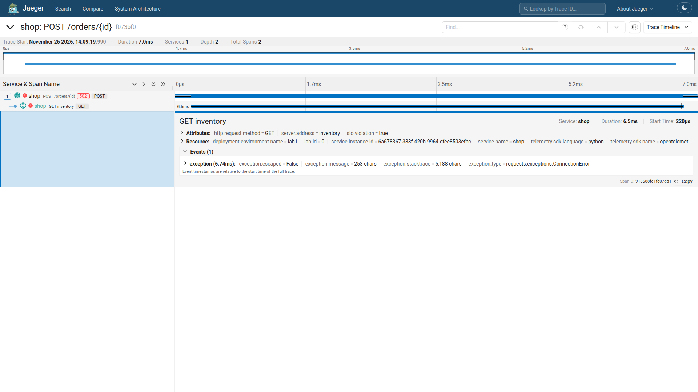

# Lab 1C : Affiner le pipeline du **collector** avec filter, transform et batch

Ce troisième lab du lab 1 se déroule dans le terminal web de `clt-N`, dans le dossier `~/lab01` utilisé lors du [lab 1B](Lab_01B_Collector_vers_Jaeger.md). L'application, le **collector** et Jaeger restent actifs.

# Objectifs

À la fin du lab, vous saurez :

- intégrer et ordonner les processors `memory_limiter`, `resource` et `batch` dans un pipeline de traces ;
- éliminer les spans de vérification de santé avec le processor `filter` ;
- anonymiser des données sensibles et normaliser des attributs de requête avec le processor `transform` en syntaxe OTTL.

# Contenu

- [Environnement](#environnement)
- [1. Du bruit dans Jaeger](#1-du-bruit-dans-jaeger)
- [2. Les premiers processors](#2-les-premiers-processors)
- [3. Supprimer les sondes avec le filter](#3-supprimer-les-sondes-avec-le-filter)
- [4. Masquer et normaliser avec transform et OTTL](#4-masquer-et-normaliser-avec-transform-et-ottl)
- [Extra](#extra)
- [Cleanup](#cleanup)

# Détail

## Environnement

L'environnement reprend l'état final du [lab 1B](Lab_01B_Collector_vers_Jaeger.md) : le pipeline du **collector** comprend le receiver `otlp`, les exporters `debug` et `otlp_http/jaeger`, et aucun processor.

Les processors configurés dans ce lab s'exécutent sur `clt-N`, dans le **collector**, avant transmission des données à `srv-N`.

## 1. Du bruit dans Jaeger

Ouvrez Jaeger dans le navigateur (`http://$SRV_HOST:16686`). Afin de comparer clairement les traces avant et après l'ajout des processors, redémarrez Jaeger pour vider son stockage en mémoire :

```bash
ssh root@$SRV_HOST 'cd ~/lab01 && docker compose -f compose-srv.yaml restart jaeger'
```

Attendez quelques secondes, puis vérifiez que la liste des services est vide :

```bash
sleep 5
curl -s http://$SRV_HOST:16686/api/v3/services
```

On obtient :

```text
{"services":["jaeger"]}
```

Démarrez le service de sondes inclus dans le profil `health`, qui interroge l'endpoint `/health` de `shop` toutes les cinq secondes :

```bash
docker compose --profile health up -d
```

Laissez tourner une minute, puis passez deux commandes :

```bash
./order.sh coffee 1 alice
./order.sh mug 1 bob
sleep 5
```

Dans Jaeger, affichez les traces récentes du service `shop`. On observe que les traces des deux commandes sont mêlées à de nombreuses traces générées par les sondes régulières. En examinant la trace d'une commande, on constate également que le span racine porte un nom générique (`handle_request`), que l'adresse électronique du client apparaît en clair (`alice@example.com`) et que le chemin de requête intègre un identifiant variable (`/orders/39211`).

> [!NOTE]
>
> Ces éléments (le nom `handle_request`, le champ `user.email` non masqué et l'identifiant dans le chemin) sont intégrés volontairement dans l'application d'exemple afin d'illustrer les opérations de nettoyage réalisables dans le **collector**.

En ligne de commande, le décompte des traces de sondes sur la dernière minute s'obtient avec :

```bash
curl -s "http://$SRV_HOST:16686/api/v3/traces?query.service_name=shop&query.startTimeMin=$(date -u -d '1 minute ago' +%Y-%m-%dT%H:%M:%SZ)&query.startTimeMax=$(date -u -d '+1 minute' +%Y-%m-%dT%H:%M:%SZ)" \
  | jq '[.result.resourceSpans[].scopeSpans[].spans[] | select(.attributes[]? | select(.key=="http.route" and .value.stringValue=="/health"))] | length'
```

On obtient, à quelques unités près selon le moment :

```text
11
```

Sur la période observée, la majorité des spans collectés correspond aux vérifications de santé, tandis que seuls quelques spans représentent des commandes réelles. Ce volume de données superflues augmente la consommation de stockage du backend et complique l'exploitation des recherches. Par ailleurs, la présence d'identifiants variables dans les chemins d'URL (`/orders/39211`, `/orders/48151`) empêche d'agréger facilement les métriques ou les traces par type d'opération.

Les sections suivantes détaillent comment traiter ces points dans le pipeline de traces à l'aide de processors spécifiques.

## 2. Les premiers processors

Les processors modifient les données entre la réception et l'exportation. Ils s'exécutent séquentiellement selon leur ordre de déclaration dans le pipeline.

Depuis `~/lab01`, réécrivez `otelcol/processors.yaml` avec trois processors :

- `memory_limiter` protège le **collector** d'un dépassement de mémoire : vérification toutes les secondes, limite de 256 MiB, marge de pic de 64 MiB ;
- `resource` ajoute deux attributs de ressource à toutes les données : `deployment.environment.name` avec la valeur `lab1`, et `lab.id` avec votre numéro. Le compose transmet déjà `LAB_ID` au conteneur : la syntaxe `${env:LAB_ID}` du **collector** lit cette variable ;
- `batch` regroupe les données avant l'envoi, avec `timeout: 2s`.

```bash
cat > otelcol/processors.yaml <<'EOF'
processors:
  memory_limiter:
    check_interval: 1s
    limit_mib: 256
    spike_limit_mib: 64
  resource:
    attributes:
      - key: deployment.environment.name
        value: lab1
        action: upsert
      - key: lab.id
        value: ${env:LAB_ID}
        action: upsert
  batch:
    timeout: 2s
EOF
```

> [!TIP]
>
> Les guillemets simples autour de `'EOF'` empêchent le shell de remplacer lui-même `${env:LAB_ID}`, qui est destiné au **collector**.

Placez ces processors dans le pipeline `traces`, entre le receiver et les exporters. Le `memory_limiter` passe en premier, pour refuser des données avant de les traiter si la mémoire est saturée, et le `batch` passe en dernier, pour grouper des données déjà traitées (le README du `batch` processor donne cette recommandation).

```bash
cat > otelcol/service.yaml <<'EOF'
service:
  pipelines:
    traces:
      receivers: [otlp]
      processors: [memory_limiter, resource, batch]
      exporters: [debug, otlp_http/jaeger]
EOF
```

Validez, redémarrez le **collector**, puis passez une commande :

```bash
./check.sh
docker compose restart otelcol
sleep 4
./order.sh coffee 1 alice
```

Les attributs de ressource apparaissent dans Jaeger, sur la trace de cette commande, dans la section **Resource** des détails d'un span :



En ligne de commande, sur la dernière trace du service `shop` :

```bash
curl -s "http://$SRV_HOST:16686/api/v3/traces?query.service_name=shop&query.startTimeMin=$(date -u -d '2 minutes ago' +%Y-%m-%dT%H:%M:%SZ)&query.startTimeMax=$(date -u -d '+1 minute' +%Y-%m-%dT%H:%M:%SZ)" \
  | jq -r '.result.resourceSpans[0].resource.attributes[] | select(.key=="lab.id" or .key=="deployment.environment.name") | "\(.key)=\(.value | (.stringValue // .intValue))"'
```

On obtient votre numéro de participant, la valeur de `$LAB_ID` (par exemple `3` pour le participant 3) :

```text
deployment.environment.name=lab1
lab.id=0
```

Ces attributs permettent d'identifier l'environnement d'exécution de manière centralisée au niveau du **collector**, sans modifier le code des applications.

Observez maintenant l'effet du `batch`. Passez `timeout` à `15s` avec `sed`, redémarrez le **collector**, puis passez une commande et suivez les logs :

```bash
sed -i 's/timeout: 2s/timeout: 15s/' otelcol/processors.yaml
docker compose restart otelcol
./order.sh coffee 1 alice
docker compose logs -f otelcol
```

Dans les logs, les spans de votre commande n'apparaissent qu'une quinzaine de secondes plus tard, le temps que le lot soit envoyé (quittez le suivi avec Ctrl+C). Remettez ensuite la valeur d'origine :

```bash
sed -i 's/timeout: 15s/timeout: 2s/' otelcol/processors.yaml
docker compose restart otelcol
```

> [!TIP]
>
> Si l'attribut `lab.id` est vide ou vaut `0`, la variable `LAB_ID` n'est pas définie dans votre terminal. Contrôlez `echo $LAB_ID`, puis relancez `docker compose up -d otelcol` pour recréer le conteneur avec la valeur.

## 3. Supprimer les sondes avec le filter

Les requêtes de vérification de santé génèrent un volume de traces répétitives qui n'apportent généralement pas d'information utile lors de l'analyse d'incidents.

Le processor `filter` supprime les données qui vérifient une condition écrite en OTTL, le langage de transformation d'OpenTelemetry. Si une des conditions de la liste est vraie, la donnée est supprimée.

> [!NOTE]
>
> Dans cette version du **collector**, le processor `filter` attend une liste `trace_conditions`, et les chemins OTTL commencent par le nom du contexte, par exemple `span.attributes["clé"]`.

Ajoutez un processor `filter/healthchecks` à la fin de `processors.yaml`, sans toucher au reste, avec `>>` à la place de `>`. L'indentation de deux espaces devant le nom du processor est nécessaire : l'entrée doit avoir la même indentation que les processors déjà présents.

```bash
cat >> otelcol/processors.yaml <<'EOF'
  filter/healthchecks:
    error_mode: ignore
    trace_conditions:
      - span.attributes["http.route"] == "/health"
EOF
```

Placez-le dans le pipeline après `resource` et avant `batch` : il est inutile de grouper des données que vous allez supprimer.

```bash
cat > otelcol/service.yaml <<'EOF'
service:
  pipelines:
    traces:
      receivers: [otlp]
      processors: [memory_limiter, resource, filter/healthchecks, batch]
      exporters: [debug, otlp_http/jaeger]
EOF
```

Validez, redémarrez le **collector**, puis attendez une minute, le temps que les sondes produisent du trafic que le nouveau pipeline refuse :

```bash
./check.sh
docker compose restart otelcol
sleep 60
```

Depuis `clt-N`, comptez les spans de sondes arrivés dans Jaeger pendant cette minute, puis vérifiez que la commande passée pendant la même fenêtre est bien arrivée :

```bash
./order.sh coffee 1 alice
sleep 5
curl -s "http://$SRV_HOST:16686/api/v3/traces?query.service_name=shop&query.startTimeMin=$(date -u -d '1 minute ago' +%Y-%m-%dT%H:%M:%SZ)&query.startTimeMax=$(date -u -d '+1 minute' +%Y-%m-%dT%H:%M:%SZ)" \
  | jq '{sondes: [.result.resourceSpans[].scopeSpans[].spans[] | select(.attributes[]? | select(.key=="http.route" and .value.stringValue=="/health"))] | length, commandes: [.result.resourceSpans[].scopeSpans[].spans[] | select(.attributes[]? | select(.key=="http.route" and .value.stringValue=="/orders"))] | length}'
```

On obtient :

```text
{"sondes":0,"commandes":1}
```

Les spans de sondes sont désormais filtrés avant transmission. Dans l'interface de Jaeger, la liste des traces pour `shop` ne contient plus que les requêtes applicatives réelles.

> [!NOTE]
>
> Les traces de sondes reçues avant le redémarrage du **collector** sont toujours dans Jaeger : elles ont traversé l'ancien pipeline. Pour les vérifications, cherchez dans une fenêtre de temps qui commence après le redémarrage, comme ci-dessus.

## 4. Masquer et normaliser avec transform et OTTL

Les traces de commandes présentent encore deux aspects à corriger : l'exposition d'une donnée personnelle en clair (`user.email`) et le manque d'uniformité du chemin d'URL (`url.path`).

Le processor `transform` modifie les données avec des instructions OTTL. Pour chaque signal, il attend une liste d'instructions (`trace_statements` pour les traces) exécutées dans l'ordre. Une instruction peut se terminer par une clause `where`, qui limite son application aux données qui vérifient la condition.

### L'état de départ

Passez une commande et lisez les attributs du span racine, avec la même requête que celle qui servira à vérifier le résultat à la fin de cette partie :

```bash
./order.sh coffee 1 alice
sleep 5
curl -s "http://$SRV_HOST:16686/api/v3/traces?query.service_name=shop&query.startTimeMin=$(date -u -d '1 minute ago' +%Y-%m-%dT%H:%M:%SZ)&query.startTimeMax=$(date -u -d '+1 minute' +%Y-%m-%dT%H:%M:%SZ)" \
  | jq -c '[.result.resourceSpans[].scopeSpans[].spans[] | select(.attributes[]? | select(.key=="user.email"))][0] | {name, email: .attributes[] | select(.key=="user.email") | .value.stringValue, path: .attributes[] | select(.key=="url.path") | .value.stringValue}'
```

On obtient le nom du span, l'adresse en clair et le chemin avec son identifiant :

```text
{"name":"handle_request","email":"alice@example.com","path":"/orders/39211"}
```

Il s'agit des attributs initiaux émis par l'application, visibles dans le panneau de détails du span sous Jaeger :


### Le processor transform

Ajoutez un processor `transform/normalize` qui règle ces trois points :

1. remplacer la partie locale de `user.email` (ce qui précède le `@`) par `***` ;
2. remplacer, dans `url.path`, chaque segment numérique par `{id}` ;
3. renommer les spans appelés `handle_request` en `<méthode> <chemin>`, avec la valeur de `http.request.method` suivie d'une espace et de celle de `url.path`.

Les fonctions utilisées sont documentées dans la référence OTTL : [replace_pattern](https://github.com/open-telemetry/opentelemetry-collector-contrib/blob/main/pkg/ottl/ottlfuncs/README.md#replace_pattern), [set](https://github.com/open-telemetry/opentelemetry-collector-contrib/blob/main/pkg/ottl/ottlfuncs/README.md#set) et [Concat](https://github.com/open-telemetry/opentelemetry-collector-contrib/blob/main/pkg/ottl/ottlfuncs/README.md#concat).

Chaque instruction se termine par une clause `where` qui vérifie que l'attribut utilisé existe (`!= nil`), pour que les données qui ne portent pas ces attributs ne produisent pas d'erreur.

L'ordre compte pour la troisième instruction : le nom doit être construit avec le chemin déjà normalisé.

La dernière instruction est longue ; elle est coupée sur deux lignes. YAML recolle les deux lignes avec une espace, le **collector** reçoit donc une seule instruction :

```bash
cat >> otelcol/processors.yaml <<'EOF'
  transform/normalize:
    error_mode: ignore
    trace_statements:
      - replace_pattern(span.attributes["user.email"], "^[^@]+", "***") where span.attributes["user.email"] != nil
      - replace_pattern(span.attributes["url.path"], "/[0-9]+", "/{id}") where span.attributes["url.path"] != nil
      - set(span.name, Concat([span.attributes["http.request.method"], span.attributes["url.path"]], " "))
        where span.name == "handle_request" and span.attributes["http.request.method"] != nil and span.attributes["url.path"] != nil
EOF
```

Placez ce processor après `filter/healthchecks` et avant `batch` : inutile de masquer des données que vous allez supprimer, et inutile de grouper des données qui vont encore changer.

```bash
cat > otelcol/service.yaml <<'EOF'
service:
  pipelines:
    traces:
      receivers: [otlp]
      processors: [memory_limiter, resource, filter/healthchecks, transform/normalize, batch]
      exporters: [debug, otlp_http/jaeger]
EOF
```

### Vérifier le résultat

Validez, redémarrez le **collector**, puis passez une commande :

```bash
./check.sh
docker compose restart otelcol
sleep 4
./order.sh coffee 1 alice
sleep 5
```

Relisez le même span, avec la requête de la partie précédente, resserrée sur les dernières secondes pour ne lire que les traces passées par le nouveau pipeline :

```bash
curl -s "http://$SRV_HOST:16686/api/v3/traces?query.service_name=shop&query.startTimeMin=$(date -u -d '30 seconds ago' +%Y-%m-%dT%H:%M:%SZ)&query.startTimeMax=$(date -u -d '+1 minute' +%Y-%m-%dT%H:%M:%SZ)" \
  | jq -c '[.result.resourceSpans[].scopeSpans[].spans[] | select(.attributes[]? | select(.key=="user.email"))][0] | {name, email: .attributes[] | select(.key=="user.email") | .value.stringValue, path: .attributes[] | select(.key=="url.path") | .value.stringValue}'
```

On obtient :

```text
{"name":"POST /orders/{id}","email":"***@example.com","path":"/orders/{id}"}
```

L'adresse électronique est désormais anonymisée, le chemin d'URL est standardisé avec le motif `{id}`, et le nom du span racine reprend la méthode HTTP et la route normalisée (`POST /orders/{id}`). Cette uniformité facilite les regroupements et les requêtes par endpoint dans les outils d'observabilité.

Le panneau de détails de Jaeger reflète ces modifications :



Le pipeline complet applique ainsi les règles de contrôle et de mise en conformité des traces au niveau du **collector** local, avant leur acheminement vers le serveur d'observabilité.

## Extra

Cet exercice optionnel prolonge la configuration établie à la partie 4 pour ajouter un indicateur explicite sur les spans en échec.

### Marquer les erreurs en OTTL

Dans les scénarios précédents ([lab 1A](Lab_01A_Voir_la_valeur.md#3-une-panne-franche) et [lab 1B](Lab_01B_Collector_vers_Jaeger.md#5-diagnostiquer-à-distance)), le statut d'erreur était porté par le code standard du span. Pour faciliter le filtrage dans certaines interfaces ou alimenter des tableaux de bord, il est parfois utile d'ajouter un attribut booléen dédié sur les spans concernés.

Depuis `clt-N` et le dossier `~/lab01`, ajoutez un processor `transform/slo` à la suite de la configuration actuelle, avec `>>` à la place de `>` :

```bash
cat >> otelcol/processors.yaml <<'EOF'
  transform/slo:
    error_mode: ignore
    trace_statements:
      - set(span.attributes["slo.violation"], true) where span.status.code == STATUS_CODE_ERROR
EOF
```

Placez-le dans le pipeline, après `transform/normalize` et avant `batch` :

```bash
cat > otelcol/service.yaml <<'EOF'
service:
  pipelines:
    traces:
      receivers: [otlp]
      processors: [memory_limiter, resource, filter/healthchecks, transform/normalize, transform/slo, batch]
      exporters: [debug, otlp_http/jaeger]
EOF
```

Validez et redémarrez le **collector** :

```bash
./check.sh
docker compose restart otelcol
```

Attendez quelques secondes, puis provoquez une erreur en éteignant `inventory`, et passez une commande :

```bash
sleep 5
./order.sh coffee 1 alice
docker compose stop inventory
./order.sh coffee 1 alice
sleep 6
```

Les sondes de santé tournent toujours : vérifiez qu'aucune n'a traversé le nouveau pipeline, en reprenant le filtre d'[à la partie 3](#3-supprimer-les-sondes-avec-le-filter), sur deux minutes cette fois :

```bash
curl -s "http://$SRV_HOST:16686/api/v3/traces?query.service_name=shop&query.startTimeMin=$(date -u -d '2 minutes ago' +%Y-%m-%dT%H:%M:%SZ)&query.startTimeMax=$(date -u -d '+1 minute' +%Y-%m-%dT%H:%M:%SZ)" \
  | jq '[.result.resourceSpans[].scopeSpans[].spans[] | select(.attributes[]? | select(.key=="http.route" and .value.stringValue=="/health"))] | length'
```

On obtient :

```text
0
```

Dans l'interface de Jaeger (`http://$SRV_HOST:16686`), les spans en erreur du service `shop` portent l'attribut `slo.violation` à `true`, et les commandes réussies ne le portent pas. Le filtre de la liste de Jaeger permet de ne garder que ces traces, en ajoutant `slo.violation=true` dans le champ des attributs.



En ligne de commande :

```bash
curl -s "http://$SRV_HOST:16686/api/v3/traces?query.service_name=shop&query.startTimeMin=$(date -u -d '5 minutes ago' +%Y-%m-%dT%H:%M:%SZ)&query.startTimeMax=$(date -u -d '+1 minute' +%Y-%m-%dT%H:%M:%SZ)" \
  | jq -r '.result.resourceSpans[] | .scopeSpans[].spans[] | select(.status.code==2) | [.attributes[] | select(.key=="slo.violation") | .value.boolValue] | join("")'
```

On obtient `true` pour chaque span en erreur, ici les deux spans de la commande qui a suivi l'arrêt d'`inventory` :

```text
true
true
```

## Cleanup

Le cleanup arrête tout ce que le lab 1 a démarré, sur les deux machines.

Sur `clt-N`, arrêtez et supprimez les conteneurs, réseaux et volumes de l'application, des sondes et du **collector**, tous profils activés, puis supprimez le dossier de travail :

```bash
cd ~/lab01
docker compose --profile otelcol --profile health down -v
rm -rf ~/lab01
```

Sur `srv-N`, arrêtez Jaeger et supprimez son dossier de travail :

```bash
ssh root@$SRV_HOST 'cd ~/lab01 && docker compose -f compose-srv.yaml down -v'
ssh root@$SRV_HOST 'rm -rf ~/lab01'
```

Vérifiez qu'il ne reste aucun conteneur du lab et que les ports de `srv-N` sont libérés :

```bash
docker ps --format '{{.Names}}' | grep lab01 || echo "aucun conteneur lab01 sur clt-N"
ssh root@$SRV_HOST 'docker ps --format "{{.Names}}" | grep lab01 || echo "aucun conteneur lab01 sur srv-N"'
ssh root@$SRV_HOST 'ss -ltn | grep -E ":(4318|16686) " || echo "ports 4318 et 16686 libres"'
```

On obtient :

```text
aucun conteneur lab01 sur clt-N
aucun conteneur lab01 sur srv-N
ports 4318 et 16686 libres
```

Les images Docker restent en place, et le dépôt `/root/opentelemetry-labs` n'est pas touché : chaque lab se prépare lui-même à partir du clone.
