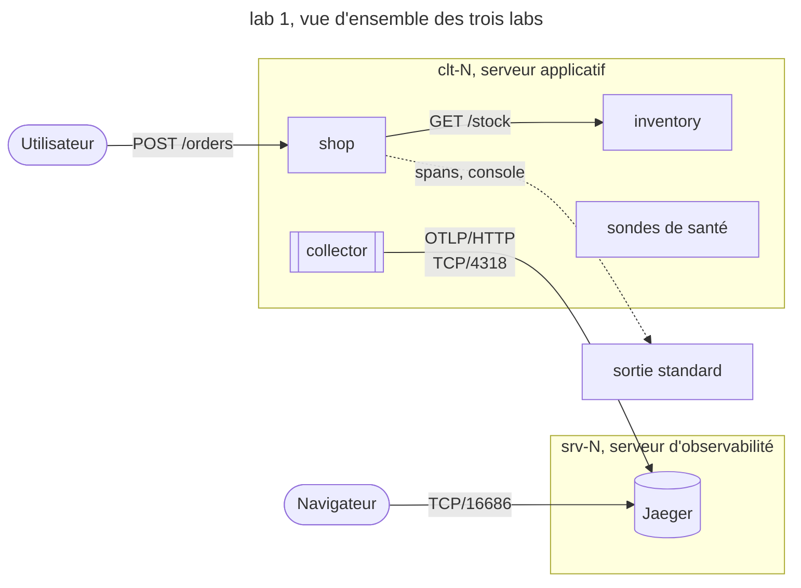

# Lab 1 : Socle, premier **collector** et processors

Le lab 1 comprend trois parties consécutives sur le même environnement :

- [lab 1A : Lire les spans d'une application en console](Lab_01A_Voir_la_valeur.md) aborde la lecture directe des spans générés par une application sur sa sortie standard, sans composant intermédiaire.
- [lab 1B : Configurer un premier **collector** et exporter vers Jaeger](Lab_01B_Collector_vers_Jaeger.md) met en place un **collector** local pour transférer ces traces vers une instance Jaeger distante.
- [lab 1C : Affiner le pipeline du **collector** avec filter, transform et batch](Lab_01C_Affiner_le_pipeline.md) introduit des processors pour filtrer les requêtes de santé et restructurer les attributs avec OTTL.

# Objectifs

À la fin du lab 1, vous saurez :

- analyser les traces d'une application instrumentée (identification du span racine, hiérarchie des spans, repérage d'erreurs et de latences) dans la console puis dans Jaeger ;
- configurer un **collector** de base avec son receiver OTLP, ses exporters et son pipeline de traces ;
- consulter et analyser des traces à distance via l'interface Jaeger ;
- ordonner et paramétrer les processors (`memory_limiter`, `resource`, `batch`) dans un pipeline de traces ;
- filtrer des spans indésirables avec `filter` et restructurer des attributs avec `transform` en syntaxe OTTL.

# Contenu

- [Environnement](#environnement)
- [Les trois labs](#les-trois-labs)
- [Le signal traces](#le-signal-traces)

# Détail

## Environnement

Le lab 1 se déroule sur deux machines : `clt-N` et `srv-N`, où N est votre numéro de participant.

`clt-N` héberge l'application et le **collector**. `srv-N` héberge le backend Jaeger. Cette séparation permet d'observer et d'analyser le comportement de l'application depuis le serveur d'observabilité.

Vous travaillez depuis le terminal web de `clt-N`, dans `/root`. Le dépôt des labs y est déjà cloné, dans `/root/opentelemetry-labs`. Les commandes destinées à `srv-N` passent par SSH depuis `clt-N` : la clé de `root` y donne accès sans mot de passe.

Un formulaire demande un nom d'utilisateur et le mot de passe communiqué par l'animateur. Vous pouvez copier-coller entre votre poste et le terminal web : Ctrl+Maj+C et Ctrl+Maj+V dans Firefox, Ctrl+Shift+C et Ctrl+Shift+V dans Chrome, ou le clic droit selon le navigateur.

### Variables d'environnement

La machine est déjà configurée avec des variables d'environnement utilisées par tous les labs, disponibles dans chaque terminal :

```bash
echo $LAB_ID $CLT_HOST $SRV_HOST
```

On obtient (N est votre numéro de participant) :

```text
N clt-N.<domaine> srv-N.<domaine>
```

- `LAB_ID` : votre numéro de participant ;
- `CLT_HOST` : le nom de la machine cliente, `clt-N.<domaine>` ;
- `SRV_HOST` : le nom de la machine serveur, `srv-N.<domaine>`.

### Mise en place

Chaque lab est autonome et ne nécessite aucun prérequis : les machines sont reconstruites entre les séances. Nous faisons donc place nette avant de démarrer.

Toutes les commandes de cette section s'exécutent sur `clt-N`, depuis le terminal web, dans `/root`. Celles qui visent `srv-N` sont lancées depuis `clt-N` par SSH.

Sur `clt-N`, récupérez les fichiers fournis depuis le clone des labs, dans un dossier de travail :

```bash
rm -rf ~/lab01
mkdir -p ~/lab01
cp -r ~/opentelemetry-labs/config/lab01/. ~/lab01/
cd ~/lab01
ls
```

On obtient :

```text
app  check.sh  compose-srv.yaml  compose.yaml  order.sh  tg.sh
```

Sur `clt-N`, construisez l'image de l'application et récupérez les images des outils. Les versions sont épinglées :

```bash
docker compose build
docker pull ghcr.io/open-telemetry/opentelemetry-collector-releases/opentelemetry-collector-contrib:0.165.0
docker pull ghcr.io/open-telemetry/opentelemetry-collector-contrib/telemetrygen:v0.165.0
docker pull curlimages/curl:8.11.0
```

Depuis `clt-N`, récupérez l'image de Jaeger sur `srv-N`, où elle sera démarrée [au lab 1B](Lab_01B_Collector_vers_Jaeger.md) :

```bash
ssh root@$SRV_HOST 'docker pull jaegertracing/jaeger:2.23.0'
```

Depuis `clt-N`, vérifiez que la connexion SSH vers `srv-N` fonctionne sans mot de passe :

```bash
ssh root@$SRV_HOST hostname
```

On obtient le nom de la machine serveur :

```text
srv-N
```

Aucun service n'est démarré à ce stade : chaque lab démarre ce dont il a besoin.

### Versions utilisées dans ce lab

| Composant | Version |
|---|---|
| **collector** OpenTelemetry (distribution `otelcol-contrib`) | 0.165.0 |
| telemetrygen | v0.165.0 |
| Jaeger | 2.23.0 |
| curl (image des sondes de santé) | 8.11.0 |
| Application (image `python:3.13.18-slim`, Flask 3.1.3) | SDK OpenTelemetry 1.45.2 |

> [!TIP]
>
> Le tag de l'image du **collector** est `0.165.0` alors que celui de `telemetrygen` est `v0.165.0` (avec le `v`).

## Les trois labs



L'architecture évolue progressivement : dans le lab 1A, les conteneurs écrivent directement leurs spans dans leurs journaux. Le lab 1B introduit le **collector** sur `clt-N` pour expédier les données vers Jaeger sur `srv-N`. Enfin, le lab 1C insère plusieurs processors dans le **collector** afin de nettoyer et enrichir les traces localement avant leur envoi.

## Le signal traces

Ce lab se concentre sur les traces. Les métriques et les logs d'application sont abordés dans les labs suivants afin d'étudier chaque signal séparément.

Jaeger est déployé ici comme backend de visualisation avec un stockage en mémoire. Sa configuration est préétablie dans les fichiers du lab.

Commencez par [le lab 1A](Lab_01A_Voir_la_valeur.md).
