# Lab 4 : Déploiement et gestion de la configuration du **collector** via Ansible et Jinja2

# Objectifs

<sub>1</sub> À la fin du lab, vous saurez :

- décrire des serveurs dans un inventaire Ansible et vérifier la connexion avec un module ad hoc ;
- écrire un playbook idempotent qui installe le **collector** à partir d'un paquet `.deb`, dont le téléchargement est vérifié par une somme de contrôle ;
- générer la configuration du **collector** avec un template Jinja2 (variables, boucle, condition) ;
- déployer des configurations **différentes** sur plusieurs serveurs à partir d'un seul playbook et de variables par hôte ;
- vérifier que les traces et les métriques des serveurs arrivent dans Jaeger et dans Prometheus.

# Contenu

- [Environnement](#environnement)
- [1. Préparer le poste de contrôle](#1-préparer-le-poste-de-contrôle)
- [2. Installer le **collector**](#2-installer-le-collector)
- [3. Générer la configuration avec Jinja2](#3-générer-la-configuration-avec-jinja2)
- [4. Déploiements successifs](#4-déploiements-successifs)
- [5. Étendre le parc : 4 serveurs, 4 configurations](#5-étendre-le-parc--4-serveurs-4-configurations)
- [Cleanup](#cleanup)
- [Extra](#extra)
  - [1. Un **collector** pour la préproduction et la production](#1-un-collector-pour-la-préproduction-et-la-production)
  - [2. Activer le scraper network du receiver hostmetrics](#2-activer-le-scraper-network-du-receiver-hostmetrics-extra)
  - [3. Conserver les versions précédentes de la configuration](#3-conserver-les-versions-précédentes-de-la-configuration)
  - [4. Revenir à une version antérieure du binaire](#4-revenir-à-une-version-antérieure-du-binaire)
  - [5. Installer node_exporter sur un serveur et le scraper via le **collector**](#5-installer-node_exporter-sur-un-serveur-et-le-scraper-via-le-collector)

# Détail

## Environnement

Ce lab se déroule sur plusieurs machines : `clt-N`, la machine cliente qui porte Ansible et les backends, `srv-N`, la machine serveur Ubuntu où le **collector** est installé, et, à partir de la partie 5, trois serveurs éphémères Debian `srv2-N`, `srv3-N` et `srv4-N` provisionnés par l'animateur (N est votre numéro de participant).

<sub>2</sub> Vous travaillez depuis le terminal web de `clt-N`, dans `/root`, où le dépôt des labs est déjà cloné dans `/root/opentelemetry-labs`. Sauf mention contraire, toutes les commandes du lab se lancent sur `clt-N` : celles qui visent les serveurs passent par Ansible, qui s'y connecte en SSH.

Ansible, Docker et SSH sont installés sur `clt-N`. La clé SSH de `root` permet de se joindre à `srv-N` sans mot de passe, et le compte dispose de `sudo` sans mot de passe sur cette machine.

<sub>3</sub> Le [lab 1](Lab_01_Socle.md) est conseillé : il présente les **receiver**, **processor** et **exporter** du **collector**, qui ne sont pas réexpliqués ici. Les commandes utilisent les noms complets des modules (`ansible.builtin.…`), qui fonctionnent avec toutes les versions récentes d'Ansible.

Versions utilisées dans ce lab :

| Composant | Version |
|---|---|
| **collector** OpenTelemetry (paquet `otelcol-contrib`) | 0.165.0 |
| telemetrygen | v0.165.0 |
| Jaeger | 2.23.0 |
| Prometheus | v3.16.0 |
| OS serveur principal | Ubuntu 24.04 |
| OS serveurs éphémères | Debian 13 |

<sub>4</sub> Les interfaces web sont accessibles depuis votre navigateur, sur `clt-N` (`$CLT_HOST`) : Jaeger sur `http://$CLT_HOST:16686` (TCP/16686) et Prometheus sur `http://$CLT_HOST:9090` (TCP/9090).

## 1. Préparer le poste de contrôle

Deux machines entrent en jeu, et il faut savoir où se trouve quoi avant de taper la première commande. Le schéma suivant couvre l'ensemble des composants du lab : le moteur Ansible, installé sur `clt-N`, qui exécute les playbooks, le moteur Docker qui héberge les backends sur `clt-N`, et le **collector** géré par systemd sur `srv-N`. Dans tous les schémas de ce lab, le bleu désigne le poste de contrôle, le jaune le **collector** et les tâches Ansible, le violet les backends, le vert un résultat réussi, le rouge un échec, et le gris un composant externe ou désactivé.

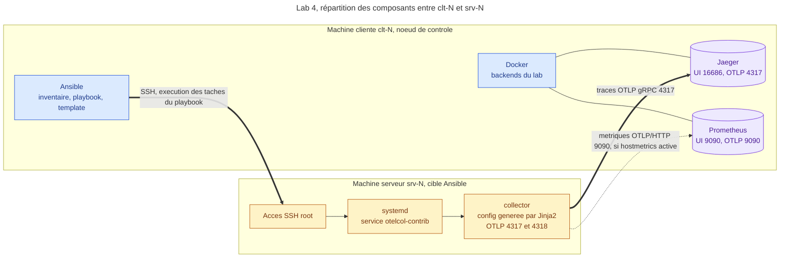

<sub>5</sub> Les flèches pleines montrent les flux présents en permanence, et la flèche en pointillés un flux conditionnel : les métriques n'existent que si la variable `otelcol_hostmetrics_enabled` est vraie. La flèche SSH ne rejoint pas le **collector** lui-même, mais le serveur, où Ansible pilote systemd.

Trois points à retenir de ce schéma :

- **le moteur Ansible ne tourne que sur `clt-N`** : c'est le nœud de contrôle. Il se connecte en SSH à `srv-N` et y exécute les tâches ; aucun playbook n'est lancé sur le serveur, et `srv-N` n'a pas besoin d'Ansible ;
- **le collector tourne sur `srv-N`**, comme service `otelcol-contrib` géré par systemd. C'est la seule machine qui reçoit le paquet `.deb` et la configuration générée ;
- **les backends tournent sur `clt-N`**, dans Docker : Jaeger écoute sur `TCP/16686` (interface web) et `TCP/4317` (OTLP des traces), Prometheus sur `TCP/9090`. Le collector de `srv-N` leur envoie ses données par le réseau privé du VPC.

<sub>6</sub> Copiez les fichiers fournis dans un dossier de travail, puis démarrez les deux backends sur `clt-N` :

```bash
mkdir -p ~/lab04
```

```bash
cp -r ~/opentelemetry-labs/config/lab04/. ~/lab04/
```

```bash
cd ~/lab04
```

```bash
docker compose up -d
```

Lisez les fichiers de configuration fournis :

```bash
cat group_vars/all.yml
```

```bash
cat ansible.cfg
```

<sub>7</sub> `group_vars/all.yml` contient les variables utilisées dans tout le lab : la version du **collector**, les sommes de contrôle des paquets, l'adresse de `clt-N` (lue dans la variable d'environnement `CLT_HOST` de la machine qui lance Ansible) et les réglages du **collector**.

`ansible.cfg` indique à Ansible où se trouve l'inventaire, et désactive la vérification des clés d'hôte (`host_key_checking = False`), adaptée à un environnement de lab.

<sub>8</sub> Créez l'inventaire. Cette fois, le mot `EOF` n'est pas entre guillemets : le shell remplace donc `$SRV_HOST` par sa valeur avant d'écrire le fichier. C'est ce que vous voulez ici, alors que dans les autres commandes du lab vous écrirez des `{{ ... }}` Jinja2 qui doivent rester tels quels.

Le groupe s'appelle `[otel]` : c'est une convention courante pour désigner les machines qui reçoivent le **collector** OpenTelemetry. La commande `ansible otel ...` cible donc tous les hôtes de ce groupe.

```bash
cat > inventory.ini <<EOF
[otel]
$SRV_HOST
EOF
```

```bash
cat inventory.ini
```

<sub>9</sub> Contrôlez la connexion et l'état du serveur :

```bash
ansible otel -m ansible.builtin.ping
```

```bash
ansible otel -m ansible.builtin.setup -a 'filter=ansible_distribution*'
```

```bash
ansible otel -m ansible.builtin.shell -a 'command -v otelcol-contrib || echo absent'
```

```bash
curl -s http://localhost:9090/-/ready
```

La première commande affiche `SUCCESS` et `"ping": "pong"` :

```json
srv-0.monlab.top | SUCCESS => {
    "ansible_facts": {
        "discovered_interpreter_python": "/usr/bin/python3"
    },
    "changed": false,
    "ping": "pong"
}
```

<sub>10</sub> La deuxième indique `"ansible_distribution": "Ubuntu"` et la version `24.04`. La troisième affiche `absent` : le **collector** n'est pas encore installé. La dernière affiche `Prometheus Server is Ready.`.

Si votre animateur a provisionné des machines éphémères pour votre groupe (voir [la partie 5](#5-étendre-le-parc--4-serveurs-4-configurations)), elles ne sont pas encore déclarées dans l'inventaire : vous les ajouterez à ce moment-là.

## 2. Installer le **collector**

<sub>11</sub> Toutes les commandes de cette partie se lancent dans le terminal de `clt-N`, dans `~/lab04`. Les commandes `ansible` et `ansible-playbook` agissent ensuite sur `srv-N` par SSH : c'est là que le paquet est téléchargé, installé, et que le service démarre. Rien n'est tapé sur `srv-N`, qui n'a ni Ansible ni le dépôt des labs.

Le schéma suivant ne montre que la partie 2, c'est-à-dire les trois tâches d'installation : la configuration générée et le handler arriveront à la partie 3.

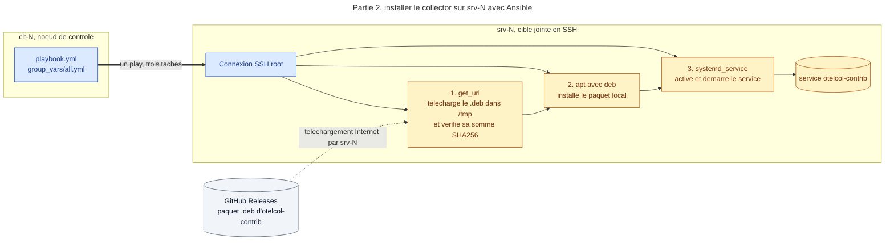

<sub>12</sub> Écrivez le playbook `playbook.yml`, qui s'exécute sur le groupe `otel` avec les droits administrateur (`become: true`).

Il contient un handler nommé `Redémarrer otelcol-contrib`, qui redémarre le service avec le module `ansible.builtin.systemd_service`, puis trois tâches : télécharger le paquet avec `ansible.builtin.get_url`, l'installer avec `ansible.builtin.apt` (paramètre `deb`), et activer puis démarrer le service avec `ansible.builtin.systemd_service`.

<sub>13</sub> Quelques précisions sur le téléchargement. Il utilise la variable `otelcol_deb_url`, vers le fichier `/tmp/otelcol-contrib_<version>.deb`, avec le paramètre `checksum` : la somme attendue dépend de l'architecture du serveur. Le fait `ansible_architecture` vaut `x86_64` ou `aarch64`, et la variable `otelcol_arch_map` fait la correspondance avec les clés de `otelcol_checksums`.

> [!NOTE]
>
> D'où vient le paquet ? L'URL est déjà définie dans `group_vars/all.yml`, dans la variable `otelcol_deb_url`, qui construit le lien GitHub Releases à partir de `otelcol_version` et de `otelcol_arch_map[ansible_architecture]` (par exemple `otelcol-contrib_0.165.0_linux_amd64.deb`). Elle pointe vers les publications GitHub du projet, canal officiel du **collector**. Il n'existe pas encore de dépôt APT officiel pour le **collector** : le projet y travaille, mais à ce jour les paquets ne vivent que sur GitHub Releases.

Ansible évalue cette URL au moment de la tâche, sur chaque cible, en y insérant la version et l'architecture lues dans les facts du serveur : chaque hôte télécharge donc son propre paquet, dans son propre `/tmp`. Ce choix a deux conséquences que le playbook compense :

- un fichier téléchargé hors dépôt n'a pas la chaîne de confiance d'un dépôt signé : le paramètre `checksum` la remplace, en comparant le SHA256 du fichier à la somme épinglée dans `group_vars/all.yml` ;
- le module `apt` est utilisé en mode fichier local (paramètre `deb`) : le paquet est quand même enregistré dans `dpkg`, avec ses dépendances, ce qui rend la désinstallation propre du [Cleanup](#cleanup) possible.

<sub>14</sub> En production, on remplace souvent ce téléchargement par cible par un miroir unique (dépôt APT interne, Nexus, Artifactory) : le fichier est téléchargé une fois puis distribué, et les serveurs cloisonnés n'ont plus besoin d'accéder à Internet.

Le handler se place avant la liste `tasks:`, et le fichier sera complété à la partie 3 en ajoutant une tâche à la fin. L'ordre des clés d'un play est sans importance pour Ansible.

```bash
cat > playbook.yml <<'EOF'
- name: Déployer le collector OpenTelemetry
  hosts: otel
  become: true
  handlers:
    - name: Redémarrer otelcol-contrib
      ansible.builtin.systemd_service:
        name: otelcol-contrib
        state: restarted
  tasks:
    - name: Télécharger le paquet du collector
      ansible.builtin.get_url:
        url: "{{ otelcol_deb_url }}"
        dest: "/tmp/otelcol-contrib_{{ otelcol_version }}.deb"
        checksum: "{{ otelcol_checksums[otelcol_arch_map[ansible_architecture]] }}"
        mode: "0644"
    - name: Installer le paquet
      ansible.builtin.apt:
        deb: "/tmp/otelcol-contrib_{{ otelcol_version }}.deb"
        state: present
    - name: Activer et démarrer le service
      ansible.builtin.systemd_service:
        name: otelcol-contrib
        state: started
        enabled: true
EOF
```

<sub>15</sub> Lancez le playbook, puis relancez-le immédiatement :

```bash
ansible-playbook playbook.yml
```

```bash
ansible-playbook playbook.yml
```

Comparez le résumé (`PLAY RECAP`) des deux exécutions. Le premier lancement modifie deux choses, le téléchargement et l'installation :

```text
PLAY RECAP *********************************************************************
srv-N.monlab.top           : ok=4    changed=2    unreachable=0    failed=0    skipped=0    rescued=0    ignored=0
```

<sub>16</sub> Le second lancement ne modifie plus rien que l'état du service, qui a été redémarré par le paquet lors de l'installation (`changed=1`) : chaque module compare l'état souhaité à l'état réel et n'agit que s'ils diffèrent. C'est l'idempotence.

Le schéma suivant ne montre que la décision prise par un module Ansible à chaque exécution, quel que soit le module concerné :

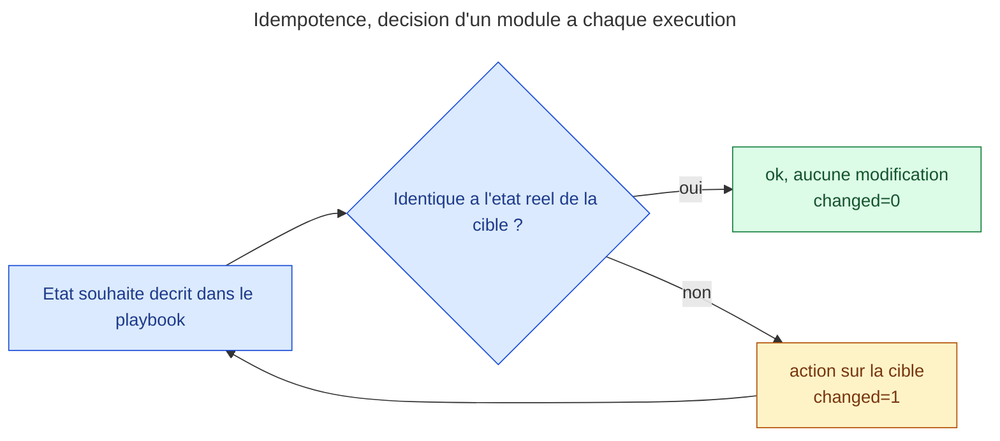

<sub>17</sub> Contrôlez ce qui est installé et ce qui écoute :

```bash
ansible otel -a '/usr/bin/otelcol-contrib --version'
```

```bash
ansible otel -a 'systemctl is-active otelcol-contrib'
```

```bash
ansible otel -m ansible.builtin.shell -a "ss -ltn | grep -E ':(4317|4318|1777|55679) '"
```

On obtient `otelcol-contrib version 0.165.0`, puis `active`, puis plusieurs lignes d'écoute :

```text
LISTEN 0      4096               *:1777             *:*
LISTEN 0      4096               *:4318             *:*
LISTEN 0      4096               *:4317             *:*
LISTEN 0      4096               *:55679            *:*
```

<sub>18</sub> Le paquet démarre le service avec sa propre configuration par défaut, qui ouvre les ports 4317 et 4318 (OTLP) mais aussi 1777 et 55679 (pprof et zpages, des interfaces de diagnostic) sur toutes les interfaces. Vous allez la remplacer par une configuration que vous maîtrisez.

## 3. Générer la configuration avec Jinja2

Le schéma suivant couvre la partie 3 uniquement : le parcours de la configuration, de sa génération à son déploiement sur `srv-N`, et celui des traces de test, émises sur `srv-N` par `telemetrygen` vers le **collector** local puis exportées vers Jaeger sur `clt-N`. Les métriques et les machines éphémères n'y figurent pas :

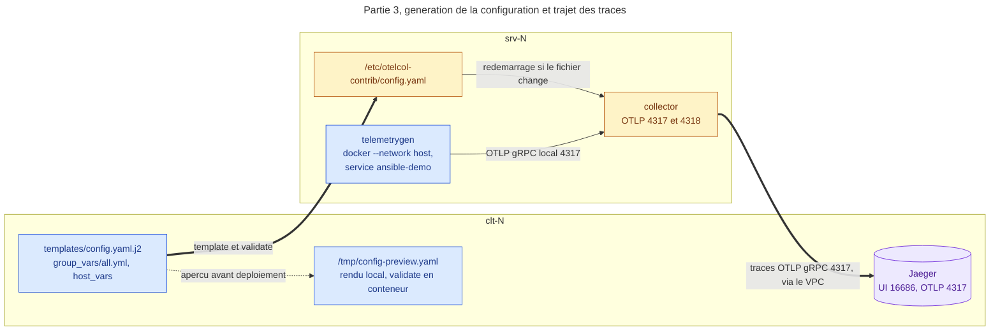

<sub>19</sub> Jinja2 est le langage de template d'Ansible. Trois constructions suffisent pour ce lab :

| Syntaxe | Rôle |
|---|---|
| `{{ variable }}` | insère la valeur d'une variable ; on peut lui appliquer un filtre (`{{ valeur \| to_json }}`) |
| ` ... ` | n'inclut le bloc que si la condition est vraie |
| ` ... ` | répète le bloc pour chaque entrée d'un dictionnaire |

Ansible supprime le saut de ligne qui suit une balise `` : les balises peuvent donc commencer en colonne 0 sans laisser de ligne vide dans le résultat.

<sub>20</sub> Le template produit une configuration de **collector** qui contient :

- une première ligne de commentaire `{{ ansible_managed | comment }}`, qui indique que le fichier est géré par Ansible ;
- un receiver `otlp` (gRPC et HTTP) qui écoute sur toutes les interfaces, ports 4317 et 4318 ;
- si la variable `otelcol_hostmetrics_enabled` est vraie, un receiver `hostmetrics` avec `collection_interval: 30s` et les scrapers `cpu`, `load` et `memory` (écrits `cpu: {}`, etc.) ;
- les processors `memory_limiter` (1 s, 256 MiB, marge de 64 MiB), `resourcedetection`, `resource` et `batch`. Le processor `resourcedetection` interroge la machine elle-même (détecteur `system` : nom d'hôte, système, identifiant machine) et complète la ressource avec ce qu'il trouve. Le processor `resource` reçoit, par une boucle sur le dictionnaire `otelcol_resource_attributes`, une entrée `upsert` par attribut (clé `key`, valeur écrite avec le filtre `to_json`, qui ajoute les guillemets nécessaires à une chaîne YAML), suivie de `service.name` et `service.instance.id` avec `action: insert`. L'action `insert` est essentielle : elle ajoute la clé uniquement si elle est absente. Ainsi, elle ne remplace pas le `service.name` déjà posé par une application ou par `telemetrygen` (`ansible-demo`), mais elle renseigne `service.name` et `service.instance.id` sur les métriques `hostmetrics` qui n'en ont pas (afin d'alimenter les labels `job` et `instance` dans Prometheus). Le processor `batch` regroupe les données avant envoi ; sa valeur `timeout` (2 s par défaut) est fournie par la variable `otelcol_batch_timeout` ;
- l'exporter `otlp_grpc/jaeger`, vers `otelcol_backend_host` sur le port 4317 sans TLS ;
- si `otelcol_hostmetrics_enabled` est vraie, un exporter `otlp_http/prometheus` dont le paramètre `metrics_endpoint` vaut `http://<otelcol_backend_host>:9090/api/v1/otlp/v1/metrics` ;
- un pipeline `traces` (receiver `otlp`, processors `memory_limiter`, `resourcedetection`, `resource` puis `batch`, exporter `otlp_grpc/jaeger`) et, si `otelcol_hostmetrics_enabled` est vraie, un pipeline `metrics` (receiver `hostmetrics`, mêmes processors, exporter `otlp_http/prometheus`).

La structure reprend celle des labs précédents. Seules changent les valeurs, qui viennent désormais des variables, et les blocs conditionnels.

<sub>21</sub> Le processor `resourcedetection` mérite un mot avant d'écrire le template. Deux façons de renseigner la ressource se complètent ici :

- `resource` pose ce que vous décidez : `deployment.environment.name`, `lab.id`, un attribut de parc commun à tous les serveurs ;
- `resourcedetection` lit ce que la machine sait d'elle-même : son nom, son système, son identifiant. Rien à déclarer, et chaque serveur reçoit sa propre valeur.

C'est ce qui rendra la partie 5 lisible : le même template déployé sur quatre serveurs produira quatre `host.name` différents, sans une variable de plus. Le réglage `override: false` laisse la priorité aux attributs déjà posés, par `resource` ou par l'application : la détection complète la ressource, elle ne l'écrase pas. Le détecteur `env` existe aussi et lit `OTEL_RESOURCE_ATTRIBUTES` dans l'environnement du service ; il n'est pas utilisé ici, pour ne pas multiplier les mécanismes dans ce lab.

<sub>22</sub> Dans le processor `resource`, le choix entre `upsert` et `insert` répond à deux comportements distincts :

- **`action: upsert`** insère l'attribut s'il est absent, et **écrase** sa valeur s'il existe déjà. Il sert aux attributs imposés par la plateforme (`deployment.environment.name`, `lab.id`), qui doivent rester uniformes quel que soit l'émetteur.
- **`action: insert`** insère l'attribut uniquement s'il est absent, et **ne modifie pas** une valeur déjà présente. Il est indispensable ici pour `service.name` et `service.instance.id` : les traces émises par `telemetrygen` (ou par une application) portent déjà leur propre `service.name` (`ansible-demo`), qu'un `upsert` écraserait par `lab4`, alors que les métriques système de `hostmetrics` n'en ont pas et reçoivent donc `service.name=lab4` et `service.instance.id=srv-N`.

> [!NOTE]
>
> `otelcol_backend_host` est lue dans l'environnement du terminal qui lance `ansible-playbook`, par `lookup('ansible.builtin.env', 'CLT_HOST')`. Si `CLT_HOST` est vide, l'endpoint de l'exporter devient `:4317` et le **collector** tente de joindre sa propre machine : les traces n'arrivent pas dans Jaeger, et les logs du service citent `127.0.0.1:4317`. Contrôlez `echo $CLT_HOST` avant de lancer le playbook ; s'il est vide, ouvrez un nouveau terminal web, où la variable est définie.

> [!NOTE]
>
> Sur un environnement fraîchement créé, il arrive que `srv-N` ne résolve pas encore le nom de `clt-N` : les résolveurs internes du fournisseur gardent quelques minutes une réponse négative émise avant la création de l'enregistrement DNS. Les logs du **collector** citent alors `dial tcp: lookup clt-N...: no such host`, et ni les traces ni les métriques n'arrivent. Contrôlez avec `ssh root@$SRV_HOST getent hosts $CLT_HOST`. Si le nom ne résout pas, relancez le playbook en donnant l'adresse privée de `clt-N` à la place du nom, le temps que le DNS se propage (`export CLT_HOST=<adresse privée de clt-N>` avant `ansible-playbook`).

```bash
mkdir -p templates
```

```bash
cat > templates/config.yaml.j2 <<'EOF'
{{ ansible_managed | comment }}
receivers:
  otlp:
    protocols:
      grpc:
        endpoint: 0.0.0.0:4317
      http:
        endpoint: 0.0.0.0:4318

  hostmetrics:
    collection_interval: 30s
    scrapers:
      cpu: {}
      load: {}
      memory: {}
      # network: {}  # optionnel, voir section Extra


processors:
  memory_limiter:
    check_interval: 1s
    limit_mib: 256
    spike_limit_mib: 64
  resourcedetection:
    detectors: [system]
    timeout: 2s
    override: false
  resource:
    attributes:

      - key: {{ key }}
        value: {{ value | to_json }}
        action: upsert

      - key: service.name
        value: {{ otelcol_environment | to_json }}
        action: insert
      - key: service.instance.id
        value: {{ ansible_hostname | to_json }}
        action: insert
  batch:
    timeout: {{ otelcol_batch_timeout }}

exporters:
  otlp_grpc/jaeger:
    endpoint: {{ otelcol_backend_host }}:4317
    tls:
      insecure: true

  otlp_http/prometheus:
    metrics_endpoint: http://{{ otelcol_backend_host }}:9090/api/v1/otlp/v1/metrics


service:
  pipelines:
    traces:
      receivers: [otlp]
      processors: [memory_limiter, resourcedetection, resource, batch]
      exporters: [otlp_grpc/jaeger]

    metrics:
      receivers: [hostmetrics]
      processors: [memory_limiter, resourcedetection, resource, batch]
      exporters: [otlp_http/prometheus]

EOF
```

Avant de déployer, produisez d'abord le rendu du template sur `clt-N`, sans toucher au serveur. Le module `ansible.builtin.template` est exécuté sur `localhost`, avec les variables de `group_vars/all.yml` :

```bash
cat > preview.yml <<'EOF'
- hosts: localhost
  connection: local
  gather_facts: true
  tasks:
    - name: Rendu de la configuration
      ansible.builtin.template:
        src: templates/config.yaml.j2
        dest: /tmp/config-preview.yaml
EOF
```

```bash
ansible-playbook preview.yml -e @group_vars/all.yml
```

```bash
cat /tmp/config-preview.yaml
```

<sub>23</sub> Le schéma suivant résume les deux pipelines que le template produit, avec les mêmes processors dans le même ordre :

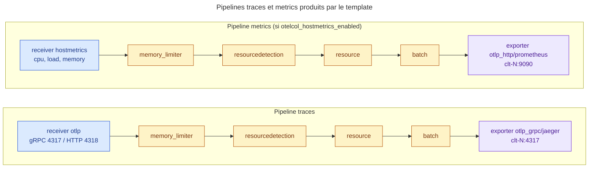

Le processor `resource` ajoute `deployment.environment.name` et `lab.id` par `upsert`, puis `service.name` et `service.instance.id` par `insert`, avant que `batch` ne regroupe les données pour l'export.

<sub>24</sub> Le schéma suivant zoome sur ce seul processor, commun aux deux pipelines : il part de deux émetteurs différents pour montrer pourquoi `upsert` et `insert` ne donnent pas le même résultat.

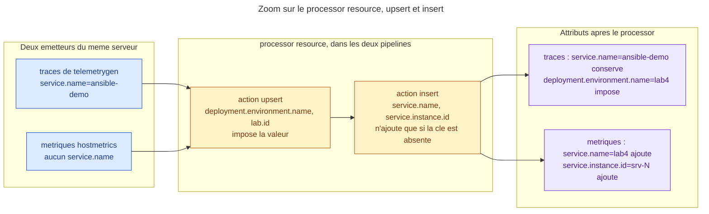

On obtient la configuration telle que le serveur la recevra, sans aucune accolade Jinja2. En tête le commentaire de gestion Ansible, plus bas les attributs produits par la boucle :

```yaml
#
# Ansible managed
#
receivers:
  otlp:
    protocols:
      grpc:
        endpoint: 0.0.0.0:4317
      http:
        endpoint: 0.0.0.0:4318

processors:
  memory_limiter:
    check_interval: 1s
    limit_mib: 256
    spike_limit_mib: 64
  resourcedetection:
    detectors: [system]
    timeout: 2s
    override: false
  resource:
    attributes:
      - key: deployment.environment.name
        value: "lab4"
        action: upsert
      - key: lab.id
        value: "<votre numéro>"
        action: upsert
      - key: service.name
        value: "lab4"
        action: insert
      - key: service.instance.id
        value: "clt-N"
        action: insert
  batch:
    timeout: 2s

exporters:
  otlp_grpc/jaeger:
    endpoint: <CLT_HOST>:4317
    tls:
      insecure: true

service:
  pipelines:
    traces:
      receivers: [otlp]
      processors: [memory_limiter, resourcedetection, resource, batch]
      exporters: [otlp_grpc/jaeger]
```

<sub>25</sub> `<CLT_HOST>` vaut la valeur de la variable `CLT_HOST` de `clt-N` et `<votre numéro>` celle de `LAB_ID`. Lors de cette prévisualisation locale sur `localhost`, le fact `ansible_hostname` vaut `clt-N` ; au déploiement sur le serveur cible, il prendra automatiquement la valeur `srv-N`. Avec la valeur par défaut `otelcol_hostmetrics_enabled: false`, le rendu ne contient aucune mention de `hostmetrics`.

Vérifiez maintenant cette configuration avec la commande `validate` du **collector**, dans un conteneur lancé sur `clt-N` :

```bash
docker run --rm -v /tmp/config-preview.yaml:/config.yaml:ro \
  ghcr.io/open-telemetry/opentelemetry-collector-releases/opentelemetry-collector-contrib:0.165.0 \
  validate --config=/config.yaml
echo "code retour : $?"
```

<sub>26</sub> La commande `validate` n'affiche rien, et le code retour vaut 0 :

```text
code retour : 0
```

Pas de message veut dire configuration valide. Au premier lancement, Docker montre d'abord le téléchargement de l'image, puis revient au silence. Le conteneur ne sert qu'à valider : il ne tourne pas, et `--rm` le supprime à la sortie.

<sub>27</sub> Complétez maintenant le playbook avec une dernière tâche, ajoutée à la fin du fichier. Elle utilise le module `ansible.builtin.template` avec les paramètres suivants :

- `src` : `config.yaml.j2` et `dest` : `/etc/otelcol-contrib/config.yaml` ;
- `owner` : `root`, `group` : `otelcol-contrib` et `mode` : `"0640"` : le service tourne sous l'utilisateur `otelcol-contrib`, qui doit pouvoir lire le fichier, et personne d'autre ne doit pouvoir l'écrire ;
- `validate` : `/usr/bin/otelcol-contrib validate --config=%s` : Ansible écrit d'abord le résultat dans un fichier temporaire, lance cette commande dessus (`%s` est remplacé par le chemin du fichier temporaire) et ne remplace le fichier réel que si elle réussit ;
- `notify` : le nom du handler, pour que le service redémarre uniquement quand le fichier change.

Le schéma suivant ne montre que cette tâche `Déployer la configuration`, c'est-à-dire le chemin du fichier entre le template et le service, avec les trois issues possibles :

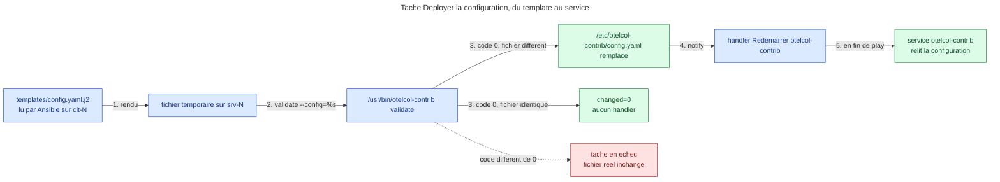

<sub>28</sub> Nommez la tâche `Déployer la configuration`. Elle doit être indentée comme les autres tâches de la liste.

```bash
cat >> playbook.yml <<'EOF'
    - name: Déployer la configuration
      ansible.builtin.template:
        src: config.yaml.j2
        dest: /etc/otelcol-contrib/config.yaml
        owner: root
        group: otelcol-contrib
        mode: "0640"
        validate: /usr/bin/otelcol-contrib validate --config=%s
      notify: Redémarrer otelcol-contrib
EOF
```

Déployez, puis générez cinq traces directement sur `srv-N` (en lançant `telemetrygen` par SSH depuis `clt-N`) vers le **collector** local (`localhost:4317`) :

```bash
ansible-playbook playbook.yml
```

```bash
ssh root@$SRV_HOST 'docker run --rm --network host ghcr.io/open-telemetry/opentelemetry-collector-contrib/telemetrygen:v0.165.0 traces --otlp-endpoint localhost:4317 --otlp-insecure --rate 10 --traces 5 --service ansible-demo'
```

> [!NOTE]
>
> L'option `--network host` permet au conteneur `telemetrygen` d'atteindre le port `localhost:4317` du **collector** systemd sur `srv-N`. Cela reproduit le schéma réel d'un serveur applicatif où l'application parle à son **collector** local, qui pousse ensuite les traces vers le serveur d'observabilité (`clt-N`).

<sub>29</sub> Dans le résumé du playbook, la tâche `Déployer la configuration` est en `changed` et le handler s'est exécuté :

```text
TASK [Déployer la configuration] ***********************************************
changed: [srv-N.monlab.top]

RUNNING HANDLER [Redémarrer otelcol-contrib] ***********************************
changed: [srv-N.monlab.top]

PLAY RECAP *********************************************************************
srv-N.monlab.top           : ok=6    changed=2    unreachable=0    failed=0    skipped=0    rescued=0    ignored=0
```

Le fichier déployé porte l'en-tête de gestion Ansible, et Jaeger a reçu les traces :

```bash
ansible otel -a 'head -n 3 /etc/otelcol-contrib/config.yaml'
```

```bash
curl -s 'http://localhost:16686/api/v3/traces?query.service_name=ansible-demo&query.startTimeMin=2020-01-01T00:00:00Z&query.startTimeMax=2030-01-01T00:00:00Z' \
  | jq '[.result.resourceSpans[].scopeSpans[].spans[].traceId] | unique | length'
```

```bash
curl -s 'http://localhost:16686/api/v3/traces?query.service_name=ansible-demo&query.startTimeMin=2020-01-01T00:00:00Z&query.startTimeMax=2030-01-01T00:00:00Z' \
  | jq -r '.result.resourceSpans[].resource.attributes[] | select(.key=="lab.id" or .key=="deployment.environment.name") | "\(.key)=\(.value | (.stringValue // .intValue))"' | sort -u
```

<sub>30</sub> La première commande affiche des lignes de commentaire dont `Ansible managed` :

```text
#
# Ansible managed
#
```

La deuxième affiche le nombre de traces uniques :

```text
5
```

<sub>31</sub> La troisième affiche les attributs ajoutés par la boucle du template :

```text
deployment.environment.name=lab4
lab.id=<votre numéro>
```

La même requête, filtrée sur `host.name`, montre ce qu'aucune variable Ansible n'a fourni : le nom de la machine, détecté automatiquement par le processor `resourcedetection`.

<sub>32</sub> Ces traces ont été générées par `telemetrygen` sur `srv-N` (lancé par SSH depuis `clt-N`), puis traitées par le **collector** local de `srv-N`. C'est pourquoi l'attribut `host.name` vaut le nom du serveur (`srv-N.monlab.top` ou `srv-N`), et non celui de `clt-N`.

```bash
curl -s 'http://localhost:16686/api/v3/traces?query.service_name=ansible-demo&query.startTimeMin=2020-01-01T00:00:00Z&query.startTimeMax=2030-01-01T00:00:00Z' \
  | jq -r '.result.resourceSpans[].resource.attributes[] | select(.key=="host.name" or .key=="os.type") | "\(.key)=\(.value.stringValue)"' | sort -u
```

```text
host.name=srv-N.monlab.top
os.type=linux
```

L'attribut `host.name` provient du nom d'hôte lu sur la machine par le processor `resourcedetection`. Le format exact dépend de la configuration du système : nom court (`srv-N`) ou nom complet (`srv-N.<domaine>`).

> [!NOTE]
>
> Si le comptage vaut 0, attendez quelques secondes et relancez la requête. Le premier export après un redémarrage du service peut prendre quelques instants (la connexion vers Jaeger doit s'établir, et le processor `batch` attend son timeout de 2 s avant d'envoyer).

<sub>33</sub> Ouvrez l'interface de Jaeger (`http://$CLT_HOST:16686`) et sélectionnez le service `ansible-demo` : les cinq traces sont visibles.

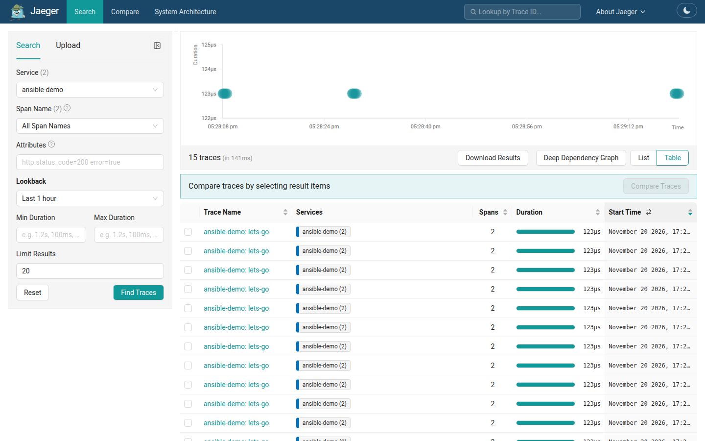

## 4. Déploiements successifs

> [!TIP]
>
> Si vous démarrez directement à cette partie (ou si vous souhaitez remettre votre environnement dans l'état exact de fin de partie 3 : backends démarrés, inventaire, playbook, template et premier déploiement du **collector**), exécutez le script de rattrapage fourni depuis `clt-N` :

```bash
bash ~/opentelemetry-labs/config/lab04/fast-forward-part4.sh
```

```bash
cd ~/lab04
```

Un parc ne se déploie pas une seule fois : il change. Cette partie enchaîne cinq déploiements sur le même serveur, du premier ajout au retour en arrière, en passant par une dérive corrigée et un changement refusé. À chaque fois la mécanique est la même : une variable ou un template, un rendu, le contrôle `validate`, puis un redémarrage si le fichier change. Le schéma suivant associe à chacune de ces situations le résultat attendu dans le résumé du playbook ; les six lignes se lisent de haut en bas, dans l'ordre des déploiements, et la dernière ligne correspond à la correction de la saisie :

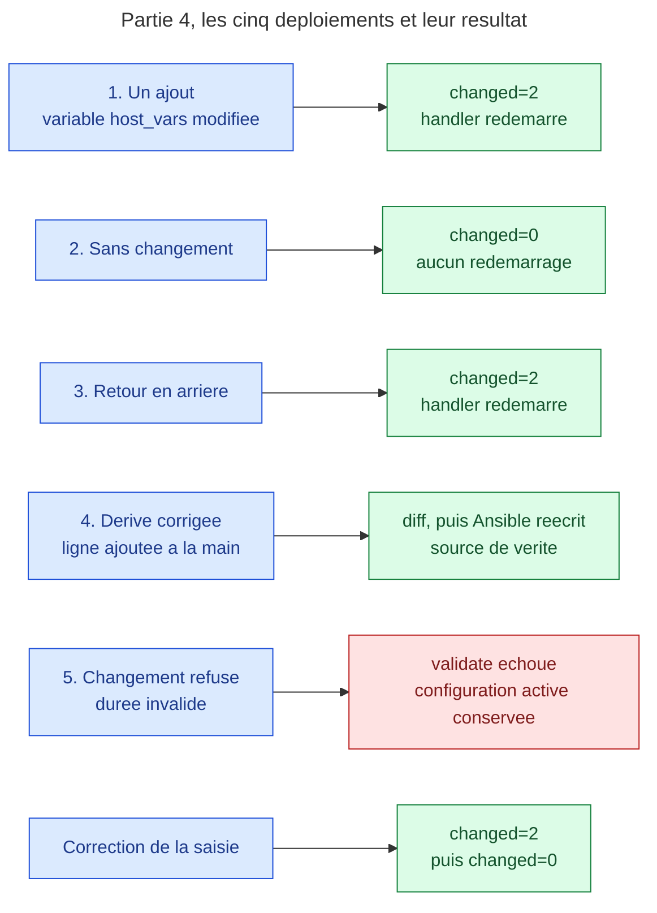

### Un ajout

<sub>34</sub> Vous allez activer la collecte des métriques du serveur sans modifier ni le playbook, ni le template : seule une variable change.

Une variable définie pour un hôte précis, dans `host_vars/<nom de l'hôte>.yml`, l'emporte sur celle de `group_vars/all.yml`.

<sub>35</sub> Le schéma suivant ne montre que le chemin d'une seule variable, `otelcol_hostmetrics_enabled`, depuis sa définition jusqu'au fichier déployé :

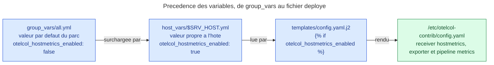

```bash
mkdir -p host_vars
```

```bash
cat > host_vars/$SRV_HOST.yml <<'EOF'
otelcol_hostmetrics_enabled: true
EOF
```

Regardez d'abord ce que ce changement ferait, sans l'appliquer :

```bash
ansible-playbook playbook.yml --check --diff
```

<sub>36</sub> Le diff montre les lignes que le template ajouterait à la configuration du serveur : le receiver `hostmetrics`, l'exporter `otlp_http/prometheus` et le pipeline `metrics` :

```diff
+  hostmetrics:
+    collection_interval: 30s
+    scrapers:
+      cpu: {}
+      load: {}
+      memory: {}
@@ -30,6 +36,8 @@
+  otlp_http/prometheus:
+    metrics_endpoint: http://<CLT_HOST>:9090/api/v1/otlp/v1/metrics
@@ -37,3 +45,7 @@
+    metrics:
+      receivers: [hostmetrics]
+      processors: [memory_limiter, resourcedetection, resource, batch]
+      exporters: [otlp_http/prometheus]
```

Appliquez le changement. Le résumé montre deux tâches modifiées : le fichier déployé, puis le handler qui redémarre le service.

```bash
ansible-playbook playbook.yml | grep -E 'RUNNING HANDLER|changed:' | head -4
```

```text
changed: [srv-N.monlab.top]
RUNNING HANDLER [Redémarrer otelcol-contrib] ***
changed: [srv-N.monlab.top]
```

<sub>37</sub> Contrôlez que l'instance en cours utilise bien cette configuration, puis attendez une minute le temps d'une collecte :

```bash
ansible otel -a 'grep -c hostmetrics /etc/otelcol-contrib/config.yaml'
```

```bash
sleep 60
```

```bash
curl -s http://localhost:9090/api/v1/query --data-urlencode 'query=count({__name__=~"system_cpu.*"})' \
  | jq -r '.data.result[0].value[1]'
```

La première commande affiche `2`, une ligne pour le receiver et une pour le pipeline. La seconde affiche un nombre supérieur à 0 : Prometheus a reçu les métriques de `srv-N`.

```text
12
```

<sub>38</sub> Le nom exact des métriques dépend de la conversion appliquée par Prometheus, d'où l'expression régulière.

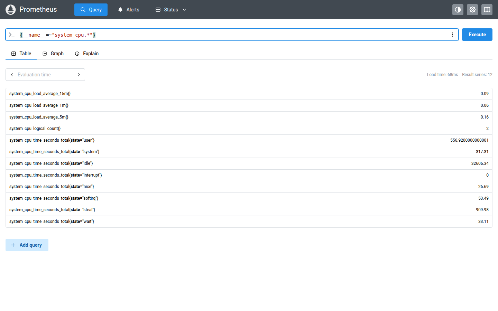

### Un passage sans changement

Relancez le playbook immédiatement, et lisez le résumé :

```bash
ansible-playbook playbook.yml | grep -A2 'PLAY RECAP'
```

<sub>39</sub> Rien n'a changé (`changed=0`) et le handler n'a pas redémarré le service : un redémarrage inutile aurait interrompu le **collector** sans raison.

```text
PLAY RECAP *********************************************************************
srv-N.monlab.top           : ok=5    changed=0    unreachable=0    failed=0    skipped=0    rescued=0    ignored=0
```

### Un retour en arrière

La collecte des métriques système a été ajoutée, elle peut être retirée de la même façon. Désactivez la variable :

```bash
cat > host_vars/$SRV_HOST.yml <<'EOF'
otelcol_hostmetrics_enabled: false
EOF
```

```bash
ansible-playbook playbook.yml --check --diff
```

<sub>40</sub> Le diff montre cette fois des lignes retirées, les mêmes qu'à l'ajout :

```diff
-  hostmetrics:
-    collection_interval: 30s
-    scrapers:
-      cpu: {}
-      load: {}
-      memory: {}
@@ -36,8 +30,6 @@
-  otlp_http/prometheus:
-    metrics_endpoint: http://<CLT_HOST>:9090/api/v1/otlp/v1/metrics
@@ -45,7 +37,3 @@
-    metrics:
-      receivers: [hostmetrics]
-      processors: [memory_limiter, resourcedetection, resource, batch]
-      exporters: [otlp_http/prometheus]
```

Appliquez, puis vérifiez que la configuration en cours ne contient plus le receiver :

```bash
ansible-playbook playbook.yml | grep -E 'RUNNING HANDLER|changed:' | head -4
```

```bash
ansible otel -m ansible.builtin.shell -a 'grep -c hostmetrics /etc/otelcol-contrib/config.yaml || true'
```

<sub>41</sub> La seconde commande affiche `0`. Dans Prometheus, les séries existantes ne disparaissent pas instantanément : le serveur les marque comme périmées après cinq minutes sans nouvelle valeur, puis les oublie. La partie suivante dure assez longtemps pour le constater à la fin, avec la même requête.

### Une dérive corrigée

Que se passe-t-il si quelqu'un modifie la configuration à la main sur le serveur ? Ajoutez une ligne au fichier déployé, comme le ferait un dépannage pressé :

```bash
ansible otel -b -m ansible.builtin.shell -a 'echo "# ajouté à la main" >> /etc/otelcol-contrib/config.yaml'
```

```bash
ansible otel -a 'tail -1 /etc/otelcol-contrib/config.yaml'
```

<sub>42</sub> Le serveur porte maintenant une configuration que le template ne décrit pas. Demandez à Ansible ce qu'il ferait :

```bash
ansible-playbook playbook.yml --check --diff
```

Le diff contient la ligne à retirer :

```diff
@@ -45,4 +45,3 @@
- # ajouté à la main
```

<sub>43</sub> Appliquez, puis contrôlez la fin du fichier :

```bash
ansible-playbook playbook.yml >/dev/null
```

```bash
ansible otel -a 'tail -1 /etc/otelcol-contrib/config.yaml'
```

La ligne a disparu, et le fichier se termine de nouveau par la déclaration du dernier pipeline du template. Les métriques système étant encore activées à ce stade, c'est le pipeline `metrics` :

```text
      exporters: [otlp_http/prometheus]
```

<sub>44</sub> Ansible est la source de vérité : une modification manuelle est écrasée au passage suivant. C'est ce qui rend un parc prévisible, et c'est aussi pourquoi une urgence se règle en modifiant le template, pas le serveur.

### Un changement refusé

Simulez enfin une erreur de saisie. La valeur de `otelcol_batch_timeout` est invalide (`"deux secondes"` au lieu d’une durée comme `2s`). Le paramètre `validate` du template doit empêcher le déploiement d’une configuration invalide :

```bash
cat > host_vars/$SRV_HOST.yml <<'EOF'
otelcol_hostmetrics_enabled: false
otelcol_batch_timeout: "deux secondes"
EOF
```

```bash
ansible-playbook playbook.yml
```

<sub>45</sub> Le playbook échoue sur la tâche `Déployer la configuration`, avec un message du **collector** qui cite `timeout` et une durée invalide :

```text
fatal: [srv-N.monlab.top]: FAILED! => {"changed": false, ..., "stderr": "Error: ... 'processors' error reading configuration for \"batch\": ... 'timeout' time: invalid duration \"deux ...", "stdout": "", ...}
srv-N.monlab.top           : ok=4    changed=0    unreachable=0    failed=1    skipped=0    rescued=0    ignored=0
```

Le serveur n'a pas été touché : le service tourne toujours avec la dernière configuration valide.

```bash
ansible otel -a 'systemctl is-active otelcol-contrib'
```

```bash
ansible otel -a 'grep -n timeout /etc/otelcol-contrib/config.yaml'
```

<sub>46</sub> Les commandes affichent `active` et une ligne `timeout: 2s`.

Corrigez l'erreur en supprimant la ligne fautive, puis relancez :

```bash
sed -i '/otelcol_batch_timeout/d' host_vars/$SRV_HOST.yml
```

```bash
ansible-playbook playbook.yml | grep -A2 'PLAY RECAP'
```

<sub>47</sub> Le résumé indique `failed=0` et `changed=2`. Le fichier est bien redéployé : la suppression de la ligne fautive retire aussi la valeur `hostmetrics` devenue `false`, donc la configuration générée change par rapport à celle qui tourne, et le service redémarre :

```text
srv-N.monlab.top           : ok=6    changed=2    unreachable=0    failed=0    skipped=0    rescued=0    ignored=0
```

Pour retrouver un `changed=0`, relancez une seconde fois le playbook : le fichier est alors déjà conforme au template.

> [!NOTE]
>
> Si Ansible affiche `UNREACHABLE`, contrôlez `cat inventory.ini` (le nom du serveur doit apparaître sous `[otel]`) puis testez `ssh $SRV_HOST hostname`. Si une variable booléenne passée avec `-e` semble ignorée, c'est la chaîne `false` qui est évaluée comme vraie par Jinja2 : utilisez la forme JSON, `-e '{"otelcol_hostmetrics_enabled": false}'`.

## 5. Étendre le parc : 4 serveurs, 4 configurations

<sub>48</sub> Votre animateur a provisionné trois serveurs éphémères Debian pour votre groupe, dans le même VPC que `clt-N`. Leurs adresses privées changent d'une session à l'autre, et DigitalOcean ne garantit pas l'ordre dans lequel il les attribue : vous allez donc les découvrir au lieu de les écrire en dur.

Le schéma suivant montre le déploiement simultané d'un seul playbook et d'un seul template vers les quatre serveurs aux profils différenciés :

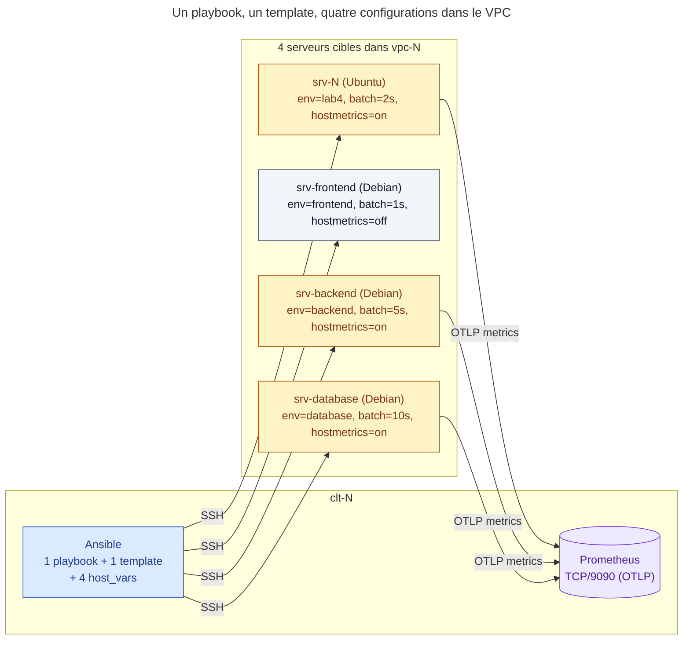

<sub>49</sub> Dans ce schéma, les cases jaunes sont les serveurs qui envoient des métriques système, la case grise est le seul serveur dont le receiver `hostmetrics` reste désactivé, et les flèches en pointillés vers Prometheus ne concernent que le pipeline `metrics`.

Le dossier contient `discover-ephemere.sh`, qui balaie le sous-réseau privé de `clt-N` sur le port SSH, interroge les machines qui répondent, et ne garde que celles dont le nom commence par `srv2-`, `srv3-` ou `srv4-`. Lancez-le, puis construisez l'inventaire à partir de son résultat :

```bash
chmod +x discover-ephemere.sh
```

```bash
./discover-ephemere.sh > ephemeres.ini
```

```bash
cat ephemeres.ini
```

```bash
cat > inventory.ini <<EOF
[otel]
$SRV_HOST

$(cat ephemeres.ini)

[collector:children]
otel
ephemere
EOF
```

```bash
cat inventory.ini
```

<sub>50</sub> La découverte prend une dizaine de secondes. Le fichier `ephemeres.ini` contient les trois alias reliés aux adresses trouvées, dans l'ordre croissant des adresses, par exemple :

```text
[ephemere]
srv-frontend ansible_host=10.20.N.7
srv-backend ansible_host=10.20.N.8
srv-database ansible_host=10.20.N.9
```

Les numéros finaux dépendent de la session : c'est justement ce que le script évite de deviner. Vérifiez maintenant que la connexion fonctionne et que le système est bien Debian :

```bash
ansible all -m ansible.builtin.ping -o | head -6
```

```bash
ansible ephemere -m ansible.builtin.setup -a 'filter=ansible_distribution' -o | grep -o 'Debian\|ansible_hostname[^,]*' | head -4
```

<sub>51</sub> La sortie attendue pour le ping est `SUCCESS` sur les quatre machines, et pour `setup`, `ansible_distribution: Debian`.

La structure de l'inventaire est nouvelle :

- `[otel]` contient le serveur principal `srv-N`, déjà déployé ;
- `[ephemere]` contient les trois serveurs Debian, chacun sous un **alias** parlant (`srv-frontend`, `srv-backend`, `srv-database`), avec `ansible_host` qui indique l'adresse IP réelle ;
- `[collector:children]` est un **groupe de groupes** : il regroupe `otel` et `ephemere`, pour que le playbook s'applique à tous.

<sub>52</sub> Le schéma suivant ne montre que la structure de l'inventaire et les alias, pas les flux réseau entre les machines :

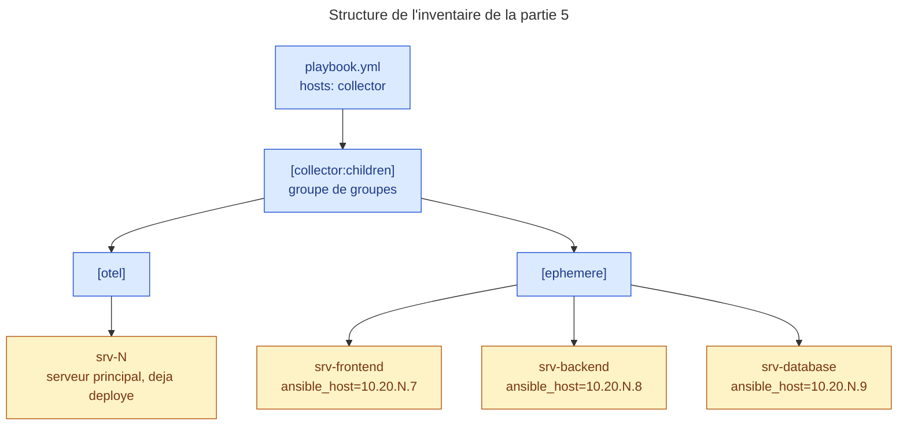

La partie 4 s'est terminée avec les métriques système désactivées sur le serveur principal. Réactivez-les, puisque cette partie compare des profils de collecte :

```bash
cat > host_vars/$SRV_HOST.yml <<'EOF'
otelcol_hostmetrics_enabled: true
EOF
```

<sub>53</sub> Créez maintenant les variables des trois serveurs éphémères, avec trois profils différents :

```bash
cat > host_vars/srv-frontend.yml <<'EOF'
otelcol_hostmetrics_enabled: false
otelcol_batch_timeout: 1s
otelcol_environment: frontend
EOF
```

```bash
cat > host_vars/srv-backend.yml <<'EOF'
otelcol_hostmetrics_enabled: true
otelcol_batch_timeout: 5s
otelcol_environment: backend
EOF
```

```bash
cat > host_vars/srv-database.yml <<'EOF'
otelcol_hostmetrics_enabled: true
otelcol_batch_timeout: 10s
otelcol_environment: database
EOF
```

Chaque serveur éphémère reçoit :

- un `batch` différent : 1 seconde pour le frontend, 5 pour le backend, 10 pour la database ;
- les métriques système activées ou non : le frontend est un serveur d'application, les deux autres sont des serveurs d'infrastructure dont on veut suivre la charge ;
- un `deployment.environment.name` différent, qui deviendra un label dans Prometheus.

<sub>54</sub> Le playbook doit maintenant s'exécuter sur le groupe `collector` (les quatre serveurs) au lieu de `otel`. Modifiez la ligne `hosts:` :

```bash
sed -i 's/^  hosts: otel/  hosts: collector/' playbook.yml
```

```bash
grep 'hosts:' playbook.yml
```

Lancez le playbook :

```bash
ansible-playbook playbook.yml
```

<sub>55</sub> Le résumé montre quatre serveurs traités en même temps. `srv-0.monlab.top` passe à `changed=2`, parce que vous venez de réactiver ses métriques : sa configuration change et son service redémarre. Les trois serveurs Debian passent de `absent` à installé, configuré et démarré (`changed=4` chacun) :

```text
PLAY RECAP *********************************************************************
srv-0.monlab.top           : ok=6    changed=2    unreachable=0    failed=0    skipped=0    rescued=0    ignored=0
srv-backend                : ok=6    changed=4    unreachable=0    failed=0    skipped=0    rescued=0    ignored=0
srv-database               : ok=6    changed=4    unreachable=0    failed=0    skipped=0    rescued=0    ignored=0
srv-frontend               : ok=6    changed=4    unreachable=0    failed=0    skipped=0    rescued=0    ignored=0
```

Un seul playbook, quatre configurations différentes. Comparez-les :

```bash
ansible collector -b -m ansible.builtin.shell \
  -a "grep -A1 'batch:' /etc/otelcol-contrib/config.yaml | tail -1; grep 'hostmetrics:' /etc/otelcol-contrib/config.yaml | head -1; grep 'value:' /etc/otelcol-contrib/config.yaml | head -1" \
  -o | sort
```

<sub>56</sub> La sortie montre que chaque serveur a bien sa configuration. L'option `-o` tient chaque hôte sur une seule ligne, avec un préfixe `CHANGED | rc=0 | (stdout)`, et les retours à la ligne internes sont remplacés par `\n`. Le `| sort` fixe l'ordre des hôtes, qui n'est pas garanti par Ansible :

```text
srv-0.monlab.top | CHANGED | rc=0 | (stdout)     timeout: 2s\n  hostmetrics:\n        value: "lab4"
srv-backend | CHANGED | rc=0 | (stdout)     timeout: 5s\n  hostmetrics:\n        value: "backend"
srv-database | CHANGED | rc=0 | (stdout)     timeout: 10s\n  hostmetrics:\n        value: "database"
srv-frontend | CHANGED | rc=0 | (stdout)     timeout: 1s\n        value: "frontend"
```

Le frontend n'affiche pas `hostmetrics`, puisque ses métriques système sont désactivées.

<sub>57</sub> Le **collector** ne fait pas scraper Prometheus : il lui pousse les métriques en OTLP. Dans ce mode, Prometheus ignore par défaut les attributs de ressource, et les collectors des quatre serveurs produiraient la même série `system_cpu_load_average_1m`, sans label, indiscernables.

Le fichier `prometheus/prometheus.yml` fourni n'est pas produit par Ansible : il est statique, monté en lecture seule dans le conteneur Prometheus par `compose.yaml`. Affichez-le :

```bash
cat prometheus/prometheus.yml
```

<sub>58</sub> Il contient un bloc `otlp` qui promeut quatre attributs de ressource en labels :

```yaml
otlp:
  promote_resource_attributes:
    - service.name
    - service.instance.id
    - deployment.environment.name
    - host.name
```

Le tableau suivant précise le mapping réalisé, tel qu'il apparaît dans les séries stockées par Prometheus :

| Attribut de ressource | Label Prometheus | Remarque |
|---|---|---|
| `service.name` | `job` | Prometheus l'utilise comme nom de cible, et le recopie aussi en `service_name` puisqu'il figure dans la liste |
| `service.instance.id` | `instance` | Même mécanisme : `instance` désigne la cible, et `service_instance_id` conserve l'attribut |
| `deployment.environment.name` | `deployment_environment_name` | Les points sont remplacés par des traits de soulignement, seul format accepté dans un nom de label |
| `host.name` | `host_name` | Même normalisation des points |

<sub>59</sub> Deux points expliquent ce double emploi. D'une part, Prometheus associe historiquement les labels `job` et `instance` à chaque série, pour identifier la cible qui l'a produite ; quand une série arrive en OTLP, il les remplit avec `service.name` et `service.instance.id`. D'autre part, tout attribut listé dans `promote_resource_attributes` est promu sous son propre nom, avec les points convertis en traits de soulignement. C'est pourquoi la requête de vérification lit `.metric.host_name` et `.metric.deployment_environment_name`, et non `.metric.host.name`.

Le schéma suivant ne montre que le pipeline `metrics`, depuis les attributs posés par le **collector** de `srv-N` jusqu'aux labels de la série stockée par Prometheus sur `clt-N`. Les quatre correspondances du tableau y sont reprises une par une :

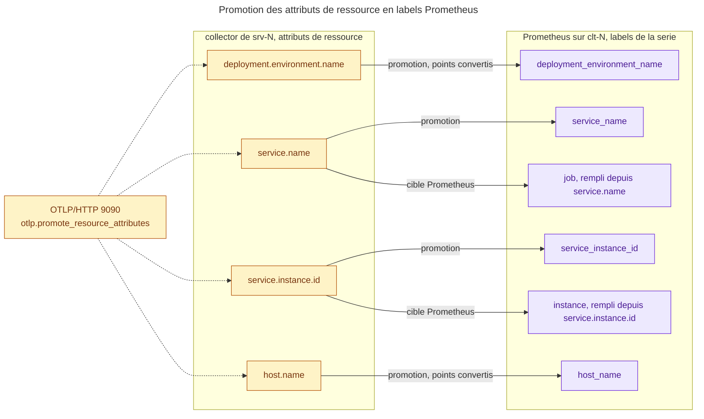

<sub>60</sub> Sans ce bloc, les quatre serveurs enverraient la même série `system_cpu_load_average_1m` sans aucun label, et il serait impossible de savoir de quelle machine elle provient.

Attendez une minute, puis interrogez Prometheus pour voir les métriques des serveurs d'infrastructure :

```bash
sleep 60
```

```bash
curl -s -G "http://localhost:9090/api/v1/query" \
  --data-urlencode "query=system_cpu_load_average_1m" \
  | jq -r '.data.result[] | "\(.metric.host_name) [\(.metric.deployment_environment_name)] : \(.value[1])"'
```

<sub>61</sub> La sortie affiche une série par serveur qui envoie des métriques système, avec le rôle entre crochets. Le frontend n'y figure pas, puisque ses métriques système sont désactivées :

```text
srv-0 [lab4] : 0.19
srv4-0 [backend] : 0.05
srv3-0 [database] : 0.13
```

`srv-frontend` n'apparaît pas : la variable `otelcol_hostmetrics_enabled: false` a supprimé le receiver `hostmetrics` et le pipeline `metrics` de sa configuration.

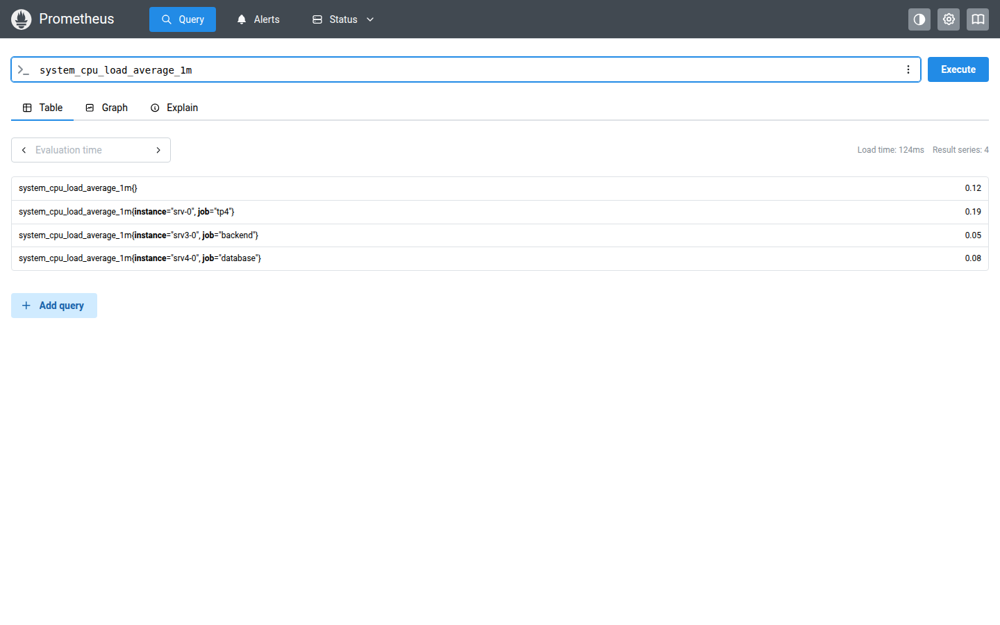

> [!NOTE]
>
> Les labels `instance` et `job` de Prometheus viennent des attributs de ressource `service.instance.id` et `service.name`. Ces deux attributs sont désormais ajoutés automatiquement dans le template (via `otelcol_environment` et le fact Ansible `ansible_hostname`).

> [!NOTE]
>
> Les machines éphémères sont détruites par l'animateur à la fin du lab : la configuration qu'elles portent est entièrement reproductible par le playbook, c'est le sens de l'infrastructure-as-code.

## Cleanup

<sub>62</sub> Arrêtez les backends du poste de contrôle, puis désinstallez le **collector** du serveur et effacez le paquet téléchargé :

```bash
cd ~/lab04
```

```bash
docker compose down
```

```bash
ansible otel -b -m ansible.builtin.apt -a "name=otelcol-contrib state=absent purge=true"
```

```bash
ansible otel -b -m ansible.builtin.file -a "path=/tmp/otelcol-contrib_0.165.0.deb state=absent"
```

```bash
ansible otel -m ansible.builtin.shell -a 'command -v otelcol-contrib || echo absent'
```

La dernière commande affiche `absent` : le binaire, la configuration `/etc/otelcol-contrib` et le paquet dans `/tmp` ont disparu du serveur.

<sub>63</sub> Si vous avez réalisé [l'extra 5](#5-installer-node_exporter-sur-un-serveur-et-le-scraper-via-le-collector), désinstallez également `prometheus-node-exporter` sur `srv-N` :

```bash
ansible otel -b -m ansible.builtin.apt -a "name=prometheus-node-exporter state=absent purge=true"
```

Si des serveurs éphémères ont été déployés [à la partie 5](#5-étendre-le-parc--4-serveurs-4-configurations), ils ne se nettoient pas depuis le terminal : votre animateur les détruit en fin de séance avec `animateur/scripts/lab04-vms-destroy.sh`. Aucun playbook n'est nécessaire pour cela, et les machines disparaissent avec leurs paquets et leurs configurations.

<sub>64</sub> Le dossier `~/lab04` peut être conservé si vous voulez rejouer le lab. Les autres labs ne le réutilisent pas : chacun fournit ses propres fichiers.

## Extra

À vous de jouer, si le temps le permet. Chaque exercice est guidé pas à pas.

### 1. Un **collector** pour la préproduction et la production

<sub>65</sub> Le cas d'usage est celui d'une équipe qui exploite deux environnements, `preprod` et `prod`, avec un seul **collector** plutôt que deux machines à maintenir. Les contraintes ne sont pas les mêmes :

- la production doit être vue vite : lots courts (1 seconde) et métriques système collectées, parce que la capacité de ces serveurs compte ;
- la préproduction peut attendre : lots longs (10 secondes), pas de métriques système, pour ne pas payer le coût d'une collecte dont personne ne se sert ;
- les deux flux (streams) doivent rester **séparés et identifiables** : ports différents, donc règles de pare-feu différentes, et un attribut `tenant` qui permet de retrouver l'origine de chaque donnée dans le backend.

C'est exactement ce qu'un template Jinja2 rend confortable : on décrit les deux environnements une fois, et le reste est généré. Sans boucle, il faudrait recopier six blocs de configuration à la main, avec le risque d'en oublier un.

<sub>66</sub> Ajoutez la description des deux locataires à la fin de `host_vars/$SRV_HOST.yml` :

```bash
cd ~/lab04
```

```bash
cat >> host_vars/$SRV_HOST.yml <<'EOF'
otelcol_tenants:
  - name: prod
    environment: production
    port_grpc: 4317
    port_http: 4318
    batch_timeout: 1s
    hostmetrics: true
  - name: preprod
    environment: preproduction
    port_grpc: 5317
    port_http: 5318
    batch_timeout: 10s
    hostmetrics: false
EOF
```

Écrivez un second template, à côté du premier :

```bash
cat > templates/config-tenants.yaml.j2 <<'EOF'
{{ ansible_managed | comment }}
receivers:

  otlp/{{ t.name }}:
    protocols:
      grpc:
        endpoint: 0.0.0.0:{{ t.port_grpc }}
      http:
        endpoint: 0.0.0.0:{{ t.port_http }}

  hostmetrics/{{ t.name }}:
    collection_interval: 30s
    scrapers:
      cpu: {}
      load: {}
      memory: {}



processors:
  memory_limiter:
    check_interval: 1s
    limit_mib: 256
    spike_limit_mib: 64

  resource/{{ t.name }}:
    attributes:
      - key: tenant
        value: {{ t.name | to_json }}
        action: upsert
      - key: deployment.environment.name
        value: {{ t.environment | to_json }}
        action: upsert
      - key: service.instance.id
        value: "otelcol-{{ t.name }}"
        action: upsert
  batch/{{ t.name }}:
    timeout: {{ t.batch_timeout }}


exporters:
  otlp_grpc/jaeger:
    endpoint: {{ otelcol_backend_host }}:4317
    tls:
      insecure: true
  otlp_http/prometheus:
    metrics_endpoint: http://{{ otelcol_backend_host }}:9090/api/v1/otlp/v1/metrics

service:
  pipelines:

    traces/{{ t.name }}:
      receivers: [otlp/{{ t.name }}]
      processors: [memory_limiter, resource/{{ t.name }}, batch/{{ t.name }}]
      exporters: [otlp_grpc/jaeger]

    metrics/{{ t.name }}:
      receivers: [hostmetrics/{{ t.name }}]
      processors: [memory_limiter, resource/{{ t.name }}, batch/{{ t.name }}]
      exporters: [otlp_http/prometheus]


EOF
```

<sub>67</sub> Quatre constructions se combinent ici :

- la boucle `` produit un bloc par environnement ;
- la condition `` n'ajoute le receiver et le pipeline `metrics` que pour ceux qui en veulent ;
- l'accès `{{ t.port_grpc }}` et `{{ t.batch_timeout }}` lit les champs de l'élément en cours d'itération ;
- le suffixe `{{ t.name }}` garantit l'unicité des noms de composants, exigée par le **collector**.

L'attribut `service.instance.id` mérite une explication : c'est lui qui devient le label `instance` dans Prometheus. Sans lui, les séries de métriques arrivent sans label et deviennent impossibles à attribuer à un environnement.

<sub>68</sub> Rendez le template sur `clt-N` et validez-le avant de déployer :

```bash
ansible localhost -m ansible.builtin.template \
  -a "src=templates/config-tenants.yaml.j2 dest=/tmp/config-tenants.yaml" -e @group_vars/all.yml
```

```bash
docker run --rm -v /tmp/config-tenants.yaml:/config.yaml:ro \
  ghcr.io/open-telemetry/opentelemetry-collector-releases/opentelemetry-collector-contrib:0.165.0 \
  validate --config=/config.yaml
echo "code retour : $?"
```

Le rendu montre les pipelines de chaque environnement, et la différence entre les deux :

```yaml
service:
  pipelines:
    traces/prod:
      receivers: [otlp/prod]
      processors: [memory_limiter, resource/prod, batch/prod]
      exporters: [otlp_grpc/jaeger]
    metrics/prod:
      receivers: [hostmetrics/prod]
      processors: [memory_limiter, resource/prod, batch/prod]
      exporters: [otlp_http/prometheus]
    traces/preprod:
      receivers: [otlp/preprod]
      processors: [memory_limiter, resource/preprod, batch/preprod]
      exporters: [otlp_grpc/jaeger]
```

<sub>69</sub> `prod` a deux pipelines, `preprod` un seul : la condition a suffi à produire cette différence.

Le schéma suivant situe les deux locataires dans le même processus du **collector** : deux jeux de receivers, deux jeux de pipelines, mais un seul `memory_limiter` et une seule paire d'exporters, partagés par tous les pipelines.

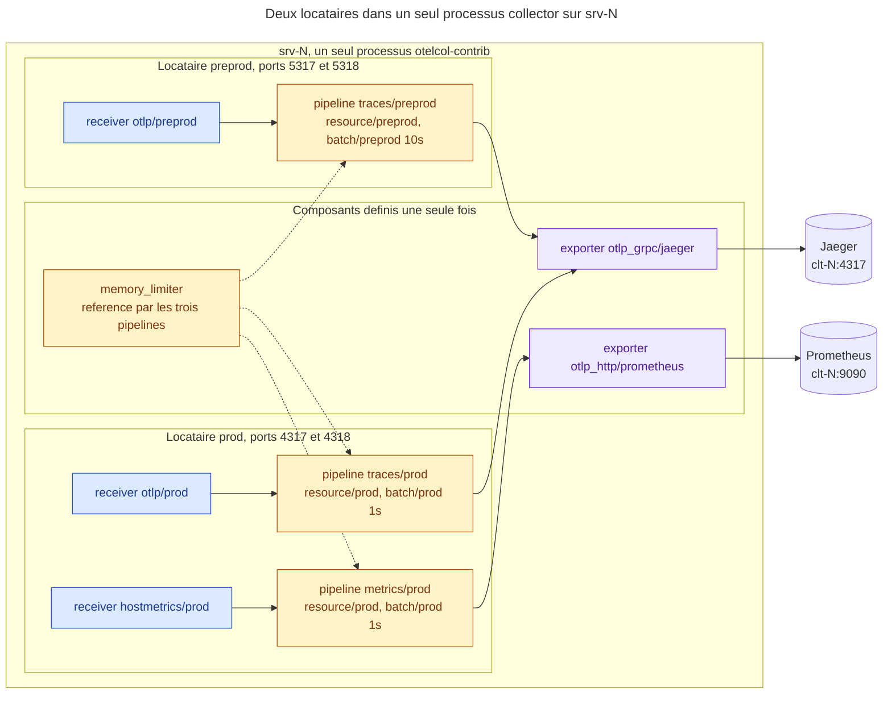

<sub>70</sub> Ce schéma couvre uniquement la configuration de l'extra 1 : le template principal du lab, avec ses ports 4317 et 4318 et ses processors `resourcedetection`, n'est pas représenté.

Déployez cette configuration en pointant la tâche sur le nouveau template :

```bash
sed -i 's|src: config.yaml.j2|src: config-tenants.yaml.j2|' playbook.yml
```

```bash
ansible-playbook playbook.yml | grep -A3 'PLAY RECAP'
```

```text
srv-N.monlab.top           : ok=6    changed=2    unreachable=0    failed=0    skipped=0    rescued=0    ignored=0
```

<sub>71</sub> Les quatre ports OTLP sont en écoute, deux par environnement :

```bash
ansible otel -m ansible.builtin.shell -a "ss -ltn | grep -E ':(4317|4318|5317|5318) '"
```

```text
LISTEN 0      4096               *:5318            *:*
LISTEN 0      4096               *:5317            *:*
LISTEN 0      4096               *:4318            *:*
LISTEN 0      4096               *:4317            *:*
```

Envoyez maintenant trois traces sur chaque endpoint, sous le même nom de service : c'est la situation réelle d'une application déployée dans les deux environnements.

```bash
ssh root@$SRV_HOST 'docker run --rm --network host ghcr.io/open-telemetry/opentelemetry-collector-contrib/telemetrygen:v0.165.0 traces --otlp-endpoint localhost:4317 --otlp-insecure --rate 10 --traces 3 --service checkout-web'
```

```bash
ssh root@$SRV_HOST 'docker run --rm --network host ghcr.io/open-telemetry/opentelemetry-collector-contrib/telemetrygen:v0.165.0 traces --otlp-endpoint localhost:5317 --otlp-insecure --rate 10 --traces 3 --service checkout-web'
```

```bash
sleep 5
```

<sub>72</sub> Dans Jaeger, le même service apparaît deux fois, distingué par les attributs que le template a posés :

```bash
curl -s 'http://localhost:16686/api/v3/traces?query.service_name=checkout-web&query.startTimeMin=2020-01-01T00:00:00Z&query.startTimeMax=2030-01-01T00:00:00Z' \
  | jq -r '[.result.resourceSpans[].resource.attributes[] | select(.key=="tenant" or .key=="deployment.environment.name") | "\(.key)=\(.value.stringValue)"] | unique | .[]'
```

```text
deployment.environment.name=preproduction
deployment.environment.name=production
tenant=preprod
tenant=prod
```

C'est la valeur du modèle : un seul pipeline de collecte, et des données attribuables à leur environnement sans ambiguïté, ce qui permet de répondre à « quelle est la latence en production ? » sans mélanger la préproduction.

<sub>73</sub> Vérifiez enfin la différence de traitement sur les métriques. Après une trentaine de secondes, seul `prod` envoie des séries système :

```bash
sleep 35
```

```bash
curl -s -G http://localhost:9090/api/v1/query \
  --data-urlencode 'query=count by (instance) ({__name__=~"system_cpu.*"})' \
  | jq -r '.data.result[] | "instance=\(.metric.instance) : \(.value[1]) series"'
```

```text
instance=otelcol-prod : 12 series
```

`preprod` n'apparaît pas : sa variable `hostmetrics: false` a supprimé le receiver et le pipeline `metrics` de sa configuration. Une seule variable change, et le template produit deux comportements.

> [!NOTE]
>
> Ce modèle a une limite bien réelle, à connaître avant de le déployer en production. Les deux environnements partagent le même processus et donc le même `memory_limiter` : si la préproduction sature son endpoint, le limiteur peut rejeter aussi les données de production. C'est le problème du voisin bruyant, et c'est pourquoi certains parcs isolent la production sur un **collector** distinct. [Le lab 9](Lab_09_Gateway_Production.md) traite ces questions de **gateway** de production.

<sub>74</sub> Revenez à la configuration du lab avant de continuer :

```bash
sed -i 's|src: config-tenants.yaml.j2|src: config.yaml.j2|' playbook.yml
```

```bash
ansible-playbook playbook.yml | grep -A3 'PLAY RECAP'
```

### 2. Activer le scraper network du receiver hostmetrics (extra)

Le receiver `hostmetrics` active par défaut seulement `cpu`, `load` et `memory`. Pour collecter également les métriques réseau (`network` : paquets, octets, erreurs, etc.), décommentez la ligne suivante dans le template :

```yaml
      network: {}
```

<sub>75</sub> Redéployez ensuite le **collector** avec le playbook. Vous verrez alors de nouvelles métriques telles que `system_network_packets` ou `system_network_io` dans Prometheus.

### 3. Conserver les versions précédentes de la configuration

Ajoutez le paramètre `backup: true` à la tâche de configuration et observez les copies conservées sur le serveur à chaque modification.

### 4. Revenir à une version antérieure du binaire

<sub>76</sub> Pour l'exercice, imaginez qu'une régression de la version 0.165.0 vous oblige à revenir à 0.164.0 le temps d'un diagnostic. Le playbook rend l'opération simple, à deux conditions : changer les sommes de contrôle avec la version, et prévenir APT qu'il s'agit d'une descente de version.

Commencez par la version et les sommes. Celles de la 0.164.0 sont publiées avec la version :

```bash
sed -i 's/otelcol_version: "0.165.0"/otelcol_version: "0.164.0"/' group_vars/all.yml
```

```bash
sed -i 's|amd64: "sha256:dafb5174344dd15f339fd8208783b17122fb4cd37fa7e5461fb09d99df212b4b"|amd64: "sha256:1995260c54cf5d74964a85e5e7d27834bb9a252c87a2582a4fb6a6c34565a90d"|' group_vars/all.yml
```

```bash
sed -i 's|arm64: "sha256:4dcfb6b69dfa10132c593ed5782823eec79dc408a0d68291e1c4adc5879d0948"|arm64: "sha256:34dca7290ff50d8be123c587dff51d93711a59e2cff41895e8801b145749dd0e"|' group_vars/all.yml
```

```bash
grep -A3 'otelcol_checksums' group_vars/all.yml
```

<sub>77</sub> Autorisez ensuite la descente de version dans la tâche d'installation :

```bash
sed -i 's|        deb: "/tmp/otelcol-contrib_{{ otelcol_version }}.deb"|        deb: "/tmp/otelcol-contrib_{{ otelcol_version }}.deb"\n        allow_downgrade: true|' playbook.yml
```

```bash
grep -A3 'deb:' playbook.yml | head -4
```

```text
        deb: "/tmp/otelcol-contrib_{{ otelcol_version }}.deb"
        allow_downgrade: true
        state: present
```

Déployez, puis contrôlez la version installée et l'état du service :

```bash
ansible-playbook playbook.yml
```

```bash
ansible otel -a '/usr/bin/otelcol-contrib --version'
```

```bash
ansible otel -a 'systemctl is-active otelcol-contrib'
```

```bash
ansible otel -a 'dpkg-query -W otelcol-contrib'
```

<sub>78</sub> On obtient la version antérieure, un service actif et un paquet marqué `0.164.0` :

```text
otelcol-contrib version 0.164.0
active
otelcol-contrib	0.164.0
```

Envoyez cinq traces pour vérifier que le **collector** déployé fonctionne toujours :

```bash
ssh root@$SRV_HOST 'docker run --rm --network host ghcr.io/open-telemetry/opentelemetry-collector-contrib/telemetrygen:v0.165.0 traces --otlp-endpoint localhost:4317 --otlp-insecure --rate 10 --traces 5 --service ansible-demo'
```

```bash
sleep 3
```

```bash
curl -s 'http://localhost:16686/api/v3/traces?query.service_name=ansible-demo&query.startTimeMin=2020-01-01T00:00:00Z&query.startTimeMax=2030-01-01T00:00:00Z' \
  | jq '[.result.resourceSpans[].scopeSpans[].spans[].traceId] | unique | length'
```

> [!NOTE]
>
> Trois choses à retenir de cet exercice. Sans `allow_downgrade`, APT refuse l'opération avec `Packages were downgraded and -y was used without --allow-downgrades`, et le paquet reste en 0.165.0. Une somme de contrôle oubliée fait échouer le téléchargement avant même l'installation. Et la remontée de version est le cas normal : sans `allow_downgrade`, APT installe la version supérieure sans broncher.

### 5. Installer node_exporter sur un serveur et le scraper via le **collector**

<sub>79</sub> Dans ce lab, les métriques système ont été collectées avec le receiver `hostmetrics`. Une autre approche très fréquente en production consiste à installer `node_exporter` (l'exporter Prometheus officiel pour Linux) sur la machine cible, puis à le faire scraper localement par le **collector** OpenTelemetry avec le receiver `prometheus`.

Le schéma suivant ne montre que le flux des métriques, de `node_exporter` jusqu'au Prometheus central sur `clt-N`. Les traces, le receiver `otlp` et le receiver `hostmetrics` du **collector** n'y figurent pas :

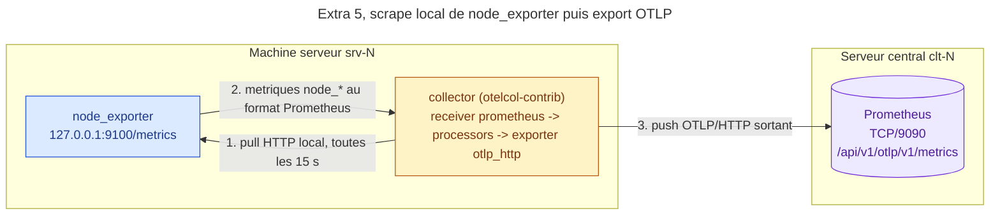

<sub>80</sub> Ce montage présente trois intérêts concrets :

- **Conserver les tableaux de bord et alertes existants.** Le receiver `hostmetrics` produit des métriques aux conventions sémantiques OpenTelemetry (`system_cpu_*`, `system_memory_*`), alors que les tableaux de bord Grafana historiques et de nombreuses règles d'alerte PromQL reposent sur les noms de `node_exporter` (`node_cpu_seconds_total`, `node_memory_MemAvailable_bytes`, `node_load1`). Scraper `node_exporter` via le **collector** permet de basculer le transport vers OpenTelemetry sans réécrire immédiatement les requêtes existantes.
- **Remplacer le pull entrant par un export OTLP sortant.** Avec un scrape Prometheus classique, le serveur Prometheus central doit ouvrir une connexion entrante vers le port `9100` de chaque machine du parc, ce qui complique les règles de pare-feu. Ici, `node_exporter` est interrogé en local sur `127.0.0.1:9100` par le **collector**, qui pousse ensuite les métriques en OTLP sortant en leur appliquant le même pipeline que les autres signaux (`resourcedetection`, `resource`, `batch`, chiffrement, filtrage).
- **Appliquer un modèle unique à tout l'écosystème Prometheus.** La même configuration de receiver `prometheus` sert à collecter n'importe quel exporter existant (`postgres_exporter`, `nginx_exporter`, ou un endpoint `/metrics` applicatif) sans déployer d'agent Prometheus dédié.

En contrepartie, faire tourner simultanément `hostmetrics` et `node_exporter` duplique les métriques système et augmente la cardinalité stockée dans Prometheus (plus de 1 700 séries `node_*` par serveur). En production, on ne conserve généralement que l'un des deux receivers.

<sub>81</sub> **Consigne** : déployez `prometheus-node-exporter` sur un unique serveur (`srv-N`, groupe `otel`), ajoutez une variable booléenne `otelcol_node_exporter_enabled` (désactivée par défaut dans `group_vars/all.yml`, activée uniquement dans `host_vars/$SRV_HOST.yml`) pour activer un receiver `prometheus/node_exporter` dans `templates/config.yaml.j2` qui scrape `127.0.0.1:9100`, redéployez sur `srv-N`, puis vérifiez dans Prometheus sur `clt-N` que la métrique `node_load1` apparaît avec les attributs de ressource (`host_name`, `deployment_environment_name`, `instance`, `job`).

La solution technique détaillée est disponible dans [solutions/sol-4-5.md](solutions/sol-4-5.md).
