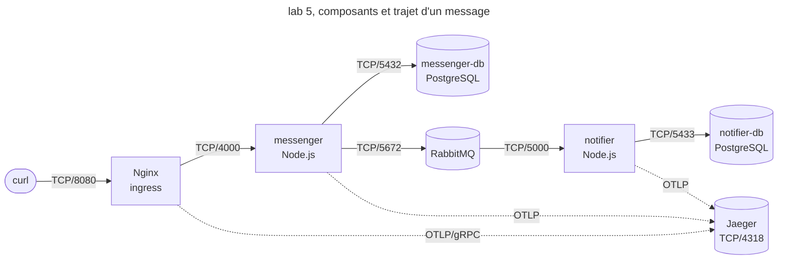
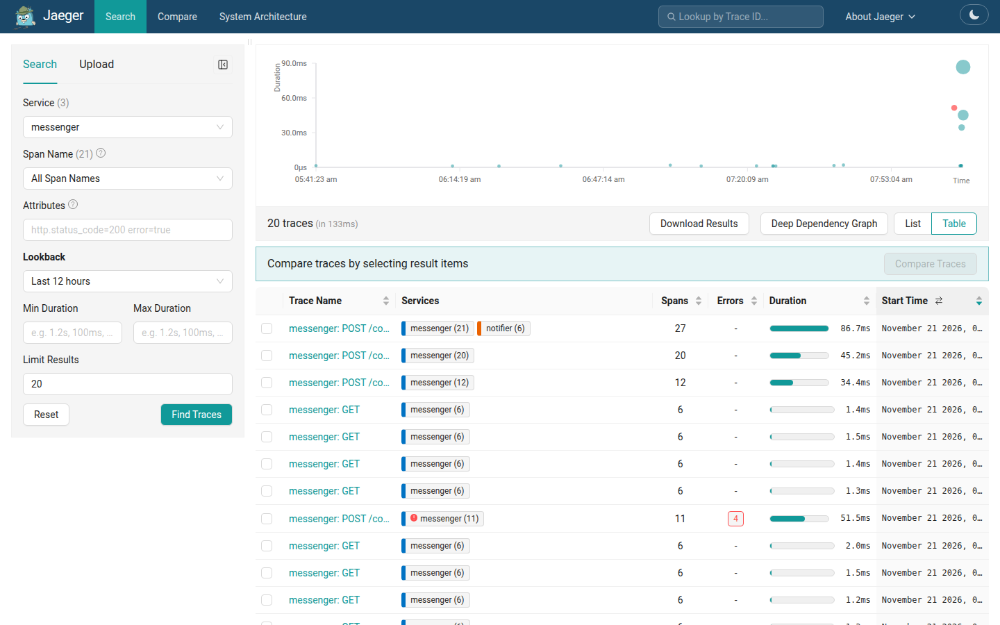
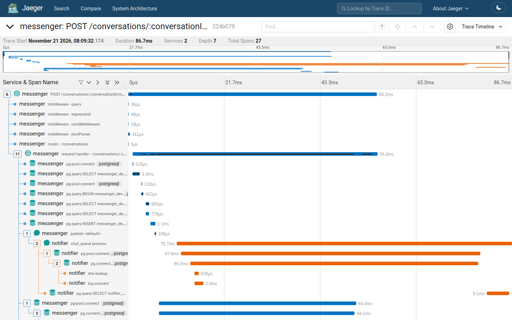
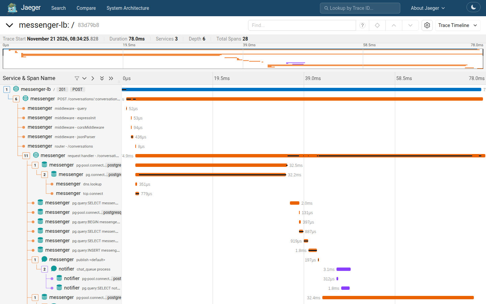

# Lab 5 : Node.js et Nginx, une trace de bout en bout

# Objectifs

À la fin du lab, vous saurez :

- démarrer une application de microservices (deux services Node.js, RabbitMQ, PostgreSQL, Nginx) et suivre un message de bout en bout, sans télémétrie ;
- auto-instrumenter un service Node.js avec le SDK OpenTelemetry et exporter ses spans en OTLP vers Jaeger ;
- nommer le service par une ressource et lire un waterfall dans Jaeger ;
- propager le contexte à travers RabbitMQ et obtenir une trace qui traverse les deux services ;
- instrumenter Nginx avec le module OpenTelemetry et faire apparaître le span racine du proxy ;
- repérer une donnée sensible ajoutée à un span et la masquer dans le **collector**.

# Contenu

- [Environnement](#environnement)
- [1. La pile et le parcours d'un message](#1-la-pile-et-le-parcours-dun-message)
- [2. Auto-instrumenter messenger](#2-auto-instrumenter-messenger)
- [3. Nommer le service et lire le waterfall](#3-nommer-le-service-et-lire-le-waterfall)
- [4. Instrumenter notifier](#4-instrumenter-notifier)
- [5. Nginx devant l'application](#5-nginx-devant-lapplication)
- [6. Données applicatives et masquage](#6-données-applicatives-et-masquage)
- [Cleanup](#cleanup)
- [Extra](#extra)

# Détail

## Environnement

Ce lab se déroule sur la machine cliente `clt-N`, qui porte les deux services Node.js, la base PostgreSQL, RabbitMQ, Nginx et Jaeger. Toutes les commandes se lancent depuis le terminal web de `clt-N`, dans `/root`.

Le [lab 1](Lab_01_Socle.md) est conseillé : il présente les **receiver**, **processor** et **exporter** du **collector**, utilisés à la partie 6.

L'application est celle de l'architecture de démonstration Microservices March, distribuée par NGINX. Elle n'est pas recopiée dans le dépôt des labs : vous la clonez à des commits précis, indiqués dans la partie 1.

Versions utilisées dans ce lab :

| Composant | Version |
|---|---|
| Node.js (installé par asdf pendant le lab) | v22.23.5 |
| npm | 10.9.9 |
| asdf | v0.16.7 |
| `@opentelemetry/sdk-node` | 0.301.2 |
| `@opentelemetry/auto-instrumentations-node` | 0.83.1 |
| `@opentelemetry/exporter-trace-otlp-proto` | 0.301.2 |
| `@opentelemetry/resources` | 3.1.1 |
| `@opentelemetry/semantic-conventions` | 1.45.0 |
| Jaeger | 2.23.0 |
| `amqplib` (mis à jour pour RabbitMQ 4) | 0.10.9 |
| RabbitMQ | 4.4.1-management-alpine |
| PostgreSQL | 17.12 |
| Nginx (image officielle avec module OTel) | 1.30.7-otel |
| **collector** OpenTelemetry (partie 6) | 0.165.0 |

Les interfaces web passent par les ports ouverts de `clt-N` : Jaeger sur `http://$CLT_HOST:16686`, l'application sur `http://$CLT_HOST:8080`.

> [!NOTE]
>
> L'auto-instrumentation Node.js actuelle exige Node.js 22.15 ou plus. Les versions indiquées ci-dessus sont celles de ce lab, épinglées pour que le comportement ne change pas d'une session à l'autre.

## 1. La pile et le parcours d'un message

L'application se compose de deux services Node.js qui communiquent par RabbitMQ, de deux bases PostgreSQL et d'un proxy Nginx. Le schéma suivant montre les composants sur `clt-N` et le trajet d'un message :



Le message suit ces étapes : une requête HTTP arrive sur `messenger`, qui joue le rôle de producteur (publisher), écrit dans sa base puis publie un événement dans RabbitMQ, le courtier de messages (broker) ; `notifier`, le consommateur (subscriber), lit l'événement dans la file (queue), écrit dans sa propre base et simule l'envoi d'un SMS. Sans télémétrie, il faut lire les logs de deux processus dans deux terminaux.

Installez d'abord Node.js, avec le gestionnaire de versions `asdf`, comme pour l'application d'origine : la machine ne fournit pas de Node.js, et il faut une version récente pour l'auto-instrumentation actuelle. Le paquet distribué par Ubuntu est trop ancien.

```bash
git clone https://github.com/asdf-vm/asdf.git /root/.asdf --branch v0.16.7
. /root/.asdf/asdf.sh
asdf plugin add nodejs https://github.com/asdf-vm/asdf-nodejs.git
asdf install nodejs 22.23.5
asdf global nodejs 22.23.5
```

`asdf` télécharge la version demandée et la rend disponible par des raccourcis (`shims`) placés en tête du `PATH`. Rendez ce `PATH` permanent, pour que les terminaux suivants, et les commandes lancées par les outils, retrouvent Node.js :

```bash
echo '. /root/.asdf/asdf.sh' >> /root/.bashrc
cat > /etc/profile.d/asdf.sh <<'EOF'
. /root/.asdf/asdf.sh
EOF
```

Vérifiez dans un nouveau terminal, puis contrôlez les versions :

```bash
which node
node --version
npm --version
cat /root/.tool-versions
```

```text
/root/.asdf/shims/node
v22.23.5
10.9.9
nodejs 22.23.5
```

> [!NOTE]
>
> `asdf` choisit la version dans l'ordre suivant : le `.tool-versions` du dossier courant, puis celui du parent, puis la version globale de `/root/.tool-versions`. C'est pourquoi la version est fixée à la fois globalement, pour les commandes lancées hors des dépôts, et localement dans chaque application, pour l'emporter sur le fichier du dépôt.

> [!NOTE]
>
> Pourquoi Node.js 22 plutôt qu'une version plus récente ? Le plancher vient de l'auto-instrumentation, pas de l'application. Les paquets OpenTelemetry actuels exigent Node.js 22.15 ou plus : les versions 18 et 20 ne sont plus prises en charge, et l'injection des bibliothèques n'y est plus garantie. Les versions 22 et 24 sont des versions LTS et conviennent. En revanche les versions impaires (23, 25) ne sont pas LTS, et l'injection, qui s'appuie sur des mécanismes internes de Node (`require-in-the-middle`, `import-in-the-middle`, `diagnostics_channel`), y est prise en charge avec du retard. Une version 22 LTS est donc le choix sûr pour un environnement pédagogique.

Clonez les trois dépôts, chacun à un commit précis :

```bash
mkdir -p ~/lab05
cd ~/lab05
git clone https://github.com/pragmatic-fermat/messenger
git clone https://github.com/pragmatic-fermat/notifier
git clone https://github.com/pragmatic-fermat/platform
git -C messenger checkout d20437aa3873
git -C notifier checkout 0c27d64993be
git -C platform checkout 56aa89e35eff
```

Chaque dépôt contient un fichier `.tool-versions` qui demande Node.js 19.3.0. `asdf` lit ce fichier en priorité sur la version globale, et refuse alors de fournir `node`. Fixez la version dans chaque application, ce qui écrit un `.tool-versions` local qui l'emporte :

```bash
cd ~/lab05/messenger/app && asdf local nodejs 22.23.5
cd ~/lab05/notifier/app && asdf local nodejs 22.23.5
cd ~/lab05/messenger/app && node --version
```

```text
v22.23.5
```

> [!NOTE]
>
> Ce lab utilise le port `TCP/8080` de `clt-N`. Si un cluster KinD d'un lab précédent tourne encore, il occupe ce port : contrôlez avec `kind get clusters` et supprimez-le avec `kind delete cluster --name cluster`. Le cleanup du [lab 3](Lab_03_Kubernetes.md) le fait déjà, mais un cluster laissé de côté bloquerait le démarrage du proxy.

Écrivez le fichier Compose qui démarre l'infrastructure et le proxy. Il reprend celui du dépôt `platform`, avec deux différences : les services Node.js n'y figurent pas, vous les lancerez vous-mêmes dans des terminaux, et Jaeger est la version 2.

```bash
cd ~/lab05
cat > compose.yaml <<'EOF'
---
services:

  ingress:
    build: ./platform/ingress
    container_name: ingress
    extra_hosts:
      - "host.docker.internal:host-gateway"
    environment:
      - NGINX_UPSTREAM=host.docker.internal
    ports:
      - 8080:80
    networks:
      - mm_network

  rabbitmq:
    image: rabbitmq:4.4.1-management-alpine
    container_name: rabbitmq
    hostname: microservices_march
    ports:
      - 5672:5672
      - 15672:15672
    networks:
      - mm_network

  jaeger:
    image: jaegertracing/jaeger:2.23.0
    container_name: jaeger
    ports:
      - "16686:16686"
      - "4317:4317"
      - "4318:4318"
    networks:
      - mm_network

  messenger-db:
    image: postgres:17.12
    container_name: messenger-db
    environment:
      POSTGRES_USER: postgres
      POSTGRES_PASSWORD: postgres
      POSTGRES_DB: messenger
      PGDATA: /var/lib/postgresql/data/pgdata
    ports:
      - 5432:5432
    volumes:
      - messenger-db-data:/var/lib/postgresql/data/pgdata
    networks:
      - mm_network

  notifier-db:
    image: postgres:17.12
    container_name: notifier-db
    environment:
      POSTGRES_USER: postgres
      POSTGRES_PASSWORD: postgres
      POSTGRES_DB: notifier
      PGDATA: /var/lib/postgresql/data/pgdata
      PGPORT: 5433
    ports:
      - 5433:5433
    volumes:
      - notifier-db-data:/var/lib/postgresql/data/pgdata
    networks:
      - mm_network

volumes:
  messenger-db-data:
  notifier-db-data:

networks:
  mm_network:
    name: mm_network
    driver: bridge
EOF
docker compose -f compose.yaml up -d --build
```

> [!NOTE]
>
> La pile démarre son propre Jaeger, neuf, et ne réutilise rien d'un lab précédent. Si un conteneur d'un lab antérieur tourne encore et occupe `TCP/4317` ou `TCP/4318`, le démarrage échoue sur `port is already allocated` : listez les conteneurs avec `docker ps`, puis arrêtez la pile concernée avec `docker compose down` depuis son dossier.

Démarrez l'infrastructure, puis vérifiez l'état des conteneurs :

```bash
docker compose -f compose.yaml ps --format 'table {{.Name}}\t{{.Status}}'
```

```text
NAME             STATUS
ingress          Up
jaeger           Up
messenger-db     Up
notifier-db      Up
rabbitmq         Up
```

Installez les dépendances des deux applications, et mettez à jour `amqplib` vers `0.10.9` :

```bash
cd ~/lab05/messenger/app && npm install && npm install --save-exact amqplib@0.10.9
cd ~/lab05/notifier/app && npm install && npm install --save-exact amqplib@0.10.9
```

> [!NOTE]
>
> RabbitMQ 4 impose une taille minimale de trame AMQP (`frame_max`) de 8192 octets, alors que la version `0.10.3` de `amqplib` épinglée dans les dépôts de 2023 négociait 4096 octets et provoquait une fermeture immédiate de la connexion. Le passage à `0.10.9` corrige ce point tout en restant compatible avec l'auto-instrumentation.

Initialisez les deux bases. Chaque service crée sa base, son schéma et un jeu de données de démonstration :

```bash
cd ~/lab05/messenger/app && npm run refresh-db
cd ~/lab05/notifier/app && npm run refresh-db
```

Lancez le notifier dans un premier terminal, dans `~/lab05/notifier/app` :

```bash
cd ~/lab05/notifier/app
node index.mjs
```

```text
listening on port 5000
```

Lancez le messenger dans un second terminal, dans `~/lab05/messenger/app` :

```bash
cd ~/lab05/messenger/app
node index.mjs
```

```text
messenger_service listening on port 4000
```

Depuis un troisième terminal, créez une conversation et envoyez un message :

```bash
curl -s -X POST -H 'Content-Type: application/json' \
  -d '{"participant_ids": [1, 2]}' \
  http://localhost:8080/conversations
```

```json
{"conversation":{"id":"1","inserted_at":"2026-11-21T07:09:32.000Z"}}
```

```bash
curl -s -X POST -H 'User-Id: 1' -H 'Content-Type: application/json' \
  -d '{"content": "This is the first message"}' \
  http://localhost:8080/conversations/1/messages
```

Le message est créé et renvoyé :

```json
{"message":{"id":"1","content":"This is the first message","index":1,"user_id":1,"username":"James Blanderphone","conversation_id":1,"inserted_at":"2026-11-21T07:09:32.000Z"}}
```

Dans le terminal du notifier, l'événement est arrivé :

```text
Received new_message:  {"type":"new_message","channel_id":1,"user_id":1,"index":1,"participant_ids":[1,2]}
Sending notification of new message via sms to 12027621401
```

Vous avez donc un parcours complet, mais réparti entre des logs. Aucune trace n'existe encore.

> [!NOTE]
>
> Les deux requêtes passent par Nginx sur `TCP/8080`, qui les renvoie au messenger sur `TCP/4000`. C'est ce proxy que vous instrumenterez à la partie 5.

## 2. Auto-instrumenter messenger

Arrêtez le messenger dans son terminal (Ctrl+C), puis installez les paquets d'instrumentation à version exacte :

```bash
cd ~/lab05/messenger/app
npm install --save-exact \
  @opentelemetry/sdk-node@0.301.2 \
  @opentelemetry/auto-instrumentations-node@0.83.1 \
  @opentelemetry/exporter-trace-otlp-proto@0.301.2 \
  @opentelemetry/resources@3.1.1
```

Le fichier `tracing.mjs` crée un SDK, lui donne l'exporteur OTLP et la liste des instrumentations automatiques. Il se charge avant l'application, avec l'option `--import` de Node.js.

```bash
cat > tracing.mjs <<'EOF'
import { NodeSDK } from "@opentelemetry/sdk-node";
import { getNodeAutoInstrumentations } from "@opentelemetry/auto-instrumentations-node";
import { OTLPTraceExporter } from "@opentelemetry/exporter-trace-otlp-proto";
import { resourceFromAttributes } from "@opentelemetry/resources";

const sdk = new NodeSDK({
  resource: resourceFromAttributes({
    "service.name": "messenger",
  }),
  traceExporter: new OTLPTraceExporter({
    url: "http://localhost:4318/v1/traces",
  }),
  instrumentations: [getNodeAutoInstrumentations()],
});

sdk.start();
EOF
```

Relancez le messenger avec le fichier d'instrumentation :

```bash
node --import ./tracing.mjs index.mjs
```

Rejouez une requête, puis regardez Jaeger dans votre navigateur, sur `http://$CLT_HOST:16686` : le service `messenger` apparaît, avec une trace par requête HTTP.



> [!NOTE]
>
> L'exporteur pointe vers `http://localhost:4318/v1/traces`, le port OTLP/HTTP de Jaeger. Le contexte est chargé avant le module de l'application : c'est le rôle de `--import`. L'ordre est important, un `import` placé dans `index.mjs` serait trop tardif pour intercepter les bibliothèques.

> [!NOTE]
>
> Les instrumentations automatiques couvrent HTTP, Express et PostgreSQL. RabbitMQ n'est pas couvert par l'auto-instrumentation : vous verrez à la partie 4 ce que cela implique pour le lien entre les deux services.

## 3. Nommer le service et lire le waterfall

Le nom du service vient de la ressource. Sans elle, Jaeger affiche `unknown_service:node`, ce qui rend la lecture impossible.

Modifiez la ressource pour y ajouter l'environnement et le numéro de participant, et gardez la même structure que dans les autres lab :

```bash
cd ~/lab05/messenger/app
cat > tracing.mjs <<'EOF'
import { NodeSDK } from "@opentelemetry/sdk-node";
import { getNodeAutoInstrumentations } from "@opentelemetry/auto-instrumentations-node";
import { OTLPTraceExporter } from "@opentelemetry/exporter-trace-otlp-proto";
import { resourceFromAttributes } from "@opentelemetry/resources";

const sdk = new NodeSDK({
  resource: resourceFromAttributes({
    "service.name": "messenger",
    "deployment.environment.name": "lab5",
    "lab.id": process.env.LAB_ID ?? "0",
  }),
  traceExporter: new OTLPTraceExporter({
    url: "http://localhost:4318/v1/traces",
  }),
  instrumentations: [getNodeAutoInstrumentations()],
});

sdk.start();
EOF
```

Relancez le messenger :

```bash
node --import ./tracing.mjs index.mjs
```

Envoyez une requête, puis ouvrez la trace dans Jaeger et dépliez-la. Vous voyez les spans produits par les bibliothèques : le span serveur de la requête HTTP entrante, un span client vers PostgreSQL, et des spans internes de Express.

```bash
curl -s http://localhost:8080/health
```

Dans la trace dépliée, les spans portent des noms parlants : `middleware - query`, `middleware - corsMiddleware`, `middleware - jsonParser` pour Express, `router - /conversations` pour la route, et `pg-pool.connect`, `pg.query:SELECT messenger_dev` pour le client PostgreSQL. La hiérarchie (indentation) montre quel span a appelé lequel.

> [!NOTE]
>
> `LAB_ID` est une variable d'environnement de la machine, définie par le terminal web. Contrôlez avec `echo $LAB_ID` : sa valeur apparaît dans les attributs de la ressource, ce qui permet de trier les traces d'un participant parmi celles des autres.

Les attributs du span `router - /conversations` s'appellent `http.request.method`, `http.response.status_code` et `url.path`. Ce sont les noms des conventions sémantiques stables d'OpenTelemetry. Les parcs instrumentés avec des versions plus anciennes, et parfois une instrumentation écrite à la main, portent encore les noms précédents (`http.method`, `http.status_code`, `http.target`) : c'est la raison pour laquelle une recherche sur `http.method` peut ne rien renvoyer alors que la donnée existe. [Le lab 7](Lab_07_Instrumentation_Manuelle.md) vous fera écrire ces attributs à la main, avec les noms actuels.

> [!NOTE]
>
> Le volume de l'auto-instrumentation se règle aussi sans code : `OTEL_NODE_DISABLED_INSTRUMENTATIONS=net,dns` retire des instrumentations de la liste, par leur nom court et séparés par des virgules, et l'équivalent en code est `getNodeAutoInstrumentations({ "@opentelemetry/instrumentation-net": { enabled: false } })`. C'est le premier levier quand une trace se remplit de spans de bas niveau ; le second est le filtrage dans le **collector**, vu au [lab 1](Lab_01_Socle.md).

## 4. Instrumenter notifier

Le notifier consomme RabbitMQ : il n'a pas de requête HTTP entrante. Ses spans ne naissent donc pas d'un span serveur HTTP, mais du consommateur de la file : ils se rattacheront à la trace d'origine si le contexte a été propagé dans les en-têtes du message, ce que le bundle d'auto-instrumentation fait ici.

Arrêtez le notifier (Ctrl+C), puis installez les mêmes paquets :

```bash
cd ~/lab05/notifier/app
npm install --save-exact \
  @opentelemetry/sdk-node@0.301.2 \
  @opentelemetry/auto-instrumentations-node@0.83.1 \
  @opentelemetry/exporter-trace-otlp-proto@0.301.2 \
  @opentelemetry/resources@3.1.1
```

Créez son fichier d'instrumentation, avec son propre nom de service :

```bash
cat > tracing.mjs <<'EOF'
import { NodeSDK } from "@opentelemetry/sdk-node";
import { getNodeAutoInstrumentations } from "@opentelemetry/auto-instrumentations-node";
import { OTLPTraceExporter } from "@opentelemetry/exporter-trace-otlp-proto";
import { resourceFromAttributes } from "@opentelemetry/resources";

const sdk = new NodeSDK({
  resource: resourceFromAttributes({
    "service.name": "notifier",
    "deployment.environment.name": "lab5",
    "lab.id": process.env.LAB_ID ?? "0",
  }),
  traceExporter: new OTLPTraceExporter({
    url: "http://localhost:4318/v1/traces",
  }),
  instrumentations: [getNodeAutoInstrumentations()],
});

sdk.start();
EOF
```

Relancez le notifier :

```bash
node --import ./tracing.mjs index.mjs
```

Envoyez un nouveau message, puis observez Jaeger : le service `notifier` apparaît, et ses spans **dans la même trace** que ceux du messenger. La trace unique traverse les deux services : le span `publish <default>` du messenger, puis le span `chat_queue process` du notifier, suivi de ses requêtes PostgreSQL.

```bash
curl -s -X POST -H 'User-Id: 1' -H 'Content-Type: application/json' \
  -d '{"content": "Second message"}' \
  http://localhost:8080/conversations/1/messages
```



> [!NOTE]
>
> La trace unique s'explique par la composition du bundle. `@opentelemetry/auto-instrumentations-node` embarque l'instrumentation de `amqplib` : à la publication, le messenger pose un span `publish <default>` et écrit le contexte dans les en-têtes du message ; à la consommation, le notifier lit ces en-têtes et continue la trace avec son span `chat_queue process`. Sans cette instrumentation, par exemple avec un `amqplib` brut, l'en-tête ne serait pas posé et le notifier apparaîtrait dans une trace séparée. Retenez pour l'instant qu'une trace séparée signifie une propagation manquante, pas une collecte en panne.

> [!NOTE]
>
> RabbitMQ n'apparaît pas dans la trace, et c'est le comportement attendu. Le courtier ne parle pas OTel : il transporte des messages AMQP, et ce sont les bibliothèques clientes instrumentées qui produisent les spans, à l'envoi et à la réception, en faisant voyager le contexte dans les en-têtes du message. Le courtier, lui, s'observe par ses métriques (profondeur de file, débit, nombre de consommateurs) et par ses logs, pas par des spans. PostgreSQL est dans le même cas : les spans de requête viennent de l'instrumentation du client, pas du serveur de base.
>
> Nginx fait exception ici parce qu'il n'est pas un courtier mais un proxy HTTP, et que son image embarque un module OTel compilé : le proxy voit la requête entrer et sortir, il peut donc créer un span et propager `traceparent` vers l'amont. La règle générale est celle-ci : les intermédiaires qui traitent du trafic, comme les proxys, les service mesh ou les API gateway, émettent souvent des spans, tandis que les systèmes de stockage et de messagerie laissent cette charge à leurs clients. Une trace décrit donc les interactions vues par l'application, pas les entrailles de l'infrastructure.

## 5. Nginx devant l'application

Jusqu'ici, les traces commencent au messenger. Nginx, le point d'entrée réel, est invisible. L'image officielle `nginx:1.30.7-otel` embarque directement le module OpenTelemetry natif (`ngx_otel_module.so`) : il crée un span par requête et propage les en-têtes W3C Trace Context vers l'amont.

Remplacez le `Dockerfile` du proxy pour utiliser cette image et charger le module :

```bash
cd ~/lab05/platform/ingress
cat > Dockerfile <<'EOF'
FROM nginx:1.30.7-otel

ENV NGINX_UPSTREAM=localhost

RUN sed -i "1i load_module modules/ngx_otel_module.so;" /etc/nginx/nginx.conf

COPY opentelemetry_module.conf /etc/nginx/conf.d/00-opentelemetry.conf
COPY default.conf.template /etc/nginx/templates/default.conf.template

EXPOSE 80
EOF
```

Écrivez la configuration du module. L'exporteur OTLP pointe vers Jaeger par son nom de conteneur sur le réseau Compose, et `otel_trace_context propagate` transmet le contexte de trace au messenger :

```bash
cd ~/lab05/platform/ingress
cat > opentelemetry_module.conf <<'EOF'
otel_exporter {
    endpoint jaeger:4317;
}
otel_service_name messenger-lb;
otel_trace on;
otel_trace_context propagate;
EOF
```

Reconstruisez et relancez le proxy, puis envoyez un message :

```bash
cd ~/lab05
docker compose -f compose.yaml up -d --build ingress
curl -s -X POST -H 'User-Id: 1' -H 'Content-Type: application/json' \
  -d '{"content": "Trace de bout en bout avec Nginx"}' \
  http://localhost:8080/conversations/1/messages
```

Dans Jaeger, un nouveau service `messenger-lb` apparaît. Ouvrez la trace : le span de Nginx est la racine (en bleu), les spans du messenger s'y rattachent (en orange), puis ceux du notifier à travers RabbitMQ (en violet). La trace complète traverse désormais les trois services.



> [!NOTE]
>
> La directive `otel_trace_context propagate;` demande au module d'injecter l'en-tête `traceparent` dans la requête transmise au messenger. Sans elle (ou avec `ignore`), Nginx produit un span isolé et le lien avec le messenger est perdu.

## 6. Données applicatives et masquage

Les développeurs demandent à voir le contenu des messages dans les traces. C'est une mauvaise idée sur des données réelles, mais l'exercice est instructif : vous allez l'ajouter, constater le résultat, puis le masquer proprement.

Créez un petit module qui ajoute un événement au span courant, avec le corps de la requête :

```bash
cd ~/lab05/messenger/app
cat > request-logger.mjs <<'EOF'
import { trace, SpanStatusCode } from "@opentelemetry/api";

export function logRequestBody(req) {
  const span = trace.getActiveSpan();
  if (!span || !req.body || Object.keys(req.body).length === 0) {
    return;
  }
  span.addEvent("request.body", { "http.request.body": JSON.stringify(req.body) });
  span.setStatus({ code: SpanStatusCode.OK });
}
EOF
```

Branchez-le sur l'application juste après `express.json()`, par un middleware qui s'exécute sur toutes les requêtes une fois le corps JSON analysé :

```bash
cd ~/lab05/messenger/app
sed -i '/import { dispatchEvent/a import { logRequestBody } from "./request-logger.mjs";' index.mjs
sed -i '/app.use(express.json());/a app.use((req, _res, next) => { logRequestBody(req); next(); });' index.mjs
grep -n "logRequestBody" index.mjs
```

```text
15:import { logRequestBody } from "./request-logger.mjs";
19:app.use((req, _res, next) => { logRequestBody(req); next(); });
```

Arrêtez le messenger s'il tourne, relancez-le avec l'instrumentation, et envoyez un message qui contient une donnée personnelle :

```bash
node --import ./tracing.mjs index.mjs
```

```bash
curl -s -X POST -H 'User-Id: 1' -H 'Content-Type: application/json' \
  -d '{"content": "Appelez-moi au 0612345678"}' \
  http://localhost:8080/conversations/1/messages
```

Dans Jaeger, ouvrez la dernière trace puis cliquez sur le span `middleware - <anonymous>` et dépliez la section **Events (1)** : l'événement `request.body` contient le numéro en clair :

```json
{"content":"Appelez-moi au 0612345678"}
```

Le masquage ne se fait pas dans le code applicatif, mais dans le **collector** : les applications envoient la donnée brute, et la politique de rétention s'applique au point de passage. Écrivez d'abord sa configuration, un **collector** qui reçoit en OTLP sur `TCP/4319`, masque, puis transmet à Jaeger :

```bash
cd ~/lab05
cat > otelcol.yaml <<'EOF'
receivers:
  otlp:
    protocols:
      http:
        endpoint: 0.0.0.0:4319

processors:
  transform/redact:
    trace_statements:
      - context: spanevent
        statements:
          - replace_pattern(attributes["http.request.body"], "0[1-9]([ .-]?[0-9]{2}){4}", "[numero masque]")
  batch:
    timeout: 2s

exporters:
  otlp_http/jaeger:
    endpoint: http://jaeger:4318
    tls:
      insecure: true

service:
  pipelines:
    traces:
      receivers: [otlp]
      processors: [transform/redact, batch]
      exporters: [otlp_http/jaeger]
EOF
docker run -d --name otelcol --network mm_network \
  -p 4319:4319 \
  -v /root/lab05/otelcol.yaml:/etc/otelcol-contrib/config.yaml:ro \
  ghcr.io/open-telemetry/opentelemetry-collector-releases/opentelemetry-collector-contrib:0.165.0
sleep 5
docker logs otelcol --tail 3
```

Faites pointer le messenger vers le **collector** au lieu de Jaeger, puis rejouez la requête :

```bash
cd ~/lab05/messenger/app
sed -i 's|http://localhost:4318/v1/traces|http://localhost:4319/v1/traces|' tracing.mjs
fuser -k 4000/tcp 2>/dev/null || true
node --import ./tracing.mjs index.mjs
```

```bash
curl -s -X POST -H 'User-Id: 1' -H 'Content-Type: application/json' \
  -d '{"content": "Appelez-moi au 0612345678"}' \
  http://localhost:8080/conversations/1/messages
```

Dans Jaeger, sur le span `middleware - <anonymous>` de la nouvelle trace, l'événement `request.body` affiche désormais :

```json
{"content":"Appelez-moi au [numero masque]"}
```

Vous pouvez aussi vérifier les deux événements (avant et après masquage) directement depuis le terminal via l'API v3 de Jaeger :

```bash
MIN=$(date -u -d '10 minutes ago' +%Y-%m-%dT%H:%M:%SZ)
MAX=$(date -u -d '+1 minute' +%Y-%m-%dT%H:%M:%SZ)
curl -s "http://localhost:16686/api/v3/traces?query.service_name=messenger&query.startTimeMin=$MIN&query.startTimeMax=$MAX" \
  | jq -r '.result.resourceSpans[].scopeSpans[].spans[].events[]? | select(.name=="request.body") | .attributes[] | select(.key=="http.request.body") | .value.stringValue'
```

```text
{"content":"Appelez-moi au [numero masque]"}
{"content":"Appelez-moi au 0612345678"}
```

> [!NOTE]
>
> Le masquage par le **collector** protège le stockage et l'accès aux traces, pas les logs applicatifs. Une donnée personnelle ne doit pas être écrite dans un span à la source : la bonne pratique est de ne jamais l'y mettre, et le masquage au **collector** n'est qu'un filet de sécurité.

## Cleanup

Arrêtez les deux services Node.js (Ctrl+C dans leurs terminaux), puis supprimez les conteneurs, les volumes et le **collector** :

```bash
docker rm -f otelcol 2>/dev/null
cd ~/lab05
docker compose -f compose.yaml down -v
docker ps --format '{{.Names}}' | grep -E 'ingress|jaeger|rabbitmq|messenger-db|notifier-db|otelcol' || echo "aucun conteneur du lab 5"
```

La seconde commande supprime aussi les volumes des deux bases PostgreSQL : les données créées pendant le lab ne survivent pas au lab. La dernière commande confirme qu'il ne reste aucun conteneur du [lab 5](Lab_05_NodeJS_Nginx.md).

Le dossier `~/lab05` peut être conservé : les dépôts clonés, les fichiers `tracing.mjs` et `request-logger.mjs` servent au [lab 7](Lab_07_Instrumentation_Manuelle.md).

> [!NOTE]
>
> À la [partie 6](#6-données-applicatives-et-masquage), `tracing.mjs` pointe vers le **collector** sur le port 4319, qui est arrêté par ce cleanup. Pour repartir sur Jaeger directement au lab suivant, remettez l'URL d'origine :

```bash
cd ~/lab05/messenger/app
sed -i 's|http://localhost:4319/v1/traces|http://localhost:4318/v1/traces|' tracing.mjs
grep -n "4318/v1/traces" tracing.mjs
cd ~/lab05/notifier/app
grep -n "4318/v1/traces" tracing.mjs
```

## Extra

À vous de jouer, si le temps le permet.

- Remplacez les valeurs écrites en dur dans `tracing.mjs` par les variables d'environnement standard (`OTEL_SERVICE_NAME`, `OTEL_EXPORTER_OTLP_ENDPOINT`, `OTEL_RESOURCE_ATTRIBUTES`) et comparez les deux approches : configuration par le code ou par l'environnement, laquelle est plus adaptée à un déploiement conteneurisé ?
- Ajoutez un attribut `messaging.system` et `messaging.destination.name` sur l'événement publié dans RabbitMQ, puis vérifiez qu'il apparaît dans Jaeger.
- Comptez les spans produits pour une seule requête, avec et sans Nginx instrumenté, et expliquez la différence dans le waterfall.
