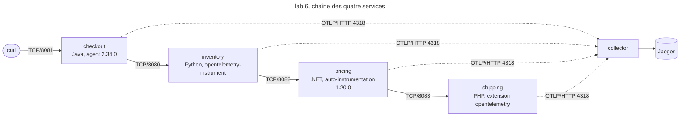
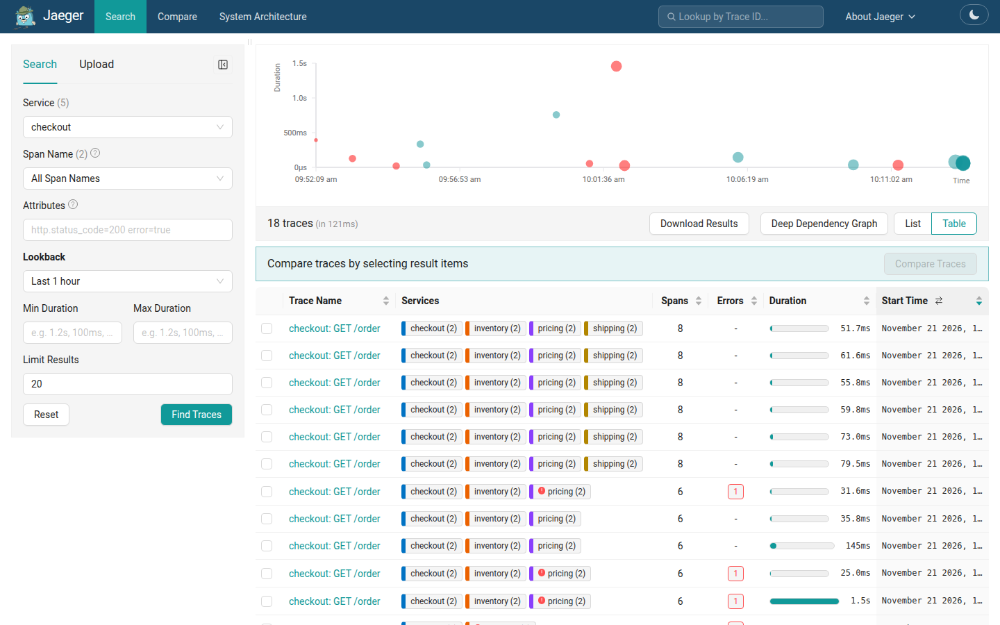
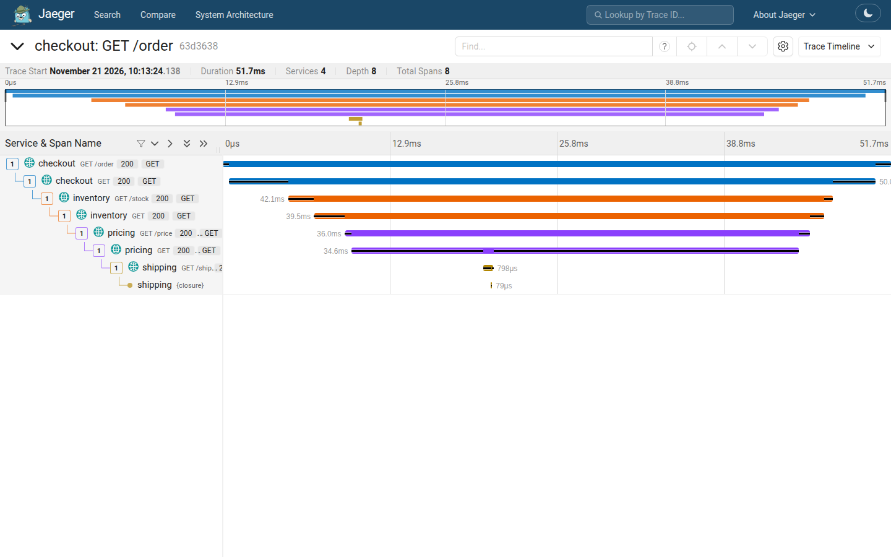

# Lab 6 : Java, Python, .NET et PHP, auto-instrumentation sur Linux

# Objectifs

<sub>1</sub> À la fin du lab, vous saurez :

- activer l'auto-instrumentation d'une application Java avec l'**agent** Java, sans modifier son code ;
- faire de même pour une application Python avec `opentelemetry-instrument` ;
- faire de même pour une application .NET sur Linux ;
- faire de même pour une application PHP, avec l'extension `opentelemetry` et les paquets Composer ;
- régler les quatre uniquement par des variables `OTEL_*` (nom de service, adresse du **collector**, attributs de ressource) ;
- obtenir une trace unique qui traverse les quatre services et comparer ce que chaque **agent** produit.

# Contenu

- [Environnement](#environnement)
- [1. Applications de départ et backends](#1-applications-de-départ-et-backends)
- [2. Java](#2-java)
- [3. Python](#3-python)
- [4. .NET](#4-net)
- [5. PHP](#5-php)
- [6. Trace multi-langages et comparaison](#6-trace-multi-langages-et-comparaison)
- [Cleanup](#cleanup)
- [Extra](#extra)

# Détail

## Environnement

Le lab se déroule sur deux machines :
- `clt-N` héberge le **collector** OpenTelemetry et le backend Jaeger ;
- `srv-N` héberge les quatre applications d'exemple (Java, Python, .NET, PHP) et leurs **agents** d'auto-instrumentation.

<sub>2</sub> Vous travaillez depuis le terminal web de `clt-N`. Les opérations sur `srv-N` sont pilotées à distance via des commandes SSH exécutées depuis ce terminal.

Prérequis : aucun lab préalable. Ce lab crée ses propres backends à la partie 1 : une instance Jaeger et un **collector** recevant en OTLP, sur `clt-N`. Les machines sont reconstruites par cloud-init : partez du principe qu'aucun service d'un lab précédent ne tourne encore, et que les ports 16686 et 4318 doivent être libres.

<sub>3</sub> Les quatre applications sont fournies dans le dépôt et recopiées sur `srv-N`. Chacune est volontairement minimale : un endpoint HTTP, un appel au service suivant, aucune bibliothèque OpenTelemetry.

Versions utilisées dans ce lab :

| Composant | Version |
|---|---|
| **agent** Java (`opentelemetry-javaagent`) | 2.34.0 |
| SDK Python (`opentelemetry-distro`) | 0.66b2 |
| Exporter OTLP Python (`opentelemetry-exporter-otlp-proto-http`) | 1.45.2 |
| Flask | 3.1.3 |
| requests | 2.34.2 |
| .NET | 10.0 (runtime ASP.NET Core) |
| Auto-instrumentation .NET | 1.20.0 (supporte .NET 10 et 11, abandonne .NET 8 et 9) |
| Extension PECL `opentelemetry` | 1.1.0 |
| SDK PHP (`open-telemetry/sdk`) | 1.7 |
| Exporter OTLP PHP (`open-telemetry/exporter-otlp`) | 1.2 |
| Slim (`slim/slim`) | 4.14 |
| OpenJDK | 21 (paquet `openjdk-21-jdk-headless`) |
| PHP | 8.3 (paquet `php8.3-cli`) |
| Jaeger | 2.23.0 |

<sub>4</sub> Le schéma suivant montre la chaîne : une requête entre par le service Java, qui appelle le service Python, qui appelle le service .NET, qui appelle le service PHP. Les quatre **agents** envoient au même **collector**.



## Ce que ce lab introduit, suppose et laisse

- Introduit : l'auto-instrumentation de quatre runtimes par quatre mécanismes différents (option de démarrage Java, point d'entrée Python, variables d'environnement .NET, extension PHP), la configuration par variables `OTEL_*` seule, et la comparaison des spans et des attributs produits par chaque **agent** sur une même requête.
- Suppose vu : rien, le lab est autonome et crée ses propres backends. La lecture d'une trace aide, et le [lab 1](Lab_01_Socle.md) la fournit.
- Laisse aux suivants : l'écriture de spans manuels et le contexte métier ([lab 7](Lab_07_Instrumentation_Manuelle.md)), la collecte et l'exploitation des logs ([lab 3](Lab_03_Kubernetes.md), [lab 7](Lab_07_Instrumentation_Manuelle.md)), l'audit des conventions et la corrélation des signaux ([lab 10](Lab_10_Exploitation.md)), le diagnostic ([lab 11](Lab_11_Diagnostic_Incident.md)).

## 1. Applications de départ et backends

Les backends de ce lab tiennent dans un fichier `compose.yaml` : un Jaeger et un **collector** qui reçoit en OTLP/HTTP.

<sub>5</sub> Sur `clt-N`, créez le dossier de travail `~/lab06` et déployez la stack du **collector** et de Jaeger :

```bash
mkdir -p ~/lab06/otelcol
cd ~/lab06

cat > compose.yaml <<'EOF'
name: lab06

services:
  jaeger:
    image: jaegertracing/jaeger:2.23.0
    ports:
      - "16686:16686"
    restart: unless-stopped

  otelcol:
    image: ghcr.io/open-telemetry/opentelemetry-collector-releases/opentelemetry-collector-contrib:0.165.0
    command:
      - --config=/etc/otelcol/receivers.yaml
      - --config=/etc/otelcol/exporters.yaml
      - --config=/etc/otelcol/service.yaml
    volumes:
      - ./otelcol:/etc/otelcol:ro
    ports:
      - "4318:4318"
    depends_on:
      - jaeger
    restart: unless-stopped
EOF

cat > otelcol/receivers.yaml <<'EOF'
receivers:
  otlp:
    protocols:
      http:
        endpoint: 0.0.0.0:4318
EOF

cat > otelcol/exporters.yaml <<'EOF'
exporters:
  otlp_http/jaeger:
    endpoint: http://jaeger:4318
EOF

cat > otelcol/service.yaml <<'EOF'
service:
  pipelines:
    traces:
      receivers: [otlp]
      exporters: [otlp_http/jaeger]
EOF

docker compose up -d
docker compose ps --format '{{.Service}} {{.State}}'
```

```text
jaeger running
otelcol running
```

Sur `clt-N`, vérifiez que les deux conteneurs locaux répondent :

```bash
curl -s http://localhost:16686/api/v3/services
curl -s -o /dev/null -w 'collector OTLP : %{http_code}\n' \
  -X POST http://localhost:4318/v1/traces -H 'Content-Type: application/json' -d '{}'
```

```text
{"services":["jaeger"]}
collector OTLP : 200
```

> [!NOTE]
>
> Ce lab n'utilise que le signal traces, et sans processor : la configuration du **collector** tient en trois fichiers. Le [lab 1](Lab_01_Socle.md) détaille les quatre sections, les processors et le fan-out ; ce lab reprend la même logique en version minimale.

> [!NOTE]
>
> Si l'API renvoie `{"services":[]}` tout de suite après le démarrage, attendez quelques secondes et réinterrogez : Jaeger enregistre le service `jaeger` lui-même une fois sa télémétrie interne démarrée.

<sub>6</sub> Depuis `clt-N`, préparez le dossier `~/lab06` sur `srv-N` et transférez-y les quatre applications fournies par SCP :

```bash
ssh $SRV_HOST 'mkdir -p ~/lab06'
scp -r ~/opentelemetry-labs/config/lab06/. $SRV_HOST:~/lab06/
ssh $SRV_HOST 'ls ~/lab06'
```

```text
checkout.java  inventory.py  pricing  shipping
```

`pricing` est un projet .NET (`pricing.csproj` et `Program.cs`), compilé à la partie 4.

<sub>7</sub> Les quatre applications s'appellent en cascade. Voici leur comportement, pour comprendre les traces que vous verrez ensuite :

- `checkout` (Java, `TCP/8081`) répond à `GET /order` et appelle `inventory` ;
- `inventory` (Python, `TCP/8080`) répond à `GET /stock` et appelle `pricing` ;
- `pricing` (.NET, `TCP/8082`) répond à `GET /price` et appelle `shipping` ;
- `shipping` (PHP, `TCP/8083`) répond à `GET /ship` et ne dépend de rien.

Sans instrumentation, une requête produit quatre lignes de log séparées et aucune trace.

## 2. Java

<sub>8</sub> Depuis le terminal de `clt-N`, installez le JRE OpenJDK 21 et téléchargez l'**agent** Java sur `srv-N` via SSH :

```bash
ssh $SRV_HOST 'apt-get update -qq && apt-get install -y -qq openjdk-21-jdk-headless'
ssh $SRV_HOST 'mkdir -p ~/lab06/java && cd ~/lab06/java && \
  curl -fsSL -o opentelemetry-javaagent.jar \
  https://github.com/open-telemetry/opentelemetry-java-instrumentation/releases/download/v2.34.0/opentelemetry-javaagent.jar'
ssh $SRV_HOST 'java -version 2>&1 | head -1'
```

```text
openjdk version "21.0.x"
```

L'**agent** Java se fixe à la machine virtuelle au démarrage, par l'option `-javaagent`. Aucune ligne de code ne change. Toujours depuis `clt-N`, compilez le service `checkout` sur `srv-N` :

```bash
ssh $SRV_HOST 'cd ~/lab06 && javac checkout.java && ls checkout.class'
```

```text
checkout.class
```

<sub>9</sub> Démarrez ensuite le service `checkout` sur `srv-N` via SSH en lui attachant l'**agent** Java et en configurant l'export OTLP vers le **collector** sur `clt-N` (`http://$CLT_HOST:4318`) :

```bash
ssh $SRV_HOST 'cd ~/lab06 && \
  OTEL_SERVICE_NAME=checkout \
  OTEL_EXPORTER_OTLP_ENDPOINT=http://'"$CLT_HOST"':4318 \
  OTEL_EXPORTER_OTLP_PROTOCOL=http/protobuf \
  OTEL_RESOURCE_ATTRIBUTES=deployment.environment.name=lab6,lab.id='"$LAB_ID"' \
  setsid nohup java -javaagent:./java/opentelemetry-javaagent.jar -cp . checkout \
  > /tmp/checkout.log 2>&1 < /dev/null &'
sleep 4
ssh $SRV_HOST 'tail -2 /tmp/checkout.log'
```

```text
checkout listening on 8081
```

> [!NOTE]
>
> Trois éléments à retenir sur ce lancement. D'abord, le mode source-file (`java checkout.java`, qui compile à la volée) ne convient pas : il charge le compilateur en mémoire, l'**agent** détecte un outil JDK et se désactive avec le message `JDK tool detected, agent will not be started`. Ensuite, `-javaagent` doit précéder `-cp` et la classe, l'**agent** devant s'attacher avant le chargement des classes. Enfin, `setsid` détache le service de la session SSH : un service lancé par SSH et détaché avec `nohup` seul peut être tué à la fermeture de la session ; `setsid` le rend indépendant de la session tout entière, et `< /dev/null` lui évite de lire le terminal. Les quatre lancements de ce lab suivent ce schéma. L'**agent** instrumente les bibliothèques du JDK et les clients HTTP sans déclaration spécifique, ce qui génère le span client vers `inventory` sans code dédié.

Sur `clt-N`, envoyez une requête HTTP vers `checkout` sur `srv-N` (port 8081), puis vérifiez dans Jaeger (local sur `clt-N`) que le service s'est enregistré :

```bash
curl -s http://$SRV_HOST:8081/order
sleep 5
curl -s "http://localhost:16686/api/v3/services" | jq -c '.services'
```

```json
{"orders":"1 mug","inventory":{"error":"ConnectException"}}
{"services":["checkout","jaeger"]}
```

<sub>10</sub> Le service `checkout` est enregistré dans Jaeger. Sa trace contient pour l'instant deux spans : le span serveur de la requête et le span client vers `inventory`. Ce dernier échoue avec `ConnectException` car le service Python n'est pas encore démarré.

## 3. Python

Depuis le terminal de `clt-N`, installez l'environnement virtuel Python et les paquets OpenTelemetry sur `srv-N` via SSH :

```bash
ssh $SRV_HOST 'apt-get install -y -qq python3-venv'
ssh $SRV_HOST 'python3 -m venv ~/lab06/venv && ~/lab06/venv/bin/pip -q install \
  flask==3.1.3 requests==2.34.2 \
  opentelemetry-distro==0.66b2 \
  opentelemetry-exporter-otlp-proto-http==1.45.2'
ssh $SRV_HOST '~/lab06/venv/bin/opentelemetry-bootstrap -a install 2>&1 | tail -3'
```

<sub>11</sub> `opentelemetry-bootstrap -a install` installe les instrumentations correspondant aux bibliothèques présentes, ici `flask` et `requests`.

Depuis `clt-N`, démarrez le service Python `inventory` sur `srv-N` via SSH avec la commande `opentelemetry-instrument`, en configurant l'export OTLP vers le **collector** sur `clt-N` :

```bash
ssh $SRV_HOST 'cd ~/lab06 && \
  OTEL_SERVICE_NAME=inventory \
  OTEL_EXPORTER_OTLP_ENDPOINT=http://'"$CLT_HOST"':4318 \
  OTEL_EXPORTER_OTLP_PROTOCOL=http/protobuf \
  OTEL_RESOURCE_ATTRIBUTES=deployment.environment.name=lab6,lab.id='"$LAB_ID"' \
  setsid nohup ~/lab06/venv/bin/opentelemetry-instrument \
  ~/lab06/venv/bin/python inventory.py > /tmp/inventory.log 2>&1 < /dev/null &'
sleep 4
ssh $SRV_HOST 'tail -2 /tmp/inventory.log'
```

```text
inventory listening on 8080
```

> [!NOTE]
>
> En Python, il n'y a pas d'option de JVM ni de variable `NODE_OPTIONS`. L'**agent** est un point d'entrée : `opentelemetry-instrument` remplace `python` et pose les hooks avant l'import de l'application.

<sub>12</sub> Sur `clt-N`, sollicitez à nouveau l'entrée de la chaîne (`checkout` sur `srv-N:8081`) et vérifiez dans Jaeger sur `clt-N` que `inventory` apparaît :

```bash
curl -s http://$SRV_HOST:8081/order
sleep 5
curl -s "http://localhost:16686/api/v3/services" | jq -c '.services'
```

```json
{"orders":"1 mug","inventory":{"sku":"1 mug","price":{"error":"ConnectionError"}}}
{"services":["checkout","inventory","jaeger"]}
```

`inventory` apparaît désormais dans Jaeger. L'appel vers `pricing` échoue avec `ConnectionError` car le service .NET n'est pas encore lancé.

## 4. .NET

<sub>13</sub> Depuis le terminal de `clt-N`, installez le SDK .NET 10 sur `srv-N` via SSH et compilez le service `pricing` :

```bash
ssh $SRV_HOST 'curl -fsSL https://dot.net/v1/dotnet-install.sh -o /tmp/dotnet-install.sh && \
  bash /tmp/dotnet-install.sh --channel 10.0 --install-dir /usr/share/dotnet && \
  ln -sf /usr/share/dotnet/dotnet /usr/local/bin/dotnet'
ssh $SRV_HOST 'export DOTNET_CLI_TELEMETRY_OPTOUT=1 DOTNET_NOLOGO=1; \
  cd ~/lab06/pricing && dotnet publish -c Release -o out 2>&1 | tail -3'
ssh $SRV_HOST 'ls ~/lab06/pricing/out/pricing.dll'
```

```text
/root/lab06/pricing/out/pricing.dll
```

L'auto-instrumentation .NET n'est pas un paquet applicatif : c'est un ensemble de bibliothèques natives chargées par le profileur CLR, plus un script qui exporte les variables nécessaires. Depuis `clt-N`, téléchargez et extrayez le paquet d'auto-instrumentation sur `srv-N` via SSH :

```bash
ssh $SRV_HOST 'apt-get install -y -qq unzip'
ssh $SRV_HOST 'mkdir -p ~/lab06/dotnet && cd ~/lab06/dotnet && \
  curl -fsSL -o oi.tar.gz \
  https://github.com/open-telemetry/opentelemetry-dotnet-instrumentation/releases/download/v1.20.0/opentelemetry-dotnet-instrumentation-linux-glibc-x64.zip'
ssh $SRV_HOST 'cd ~/lab06/dotnet && unzip -q oi.tar.gz && ls'
```

```text
LICENSE  OpenTelemetry.AutoInstrumentation.Native.so  instrument.sh  linux-x64  net  ...
```

> [!NOTE]
>
> L'auto-instrumentation 1.20.0 supporte .NET 10 et 11. C'est pourquoi le service cible `net10.0`. Avec une version plus ancienne de l'auto-instrumentation, l'application ne démarrerait pas ou resterait sans spans.

<sub>14</sub> Depuis `clt-N`, démarrez le service .NET `pricing` sur `srv-N` via SSH au moyen du script `instrument.sh`, en configurant l'export OTLP vers le **collector** sur `clt-N` :

```bash
ssh $SRV_HOST 'cd ~/lab06 && \
  OTEL_SERVICE_NAME=pricing \
  OTEL_EXPORTER_OTLP_ENDPOINT=http://'"$CLT_HOST"':4318 \
  OTEL_EXPORTER_OTLP_PROTOCOL=http/protobuf \
  OTEL_RESOURCE_ATTRIBUTES=deployment.environment.name=lab6,lab.id='"$LAB_ID"' \
  OTEL_DOTNET_AUTO_HOME=/root/lab06/dotnet \
  setsid nohup sh /root/lab06/dotnet/instrument.sh dotnet /root/lab06/pricing/out/pricing.dll \
  > /tmp/pricing.log 2>&1 < /dev/null &'
sleep 5
ssh $SRV_HOST 'tail -3 /tmp/pricing.log'
```

```text
      Hosting environment: Production
info: Microsoft.Hosting.Lifetime[0]
      Content root path: /root/lab06
```

> [!NOTE]
>
> Contrairement aux trois autres services, le service .NET n'affiche pas de message de démarrage explicite : les lignes ci-dessus, écrites par ASP.NET Core, signalent qu'il est prêt. Le port se vérifie par un appel : `curl -s http://$SRV_HOST:8082/price`.

> [!NOTE]
>
> Sur .NET, l'activation passe par le profileur CLR (`CORECLR_ENABLE_PROFILING`, `CORECLR_PROFILER`), que le script `instrument.sh` exporte. Le script cherche ses fichiers dans `OTEL_DOTNET_AUTO_HOME`, qui vaut par défaut `~/.otel-dotnet-auto` : sans cette variable, il échoue avec `There are no files under the location specified via OTEL_DOTNET_AUTO_HOME`.

Sur `clt-N`, testez la chaîne des trois premiers services en envoyant une requête vers `checkout` sur `srv-N:8081`, puis contrôlez les services enregistrés dans Jaeger sur `clt-N` :

```bash
curl -s http://$SRV_HOST:8081/order
sleep 5
curl -s "http://localhost:16686/api/v3/services" | jq -c '.services'
```

```json
{"orders":"1 mug","inventory":{"sku":"1 mug","price":{"currency":"EUR","amount":12.5,"shipping":{"error":"HttpRequestException"}}}}
{"services":["checkout","inventory","jaeger","pricing"]}
```

<sub>15</sub> `pricing` est maintenant actif et enregistré dans Jaeger. L'appel vers `shipping` échoue encore avec `HttpRequestException` : le service PHP est déployé à la partie suivante.

## 5. PHP

Depuis le terminal de `clt-N`, installez PHP 8.3, l'extension `opentelemetry` et Composer sur `srv-N` via SSH :

```bash
ssh $SRV_HOST 'apt-get install -y -qq php8.3-cli php8.3-curl php8.3-xml php8.3-mbstring unzip composer php-pear php8.3-dev build-essential'
ssh $SRV_HOST 'pecl install opentelemetry-1.1.0'
ssh $SRV_HOST 'echo "extension=opentelemetry.so" > /etc/php/8.3/cli/conf.d/20-opentelemetry.ini; php -m | grep opentelemetry'
```

```text
opentelemetry
```

> [!NOTE]
>
> `pecl` provient du paquet `php-pear`, et la compilation de l'extension nécessite `php8.3-dev` et les outils de compilation (`build-essential`). L'extension `opentelemetry` de PHP se compile à l'installation.

<sub>16</sub> L'extension seule fournit les points d'accroche ; les paquets Composer déterminent ce qui est instrumenté. Depuis `clt-N`, installez l'application et ses dépendances sur `srv-N` via SSH :

```bash
ssh $SRV_HOST 'cd ~/lab06/shipping && composer install --no-interaction --no-progress 2>&1 | tail -3'
ssh $SRV_HOST 'ls ~/lab06/shipping/vendor/open-telemetry'
```

```text
api  context  exporter-otlp  gen-otlp-protobuf  opentelemetry-auto-slim  sdk  sem-conv
```

> [!NOTE]
>
> L'exporter OTLP en HTTP a besoin d'un client PSR-18 pour envoyer les requêtes. Le `composer.json` fourni contient donc `guzzlehttp/guzzle`. Sans lui, chaque requête lève l'avertissement `No PSR-18 clients found. Make sure to install a package providing "psr/http-client-implementation"`, et aucun span n'est envoyé.

Depuis `clt-N`, démarrez le service PHP `shipping` sur `srv-N` via SSH avec le serveur intégré de PHP, en activant l'autoload et en configurant l'export OTLP vers le **collector** sur `clt-N` :

```bash
ssh $SRV_HOST "cd ~/lab06/shipping && \
  OTEL_PHP_AUTOLOAD_ENABLED=true \
  OTEL_SERVICE_NAME=shipping \
  OTEL_EXPORTER_OTLP_ENDPOINT=http://$CLT_HOST:4318 \
  OTEL_EXPORTER_OTLP_PROTOCOL=http/protobuf \
  OTEL_RESOURCE_ATTRIBUTES=deployment.environment.name=lab6,lab.id=$LAB_ID \
  setsid nohup php -S 0.0.0.0:8083 -t public > /tmp/shipping.log 2>&1 < /dev/null &"
sleep 4
ssh $SRV_HOST 'tail -2 /tmp/shipping.log'
```

```text
[Fri Nov 21 ...] PHP 8.3.x Development Server (http://0.0.0.0:8083) started
```

> [!NOTE]
>
> En PHP, l'activation repose sur deux éléments indispensables : l'extension `opentelemetry` fournit les points d'accroche au niveau du moteur d'exécution, et la variable `OTEL_PHP_AUTOLOAD_ENABLED=true` déclenche l'enregistrement automatique du SDK à chaque requête entrante.

<sub>17</sub> Sur `clt-N`, testez la cascade complète des quatre services en appelant `checkout` sur `srv-N:8081`, puis vérifiez l'enregistrement de l'ensemble des services dans Jaeger sur `clt-N` :

```bash
curl -s http://$SRV_HOST:8081/order
sleep 5
curl -s "http://localhost:16686/api/v3/services" | jq -c '.services'
```

```json
{"orders":"1 mug","inventory":{"sku":"1 mug","price":{"currency":"EUR","amount":12.5,"shipping":{"carrier":"colissimo","eta_days":2}}}}
{"services":["checkout","inventory","jaeger","pricing","shipping"]}
```

> [!NOTE]
>
> L'exemple de la documentation PHP est souvent un script unique servi par le serveur intégré. Cela fonctionne pour l'export, mais pas pour l'instrumentation automatique de l'entrée HTTP : il n'y a pas de framework à intercepter. C'est pourquoi le service utilise Slim, dont l'instrumentation est fournie par `opentelemetry-auto-slim`. Pour reprendre l'esprit de l'application PHP de démonstration du lab d'origine, c'est la même mécanique qui s'appliquerait, avec un framework plutôt qu'avec un script nu.

## 6. Trace multi-langages et comparaison

Sur `clt-N`, envoyez quelques requêtes vers `srv-N` puis ouvrez Jaeger dans le navigateur (`http://$CLT_HOST:16686` ou `http://localhost:16686`) et sélectionnez le service `checkout`. Une requête produit une trace unique à travers les quatre langages, grâce au propagateur W3C `tracecontext`, actif par défaut dans les quatre **agents** :



<sub>18</sub> Depuis `clt-N`, interrogez l'API de Jaeger pour analyser les types de spans composant la trace :

```bash
for i in $(seq 5); do curl -s http://$SRV_HOST:8081/order > /dev/null; done
sleep 5
curl -s "http://localhost:16686/api/v3/traces?query.service_name=checkout&query.startTimeMin=$(date -u -d '10 minutes ago' +%Y-%m-%dT%H:%M:%SZ)&query.startTimeMax=$(date -u -d '+1 minute' +%Y-%m-%dT%H:%M:%SZ)" \
  | jq -r '[.result.resourceSpans[].scopeSpans[].spans[] | "\(.kind) \(.name)"] | unique | .[]' | sort
```

```text
1 {closure}
2 GET /order
2 GET /price
2 GET /ship
2 GET /stock
3 GET
```

Les kinds se lisent ainsi : `2` désigne un span serveur, `3` un span client, et `1` un span interne. On retrouve les quatre spans serveur (un par service et par langage) ainsi que les spans client qui les relient (regroupés sous la ligne `3 GET` par le filtre `unique`). Le span interne `{closure}` est produit par le middleware de Slim côté PHP :



<sub>19</sub> Sur `clt-N`, comparez maintenant les attributs de ressource collectés par Jaeger pour chaque service :

```bash
curl -s "http://localhost:16686/api/v3/traces?query.service_name=checkout&query.startTimeMin=$(date -u -d '10 minutes ago' +%Y-%m-%dT%H:%M:%SZ)&query.startTimeMax=$(date -u -d '+1 minute' +%Y-%m-%dT%H:%M:%SZ)" \
  | jq -r '[.result.resourceSpans[].resource.attributes[] | "\(.key)=\(.value.stringValue // .value.intValue)"] | unique | .[]' | sort | grep -E "telemetry|service.name|deployment"
```

```text
deployment.environment.name=lab6
service.name=checkout
service.name=inventory
service.name=pricing
service.name=shipping
telemetry.auto.version=0.66b2
telemetry.distro.name=opentelemetry-dotnet-instrumentation
telemetry.distro.name=opentelemetry-java-instrumentation
telemetry.distro.name=opentelemetry-php-instrumentation
telemetry.distro.version=1.1.0
telemetry.distro.version=1.20.0
telemetry.distro.version=2.34.0
telemetry.sdk.language=dotnet
telemetry.sdk.language=java
telemetry.sdk.language=php
telemetry.sdk.language=python
telemetry.sdk.name=opentelemetry
telemetry.sdk.version=1.17.0
telemetry.sdk.version=1.21.0
telemetry.sdk.version=1.45.2
telemetry.sdk.version=1.68.0
```

Trois différences sont notables :

- **`telemetry.sdk.language`** vaut `java`, `python`, `dotnet` ou `php` selon le service ;
- **les noms de spans** varient : Java produit `GET /order`, Python `GET /stock`, .NET `GET /price` et PHP `GET /ship`, chaque instrumentation appliquant les conventions de son framework HTTP ;
- **les versions de SDK** varient également (`1.68.0` pour l'**agent** Java, `1.45.2` pour le SDK Python, `1.21.0` pour le SDK .NET, `1.17.0` pour le SDK PHP), chaque écosystème suivant son propre cycle de publication.

> [!NOTE]
>
> La propagation entre langages ne demande aucune configuration supplémentaire parce que les quatre **agents** utilisent `tracecontext` par défaut. Si un service n'apparaissait pas dans la trace, la première vérification est l'en-tête `traceparent` sur l'appel sortant, et la seconde le propagator configuré par `OTEL_PROPAGATORS`.

## Cleanup

<sub>20</sub> Le cleanup remet les deux machines dans leur état initial.

Depuis le terminal de `clt-N`, arrêtez les quatre services applicatifs sur `srv-N` via SSH et désinstallez les paquets ajoutés :

```bash
ssh $SRV_HOST 'pkill -f "[j]ava.*checkout"; pkill -f "[i]nventory.py"; \
  pkill -f "[p]ricing.dll"; pkill -f "[p]hp -S"'
ssh $SRV_HOST 'rm -rf ~/lab06 /usr/share/dotnet /usr/local/bin/dotnet'
ssh $SRV_HOST 'pecl uninstall opentelemetry; rm -f /etc/php/8.3/cli/conf.d/20-opentelemetry.ini'
ssh $SRV_HOST 'apt-get purge -y openjdk-21-jdk-headless python3-venv php8.3-cli php8.3-curl php8.3-xml php8.3-mbstring composer unzip php-pear php8.3-dev build-essential'
```

<sub>21</sub> Les services étaient lancés en `nohup`, sans service systemd : `pkill` suffit. Les motifs sont écrits avec des crochets (par exemple `[j]ava.*checkout` ou `[i]nventory.py`) pour éviter que `pkill -f` ne cible le shell SSH qui exécute la commande.

Depuis `clt-N`, vérifiez par SSH que les processus applicatifs sont arrêtés sur `srv-N` :

```bash
ssh $SRV_HOST 'pgrep -af "[j]ava.*checkout|[i]nventory.py|[p]ricing.dll|[p]hp -S" || echo "aucun service"'
```

```text
aucun service
```

<sub>22</sub> Sur `clt-N`, arrêtez les conteneurs du **collector** et de Jaeger puis supprimez le dossier de travail :

```bash
cd ~/lab06 && docker compose down -v
rm -rf ~/lab06
```

Sur `clt-N`, vérifiez que les ports locaux 16686 et 4318 sont libérés :

```bash
ss -ltn | grep -E ':(16686|4318) ' || echo "ports libres"
```

```text
ports libres
```

## Extra

<sub>23</sub> Cet exercice optionnel permet d'approfondir les options d'auto-instrumentation disponibles via les variables d'environnement.

- Désactivez une instrumentation précise par variable d'environnement, par exemple `OTEL_PYTHON_DISABLED_INSTRUMENTATIONS=requests`, et observez la disparition du span client.
- Excluez un endpoint du traçage avec `OTEL_PYTHON_FLASK_EXCLUDED_URLS=/health`.
- Ajoutez un attribut de ressource propre à chaque service depuis la ligne de commande, et vérifiez qu'il apparaît dans Jaeger.
