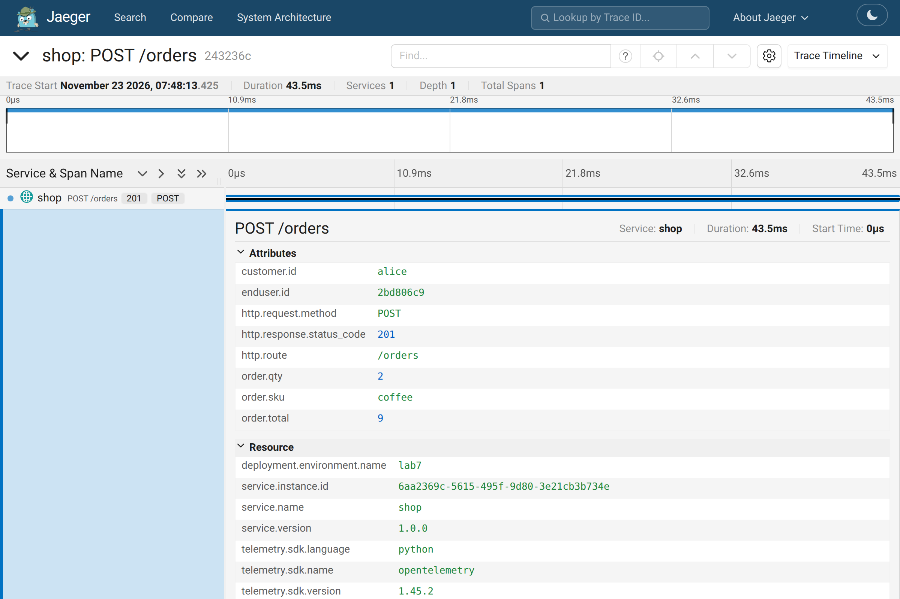
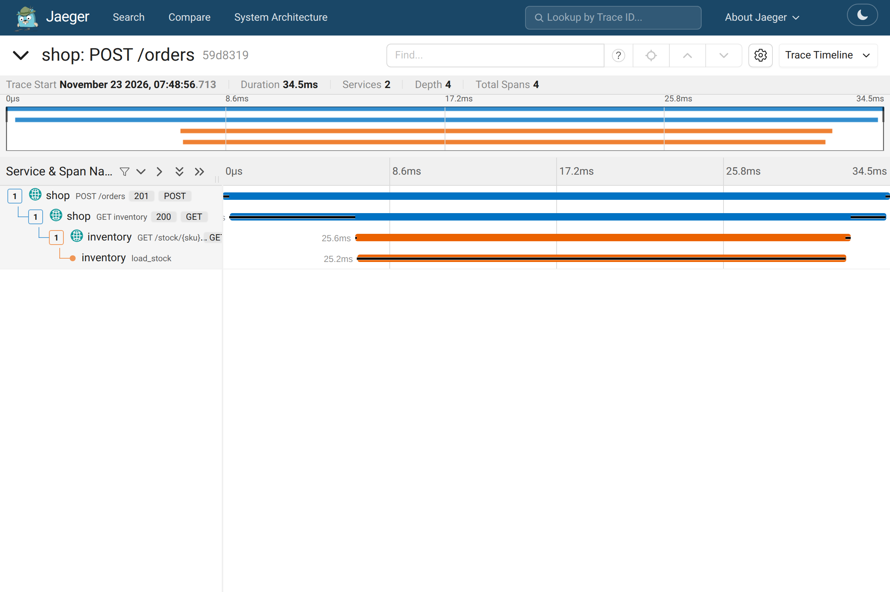
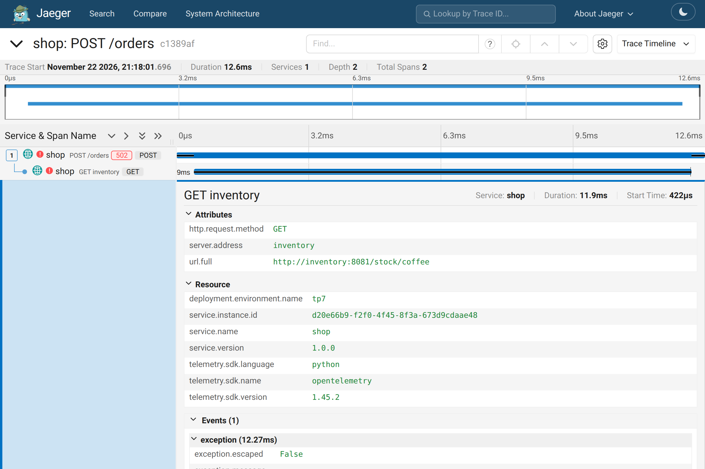

# Lab 7 : Instrumenter une application Python à la main

# Objectifs

À la fin du lab, vous saurez :

- configurer le SDK OpenTelemetry pour Python (`Resource`, `TracerProvider`, `BatchSpanProcessor`, `OTLPSpanExporter`) ;
- créer des spans avec un type (`SpanKind`), des attributs métier et HTTP, des événements et un statut d'erreur ;
- propager le contexte de trace entre microservices via l'en-tête W3C `traceparent` (`inject` et `extract`) ;
- faire voyager une donnée métier d'un service à l'autre avec le baggage W3C, et connaître ses limites ;
- anonymiser des données personnelles sensibles (`enduser.id`) au niveau du **collector** avant export vers le backend ;
- analyser dans Jaeger la hiérarchie d'une trace distribuée et le comportement lors d'une panne réseau.

# Contenu

- [Environnement](#environnement)
- [1. Démarrer l'application sans instrumentation](#1-démarrer-lapplication-sans-instrumentation)
- [2. Configurer le SDK](#2-configurer-le-sdk)
- [3. Créer des spans dans shop](#3-créer-des-spans-dans-shop)
- [4. Propager le contexte entre les services](#4-propager-le-contexte-entre-les-services)
- [Cleanup](#cleanup)
- [Extra](#extra)

# Détail

## Environnement

Ce lab se déroule sur la machine cliente `clt-N` (N est votre numéro de participant), dans le dossier `~/lab07`. La machine serveur `srv-N` n'est pas sollicitée dans ce lab.

Vous travaillez depuis le terminal web de `clt-N`, dans `/root`, où le dépôt des labs est cloné dans `/root/opentelemetry-labs`.

L'application d'exemple se compose de deux services : `shop` reçoit les commandes et interroge `inventory` pour vérifier la disponibilité des stocks. Vous allez instrumenter ce code Python manuellement en utilisant l'API et le SDK OpenTelemetry, sans recourir à un agent d'auto-instrumentation.

Le [lab 1](Lab_01_Socle.md) est recommandé pour comprendre le rôle du **collector** et le format OTLP. Aucune expertise en développement Python n'est nécessaire : les extraits de code sont courts, abondamment commentés et accompagnés d'explications sur les idiomes du langage.

Versions utilisées dans ce lab :

| Composant | Version |
|---|---|
| Python (image de l'application) | 3.13.18 |
| API, SDK et exporter OTLP/HTTP OpenTelemetry pour Python | 1.45.2 |
| Flask, requests | 3.1.3, 2.34.2 |
| **collector** OpenTelemetry (distribution `otelcol-contrib`) | 0.165.0 |
| Jaeger | 2.23.0 |

L'interface web de Jaeger est accessible depuis votre navigateur sur `clt-N` : `http://$CLT_HOST:16686` (TCP/16686).

## 1. Démarrer l'application sans instrumentation

Sur `clt-N`, copiez les fichiers fournis dans le dossier de travail `~/lab07`, puis construisez et démarrez la stack Docker :

```bash
mkdir -p ~/lab07
cp -r ~/opentelemetry-labs/config/lab07/. ~/lab07/
cd ~/lab07
docker compose up -d --build
docker compose ps
```

La stack comprend l'application (`shop` sur le port 8080 et `inventory` sur le port 8081), un **collector** local recevant sur le port 4318 et une instance Jaeger exposée sur le port 16686.

Le dossier `app/` contient le code source Python. Les modules `orders.py` et `stock.py` portent la logique métier et ne sont pas modifiés. Au fil du lab, vous allez compléter quatre modules : `telemetry.py`, `shop_handler.py`, `inventory_handler.py` et `inventory_client.py`. Leurs versions initiales ne produisent aucune télémétrie.

Le dossier `app/` est monté en volume dans les conteneurs : après chaque modification de fichier, un redémarrage des conteneurs applicatifs avec `docker compose restart shop inventory` suffit pour appliquer vos changements sans reconstruire l'image.

Sur `clt-N`, envoyez trois commandes de test à l'aide du script `order.sh` (articles connus : `coffee` avec un stock de 12, `mug` avec un stock de 3, et `tea` en rupture avec un stock de 0) :

```bash
./order.sh coffee 2 alice
./order.sh mug 5 bob
./order.sh pizza
```

On obtient, le code HTTP de réponse étant affiché entre crochets :

```text
{"status":"accepted","total":9.0} [201]
{"error":"insufficient stock","stock":3} [409]
{"error":"unknown sku"} [404]
```

Sur `clt-N`, vérifiez les services enregistrés dans Jaeger :

```bash
curl -s http://localhost:16686/api/v3/services | jq -r '.services[]'
```

La commande ne retourne que `jaeger`. L'application fonctionne, mais n'émet aucune donnée d'observabilité.

## 2. Configurer le SDK

Pour produire des traces, une application doit initialiser un `TracerProvider`. Cet objet gère la configuration globale du traçage : il définit qui émet la télémétrie (la ressource), comment traiter les spans terminés (le processor) et vers quelle destination les expédier (l'exporter).

Vous allez écrire le module `telemetry.py`, que `shop.py` et `inventory.py` appellent au démarrage en lui passant le nom de leur service respectif.

> [!NOTE]
>
> Pour les participants non familiers de Python ou du SDK OpenTelemetry, voici les rôles des cinq composants manipulés :
> - `Resource` : ensemble d'attributs décrivant l'entité émettrice (`service.name`, `service.version`, `deployment.environment.name`). Ces métadonnées sont automatiquement attachées à chaque span.
> - `TracerProvider` : fabrique centrale responsable de la création des traceurs (`Tracer`) et de l'orchestration des processeurs de spans.
> - `BatchSpanProcessor` : processeur qui place les spans terminés dans une file d'attente en mémoire vive et les expédie par lots réguliers, évitant de pénaliser les performances de l'application avec un appel réseau à chaque fin de span.
> - `OTLPSpanExporter` : client d'exportation qui transmet les données au **collector** en HTTP/protobuf sur le port 4318. Instancié sans paramètre, il lit automatiquement la variable d'environnement standard `OTEL_EXPORTER_OTLP_ENDPOINT` définie dans `compose.yaml`.
> - `trace.set_tracer_provider` : déclare cette instance comme le fournisseur global du processus Python, accessible par tout module via `trace.get_tracer()`.

Sur `clt-N`, créez `app/telemetry.py` :

```bash
cat > app/telemetry.py <<'EOF'
"""Configuration du SDK OpenTelemetry pour Python.

Ce module initialise le TracerProvider et l'exportateur OTLP/HTTP.
Il est appelé par shop.py et inventory.py au démarrage.
"""

from opentelemetry import trace
from opentelemetry.exporter.otlp.proto.http.trace_exporter import OTLPSpanExporter
from opentelemetry.sdk.resources import Resource
from opentelemetry.sdk.trace import TracerProvider
from opentelemetry.sdk.trace.export import BatchSpanProcessor


def setup(service_name):
    # 1. Définition de la ressource : identifie l'application émettrice.
    # Ces attributs accompagnent chaque span produit par ce service.
    resource = Resource.create(
        {
            "service.name": service_name,
            "service.version": "1.0.0",
            "deployment.environment.name": "lab7",
        }
    )

    # 2. Création du TracerProvider : point d'entrée central du SDK.
    provider = TracerProvider(resource=resource)

    # 3. Ajout du BatchSpanProcessor : regroupe les spans en mémoire
    # et les envoie par lots via l'exportateur OTLP/HTTP.
    # L'exportateur lit la variable d'environnement OTEL_EXPORTER_OTLP_ENDPOINT
    # (configurée dans compose.yaml, ex. http://otelcol:4318).
    exporter = OTLPSpanExporter()
    processor = BatchSpanProcessor(exporter)
    provider.add_span_processor(processor)

    # 4. Enregistrement comme TracerProvider global : tout appel ultérieur
    # à trace.get_tracer() utilisera ce provider et sa configuration.
    trace.set_tracer_provider(provider)
EOF
```

Sur `clt-N`, redémarrez les conteneurs applicatifs, puis validez le bon fonctionnement du SDK en exécutant un court script de test dans le conteneur `shop` :

```bash
docker compose restart shop inventory
docker compose exec -T shop python - <<'EOF'
import telemetry
from opentelemetry import trace

telemetry.setup("smoke-test")
tracer = trace.get_tracer("smoke-test")
with tracer.start_as_current_span("hello"):
    pass
trace.get_tracer_provider().shutdown()
EOF
```

> [!NOTE]
>
> La syntaxe `python - <<'EOF'` permet d'exécuter un script Python éphémère transmis sur l'entrée standard du conteneur. L'appel explicite à `shutdown()` force le vidage immédiat de la file d'attente du `BatchSpanProcessor` avant la fin du processus.

Interrogez l'API de Jaeger sur `clt-N` :

```bash
curl -s http://localhost:16686/api/v3/services | jq -c '.services'
```

La liste contient désormais `smoke-test`.

Passez une commande avec `./order.sh coffee 2 alice` : la commande réussit, mais ni `shop` ni `inventory` n'apparaissent encore dans Jaeger. L'initialisation du SDK ne génère aucune télémétrie par elle-même : il faut maintenant instrumenter le code qui traite les requêtes.

## 3. Créer des spans dans shop

Le module `shop_handler.py` constitue le point d'entrée HTTP de `POST /orders` : il reçoit les données de commande et appelle la logique de `orders.py`. Vous allez encapsuler ce traitement dans un span OpenTelemetry.

> [!NOTE]
>
> Éléments de syntaxe Python utilisés dans ce module :
> - L'instruction `with tracer.start_as_current_span(...) as span:` est un gestionnaire de contexte. Elle démarre le span au début du bloc et le clôture automatiquement à la sortie du bloc (en calculant la durée exacte), y compris en cas de levée d'exception.
> - La méthode `payload.get("clé", valeur_par_défaut)` extrait une valeur d'un dictionnaire sans lever d'erreur `KeyError` si la clé est absente.
> - `SpanKind.SERVER` indique que ce span mesure le traitement d'une requête réseau entrante reçue par le service.

Sur `clt-N`, écrivez la version instrumentée de `app/shop_handler.py` :

```bash
cat > app/shop_handler.py <<'EOF'
"""Gestionnaire des commandes pour le service shop.

Ce module intercepte les requêtes POST /orders, crée un span serveur OpenTelemetry,
y attache les attributs métier et HTTP, et gère les statuts d'erreur et événements.
"""

from opentelemetry import trace
from opentelemetry.propagate import extract
from opentelemetry.trace import SpanKind, Status, StatusCode

import orders

# Récupération d'un traceur nommé pour le module shop.
tracer = trace.get_tracer("shop")


def create_order(payload, headers):
    # 1. Extraction du contexte parent éventuel depuis les en-têtes HTTP de la requête.
    # Si le client envoie un en-tête W3C 'traceparent', ce span deviendra son enfant.
    parent_context = extract(headers)

    # 2. Création et ouverture du span serveur couvrant le traitement de la commande.
    # L'instruction 'with' en Python garantit que le span est démarré au début du bloc
    # et automatiquement fermé (avec calcul de durée) dès la sortie du bloc.
    with tracer.start_as_current_span(
        "POST /orders",
        context=parent_context,
        kind=SpanKind.SERVER,
    ) as span:
        # 3. Attributs conformes aux conventions sémantiques OpenTelemetry HTTP
        span.set_attribute("http.request.method", "POST")
        span.set_attribute("http.route", "/orders")

        # 4. Attributs métier spécifiques à l'application e-commerce
        span.set_attribute("order.sku", str(payload.get("sku")))
        span.set_attribute("order.qty", int(payload.get("qty", 1)))
        span.set_attribute("customer.id", payload.get("customer", "anonymous"))
        span.set_attribute("enduser.id", payload.get("customer", "anonymous"))

        # 5. Appel de la logique métier (création de commande dans orders.py)
        body, status = orders.create_order(payload)

        # 6. Enregistrement du code de réponse HTTP retourné
        span.set_attribute("http.response.status_code", status)

        # 7. Enrichissement conditionnel selon le résultat métier
        if status == 201:
            # Commande validée : ajout du montant total facturé
            span.set_attribute("order.total", body["total"])
        elif status == 409:
            # Conflit de stock : enregistrement d'un événement temporel avec les détails
            span.add_event("stock.insufficient", {"stock": body["stock"]})

        # 8. Positionnement explicite du statut d'erreur si le code HTTP est >= 400
        if status >= 400:
            error_message = body.get("error", "HTTP error")
            span.set_status(Status(StatusCode.ERROR, error_message))

        return body, status
EOF
```

Sur `clt-N`, redémarrez les conteneurs et générez les trois commandes :

```bash
docker compose restart shop inventory
./order.sh coffee 2 alice
./order.sh mug 5 bob
./order.sh pizza
```

Dans Jaeger (`http://$CLT_HOST:16686`), le service `shop` apparaît. La trace de la commande `pizza` ne comporte pour l'instant qu'un seul span, car l'appel vers `inventory` n'est pas encore instrumenté. Inspectez ses attributs via l'API locale :

```bash
Q='http://localhost:16686/api/v3/traces?query.service_name=shop&query.startTimeMin=2020-01-01T00:00:00Z&query.startTimeMax=2030-01-01T00:00:00Z'
curl -s "$Q" | jq -r '.result.resourceSpans[0].scopeSpans[0].spans[0].attributes[] | "\(.key)=\(.value | (.stringValue // .intValue // .boolValue))"'
```

On retrouve notamment les attributs enregistrés :

```text
order.sku=pizza
http.response.status_code=404
```

Vérifiez le statut du span :

```bash
curl -s "$Q" | jq -c '.result.resourceSpans[0].scopeSpans[0].spans[0].status'
```

```text
{"message":"unknown sku","code":2}
```

Le code numérique `2` correspond au statut d'erreur standard d'OpenTelemetry (`StatusCode.ERROR`).

Consultez ensuite la trace de la commande `mug` : son span porte l'événement `stock.insufficient` avec la valeur du stock résiduel (`3`), visible dans les détails du span.

### Hacher l'identité avant l'export

L'attribut `enduser.id` identifie l'utilisateur final. Conserver cette information en clair dans un backend d'observabilité expose des données personnelles. Plutôt que de supprimer cet attribut, vous allez remplacer sa valeur par son empreinte cryptographique : deux commandes d'un même client porteront la même empreinte, permettant de corréler ses requêtes sans divulguer son identité.

Le **collector** lit `otelcol/config.yaml`. Créez un second fichier de configuration `otelcol/anonymize.yaml` qui insère un processor `transform` basé sur le langage OTTL :

```bash
cat > otelcol/anonymize.yaml <<'EOF'
processors:
  transform/anonymize:
    error_mode: ignore
    trace_statements:
      - context: span
        statements:
          - set(attributes["enduser.id"], Substring(SHA256(attributes["enduser.id"]), 0, 8)) where attributes["enduser.id"] != nil

service:
  pipelines:
    traces:
      receivers: [otlp]
      processors: [transform/anonymize, batch]
      exporters: [otlp_grpc/jaeger, debug]
EOF
```

La fonction `SHA256` calcule le condensat de l'identifiant et `Substring(..., 0, 8)` en retient les huit premiers caractères. La clause `where` garantit que l'instruction ne s'applique qu'aux spans portant cet attribut.

Sur `clt-N`, déclarez ce second fichier dans `compose.yaml` et recréez le conteneur du **collector** :

```bash
sed -i 's|command: \["--config=/etc/otelcol/config.yaml"\]|command: ["--config=/etc/otelcol/config.yaml", "--config=/etc/otelcol/anonymize.yaml"]|' compose.yaml
docker compose up -d otelcol
```

Passez une commande et vérifiez l'effet du processor :

```bash
./order.sh coffee 2 alice
Q='http://localhost:16686/api/v3/traces?query.service_name=shop&query.startTimeMin=2020-01-01T00:00:00Z&query.startTimeMax=2030-01-01T00:00:00Z'
curl -s "$Q" | jq -r '.result.resourceSpans[0].scopeSpans[0].spans[0].attributes[] | select(.key=="customer.id" or .key=="enduser.id") | "\(.key)=\(.value.stringValue)"'
```

```text
enduser.id=2bd806c9
customer.id=alice
```

L'attribut `enduser.id` a été remplacé par l'empreinte `2bd806c9`, tandis que `customer.id` est resté inchangé. Dans l'interface web de Jaeger (`http://$CLT_HOST:16686`), le panneau de détails du span affiche ces attributs :



## 4. Propager le contexte entre les services

Jusqu'ici, le service `inventory` n'est pas instrumenté. Lorsque `shop` l'interroge, la continuité de la trace est rompue. Vous allez instrumenter les deux côtés de la communication HTTP pour rétablir cette chaîne.

### Côté inventory

Le module `inventory_handler.py` reçoit la requête `GET /stock/<sku>`. Vous allez en extraire le contexte parent et créer un span serveur, ainsi qu'un sous-span interne mesurant la consultation du stock.

Sur `clt-N`, écrivez `app/inventory_handler.py` :

```bash
cat > app/inventory_handler.py <<'EOF'
"""Gestionnaire des requêtes de stock pour le service inventory.

Ce module intercepte GET /stock/<sku>, extrait le contexte parent W3C (traceparent),
crée un span serveur pour la requête HTTP et un sous-span interne pour l'accès aux données.
"""

import logging

from opentelemetry import trace
from opentelemetry.propagate import extract
from opentelemetry.trace import SpanKind, Status, StatusCode

import stock

logger = logging.getLogger("inventory.handler")
tracer = trace.get_tracer("inventory")


def lookup(sku, headers):
    # 1. Extraction du contexte de propagation transmis dans les en-têtes HTTP.
    # Si le service appelant (shop) a injecté un en-tête W3C 'traceparent',
    # le span serveur créé ci-dessous se rattachera à la même trace globale.
    parent_context = extract(headers)

    # 2. Création du span serveur HTTP pour le traitement de la requête entrante.
    with tracer.start_as_current_span(
        "GET /stock/{sku}",
        context=parent_context,
        kind=SpanKind.SERVER,
    ) as span:
        span.set_attribute("http.request.method", "GET")
        span.set_attribute("http.route", "/stock/{sku}")
        span.set_attribute("inventory.sku", sku)

        # 3. Création d'un span interne (SpanKind.INTERNAL par défaut) imbriqué.
        # Ce sous-span mesure précisément la durée de lecture du stock en mémoire.
        with tracer.start_as_current_span("load_stock") as load_span:
            quantity = stock.load_stock(sku)
            # Attribut booléen indiquant si l'article a été trouvé
            load_span.set_attribute("inventory.found", quantity is not None)

        # 4. Traitement de l'erreur si l'article n'existe pas
        if quantity is None:
            span.set_status(Status(StatusCode.ERROR, "unknown sku"))
            logger.warning("unknown sku=%s", sku)
            return {"error": "unknown sku"}, 404

        # 5. Enrichissement du span serveur avec la quantité disponible
        span.set_attribute("inventory.stock", quantity)
        logger.info("stock lookup sku=%s stock=%s", sku, quantity)
        return {"sku": sku, "stock": quantity}, 200
EOF
```

Sur `clt-N`, appliquez le changement et passez une commande :

```bash
docker compose restart shop inventory
./order.sh coffee 2 alice
```

Comparez les identifiants de trace enregistrés pour `shop` et pour `inventory` :

```bash
for s in shop inventory; do
  echo -n "$s: "
  curl -s "http://localhost:16686/api/v3/traces?query.service_name=$s&query.startTimeMin=$(date -u -d '1 minute ago' +%Y-%m-%dT%H:%M:%SZ)&query.startTimeMax=$(date -u -d '+1 minute' +%Y-%m-%dT%H:%M:%SZ)" \
    | jq -r '.result.resourceSpans[0].scopeSpans[0].spans[0].traceId'
done
```

Les deux identifiants sont distincts : `inventory` a créé sa propre trace car `shop` n'injecte pas encore le contexte de propagation dans sa requête sortante.

### Côté shop

Le module `inventory_client.py` effectue l'appel HTTP sortant vers `inventory`. Vous allez créer un span client (`SpanKind.CLIENT`) et y injecter le contexte actif dans les en-têtes HTTP de la requête avec `inject(headers)`.

> [!NOTE]
>
> Le mécanisme W3C `Trace Context` repose sur l'en-tête HTTP standardisé `traceparent`. La fonction `inject(headers)` sérialise le `trace_id` et le `span_id` du span actif dans ce dictionnaire, permettant au service distant récepteur de reconstruire la hiérarchie parent-enfant via `extract(headers)`.

Sur `clt-N`, écrivez `app/inventory_client.py` :

```bash
cat > app/inventory_client.py <<'EOF'
"""Client HTTP vers le service inventory pour shop.

Ce module envoie les requêtes GET /stock/<sku>, crée un span client,
et injecte le contexte de trace actif (en-tête W3C traceparent) dans les en-têtes HTTP.
"""

import os

import requests
from opentelemetry import trace
from opentelemetry.propagate import inject
from opentelemetry.trace import SpanKind

INVENTORY_URL = os.environ.get("INVENTORY_URL", "http://inventory:8081")

tracer = trace.get_tracer("shop.inventory_client")


def get_stock(sku):
    url = f"{INVENTORY_URL}/stock/{sku}"

    # 1. Création d'un span client représentant l'appel HTTP sortant vers inventory.
    # SpanKind.CLIENT indique que ce span mesure une requête émise vers un service distant.
    with tracer.start_as_current_span("GET inventory", kind=SpanKind.CLIENT) as span:
        span.set_attribute("http.request.method", "GET")
        span.set_attribute("url.full", url)
        span.set_attribute("server.address", "inventory")

        # 2. Injection du contexte W3C : inject() écrit l'en-tête 'traceparent'
        # contenant le trace_id et le span_id actuel dans le dictionnaire headers.
        headers = {}
        inject(headers)

        # 3. Envoi de la requête réseau avec les en-têtes enrichis.
        resp = requests.get(url, headers=headers, timeout=2)
        span.set_attribute("http.response.status_code", resp.status_code)

        # En cas d'erreur HTTP (ex. 502 ou 500), raise_for_status() lève une exception.
        # Le bloc 'with' intercepte cette exception et marque automatiquement le span en erreur.
        resp.raise_for_status()

        return resp.json()["stock"]
EOF
```

Sur `clt-N`, redémarrez les services et passez une commande :

```bash
docker compose restart shop inventory
./order.sh coffee 2 alice
sleep 4
```

Vérifiez que la trace relie désormais les deux services et comporte quatre spans. Récupérez d'abord l'identifiant de la trace de la commande qui vient d'être passée, puis interrogez cette trace :

```bash
TID=$(curl -s "http://localhost:16686/api/v3/traces?query.service_name=shop&query.startTimeMin=$(date -u -d '1 minute ago' +%Y-%m-%dT%H:%M:%SZ)&query.startTimeMax=$(date -u -d '+1 minute' +%Y-%m-%dT%H:%M:%SZ)" \
  | jq -r '[.result.resourceSpans[].scopeSpans[].spans[] | select(.name=="POST /orders")] | sort_by(.startTimeUnixNano) | last | .traceId')
curl -s "http://localhost:16686/api/v3/traces/$TID" \
  | jq -c '([.result.resourceSpans[].resource.attributes[] | select(.key=="service.name") | .value.stringValue] | sort), ([.result.resourceSpans[].scopeSpans[].spans[]] | length)'
```

On obtient :

```text
["inventory","shop"]
4
```

Dans l'interface web de Jaeger, la trace complète affiche la hiérarchie de bout en bout : `POST /orders` (serveur) appelle `GET inventory` (client), qui déclenche `GET /stock/{sku}` (serveur sur inventory), qui englobe à son tour `load_stock` (interne) :



### Faire voyager une donnée avec le baggage

Le baggage est un ensemble de paires clé-valeur qui voyage dans l'en-tête HTTP `baggage`, à côté de `traceparent`. Il accompagne la trace vers tous les services en aval. Il ne devient pas automatiquement un attribut de span : un service qui veut le voir dans Jaeger doit lire l'entrée dans le contexte reçu et l'écrire lui-même sur son span.

Côté `shop`, réécrivez `app/inventory_client.py` pour poser une entrée `customer.tier` avant l'appel :

```bash
cat > app/inventory_client.py <<'EOF'
"""Client HTTP vers le service inventory pour shop.

Ce module envoie les requêtes GET /stock/<sku>, crée un span client,
et injecte le contexte de trace et le baggage dans les en-têtes HTTP.
"""

import os

import requests
from opentelemetry import baggage, trace
from opentelemetry.propagate import inject
from opentelemetry.trace import SpanKind

INVENTORY_URL = os.environ.get("INVENTORY_URL", "http://inventory:8081")

tracer = trace.get_tracer("shop.inventory_client")


def get_stock(sku):
    url = f"{INVENTORY_URL}/stock/{sku}"

    # 1. Création d'un span client représentant l'appel HTTP sortant vers inventory.
    # SpanKind.CLIENT indique que ce span mesure une requête émise vers un service distant.
    with tracer.start_as_current_span("GET inventory", kind=SpanKind.CLIENT) as span:
        span.set_attribute("http.request.method", "GET")
        span.set_attribute("url.full", url)
        span.set_attribute("server.address", "inventory")

        # 2. Pose d'une entrée de baggage non personnelle.
        # set_baggage() ne modifie pas le contexte courant : il renvoie un nouveau contexte.
        ctx = baggage.set_baggage("customer.tier", "gold")

        # 3. Injection du contexte W3C : inject() écrit 'traceparent' et 'baggage'
        # dans le dictionnaire headers, en lisant le contexte qui contient le baggage.
        headers = {}
        inject(headers, context=ctx)

        # 4. Envoi de la requête réseau avec les en-têtes enrichis.
        resp = requests.get(url, headers=headers, timeout=2)
        span.set_attribute("http.response.status_code", resp.status_code)

        # En cas d'erreur HTTP (ex. 502 ou 500), raise_for_status() lève une exception.
        # Le bloc 'with' intercepte cette exception et marque automatiquement le span en erreur.
        resp.raise_for_status()

        return resp.json()["stock"]
EOF
```

La fonction `set_baggage` renvoie un nouveau contexte, car un contexte OpenTelemetry est immuable. C'est ce contexte, et non celui du span actif, qu'il faut passer à `inject` pour que l'entrée voyage avec `traceparent`.

Côté `inventory`, réécrivez `app/inventory_handler.py` pour lire l'entrée et la copier sur le span serveur :

```bash
cat > app/inventory_handler.py <<'EOF'
"""Gestionnaire des requêtes de stock pour le service inventory.

Ce module intercepte GET /stock/<sku>, extrait le contexte parent W3C,
lit le baggage, crée un span serveur et copie l'entrée de baggage sur ce span.
"""

import logging

from opentelemetry import baggage, trace
from opentelemetry.propagate import extract
from opentelemetry.trace import SpanKind, Status, StatusCode

import stock

logger = logging.getLogger("inventory.handler")
tracer = trace.get_tracer("inventory")


def lookup(sku, headers):
    # 1. Extraction du contexte de propagation transmis dans les en-têtes HTTP.
    # Le contexte contient 'traceparent' et, si le service appelant en a posé, 'baggage'.
    parent_context = extract(headers)

    # 2. Lecture de l'entrée de baggage dans le contexte extrait.
    tier = baggage.get_baggage("customer.tier", context=parent_context)

    # 3. Journalisation de l'en-tête brut, pour vérifier ce qui arrive sur le réseau.
    logger.info("baggage recu : %s", headers.get("baggage"))

    # 4. Création du span serveur HTTP, rattaché au contexte parent.
    with tracer.start_as_current_span(
        "GET /stock/{sku}",
        context=parent_context,
        kind=SpanKind.SERVER,
    ) as span:
        span.set_attribute("http.request.method", "GET")
        span.set_attribute("http.route", "/stock/{sku}")
        span.set_attribute("inventory.sku", sku)

        # 5. Copie de l'entrée de baggage sur le span.
        # Sans cette ligne, la donnée a traversé le service mais n'apparaît sur aucun span.
        if tier:
            span.set_attribute("customer.tier", tier)

        # 6. Création d'un span interne (SpanKind.INTERNAL par défaut) imbriqué.
        # Ce sous-span mesure la durée de lecture du stock en mémoire.
        with tracer.start_as_current_span("load_stock") as load_span:
            quantity = stock.load_stock(sku)
            # Attribut booléen indiquant si l'article a été trouvé.
            load_span.set_attribute("inventory.found", quantity is not None)

        # 7. Traitement de l'erreur si l'article n'existe pas.
        if quantity is None:
            span.set_status(Status(StatusCode.ERROR, "unknown sku"))
            logger.warning("unknown sku=%s", sku)
            return {"error": "unknown sku"}, 404

        # 8. Enrichissement du span serveur avec la quantité disponible.
        span.set_attribute("inventory.stock", quantity)
        logger.info("stock lookup sku=%s stock=%s", sku, quantity)
        return {"sku": sku, "stock": quantity}, 200
EOF
```

Redémarrez les services et passez une commande :

```bash
docker compose restart shop inventory
./order.sh coffee 2 alice
sleep 4
```

Preuve sur le réseau : le gestionnaire d'`inventory` journalise l'en-tête `baggage` reçu. Affichez la ligne :

```bash
docker compose logs --no-log-prefix inventory | grep "baggage recu" | tail -1 | cut -d' ' -f3-
```

On obtient :

```text
INFO inventory.handler baggage recu : customer.tier=gold
```

Preuve dans Jaeger : interrogez la trace de la commande et lisez l'attribut sur le span serveur d'`inventory` :

```bash
curl -s "http://localhost:16686/api/v3/traces?query.service_name=shop&query.startTimeMin=$(date -u -d '1 minute ago' +%Y-%m-%dT%H:%M:%SZ)&query.startTimeMax=$(date -u -d '+1 minute' +%Y-%m-%dT%H:%M:%SZ)" \
  | jq -r '.result.resourceSpans[].scopeSpans[].spans[] | select(.name=="GET /stock/{sku}") | .attributes[] | select(.key=="customer.tier") | "\(.key)=\(.value.stringValue)"' | tail -1
```

On obtient :

```text
customer.tier=gold
```

L'attribut n'apparaît pas sur les spans de `shop` : le service a posé le baggage et l'a transmis, mais il ne l'a pas écrit sur ses propres spans.

> [!WARNING]
>
> Le baggage est transmis à tous les services en aval, y compris des services tiers, et circule en clair dans un en-tête HTTP. N'y placez ni donnée personnelle ni secret. La valeur `customer.tier=gold` est une valeur de démonstration. Le hachage de `enduser.id` vu plus haut montre comment traiter une donnée personnelle avant export.

### Comportement lors d'une panne

Simulez maintenant une défaillance en arrêtant le service `inventory` avant d'envoyer une commande :

```bash
docker compose stop inventory
./order.sh coffee 1 carol
docker compose start inventory
```

La commande renvoie le code HTTP 502 :

```text
{"error":"inventory unavailable"} [502]
```

Dans Jaeger, la trace correspondante met en évidence le span client `GET inventory` en erreur. Le gestionnaire de contexte `with tracer.start_as_current_span(...)` a intercepté l'exception réseau levée par `requests` et a automatiquement attaché l'événement `exception` au span :



## Cleanup

Le cleanup arrête la stack et supprime les conteneurs et images locales sur `clt-N`.

Sur `clt-N`, arrêtez la stack Docker Compose et supprimez les images locales et le dossier de travail :

```bash
cd ~/lab07
docker compose down -v --rmi local
rm -rf ~/lab07
```

Vérifiez que les conteneurs sont supprimés et que les ports sont libérés :

```bash
docker ps -a --format '{{.Names}}' | grep lab07 || echo "aucun conteneur lab07"
ss -ltn | grep -E ':(8080|8081|16686|4318) ' || echo "ports libres"
```

On obtient :

```text
aucun conteneur lab07
ports libres
```

## Extra

Cet exercice optionnel permet d'approfondir les capacités de l'instrumentation manuelle.

- Instrumentez l'émission de métriques applicatives : créez un `MeterProvider` dans `telemetry.py` et ajoutez un compteur de commandes (`create_counter`) dans `shop_handler.py`.
- Testez la reprise d'une trace externe en fournissant votre propre en-tête `traceparent` lors d'un appel `curl` (`curl -H 'traceparent: 00-0af7651916cd43dd8448eb211c80319c-b7ad6b7169203331-01' http://localhost:8080/orders -d '{"sku":"coffee","qty":1}' -H 'Content-Type: application/json'`) et constatez que Jaeger rattache la requête à cet identifiant de trace.
- Envoyez à la main un en-tête `baggage:` à `inventory` avec `curl` (`curl -H 'baggage: customer.tier=gold' http://localhost:8081/stock/coffee`) et retrouvez l'attribut `customer.tier` dans Jaeger.
- Configurez un taux d'échantillonnage (sampling) de 20 % via la variable standard `OTEL_TRACES_SAMPLER=parentbased_traceidratio` et `OTEL_TRACES_SAMPLER_ARG=0.2` dans `compose.yaml`.
