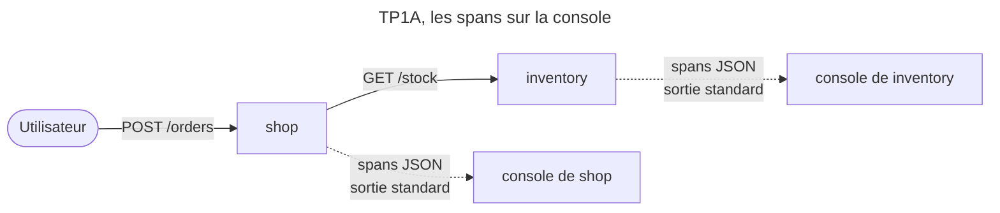

# Lab TP1A : Voir la valeur de la télémétrie, en console

Ce lab est le premier des trois du TP1. Il se déroule sur `clt-N`, dans le dossier `~/tp01` préparé à la [Mise en place du TP1](Lab_TP01_Socle.md#mise-en-place). Aucun **collector**, aucun backend : l'application seule, et sa télémétrie sur la sortie standard.

# Objectifs

À la fin du lab, vous saurez :

- lire les spans qu'une application instrumentée écrit sur sa sortie standard ;
- distinguer un span racine d'un span enfant et reconstituer une trace avec `jq` ;
- retrouver une panne et une lenteur dans la sortie console, sans autre outil.

# Contenu

- [Environnement](#environnement)
- [1. Démarrer l'application](#1-démarrer-lapplication)
- [2. Une commande, une trace](#2-une-commande-une-trace)
- [3. Une panne franche](#3-une-panne-franche)
- [4. Une lenteur](#4-une-lenteur)
- [Ce que la console ne fait pas](#ce-que-la-console-ne-fait-pas)

# Détail

## Environnement

L'application tient dans le dossier `app/` du TP : deux services Python, `shop` et `inventory`. `shop` reçoit les commandes (`POST /orders`), `inventory` répond aux demandes de stock (`GET /stock/<sku>`). Les deux sont instrumentées avec le SDK OpenTelemetry, et leurs spans sortent sur la sortie standard des conteneurs, un objet JSON par ligne.

L'application compose les versions futures de vous deux : le SDK est déjà en place, vous ne configurez rien d'OpenTelemetry dans ce lab. Vous lisez ce que l'instrumentation produit.

Le schéma suivant montre le chemin des données dans ce lab : une commande traverse les deux services, et chaque span finit sur la sortie standard du conteneur qui l'a produit.



## 1. Démarrer l'application

Depuis `~/tp01`, démarrez les deux services :

```bash
docker compose up -d
docker compose ps --format '{{.Service}} {{.State}}'
```

On obtient :

```text
inventory running
shop running
```

Le fichier `.env` n'existe pas à ce stade : c'est ce qui fait sortir les spans sur la console. Ne le créez pas [avant le TP1B](Lab_TP01B_Collector_vers_Jaeger.md#2-lapplication-parle-au-collector).

Passez une commande avec `order.sh`, qui appelle `shop` et affiche la réponse suivie du code HTTP. Articles connus : `coffee` (stock 12), `tea` (stock 0), `mug` (stock 3) :

```bash
./order.sh coffee 2 alice
```

On obtient :

```text
{"status":"accepted","total":9.0}
 [201]
```

La commande a réussi. Maintenant, lisez la sortie des deux conteneurs :

```bash
docker compose logs --no-log-prefix --since 1m shop inventory
```

On obtient un mélange de lignes. Les unes sont des logs applicatifs classiques, horodatés ; les autres sont des objets JSON, un par span :

```text
2026-11-22 05:09:22,235 INFO shop.orders [6bfdff188ca025b3179e4f0aacb62cac] order received sku=coffee qty=2 customer=alice
{"name": "GET inventory", "service": "shop", "trace_id": "6bfdff188ca025b3179e4f0aacb62cac", "span_id": "eb79c26250533f39", "parent_span_id": "cd3cd18b4c336ea4", "duration_ms": 48.86, "status": "UNSET", "attributes": {"http.request.method": "GET", "server.address": "inventory", "http.response.status_code": 200}, "events": []}
2026-11-22 05:09:22,284 INFO shop.orders [6bfdff188ca025b3179e4f0aacb62cac] order accepted sku=coffee total=9.0
{"name": "handle_request", "service": "shop", "trace_id": "6bfdff188ca025b3179e4f0aacb62cac", "span_id": "cd3cd18b4c336ea4", "parent_span_id": null, "duration_ms": 49.54, "status": "UNSET", "attributes": {"http.request.method": "POST", "http.route": "/orders", "url.path": "/orders/39211", "order.sku": "coffee", "order.qty": 2, "user.email": "alice@example.com", "http.response.status_code": 201, "order.total": 9.0}, "events": []}
{"name": "load_stock", "service": "inventory", "trace_id": "6bfdff188ca025b3179e4f0aacb62cac", "span_id": "e7b35943b10c6480", "parent_span_id": "cd3cd18b4c336ea4", "duration_ms": 44.39, "status": "UNSET", "attributes": {"http.request.method": "GET", "http.route": "/stock/coffee", "inventory.sku": "coffee", "inventory.stock": 12}, "events": []}
```

Trois objets JSON, un par span produit par la commande :

- `handle_request`, sur `shop` : le traitement de la requête entrante, sans parent (`parent_span_id` à `null`) ;
- `GET inventory`, sur `shop` : l'appel HTTP vers l'autre service, avec `handle_request` pour parent ;
- `load_stock`, sur `inventory` : le traitement de la demande de stock, enfant de `handle_request`.

Ces trois spans partagent le même `trace_id`. C'est la trace : une commande = une trace, qui traverse les deux services. Les logs applicatifs portent aussi l'identifiant, entre crochets : la même commande, vue par les logs et par les traces.

> [!NOTE]
>
> Les spans sont des objets JSON distincts pour une raison pratique : `jq` peut les lire un par un, au milieu des lignes de log qui ne sont pas du JSON. C'est une mise en forme de ce lab, pas une pratique recommandée : en production, les spans partent vers un **collector**, pas vers une console.

## 2. Une commande, une trace

La sortie mélangée se lit mal à l'œil. Filtrez-la avec `jq` : l'option `-R` lit l'entrée ligne par ligne, `fromjson?` transforme en objet les lignes qui sont du JSON et ignore silencieusement les autres.

Listez les spans, avec leur nom, leur service, leur parent, leur durée et leur statut :

```bash
docker compose logs --no-log-prefix shop inventory \
  | jq -cR 'fromjson? | select(.name) | {name, service, parent_span_id, duration_ms, status}'
```

On obtient, dans l'ordre d'écriture :

```text
{"name":"handle_request","service":"shop","parent_span_id":null,"duration_ms":49.54,"status":"UNSET"}
{"name":"GET inventory","service":"shop","parent_span_id":"cd3cd18b4c336ea4","duration_ms":48.86,"status":"UNSET"}
{"name":"load_stock","service":"inventory","parent_span_id":"cd3cd18b4c336ea4","duration_ms":44.39,"status":"UNSET"}
```

Le span `handle_request` n'a pas de parent : c'est le span racine de la trace. Les deux autres portent son `span_id` dans leur `parent_span_id` : ce sont ses enfants. La hiérarchie se lit ainsi : `shop` a reçu la requête, a appelé `inventory`, qui a répondu.

Reconstituez maintenant la trace complète de la dernière commande. D'abord son identifiant, puis tous les spans qui le portent :

```bash
TRACE=$(docker compose logs --no-log-prefix shop \
  | jq -rR 'fromjson? | select(.name=="handle_request") | .trace_id' | tail -1)
echo "trace_id=$TRACE"
docker compose logs --no-log-prefix shop inventory \
  | jq -cR "fromjson? | select(.trace_id==\"$TRACE\") | {name, service, parent_span_id, duration_ms}"
```

On obtient l'identifiant, puis les trois spans de la trace :

```text
trace_id=6bfdff188ca025b3179e4f0aacb62cac
{"name":"load_stock","service":"inventory","parent_span_id":"cd3cd18b4c336ea4","duration_ms":44.39}
{"name":"GET inventory","service":"shop","parent_span_id":"cd3cd18b4c336ea4","duration_ms":48.86}
{"name":"handle_request","service":"shop","parent_span_id":null,"duration_ms":49.54}
```

Les durées se lisent de la plus courte à la plus longue en remontant vers le racine : le temps de `shop` (49,54 ms) contient l'appel vers `inventory` (48,86 ms), qui contient le traitement côté `inventory` (44,39 ms). Trois millisecondes séparent le racine de son enfant : c'est le temps passé dans `shop` lui-même.

Passez une commande qui échoue côté métier, avec un article en stock insuffisant :

```bash
./order.sh mug 5 bob
```

On obtient :

```text
{"error":"insufficient stock","stock":3}
 [409]
```

Le span racine de cette commande porte un événement `stock.insufficient` et un statut d'erreur :

```bash
TRACE=$(docker compose logs --no-log-prefix shop \
  | jq -rR 'fromjson? | select(.name=="handle_request") | .trace_id' | tail -1)
docker compose logs --no-log-prefix shop \
  | jq -cR "fromjson? | select(.trace_id==\"$TRACE\") | {status, events}"
```

```text
{"status":"ERROR","events":[{"name":"stock.insufficient","attributes":{"stock":3}}]}
```

Une commande refusée par le métier est une trace en erreur, avec la raison dans un événement. Rien de tout cela n'était visible dans la réponse HTTP, qui se résumait à un code 409.

## 3. Une panne franche

Le scénario : les utilisateurs signalent des erreurs, et personne ne sait pourquoi. Éteignez brutalement le service `inventory`, comme si le processus avait crashé :

```bash
docker compose stop inventory
./order.sh coffee 1 alice
```

On obtient une erreur 502, sans autre explication :

```text
{"error":"inventory unavailable"}
 [502]
```

C'est le code que voit l'utilisateur. La télémétrie, elle, sait pourquoi. Retrouvez le span en erreur :

```bash
docker compose logs --no-log-prefix shop inventory \
  | jq -cR 'fromjson? | select(.status=="ERROR") | {name, service, attributes}'
```

On obtient :

```text
{"name":"GET inventory","service":"shop","attributes":{"http.request.method":"GET","server.address":"inventory"}}
{"name":"handle_request","service":"shop","attributes":{"http.request.method":"POST","http.route":"/orders","url.path":"/orders/49316","order.sku":"coffee","order.qty":1,"user.email":"alice@example.com","http.response.status_code":502}}
```

Deux spans en erreur : le racine, et l'appel vers `inventory`. Le message d'erreur complet est dans les logs du SDK, mais l'essentiel est là : la commande a échoué parce que l'appel vers `inventory` a échoué, et non à cause du traitement de la commande.

Retrouvez aussi la ligne de log correspondante, grâce à l'identifiant de trace que portent les logs :

```bash
TRACE=$(docker compose logs --no-log-prefix shop \
  | jq -rR 'fromjson? | select(.status=="ERROR") | .trace_id' | tail -1)
docker compose logs --no-log-prefix shop inventory | grep "$TRACE" | grep INFO
```

On obtient :

```text
2026-11-22 05:10:07,510 INFO shop.orders [dbf320184f73b4f509dc3cf1d9e303b9] order received sku=coffee qty=1 customer=alice
2026-11-22 05:10:07,516 ERROR shop.orders [dbf320184f73b4f509dc3cf1d9e303b9] inventory unavailable: 502 Server Error: ...
```

Redémarrez `inventory` pour la suite :

```bash
docker compose start inventory
```

## 4. Une lenteur

Deuxième scénario, le plus courant : les utilisateurs trouvent l'application lente, mais votre propre test est rapide. `inventory` dispose d'un mode lent, activé par la variable `INVENTORY_DELAY_MS` : le service attend alors ce nombre de millisecondes avant de répondre, à l'intérieur de son span.

Ajoutez trois secondes de délai, puis passez une commande :

```bash
INVENTORY_DELAY_MS=3000 docker compose up -d inventory
```

Compose recrée le conteneur avec la nouvelle variable. Attendez quelques secondes que le service soit prêt, puis passez une commande :

```bash
sleep 5
./order.sh coffee 1 alice
```

La commande met maintenant trois secondes à répondre. Retrouvez le coupable en triant les spans par durée décroissante :

```bash
docker compose logs --no-log-prefix shop inventory \
  | jq -Rs 'split("\n") | map(fromjson? // empty) | sort_by(-.duration_ms) | .[0:3] | map({name, service, duration_ms})'
```

On obtient :

```text
[
  {
    "name": "handle_request",
    "service": "shop",
    "duration_ms": 3062.61
  },
  {
    "name": "GET inventory",
    "service": "shop",
    "duration_ms": 3061.4
  },
  {
    "name": "load_stock",
    "service": "inventory",
    "duration_ms": 3050.06
  }
]
```

Le span le plus lent est le racine, mais il ne fait que contenir les autres : la lenteur vient de `load_stock`, sur `inventory`, à 3 050 ms. L'appel HTTP et le traitement de la commande n'ajoutent que quelques millisecondes. C'est le raisonnement que permettent les durées imbriquées des spans : remonter du symptôme à la cause.

Remettez le service dans son état rapide, en supprimant la variable du conteneur :

```bash
docker compose up -d inventory
```

## Ce que la console ne fait pas

Ce lab a répondu à deux questions, chacune en quelques commandes : pourquoi ces erreurs, pourquoi cette lenteur. La télémétrie en console suffit quand on sait déjà où regarder.

Elle ne suffit plus dès que la question change de forme. Posez-vous celle-ci :

> Que se passe-t-il avec 50 requêtes par seconde et dix services ?

La console ne garde rien : les traces défilent et disparaissent avec les conteneurs. Elle ne cherche rien : impossible de retrouver la trace d'un client qui a appelé à 14 h 03. Et elle ne montre rien d'autre qu'une suite de lignes : pas d'arbre graphique, pas de comparaison entre services, pas de recherche par durée ou par statut.

La réponse à cette question tient en deux briques : un **collector**, qui reçoit les données de l'application, et un backend, qui les garde et les interroge. C'est le sujet du [TP1B](Lab_TP01B_Collector_vers_Jaeger.md).
