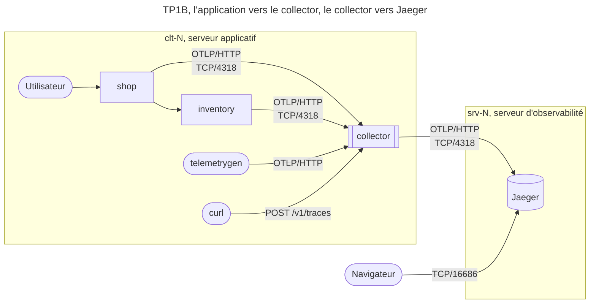
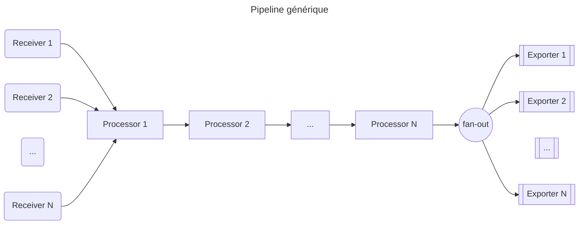
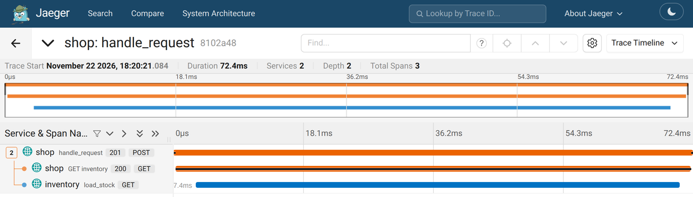

# Lab TP1B : Un **collector**, de l'application vers Jaeger

Ce lab est le deuxième des trois du TP1. Il se déroule dans le terminal web de `clt-N`, dans le dossier `~/tp01` qui a servi [au TP1A](Lab_TP01A_Voir_la_valeur.md). Jaeger démarre sur `srv-N`, mais toujours depuis `clt-N`, par SSH.

# Objectifs

À la fin du lab, vous saurez :

- écrire la configuration d'un **collector** : un receiver OTLP, un exporter, un pipeline de traces, et la valider avant de démarrer ;
- faire passer l'application de la console au **collector**, en ne changeant qu'une variable d'environnement ;
- envoyer un span à la main, sans SDK, avec une requête `curl` ;
- exporter vers Jaeger, sur une machine distante, et y retrouver les traces de l'application ;
- diagnostiquer une panne et une lenteur après coup, depuis Jaeger, sans ouvrir de session sur le serveur applicatif.

# Contenu

- [Environnement](#environnement)
- [1. Un premier **collector**](#1-un-premier-collector)
- [2. L'application parle au **collector**](#2-lapplication-parle-au-collector)
- [3. Un span sans SDK](#3-un-span-sans-sdk)
- [4. Jaeger, sur la machine d'observabilité](#4-jaeger-sur-la-machine-dobservabilité)
- [5. Diagnostiquer à distance](#5-diagnostiquer-à-distance)

# Détail

## Environnement

Les machines et le dossier `~/tp01` sont ceux du [TP1A](Lab_TP01A_Voir_la_valeur.md) : les deux labs s'enchaînent sur les mêmes machines. L'application tourne toujours, ses spans sortent toujours sur la console.

Le schéma suivant montre la cible de ce lab : un **collector** apparaît à côté de l'application, sur `clt-N`, et envoie les traces à Jaeger, sur `srv-N`. Le navigateur consulte Jaeger directement.



Le **collector** reste à côté de l'application : c'est sa place quand il ne sert qu'à transmettre. Le backend, lui, est ailleurs : il collecte les données de plusieurs applications et survit à leur recréation.

## 1. Un premier **collector**

Un **collector** se décrit en YAML.

Les **receivers** reçoivent les données, les **exporters** les envoient ailleurs, et la section `service.pipelines` relie les deux pour chaque type de signal. Un composant déclaré mais absent d'un pipeline n'est pas utilisé.

Le schéma suivant, tiré de [la documentation officielle du **collector**](https://opentelemetry.io/docs/collector/architecture/), représente un pipeline générique : les données entrent par un ou plusieurs receivers, traversent une série de processors, et le dernier processor les copie vers chaque exporter via un fan-out :



Dans cette partie, le pipeline `traces` ne compte qu'un receiver (`otlp`) et un exporter (`debug`) ; les processors arrivent [au TP1C](Lab_TP01C_Affiner_le_pipeline.md#2-les-premiers-processors).

Le **collector** reçoit sa configuration en quatre fichiers, un par section, passés avec quatre options `--config` : il les fusionne en une seule configuration. Ce découpage permet d'ajouter des éléments au fil du TP sans réécrire un fichier entier. Les fichiers sont montés depuis le dossier `otelcol/` par le service `otelcol` du compose, que vous démarrierez à la fin de cette partie.

Pour retrouver les options de chaque composant, consultez son README dans le dépôt [opentelemetry-collector-contrib](https://github.com/open-telemetry/opentelemetry-collector-contrib). L'exporter `debug` est documenté dans le dépôt [opentelemetry-collector](https://github.com/open-telemetry/opentelemetry-collector).

Depuis `~/tp01`, créez le receiver `otlp`, qui accepte le HTTP (port 4318) sur toutes les interfaces du conteneur :

```bash
mkdir -p otelcol
cat > otelcol/receivers.yaml <<'EOF'
receivers:
  otlp:
    protocols:
      http:
        endpoint: 0.0.0.0:4318
EOF
```

> [!NOTE]
>
> Ce TP n'utilise que le transport HTTP de l'OTLP. Il est plus facile à déboguer : une simple requête `curl` suffit, comme [à la partie 3](#3-un-span-sans-sdk), et il passe mieux à travers les proxys. Le transport gRPC reste le plus fréquent dans les configurations de production et dans les exemples de la documentation : vous le croiserez souvent (`protocols: grpc` sur le receiver, exporter `otlp_grpc`).

Créez l'exporter `debug`, avec le niveau de détail `detailed`, qui écrit les données reçues dans les logs du **collector** :

```bash
cat > otelcol/exporters.yaml <<'EOF'
exporters:
  debug:
    verbosity: detailed
EOF
```

Le fichier des processors reste vide pour l'instant (vous le remplirez [au TP1C](Lab_TP01C_Affiner_le_pipeline.md#2-les-premiers-processors)), mais le **collector** attend quand même les quatre fichiers :

```bash
cat > otelcol/processors.yaml <<'EOF'
processors: {}
EOF
```

Définissez enfin un pipeline `traces` qui relie le receiver à l'exporter :

```bash
cat > otelcol/service.yaml <<'EOF'
service:
  pipelines:
    traces:
      receivers: [otlp]
      exporters: [debug]
EOF
```

Validez la configuration avant de démarrer. Le script `check.sh` lance la commande `validate` du **collector** sur les quatre fichiers :

```bash
./check.sh
```

La commande n'affiche rien et se termine sans erreur si la configuration est correcte. En cas d'erreur, le message cite le fichier et la clé en cause.

Démarrez le **collector** et lisez ses logs :

```bash
docker compose --profile otelcol up -d
docker compose logs --no-log-prefix otelcol | tail -n 1
```

Le dernier message doit se terminer par :

```text
Everything is ready. Begin running and processing data.
```

Envoyez cinq traces avec `./tg.sh`, un script fourni qui lance [telemetrygen](https://github.com/open-telemetry/opentelemetry-collector-contrib/tree/main/cmd/telemetrygen) vers le **collector**. Ce générateur produit des spans sans application, pratique pour tester un pipeline :

```bash
./tg.sh traces --traces 5 --service demo
```

Chaque trace contient deux spans : un span parent `lets-go` et un span enfant `okey-dokey-0`. Le **collector** a donc affiché dix spans :

```bash
docker compose logs --no-log-prefix otelcol | grep -c 'Span #'
```

On obtient :

```text
10
```

> [!TIP]
>
> Deux erreurs courantes, à lire dans les logs du **collector** :
>
> - `connection refused` vers Jaeger : l'exporter vise une adresse qui n'héberge pas Jaeger. Dans ce TP, Jaeger n'est pas sur la même machine que le **collector** : l'exporter doit viser `$SRV_HOST`, pas `localhost` ni un nom de service du compose.
> - un émetteur qui ne se connecte pas : vérifiez que le **collector** tourne (`docker compose ps`) et que son receiver écoute sur `0.0.0.0`, sinon il n'accepte que les connexions venant de son propre conteneur.

## 2. L'application parle au **collector**

L'application écrit ses spans sur la console depuis [le TP1A](Lab_TP01A_Voir_la_valeur.md), parce que la variable `OTEL_EXPORTER_OTLP_ENDPOINT` n'est pas définie. Dès qu'elle l'est, le SDK envoie les spans en OTLP/HTTP vers l'adresse qu'elle contient : c'est la seule chose qui change.

Le compose lit cette variable dans le fichier `.env` du dossier. Créez-le, puis relancez les services avec le profil du **collector** :

```bash
echo 'OTEL_EXPORTER_OTLP_ENDPOINT=http://otelcol:4318' > .env
docker compose --profile otelcol up -d
```

Compose recrée les conteneurs de l'application avec la variable, et démarre le **collector** s'il ne tourne pas. Vérifiez que la console ne reçoit plus de spans et que le **collector**, lui, en reçoit :

```bash
./order.sh coffee 1 alice
sleep 2
echo "spans sur la console : $(docker compose logs --no-log-prefix --since 30s shop | jq -cR 'fromjson? | select(.name)' | wc -l)"
echo "spans dans le collector : $(docker compose logs --no-log-prefix --since 30s otelcol | grep -c 'Span #' || true)"
```

On obtient :

```text
{"status":"accepted","total":4.5}
 [201]
spans sur la console : 0
spans dans le collector : 3
```

Trois spans : `handle_request`, `GET inventory` et `load_stock`, exactement ceux de [la partie 2 du TP1A](Lab_TP01A_Voir_la_valeur.md#2-une-commande-une-trace). Mêmes données, autre chemin : rien n'a changé dans l'application, seulement l'adresse d'export.

> [!NOTE]
>
> Désormais, tout ce que vous verrez passer dans les logs du **collector** a déjà quitté l'application. Les processors que vous ajouterez [au TP1C](Lab_TP01C_Affiner_le_pipeline.md#2-les-premiers-processors) s'exécutent sur `clt-N`, avant l'envoi vers le serveur d'observabilité : ce qui doit être masqué peut l'être avant de partir.

## 3. Un span sans SDK

Jusqu'ici, les spans ont été produits par le SDK OpenTelemetry embarqué dans l'application. Un SDK fabrique un document JSON conforme au format OTLP, avec un identifiant de trace, un identifiant de span et des horodatages, puis l'envoie au **collector**. Sans SDK, on peut fabriquer ce document à la main et le poster : c'est ce que fait cette commande, tapée sur `clt-N`, pour voir ce qu'il y a derrière l'instrumentation.

```bash
NOW=$(date +%s%N)
curl -s -o /dev/null -w '%{http_code}\n' -X POST http://localhost:4318/v1/traces \
  -H 'Content-Type: application/json' -d '{
  "resourceSpans": [{
    "resource": {"attributes": [{"key": "service.name", "value": {"stringValue": "manuel"}}]},
    "scopeSpans": [{
      "scope": {"name": "curl"},
      "spans": [{
        "traceId": "5b8efff798038103d269b633813fc60c",
        "spanId": "eee19b7ec3c1b174",
        "name": "hello",
        "kind": 1,
        "startTimeUnixNano": "'"$NOW"'",
        "endTimeUnixNano": "'"$NOW"'"
      }]
    }]
  }]
}'
```

On obtient `200`. Le span est arrivé dans le **collector**, qui l'affiche dans ses logs avec les autres :

```bash
docker compose logs --no-log-prefix --since 1m otelcol | grep -c 'manuel'
```

On obtient :

```text
1
```

Le span existe, sans SDK, sans bibliothèque, sans instrumentation : seulement un POST JSON. C'est exactement ce qu'un SDK envoie, à ceci près qu'il le fait pour chaque opération de l'application. Vous le retrouverez dans Jaeger à [la partie 4](#4-jaeger-sur-la-machine-dobservabilité).

## 4. Jaeger, sur la machine d'observabilité

Le **collector** affiche tout ce qu'il reçoit, mais ne garde rien : ses logs défilent, et il faut être connecté à la machine applicative pour les lire. Le backend, lui, garde et interroge.

Jaeger est fourni, tout-en-un, avec un stockage en mémoire. Son compose est un fichier à part, `compose-srv.yaml`, destiné à `srv-N`. Démarrez-le depuis `clt-N`, par SSH :

```bash
ssh root@$SRV_HOST 'mkdir -p ~/tp01 && cp /root/opentelemetry-labs/config/tp01/compose-srv.yaml ~/tp01/ && cd ~/tp01 && docker compose -f compose-srv.yaml up -d'
```

Vérifiez que `clt-N` le joint sur ses deux ports : l'interface sur 16686, l'OTLP sur 4318.

```bash
curl -s -o /dev/null -w '%{http_code}\n' http://$SRV_HOST:16686/
curl -s -o /dev/null -w '%{http_code}\n' -X POST http://$SRV_HOST:4318/v1/traces \
  -H 'Content-Type: application/x-protobuf' --data-binary ''
```

On obtient `200` deux fois. Le premier port sert au navigateur, le second au **collector**.

> [!NOTE]
>
> Jaeger est un backend de démonstration : sans authentification, sans TLS, joignable sur les ports publiés de la machine. En production, il serait derrière TLS, sur le réseau privé, avec une authentification devant. Il stocke les traces en mémoire : elles disparaissent si le conteneur redémarre.

Branchez le **collector** sur ce backend. Toujours sur `clt-N`, ajoutez un exporter `otlp_http/jaeger` à la fin de `exporters.yaml`, avec `>>` à la place de `>` :

```bash
cat >> otelcol/exporters.yaml <<EOF
  otlp_http/jaeger:
    endpoint: http://$SRV_HOST:4318
EOF
```

> [!NOTE]
>
> Le délimiteur `EOF` n'est pas entre guillemets ici, volontairement : le shell remplace `$SRV_HOST` par le nom de votre machine d'observabilité pendant la création du fichier. Le **collector**, lui, reçoit l'adresse écrite en clair.
>
> `otlp_http` est le type actuel de l'exporter, l'ancien nom `otlphttp` n'est conservé que comme alias déprécié. Vous le rencontrerez encore dans beaucoup de configurations trouvées sur Internet.

Ajoutez cet exporter au pipeline `traces`, à côté du `debug` :

```bash
cat > otelcol/service.yaml <<'EOF'
service:
  pipelines:
    traces:
      receivers: [otlp]
      exporters: [debug, otlp_http/jaeger]
EOF
```

Validez, redémarrez le **collector**, puis générez du trafic :

```bash
./check.sh
docker compose restart otelcol
./order.sh coffee 1 alice
./tg.sh traces --traces 5 --service demo
NOW=$(date +%s%N)
curl -s -o /dev/null -w '%{http_code}\n' -X POST http://localhost:4318/v1/traces \
  -H 'Content-Type: application/json' -d '{
  "resourceSpans": [{
    "resource": {"attributes": [{"key": "service.name", "value": {"stringValue": "manuel"}}]},
    "scopeSpans": [{
      "scope": {"name": "curl"},
      "spans": [{
        "traceId": "5b8efff798038103d269b633813fc60c",
        "spanId": "eee19b7ec3c1b174",
        "name": "hello",
        "kind": 1,
        "startTimeUnixNano": "'"$NOW"'",
        "endTimeUnixNano": "'"$NOW"'"
      }]
    }]
  }]
}'
```

Les traces de l'application, les cinq traces de `demo` et le span de `manuel` sont parties vers Jaeger. Ouvrez l'interface depuis votre poste, dans le navigateur, sur `http://$SRV_HOST:16686` : choisissez le service `shop`, cliquez sur **Find Traces**, puis sur une trace pour lire son waterfall. Les trois spans du TP1A s'y retrouvent, avec leurs durées et leur hiérarchie.



En ligne de commande, les mêmes vérifications passent par l'API v3 de Jaeger, appelée depuis `clt-N`. Le nombre de traces du service `shop`, puis le nom du span envoyé avec `curl` :

```bash
curl -s "http://$SRV_HOST:16686/api/v3/traces?query.service_name=shop&query.startTimeMin=2020-01-01T00:00:00Z&query.startTimeMax=2030-01-01T00:00:00Z" \
  | jq '[.result.resourceSpans[].scopeSpans[].spans[].traceId] | unique | length'
curl -s "http://$SRV_HOST:16686/api/v3/traces?query.service_name=manuel&query.startTimeMin=2020-01-01T00:00:00Z&query.startTimeMax=2030-01-01T00:00:00Z" \
  | jq -r '.result.resourceSpans[0].scopeSpans[0].spans[0].name'
```

On obtient :

```text
1
hello
```

> [!TIP]
>
> Jaeger 2.x n'a plus l'API v1 (`/api/traces`, `/api/services`) : seule l'API v3 (`/api/v3/...`) répond, et sa recherche de traces exige une fenêtre temporelle explicite (`startTimeMin` et `startTimeMax`).

## 5. Diagnostiquer à distance

Reprenez les deux scénarios du [TP1A](Lab_TP01A_Voir_la_valeur.md), mais cette fois sans regarder la console : pas de `docker compose logs`, pas de `jq` sur la sortie des conteneurs. Tout se passe dans le navigateur, sur `http://$SRV_HOST:16686`, et tout se passe après coup : les traces y sont déjà quand vous cherchez.

Un mot sur le rôle de chacun. Les commandes qui suivent, toujours tapées sur `clt-N`, arrêtent `inventory` ou activent son mode lent : elles simulent ce qui se passe en production, ou ce qu'un collègue provoque sur une machine où vous n'avez pas accès. Une fois l'incident déclenché, vous jouez l'astreinte : laissez l'onglet du terminal de côté, et ne touchez plus qu'au navigateur, ouvert sur votre poste.

### La panne

Éteignez `inventory`, puis passez une commande qui échoue :

```bash
docker compose stop inventory
./order.sh coffee 1 alice
sleep 5
```

On obtient `502`. Dans l'interface de Jaeger, cherchez les traces du service `shop` des deux dernières minutes : la trace fautive porte un point d'exclamation, signe d'un span en erreur. Ouvrez-la : le span `GET inventory` est en erreur, et son parent `handle_request` l'est aussi. La cause est visible sans avoir rien vu en direct.

En ligne de commande, la même trace se retrouve par son statut :

```bash
curl -s "http://$SRV_HOST:16686/api/v3/traces?query.service_name=shop&query.startTimeMin=$(date -u -d '5 minutes ago' +%Y-%m-%dT%H:%M:%SZ)&query.startTimeMax=$(date -u -d '+1 minute' +%Y-%m-%dT%H:%M:%SZ)" \
  | jq -r '.result.resourceSpans[] | select([.scopeSpans[].spans[].status.code] | contains([2])) | .scopeSpans[0].spans[0].name'
```

On obtient le span fautif :

```text
GET inventory
```

### La lenteur

Redémarrez `inventory`, puis activez son mode lent :

```bash
docker compose start inventory
sleep 5
INVENTORY_DELAY_MS=3000 docker compose up -d inventory
sleep 5
./order.sh coffee 1 alice
sleep 5
```

Dans l'interface de Jaeger, la trace de cette commande sort du lot : sa durée, trois secondes, la rend immédiatement repérable dans la liste. Le waterfall montre où sont passées ces trois secondes : dans `load_stock`, sur `inventory`. Le raisonnement du [TP1A](Lab_TP01A_Voir_la_valeur.md#4-une-lenteur), mais dans une interface qui garde et qui trie.

En ligne de commande, la recherche de Jaeger sait filtrer par durée. La commande suivante place la durée en tête de ligne, arrondie à la milliseconde, pour que `sort -rn` puisse trier dessus :

```bash
curl -s "http://$SRV_HOST:16686/api/v3/traces?query.service_name=shop&query.startTimeMin=$(date -u -d '5 minutes ago' +%Y-%m-%dT%H:%M:%SZ)&query.startTimeMax=$(date -u -d '+1 minute' +%Y-%m-%dT%H:%M:%SZ)&query.minDuration=2s" \
  | jq -r '.result.resourceSpans[] | .scopeSpans[].spans[] | "\(((.endTimeUnixNano|tonumber) - (.startTimeUnixNano|tonumber))/1000000 | round)ms \(.name)"' \
  | sort -rn | head -3
```

On obtient :

```text
3022ms handle_request
3022ms GET inventory
3016ms load_stock
```

La racine et l'appel HTTP affichent la même durée arrondie : l'un contient l'autre, et ce qui les sépare se compte en microsecondes. La cause est `load_stock`, sur `inventory`. Remettez le service rapide :

```bash
docker compose up -d inventory
```

### Ce que ce chemin change

Reprenez la question posée à la fin du [TP1A](Lab_TP01A_Voir_la_valeur.md#ce-que-la-console-ne-fait-pas) : que se passe-t-il avec 50 requêtes par seconde et dix services ?

- Les traces sont **gardées** : celle de 14 h 03 se retrouve autant que celle d'il y a une minute, sans être connecté à la machine au moment où elle a eu lieu.
- Elles sont **recherchables** : par service, par durée, par statut d'erreur.
- Elles sont **lisibles** : le waterfall montre l'arbre des spans, et l'imbrication des durées remonte du symptôme à la cause.
- Et le diagnostic est **à distance** : une fois les données envoyées, vous n'avez plus besoin de vous connecter au serveur applicatif. Les commandes de cette partie ont simulé la production ; le diagnostic, lui, n'a utilisé que le navigateur.

L'application, elle, ne connaît que le **collector** : l'adresse d'un exporter est sa seule connaissance du système d'observabilité. Changer de backend ne la concerne pas.

La suite, [le TP1C](Lab_TP01C_Affiner_le_pipeline.md), part d'un constat que vous avez peut-être déjà fait dans Jaeger : il y a du bruit.
