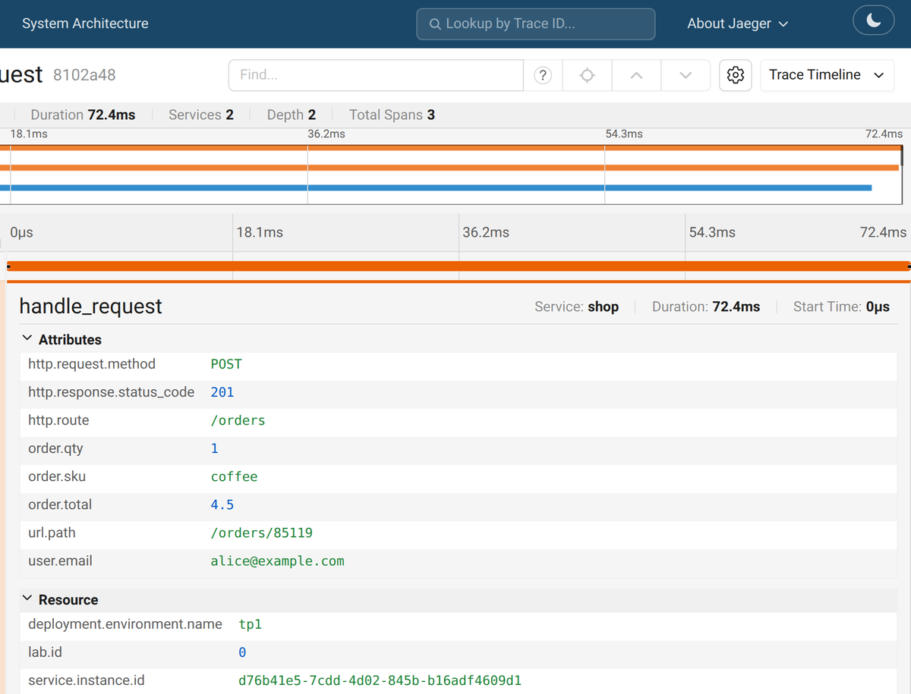
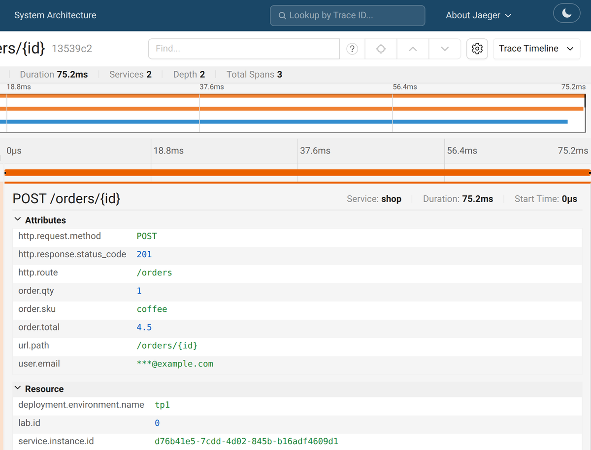

# Lab TP1C : Affiner le pipeline

Ce lab est le dernier des trois du TP1. Il se déroule dans le terminal web de `clt-N`, dans le dossier `~/tp01` qui a servi [au TP1B](Lab_TP01B_Collector_vers_Jaeger.md). L'application, le **collector** et Jaeger tournent toujours.

# Objectifs

À la fin du lab, vous saurez :

- ajouter les processors `memory_limiter`, `batch` et `resource`, et expliquer pourquoi leur ordre compte ;
- supprimer des spans avec le processor `filter`, et vérifier leur disparition dans Jaeger ;
- masquer une adresse électronique et normaliser un chemin avec le processor `transform` et le langage OTTL.

# Contenu

- [Environnement](#environnement)
- [1. Du bruit dans Jaeger](#1-du-bruit-dans-jaeger)
- [2. Les premiers processors](#2-les-premiers-processors)
- [3. Supprimer les sondes avec le filter](#3-supprimer-les-sondes-avec-le-filter)
- [4. Masquer et normaliser avec transform et OTTL](#4-masquer-et-normaliser-avec-transform-et-ottl)
- [Cleanup](#cleanup)
- [Extra](#extra)

# Détail

## Environnement

Les machines et le dossier `~/tp01` sont ceux du [TP1B](Lab_TP01B_Collector_vers_Jaeger.md) : les trois labs s'enchaînent sur les mêmes machines. Le pipeline du **collector** comporte pour l'instant un receiver `otlp` et deux exporters (`debug` et `otlp_http/jaeger`), et aucun processor.

Les processors de ce lab s'exécutent tous sur `clt-N`, dans le **collector**, avant l'envoi vers `srv-N` : ce qui part vers le serveur d'observabilité part déjà traité.

## 1. Du bruit dans Jaeger

Ouvrez Jaeger dans le navigateur (`http://$SRV_HOST:16686`). Il contient encore les traces des parties précédentes, dont les sondes que vous allez ajouter maintenant : pour lire un avant et un après sans mélanger, repartez d'un Jaeger vide. Les traces sont en mémoire, un redémarrage du conteneur suffit :

```bash
ssh root@$SRV_HOST 'cd ~/tp01 && docker compose -f compose-srv.yaml restart jaeger'
```

Attendez quelques secondes, puis vérifiez que la liste des services est vide :

```bash
sleep 5
curl -s http://$SRV_HOST:16686/api/v3/services
```

On obtient :

```text
{"services":["jaeger"]}
```

Ajoutez maintenant du bruit, le genre qui s'accumule dans les installations réelles. Le dossier contient un service de sondes, activé par le profil `health`, qui appelle la route `/health` de `shop` toutes les cinq secondes :

```bash
docker compose --profile health up -d
```

Laissez tourner une minute, puis passez deux commandes :

```bash
./order.sh coffee 1 alice
./order.sh mug 1 bob
sleep 5
```

Dans Jaeger, cherchez les traces du service `shop` de la dernière minute. Vous voyez la trace des deux commandes, entourées de dizaines de traces de sondes. Ouvrez la trace d'une commande : son span racine s'appelle `handle_request`, un nom qui ne dit rien de la requête, et ses attributs montrent une adresse électronique en clair (`alice@example.com`) et un chemin qui porte un identifiant (`/orders/39211`, différent à chaque commande).

En ligne de commande, le décompte du bruit :

```bash
curl -s "http://$SRV_HOST:16686/api/v3/traces?query.service_name=shop&query.startTimeMin=$(date -u -d '1 minute ago' +%Y-%m-%dT%H:%M:%SZ)&query.startTimeMax=$(date -u -d '+1 minute' +%Y-%m-%dT%H:%M:%SZ)" \
  | jq '[.result.resourceSpans[].scopeSpans[].spans[] | select(.attributes[]? | select(.key=="http.route" and .value.stringValue=="/health"))] | length'
```

On obtient, à quelques unités près selon le moment :

```text
11
```

Onze des quatorze spans de la minute sont des sondes. Ce bruit a deux coûts, que la slide « Coûts » du cours résume : il consomme du stockage pour des données qui n'aideront jamais personne, et il pollue les recherches : un chemin différent par commande (`/orders/39211`, puis `/orders/48151`) crée autant de valeurs distinctes que de commandes passées, ce qui rend les regroupements impossibles.

Les trois parties qui suivent traitent ces trois problèmes, un processor à la fois, avec un avant et un après visibles dans Jaeger.

## 2. Les premiers processors

Les processors transforment les données entre le receiver et les exporters. Ils s'exécutent dans l'ordre où ils sont listés dans le pipeline, et cet ordre a des conséquences.

Réécrivez `otelcol/processors.yaml` avec trois processors :

- `memory_limiter` protège le **collector** d'un dépassement de mémoire : vérification toutes les secondes, limite de 256 MiB, marge de pic de 64 MiB ;
- `resource` ajoute deux attributs de ressource à toutes les données : `deployment.environment.name` avec la valeur `tp1`, et `lab.id` avec votre numéro. Le compose transmet déjà `LAB_ID` au conteneur : la syntaxe `${env:LAB_ID}` du **collector** lit cette variable ;
- `batch` regroupe les données avant l'envoi, avec `timeout: 2s`.

```bash
cat > otelcol/processors.yaml <<'EOF'
processors:
  memory_limiter:
    check_interval: 1s
    limit_mib: 256
    spike_limit_mib: 64
  resource:
    attributes:
      - key: deployment.environment.name
        value: tp1
        action: upsert
      - key: lab.id
        value: ${env:LAB_ID}
        action: upsert
  batch:
    timeout: 2s
EOF
```

> [!TIP]
>
> Les guillemets simples autour de `'EOF'` empêchent le shell de remplacer lui-même `${env:LAB_ID}`, qui est destiné au **collector**.

Placez ces processors dans le pipeline `traces`, entre le receiver et les exporters. Le `memory_limiter` passe en premier, pour refuser des données avant de les traiter si la mémoire est saturée, et le `batch` passe en dernier, pour grouper des données déjà traitées (le README du `batch` processor donne cette recommandation).

```bash
cat > otelcol/service.yaml <<'EOF'
service:
  pipelines:
    traces:
      receivers: [otlp]
      processors: [memory_limiter, resource, batch]
      exporters: [debug, otlp_http/jaeger]
EOF
```

Validez, redémarrez le **collector**, puis passez une commande :

```bash
./check.sh
docker compose restart otelcol
sleep 4
./order.sh coffee 1 alice
```

Les attributs de ressource apparaissent dans Jaeger, sur la trace de cette commande, dans la section **Resource** des détails d'un span :



En ligne de commande, sur la dernière trace du service `shop` :

```bash
curl -s "http://$SRV_HOST:16686/api/v3/traces?query.service_name=shop&query.startTimeMin=$(date -u -d '2 minutes ago' +%Y-%m-%dT%H:%M:%SZ)&query.startTimeMax=$(date -u -d '+1 minute' +%Y-%m-%dT%H:%M:%SZ)" \
  | jq -r '.result.resourceSpans[0].resource.attributes[] | select(.key=="lab.id" or .key=="deployment.environment.name") | "\(.key)=\(.value | (.stringValue // .intValue))"'
```

On obtient votre numéro de participant, la valeur de `$LAB_ID` (par exemple `3` pour le participant 3) :

```text
deployment.environment.name=tp1
lab.id=0
```

Ces attributs posés par le **collector** accompagnent toutes les données qui le traversent, même si l'application ne les connaît pas : c'est ainsi qu'on étiquette un environnement entier sans toucher aux applications.

Observez maintenant l'effet du `batch`. Passez `timeout` à `15s` avec `sed`, redémarrez le **collector**, puis passez une commande et suivez les logs :

```bash
sed -i 's/timeout: 2s/timeout: 15s/' otelcol/processors.yaml
docker compose restart otelcol
./order.sh coffee 1 alice
docker compose logs -f otelcol
```

Dans les logs, les spans de votre commande n'apparaissent qu'une quinzaine de secondes plus tard, le temps que le lot soit envoyé (quittez le suivi avec Ctrl+C). Remettez ensuite la valeur d'origine :

```bash
sed -i 's/timeout: 15s/timeout: 2s/' otelcol/processors.yaml
docker compose restart otelcol
```

> [!TIP]
>
> Si l'attribut `lab.id` est vide ou vaut `0`, la variable `LAB_ID` n'est pas définie dans votre terminal. Contrôlez `echo $LAB_ID`, puis relancez `docker compose up -d otelcol` pour recréer le conteneur avec la valeur.

## 3. Supprimer les sondes avec le filter

Les sondes de santé (`/health`, `/ready`) produisent beaucoup de spans qui n'apportent rien à l'analyse : vous venez de le voir dans Jaeger.

Le processor `filter` supprime les données qui vérifient une condition écrite en OTTL, le langage de transformation d'OpenTelemetry. Si une des conditions de la liste est vraie, la donnée est supprimée.

> [!NOTE]
>
> Dans cette version du **collector**, le processor `filter` attend une liste `trace_conditions`, et les chemins OTTL commencent par le nom du contexte, par exemple `span.attributes["clé"]`.

Ajoutez un processor `filter/healthchecks` à la fin de `processors.yaml`, sans toucher au reste, avec `>>` à la place de `>`. Les deux espaces devant le nom du processor sont nécessaires : l'entrée doit avoir la même indentation que les processors déjà présents.

```bash
cat >> otelcol/processors.yaml <<'EOF'
  filter/healthchecks:
    error_mode: ignore
    trace_conditions:
      - span.attributes["http.route"] == "/health"
EOF
```

Placez-le dans le pipeline après `resource` et avant `batch` : il est inutile de grouper des données que vous allez supprimer.

```bash
cat > otelcol/service.yaml <<'EOF'
service:
  pipelines:
    traces:
      receivers: [otlp]
      processors: [memory_limiter, resource, filter/healthchecks, batch]
      exporters: [debug, otlp_http/jaeger]
EOF
```

Validez, redémarrez le **collector**, puis attendez une minute, le temps que les sondes produisent du trafic que le nouveau pipeline refuse :

```bash
./check.sh
docker compose restart otelcol
sleep 60
```

Comptez les spans de sondes arrivés dans Jaeger pendant cette minute, puis vérifiez que la commande passée pendant la même fenêtre est bien arrivée :

```bash
./order.sh coffee 1 alice
sleep 5
curl -s "http://$SRV_HOST:16686/api/v3/traces?query.service_name=shop&query.startTimeMin=$(date -u -d '1 minute ago' +%Y-%m-%dT%H:%M:%SZ)&query.startTimeMax=$(date -u -d '+1 minute' +%Y-%m-%dT%H:%M:%SZ)" \
  | jq '{sondes: [.result.resourceSpans[].scopeSpans[].spans[] | select(.attributes[]? | select(.key=="http.route" and .value.stringValue=="/health"))] | length, commandes: [.result.resourceSpans[].scopeSpans[].spans[] | select(.attributes[]? | select(.key=="http.route" and .value.stringValue=="/orders"))] | length}'
```

On obtient :

```text
{"sondes":0,"commandes":1}
```

Les sondes ont disparu, la commande est passée. Dans l'interface de Jaeger, la liste des traces du service `shop` ne contient plus que les commandes.

> [!NOTE]
>
> Les traces de sondes reçues avant le redémarrage du **collector** sont toujours dans Jaeger : elles ont traversé l'ancien pipeline. Pour les vérifications, cherchez dans une fenêtre de temps qui commence après le redémarrage, comme ci-dessus.

## 4. Masquer et normaliser avec transform et OTTL

Restent deux problèmes, visibles sur la trace de commande de [la partie 1](#1-du-bruit-dans-jaeger) : une adresse électronique en clair, et un chemin différent à chaque commande.

Le processor `transform` modifie les données avec des instructions OTTL. Pour chaque signal, il attend une liste d'instructions (`trace_statements` pour les traces) exécutées dans l'ordre. Une instruction peut se terminer par une clause `where`, qui limite son application aux données qui vérifient la condition.

### L'état de départ

Passez une commande et lisez les attributs du span racine, avec la même requête que celle qui servira à vérifier le résultat à la fin de cette partie :

```bash
./order.sh coffee 1 alice
sleep 5
curl -s "http://$SRV_HOST:16686/api/v3/traces?query.service_name=shop&query.startTimeMin=$(date -u -d '1 minute ago' +%Y-%m-%dT%H:%M:%SZ)&query.startTimeMax=$(date -u -d '+1 minute' +%Y-%m-%dT%H:%M:%SZ)" \
  | jq -c '[.result.resourceSpans[].scopeSpans[].spans[] | select(.attributes[]? | select(.key=="user.email"))][0] | {name, email: .attributes[] | select(.key=="user.email") | .value.stringValue, path: .attributes[] | select(.key=="url.path") | .value.stringValue}'
```

On obtient le nom du span, l'adresse en clair et le chemin avec son identifiant :

```text
{"name":"handle_request","email":"alice@example.com","path":"/orders/39211"}
```

Ce sont les données brutes, telles que l'application les a produites. Dans l'interface de Jaeger, le détail du span montre ces valeurs :


### Le processor transform

Ajoutez un processor `transform/normalize` qui règle ces trois points :

1. remplacer la partie locale de `user.email` (ce qui précède le `@`) par `***` ;
2. remplacer, dans `url.path`, chaque segment numérique par `{id}` ;
3. renommer les spans appelés `handle_request` en `<méthode> <chemin>`, avec la valeur de `http.request.method` suivie d'une espace et de celle de `url.path`.

Les fonctions utilisées sont documentées dans la référence OTTL : [replace_pattern](https://github.com/open-telemetry/opentelemetry-collector-contrib/blob/main/pkg/ottl/ottlfuncs/README.md#replace_pattern), [set](https://github.com/open-telemetry/opentelemetry-collector-contrib/blob/main/pkg/ottl/ottlfuncs/README.md#set) et [Concat](https://github.com/open-telemetry/opentelemetry-collector-contrib/blob/main/pkg/ottl/ottlfuncs/README.md#concat).

Chaque instruction se termine par une clause `where` qui vérifie que l'attribut utilisé existe (`!= nil`), pour que les données qui ne portent pas ces attributs ne produisent pas d'erreur.

L'ordre compte pour la troisième instruction : le nom doit être construit avec le chemin déjà normalisé.

La dernière instruction est longue ; elle est coupée sur deux lignes. YAML recolle les deux lignes avec une espace, le **collector** reçoit donc une seule instruction :

```bash
cat >> otelcol/processors.yaml <<'EOF'
  transform/normalize:
    error_mode: ignore
    trace_statements:
      - replace_pattern(span.attributes["user.email"], "^[^@]+", "***") where span.attributes["user.email"] != nil
      - replace_pattern(span.attributes["url.path"], "/[0-9]+", "/{id}") where span.attributes["url.path"] != nil
      - set(span.name, Concat([span.attributes["http.request.method"], span.attributes["url.path"]], " "))
        where span.name == "handle_request" and span.attributes["http.request.method"] != nil and span.attributes["url.path"] != nil
EOF
```

Placez ce processor après `filter/healthchecks` et avant `batch` : inutile de masquer des données que vous allez supprimer, et inutile de grouper des données qui vont encore changer.

```bash
cat > otelcol/service.yaml <<'EOF'
service:
  pipelines:
    traces:
      receivers: [otlp]
      processors: [memory_limiter, resource, filter/healthchecks, transform/normalize, batch]
      exporters: [debug, otlp_http/jaeger]
EOF
```

### Vérifier le résultat

Validez, redémarrez le **collector**, puis passez une commande :

```bash
./check.sh
docker compose restart otelcol
sleep 4
./order.sh coffee 1 alice
sleep 5
```

Relisez le même span, avec la requête de la partie précédente, resserrée sur les dernières secondes pour ne lire que les traces passées par le nouveau pipeline :

```bash
curl -s "http://$SRV_HOST:16686/api/v3/traces?query.service_name=shop&query.startTimeMin=$(date -u -d '30 seconds ago' +%Y-%m-%dT%H:%M:%SZ)&query.startTimeMax=$(date -u -d '+1 minute' +%Y-%m-%dT%H:%M:%SZ)" \
  | jq -c '[.result.resourceSpans[].scopeSpans[].spans[] | select(.attributes[]? | select(.key=="user.email"))][0] | {name, email: .attributes[] | select(.key=="user.email") | .value.stringValue, path: .attributes[] | select(.key=="url.path") | .value.stringValue}'
```

On obtient :

```text
{"name":"POST /orders/{id}","email":"***@example.com","path":"/orders/{id}"}
```

Comparé à l'état de départ, on obtient exactement ce qui était visé : l'adresse électronique est masquée, le chemin porte `{id}` au lieu de l'identifiant réel, et le span racine s'appelle `POST /orders/{id}` pour toutes les commandes du même endpoint. Les traces de commandes se regroupent désormais dans les recherches.

Dans l'interface de Jaeger, le même span porte maintenant un nom lisible et des attributs masqués :



Le pipeline du **collector** a maintenant sa forme finale : un receiver, cinq processors dans un ordre justifié, deux exporters dont l'un envoie vers une machine distante. Ce que l'application a produit a été filtré, enrichi, masqué et normalisé avant de quitter sa machine.

## Cleanup

Le cleanup arrête tout ce que le TP1 a démarré, sur les deux machines.

Sur `clt-N`, arrêtez et supprimez les conteneurs, réseaux et volumes de l'application, des sondes et du **collector**, tous profils activés, puis supprimez le dossier de travail :

```bash
cd ~/tp01
docker compose --profile otelcol --profile health down -v
rm -rf ~/tp01
```

Sur `srv-N`, arrêtez Jaeger et supprimez son dossier de travail :

```bash
ssh root@$SRV_HOST 'cd ~/tp01 && docker compose -f compose-srv.yaml down -v'
ssh root@$SRV_HOST 'rm -rf ~/tp01'
```

Vérifiez qu'il ne reste aucun conteneur du TP et que les ports de `srv-N` sont libérés :

```bash
docker ps --format '{{.Names}}' | grep tp01 || echo "aucun conteneur tp01 sur clt-N"
ssh root@$SRV_HOST 'docker ps --format "{{.Names}}" | grep tp01 || echo "aucun conteneur tp01 sur srv-N"'
ssh root@$SRV_HOST 'ss -ltn | grep -E ":(4318|16686) " || echo "ports 4318 et 16686 libres"'
```

On obtient :

```text
aucun conteneur tp01 sur clt-N
aucun conteneur tp01 sur srv-N
ports 4318 et 16686 libres
```

Les images Docker restent en place, et le dépôt `/root/opentelemetry-labs` n'est pas touché : chaque lab se prépare lui-même à partir du clone.

## Extra

À vous de jouer, si le temps le permet.

### Marquer les erreurs en OTTL

Les traces en erreur ont été visibles à deux reprises dans ce TP : la panne d'`inventory` [au TP1B](Lab_TP01B_Collector_vers_Jaeger.md#5-diagnostiquer-à-distance), les commandes refusées par le métier [au TP1A](Lab_TP01A_Voir_la_valeur.md#3-une-panne-franche). Un système de supervision qui voudrait compter ces traces chercherait un attribut bien choisi, plutôt qu'à relire chaque span.

Le cleanup a arrêté la stack. Reprenez-la : les fichiers fournis depuis le clone, la configuration finale du **collector**, puis Jaeger sur `srv-N`.

```bash
mkdir -p ~/tp01 && cp -r ~/opentelemetry-labs/config/tp01/. ~/tp01/
cd ~/tp01
mkdir -p otelcol
cat > otelcol/receivers.yaml <<'EOF'
receivers:
  otlp:
    protocols:
      http:
        endpoint: 0.0.0.0:4318
EOF
cat > otelcol/exporters.yaml <<EOF
exporters:
  debug:
    verbosity: detailed
  otlp_http/jaeger:
    endpoint: http://$SRV_HOST:4318
EOF
cat > otelcol/processors.yaml <<'EOF'
processors:
  memory_limiter:
    check_interval: 1s
    limit_mib: 256
    spike_limit_mib: 64
  resource:
    attributes:
      - key: deployment.environment.name
        value: tp1
        action: upsert
      - key: lab.id
        value: ${env:LAB_ID}
        action: upsert
  batch:
    timeout: 2s
EOF
cat > otelcol/service.yaml <<'EOF'
service:
  pipelines:
    traces:
      receivers: [otlp]
      processors: [memory_limiter, resource, batch]
      exporters: [debug, otlp_http/jaeger]
EOF
echo 'OTEL_EXPORTER_OTLP_ENDPOINT=http://otelcol:4318' > .env
docker compose --profile otelcol up -d
ssh root@$SRV_HOST 'mkdir -p ~/tp01 && cp /root/opentelemetry-labs/config/tp01/compose-srv.yaml ~/tp01/ && cd ~/tp01 && docker compose -f compose-srv.yaml up -d'
```

Ajoutez [à la partie 4](#4-masquer-et-normaliser-avec-transform-et-ottl) un processor qui marque d'un attribut les spans en erreur :

```bash
cat >> otelcol/processors.yaml <<'EOF'
  transform/slo:
    error_mode: ignore
    trace_statements:
      - set(span.attributes["slo.violation"], true) where span.status.code == STATUS_CODE_ERROR
EOF
cat > otelcol/service.yaml <<'EOF'
service:
  pipelines:
    traces:
      receivers: [otlp]
      processors: [memory_limiter, resource, transform/slo, batch]
      exporters: [debug, otlp_http/jaeger]
EOF
./check.sh
docker compose up -d otelcol
```

Attendez quelques secondes, puis provoquez une erreur en éteignant `inventory`, et passez une commande :

```bash
sleep 5
./order.sh coffee 1 alice
docker compose stop inventory
./order.sh coffee 1 alice
sleep 3
```

Dans l'interface de Jaeger (`http://$SRV_HOST:16686`), les spans en erreur du service `shop` portent l'attribut `slo.violation` à `true`, et les commandes réussies ne le portent pas. Le filtre de la liste de Jaeger permet de ne garder que ces traces, en ajoutant `slo.violation=true` dans le champ des attributs.

En ligne de commande :

```bash
curl -s "http://$SRV_HOST:16686/api/v3/traces?query.service_name=shop&query.startTimeMin=$(date -u -d '5 minutes ago' +%Y-%m-%dT%H:%M:%SZ)&query.startTimeMax=$(date -u -d '+1 minute' +%Y-%m-%dT%H:%M:%SZ)" \
  | jq -r '.result.resourceSpans[] | .scopeSpans[].spans[] | select(.status.code==2) | [.attributes[] | select(.key=="slo.violation") | .value.boolValue] | join("")'
```

On obtient `true` pour chaque span en erreur.

Terminez par le [Cleanup](#cleanup), qui est le même qu'à la fin du TP.
