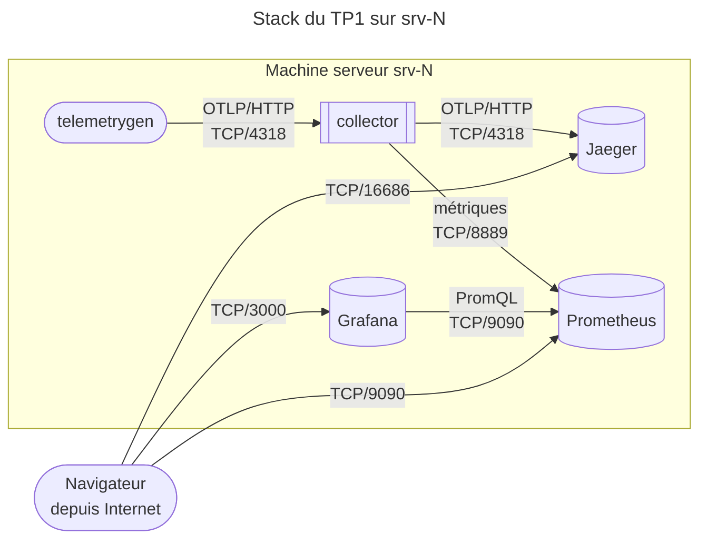
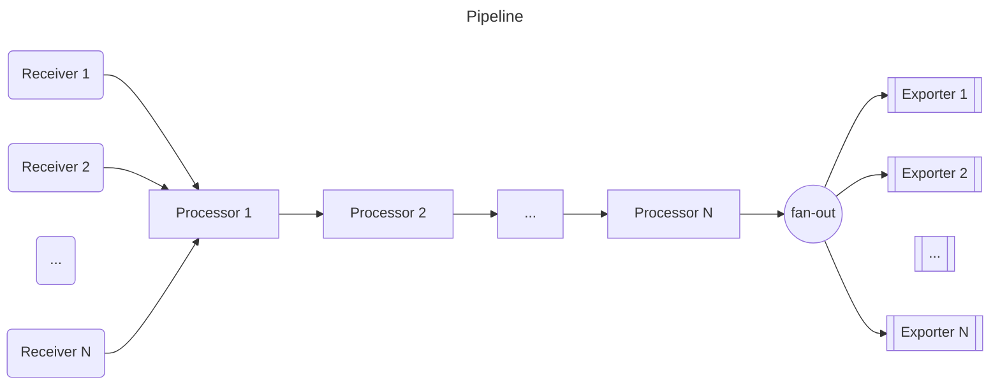
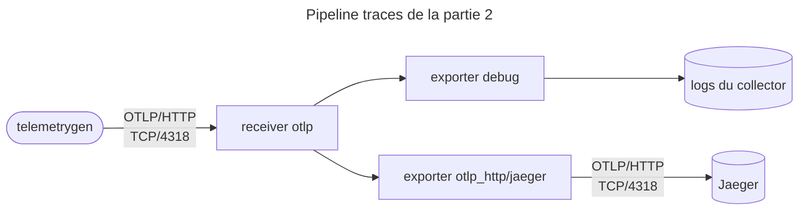
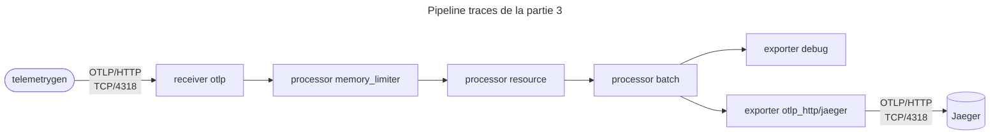

# Lab TP1 : Socle, backends et premier collector

# Objectifs

À la fin du lab, vous saurez :

- démarrer une stack de backends (Jaeger, Prometheus, Grafana) avec Docker Compose et vérifier que chaque service répond ;
- écrire la configuration d'un collector : un receiver OTLP, un exporter vers Jaeger et un pipeline de traces ;
- ajouter les processors `memory_limiter`, `batch` et `resource`, et expliquer pourquoi leur ordre compte ;
- supprimer des spans avec le processor `filter`, puis masquer et normaliser des attributs avec le processor `transform` et le langage OTTL ;
- envoyer des métriques vers Prometheus et les consulter dans Grafana.

# Contenu

- [Environnement](#environnement)
- [1. Démarrer les backends](#1-démarrer-les-backends)
- [2. Un premier collector](#2-un-premier-collector)
- [3. Les premiers processors](#3-les-premiers-processors)
- [4. Supprimer du bruit avec le filter](#4-supprimer-du-bruit-avec-le-filter)
- [5. Masquer et normaliser avec transform et OTTL](#5-masquer-et-normaliser-avec-transform-et-ottl)
- [6. Les métriques vers Prometheus et Grafana](#6-les-métriques-vers-prometheus-et-grafana)
- [Cleanup](#cleanup)
- [Extra](#extra)

# Détail

## Environnement

Ce lab se déroule sur la machine serveur `srv-N`, où N est votre numéro de participant.

Il n'y a pas de prérequis : aucun lab précédent n'est nécessaire.

### Terminal web

L'animateur vous communique en séance deux informations :

- l'adresse du terminal web de votre machine serveur, `https://srv-N.<domaine>` (la variable `SRV_HOST` contient ce nom) ;
- le mot de passe du terminal web.

Ouvrez cette adresse dans votre navigateur.

Un formulaire demande le nom d'utilisateur `stagiaire` et le mot de passe.

Vous arrivez ensuite dans un shell directement en root, dans le home `/root`. Le dépôt des labs y est déjà cloné, dans `/root/opentelemetry-labs`.

Vous pouvez copier-coller entre votre poste et le terminal web : Ctrl+Maj+C et Ctrl+Maj+V dans Firefox, Ctrl+Shift+C et Ctrl+Shift+V dans Chrome, ou le clic droit selon le navigateur.

### Variables d'environnement

La machine est déjà configurée avec des variables d'environnement utilisées par tous les labs, disponibles dans chaque terminal :

```bash
echo $LAB_ID $CLT_HOST $SRV_HOST
```

On obtient (N est votre numéro de participant) :

```text
N clt-N.<domaine> srv-N.<domaine>
```

- `LAB_ID` : votre numéro de participant ;
- `CLT_HOST` : le nom de la machine cliente, `clt-N.<domaine>` ;
- `SRV_HOST` : le nom de la machine serveur, `srv-N.<domaine>`.

Les deux machines jouent un rôle distinct : `clt-N` est le poste de travail d'où l'on pilote et d'où l'on envoie des requêtes, `srv-N` héberge ce que l'on observe.

Ce TP porte sur le socle de collecte côté serveur : tout s'installe sur `srv-N`, et vous exécuterez toutes les commandes depuis son terminal web.

### Données de télémétrie

Les données sont produites par [telemetrygen](https://github.com/open-telemetry/opentelemetry-collector-contrib/tree/main/cmd/telemetrygen), un générateur de télémétrie fourni avec le projet OpenTelemetry.

Il produit des traces, des métriques et des logs sans qu'il soit besoin d'écrire une application : on se concentre sur le **collector**.

Versions utilisées dans ce lab :

| Composant | Version |
|---|---|
| collector OpenTelemetry (distribution `otelcol-contrib`) | 0.165.0 |
| telemetrygen | v0.165.0 |
| Jaeger | 2.23.0 |
| Prometheus | v3.16.0 |
| Grafana | 13.3.1 |

**Note** : le tag de l'image du collector est `0.165.0` alors que celui de `telemetrygen` est `v0.165.0` (avec le `v`).

Les interfaces web sont accessibles depuis votre navigateur, sur la machine serveur (`$SRV_HOST`) :

- Jaeger : `http://$SRV_HOST:16686` (TCP/16686)
- Prometheus : `http://$SRV_HOST:9090` (TCP/9090)
- Grafana : `http://$SRV_HOST:3000` (TCP/3000, compte `admin`, mot de passe `formation`)

## 1. Démarrer les backends

Le schéma suivant représente cette architecture. Votre navigateur vient d'Internet et atteint directement les ports publiés par la machine serveur ; Jaeger, Prometheus, Grafana et le collector tournent tous sur `srv-N`, dans des conteneurs reliés par le réseau Docker du compose :



Le collector et `telemetrygen` sont ajoutés [à la partie 2](#2-un-premier-collector) ; la partie 1 ne démarre que les trois backends.

Le dépôt des labs est déjà cloné dans `~/opentelemetry-labs`.

Créez un dossier de travail et récupérez-y les fichiers fournis (deux scripts et la déclaration des sources de données de Grafana) depuis le clone des labs :

```bash
mkdir -p ~/tp01
cp -r ~/opentelemetry-labs/config/tp01/. ~/tp01/
cd ~/tp01
ls
```

On obtient :

```text
check.sh  grafana  tg.sh
```

Créez le fichier `prometheus/prometheus.yml`. Prometheus va interroger toutes les 5 secondes un point d'accès que le collector exposera [à la partie 6](#6-les-métriques-vers-prometheus-et-grafana) :

```bash
mkdir -p prometheus
cat > prometheus/prometheus.yml <<'EOF'
global:
  scrape_interval: 5s

scrape_configs:
  # Métriques exposées par l'exporter prometheus du collector (partie 6).
  - job_name: otelcol-exporter
    static_configs:
      - targets: ["otelcol:8889"]
EOF
```

Créez ensuite le fichier `compose.yaml`. Il décrit quatre services : Jaeger, Prometheus et Grafana, que vous démarrez maintenant, et le collector, que vous démarrerez [à la partie 2](#2-un-premier-collector).

Le collector reçoit sa configuration en quatre fichiers, un par section, passés avec quatre options `--config` : il les fusionne en une seule configuration. Ce découpage permet d'ajouter des éléments au fil du lab sans réécrire un fichier entier.

```bash
cat > compose.yaml <<'EOF'
name: tp01

services:
  jaeger:
    image: jaegertracing/jaeger:2.23.0
    ports:
      - "16686:16686"
    restart: unless-stopped

  prometheus:
    image: prom/prometheus:v3.16.0
    volumes:
      - ./prometheus/prometheus.yml:/etc/prometheus/prometheus.yml:ro
    ports:
      - "9090:9090"
    restart: unless-stopped

  grafana:
    image: grafana/grafana:13.3.1
    environment:
      GF_SECURITY_ADMIN_USER: admin
      GF_SECURITY_ADMIN_PASSWORD: ${GRAFANA_ADMIN_PASSWORD:-formation}
      GF_USERS_ALLOW_SIGN_UP: "false"
    volumes:
      - ./grafana/provisioning:/etc/grafana/provisioning:ro
    ports:
      - "3000:3000"
    depends_on:
      - jaeger
      - prometheus
    restart: unless-stopped

  otelcol:
    image: ghcr.io/open-telemetry/opentelemetry-collector-releases/opentelemetry-collector-contrib:0.165.0
    command:
      - --config=/etc/otelcol/receivers.yaml
      - --config=/etc/otelcol/processors.yaml
      - --config=/etc/otelcol/exporters.yaml
      - --config=/etc/otelcol/service.yaml
    environment:
      LAB_ID: ${LAB_ID:-0}
    volumes:
      - ./otelcol:/etc/otelcol:ro
    ports:
      - "4318:4318"
    depends_on:
      - jaeger
    restart: "no"

  # Générateur de télémétrie, utilisé via ./tg.sh
  telemetrygen:
    image: ghcr.io/open-telemetry/opentelemetry-collector-contrib/telemetrygen:v0.165.0
    profiles: ["tools"]
EOF
```

**Note** : Jaeger stocke les traces en mémoire, elles disparaissent si le conteneur redémarre. Le mot de passe de Grafana est celui du lab : ne le réutilisez jamais en dehors de ce contexte.

Démarrez les trois backends :

```bash
docker compose up -d jaeger prometheus grafana
docker compose ps --format '{{.Service}} {{.State}}'
```

On obtient :

```text
grafana running
jaeger running
prometheus running
```

Vérifiez que chaque service répond :

```bash
curl -s -o /dev/null -w '%{http_code}\n' http://localhost:16686/
curl -s http://localhost:9090/-/ready
curl -s http://localhost:3000/api/health | jq -r .database
curl -s -u admin:formation http://localhost:3000/api/datasources | jq -r '.[].name'
```

On obtient :

```text
200
Prometheus Server is Ready.
ok
Jaeger
Prometheus
```

Ouvrez aussi l'interface de Jaeger dans le navigateur (`http://$SRV_HOST:16686`) : elle s'affiche avec une liste de services vide.

## 2. Un premier collector

Un **collector** se décrit en YAML.

Les **receivers** reçoivent les données, les **exporters** les envoient ailleurs, et la section `service.pipelines` relie les deux pour chaque type de signal.

Un composant déclaré mais absent d'un pipeline n'est pas utilisé.

Le schéma suivant, tiré de [la documentation officielle du collector](https://opentelemetry.io/docs/collector/architecture/), représente un pipeline type : les données entrent par un ou plusieurs receivers, traversent une série de processors, et le dernier processor les copie vers chaque exporter via un fan-out :



Dans ce lab, le pipeline `traces` que vous allez construire plus loin ne compte qu'un **receiver** (`otlp`) et deux **exporters** (`debug` et `otlp_http/jaeger`) ; les processors arrivent [à la partie 3](#3-les-premiers-processors).

Voici le pipeline que vous mettez en place dans cette partie : les traces entrent par le receiver `otlp`, puis partent vers deux exporters, l'un qui les écrit dans les logs du collector, l'autre qui les envoie à Jaeger.



Les quatre fichiers de configuration sont dans le dossier `otelcol/`.

Pour retrouver les options de chaque composant, consultez son README dans le dépôt [opentelemetry-collector-contrib](https://github.com/open-telemetry/opentelemetry-collector-contrib). Les exporters `debug` et `otlp_http` sont documentés dans le dépôt [opentelemetry-collector](https://github.com/open-telemetry/opentelemetry-collector).

**NB** : le collector tourne dans un conteneur, donc `localhost` désigne le conteneur lui-même et non Jaeger. C'est pourquoi l'exporter vers Jaeger utilise le nom du service du compose, `jaeger`.

Créez d'abord le receiver `otlp`, qui accepte le HTTP (port 4318) sur toutes les interfaces du conteneur :

```bash
mkdir -p otelcol
cat > otelcol/receivers.yaml <<'EOF'
receivers:
  otlp:
    protocols:
      http:
        endpoint: 0.0.0.0:4318
EOF
```

**NB** : ce lab n'utilise que le transport HTTP de l'OTLP.

Il est plus facile à déboguer : une simple requête `curl` suffit, comme [dans l'Extra](#extra), et il passe mieux à travers les proxys.

Le transport gRPC reste le plus fréquent dans les configurations de production et dans les exemples de la documentation : vous le croiserez souvent (`protocols: grpc` sur le receiver, exporter `otlp_grpc`).

Créez les deux exporters : `debug` avec le niveau de détail `detailed`, qui écrit les données reçues dans les logs du collector, et `otlp_http/jaeger`, qui envoie vers le service `jaeger`, port 4318, en HTTP sans TLS.

```bash
cat > otelcol/exporters.yaml <<'EOF'
exporters:
  debug:
    verbosity: detailed
  otlp_http/jaeger:
    endpoint: http://jaeger:4318
EOF
```

**NB** : `otlp_http` est le type actuel de l'exporter, l'ancien nom `otlphttp` n'est conservé que comme alias déprécié. Vous le rencontrerez encore dans beaucoup de configurations trouvées sur Internet.

Le nom qui suit le `/` (`jaeger`) distingue plusieurs instances d'un même type de composant.

Le fichier des processors reste vide pour l'instant (vous le remplirez [à la partie 3](#3-les-premiers-processors)), mais le collector attend quand même les quatre fichiers :

```bash
cat > otelcol/processors.yaml <<'EOF'
processors: {}
EOF
```

Définissez enfin un pipeline `traces` qui relie le receiver aux deux exporters :

```bash
cat > otelcol/service.yaml <<'EOF'
service:
  pipelines:
    traces:
      receivers: [otlp]
      exporters: [debug, otlp_http/jaeger]
EOF
```

Validez la configuration avant de démarrer. Le script `check.sh` lance la commande `validate` du collector sur les quatre fichiers :

```bash
./check.sh
```

La commande n'affiche rien et se termine sans erreur si la configuration est correcte. En cas d'erreur, le message cite le fichier et la clé en cause.

Démarrez le collector et lisez ses logs :

```bash
docker compose up -d otelcol
docker compose logs otelcol | tail -n 5
```

Le dernier message doit se terminer par :

```text
Everything is ready. Begin running and processing data.
```

Envoyez cinq traces avec `./tg.sh`, un petit script qui lance `telemetrygen` vers le collector :

```bash
./tg.sh traces --traces 5 --service demo
```

Chaque trace contient deux spans : un span parent `lets-go` et un span enfant `okey-dokey-0`. Le collector a donc affiché dix spans :

```bash
docker compose logs otelcol | grep -c 'Span #'
```

On obtient :

```text
10
```

Contrôlez que Jaeger a reçu les traces :

```bash
curl -s 'http://localhost:16686/api/v3/traces?query.service_name=demo&query.startTimeMin=2020-01-01T00:00:00Z&query.startTimeMax=2030-01-01T00:00:00Z' \
  | jq '.result.resourceSpans | length'
```

On obtient :

```text
5
```

Dans l'interface de Jaeger (`http://$SRV_HOST:16686`), choisissez le service `demo` puis cliquez sur Find Traces : vous retrouvez les cinq traces.

**Note** : dans la commande `docker compose logs`, une erreur de type `connection refused` vers Jaeger signifie que l'adresse de l'exporter n'utilise pas le nom du service (`jaeger`). Si `telemetrygen` ne se connecte pas, vérifiez que le collector tourne (`docker compose ps`) et que son receiver écoute sur `0.0.0.0`.

## 3. Les premiers processors

Les processors transforment les données entre le receiver et les exporters. Ils s'exécutent dans l'ordre où ils sont listés dans le pipeline, et cet ordre a des conséquences.

Réécrivez `processors.yaml` avec trois processors :

- `memory_limiter` protège le collector d'un dépassement de mémoire : vérification toutes les secondes, limite de 256 MiB, marge de pic de 64 MiB ;
- `resource` ajoute deux attributs de ressource à toutes les données : `deployment.environment.name` avec la valeur `tp1`, et `lab.id` avec votre numéro. Le compose transmet déjà `LAB_ID` au conteneur : la syntaxe `${env:LAB_ID}` du collector lit cette variable ;
- `batch` regroupe les données avant l'envoi, avec `timeout: 2s`.

```bash
cat > otelcol/processors.yaml <<'EOF'
processors:
  memory_limiter:
    check_interval: 1s
    limit_mib: 256
    spike_limit_mib: 64
  resource:
    attributes:
      - key: deployment.environment.name
        value: tp1
        action: upsert
      - key: lab.id
        value: ${env:LAB_ID}
        action: upsert
  batch:
    timeout: 2s
EOF
```

**Note** : les guillemets simples autour de `'EOF'` empêchent le shell de remplacer lui-même `${env:LAB_ID}`, qui est destiné au collector.

Placez ces processors dans le pipeline `traces`. Le `memory_limiter` passe en premier, pour refuser des données avant de les traiter si la mémoire est saturée, et le `batch` passe en dernier, pour grouper des données déjà traitées (le README du `batch` processor donne cette recommandation).

Le pipeline mis en place dans cette partie comporte donc trois processors entre le receiver et les exporters :



```bash
cat > otelcol/service.yaml <<'EOF'
service:
  pipelines:
    traces:
      receivers: [otlp]
      processors: [memory_limiter, resource, batch]
      exporters: [debug, otlp_http/jaeger]
EOF
```

Validez, redémarrez le collector et envoyez des traces avec un nouveau nom de service :

```bash
./check.sh
docker compose restart otelcol
./tg.sh traces --traces 5 --service shop
```

Les attributs de ressource apparaissent dans Jaeger, sur chaque trace du service `shop`, dans la section Process des détails d'un span. En ligne de commande :

```bash
curl -s 'http://localhost:16686/api/v3/traces?query.service_name=shop&query.startTimeMin=2020-01-01T00:00:00Z&query.startTimeMax=2030-01-01T00:00:00Z' \
  | jq -r '.result.resourceSpans[0].resource.attributes[] | select(.key=="lab.id") | .value | (.stringValue // .intValue)'
```

On obtient votre numéro de participant, la valeur de `$LAB_ID` (par exemple `3` pour le participant 3) :

```text
3
```

Observez maintenant l'effet du `batch`. Passez `timeout` à `15s` avec `sed`, redémarrez le collector, puis envoyez trois traces avec le service `shop-delay` :

```bash
sed -i 's/timeout: 2s/timeout: 15s/' otelcol/processors.yaml
docker compose restart otelcol
./tg.sh traces --traces 3 --service shop-delay
docker compose logs -f otelcol
```

Dans les logs, les spans n'apparaissent qu'après environ quinze secondes, le temps que le lot soit envoyé (quittez le suivi avec Ctrl+C). Remettez ensuite la valeur d'origine :

```bash
sed -i 's/timeout: 15s/timeout: 2s/' otelcol/processors.yaml
docker compose restart otelcol
```

**Note** : si l'attribut `lab.id` est vide ou vaut `0`, la variable `LAB_ID` n'est pas définie dans votre terminal. Contrôlez `echo $LAB_ID`, puis relancez `docker compose up -d otelcol` pour recréer le conteneur avec la valeur.

## 4. Supprimer du bruit avec le filter

Les sondes de santé (`/health`, `/ready`) produisent beaucoup de spans qui n'apportent rien à l'analyse.

Le processor `filter` supprime les données qui vérifient une condition écrite en OTTL, le langage de transformation d'OpenTelemetry.

Si une des conditions de la liste est vraie, la donnée est supprimée.

**NB** : dans cette version du collector, le processor `filter` attend une liste `trace_conditions`, et les chemins OTTL commencent par le nom du contexte, par exemple `span.attributes["clé"]`.

Ajoutez un processor `filter/healthchecks` à la fin de `processors.yaml`, sans toucher au reste, avec `>>` à la place de `>`. Les deux espaces devant le nom du processor sont nécessaires : l'entrée doit avoir la même indentation que les processors déjà présents.

```bash
cat >> otelcol/processors.yaml <<'EOF'
  filter/healthchecks:
    error_mode: ignore
    trace_conditions:
      - span.attributes["http.route"] == "/health"
      - span.attributes["http.route"] == "/ready"
EOF
```

Placez-le dans le pipeline après `resource` et avant `batch` : il est inutile de grouper des données que vous allez supprimer.

```bash
cat > otelcol/service.yaml <<'EOF'
service:
  pipelines:
    traces:
      receivers: [otlp]
      processors: [memory_limiter, resource, filter/healthchecks, batch]
      exporters: [debug, otlp_http/jaeger]
EOF
```

Validez, redémarrez le collector, puis envoyez deux séries de traces, l'une qui doit être filtrée et l'autre non :

```bash
./check.sh
docker compose restart otelcol
./tg.sh traces --traces 10 --service shop-filter --telemetry-attributes 'http.route="/health"'
./tg.sh traces --traces 10 --service shop-filter --telemetry-attributes 'http.route="/api/orders"'
```

**NB** : les guillemets doubles à l'intérieur des guillemets simples sont nécessaires, `telemetrygen` s'en sert pour savoir que la valeur est une chaîne.

Seules les dix traces de `/api/orders` doivent exister dans Jaeger :

```bash
curl -s 'http://localhost:16686/api/v3/traces?query.service_name=shop-filter&query.startTimeMin=2020-01-01T00:00:00Z&query.startTimeMax=2030-01-01T00:00:00Z' \
  | jq '.result.resourceSpans | length'
curl -s 'http://localhost:16686/api/v3/traces?query.service_name=shop-filter&query.startTimeMin=2020-01-01T00:00:00Z&query.startTimeMax=2030-01-01T00:00:00Z' \
  | jq -c '[.result.resourceSpans[].scopeSpans[].spans[].attributes[] | select(.key=="http.route") | .value.stringValue] | unique'
```

On obtient :

```text
10
["/api/orders"]
```

## 5. Masquer et normaliser avec transform et OTTL

Le processor `transform` modifie les données avec des instructions OTTL.

Pour chaque signal, il attend une liste d'instructions (`trace_statements` pour les traces) exécutées dans l'ordre.

Une instruction peut se terminer par une clause `where`, qui limite son application aux données qui vérifient la condition.

### L'état de départ

Envoyez des données qui contiennent une adresse e-mail et un chemin avec un identifiant :

```bash
./tg.sh traces --traces 5 --service accounts \
  --telemetry-attributes 'http.request.method="GET"' \
  --telemetry-attributes 'url.path="/api/orders/48151"' \
  --telemetry-attributes 'user.email="alice@example.com"'
```

Contrôlez ce que Jaeger a reçu, avec la même commande que celle qui servira à vérifier le résultat à la fin de cette partie :

```bash
curl -s 'http://localhost:16686/api/v3/traces?query.service_name=accounts&query.startTimeMin=2020-01-01T00:00:00Z&query.startTimeMax=2030-01-01T00:00:00Z' \
  | jq -r '.result.resourceSpans[0].scopeSpans[0].spans[].name' \
  | sort
curl -s 'http://localhost:16686/api/v3/traces?query.service_name=accounts&query.startTimeMin=2020-01-01T00:00:00Z&query.startTimeMax=2030-01-01T00:00:00Z' \
  | jq -r '.result.resourceSpans[0].scopeSpans[0].spans[] | .attributes[]? | select(.key=="user.email" or .key=="url.path") | "\(.key)=\(.value.stringValue)"' \
  | sort -u
```

La première commande affiche les noms de spans, triés :

```text
lets-go
okey-dokey-0
```

La seconde affiche les attributs qui nous intéressent, sans doublon :

```text
url.path=/api/orders/48151
user.email=alice@example.com
```

Ce sont les données brutes, telles que l'application les a produites.

Deux problèmes apparaissent. L'adresse e-mail est en clair, ce qui pose une question de confidentialité, et chaque identifiant de commande crée un chemin différent (`/api/orders/48151`, puis `/api/orders/48152`), ce qui rend les regroupements impossibles.

### Le processor transform

Ajoutez un processor `transform/normalize` qui règle ces trois points :

1. remplacer la partie locale de `user.email` (ce qui précède le `@`) par `***` ;
2. remplacer, dans `url.path`, chaque segment numérique par `{id}` ;
3. renommer les spans appelés `lets-go` en `<méthode> <chemin>`, avec la valeur de `http.request.method` suivie d'une espace et de celle de `url.path`.

Les fonctions utilisées sont documentées dans la référence OTTL : [replace_pattern](https://github.com/open-telemetry/opentelemetry-collector-contrib/blob/main/pkg/ottl/ottlfuncs/README.md#replace_pattern), [set](https://github.com/open-telemetry/opentelemetry-collector-contrib/blob/main/pkg/ottl/ottlfuncs/README.md#set) et [Concat](https://github.com/open-telemetry/opentelemetry-collector-contrib/blob/main/pkg/ottl/ottlfuncs/README.md#concat).

Chaque instruction se termine par une clause `where` qui vérifie que l'attribut utilisé existe (`!= nil`), pour que les données qui ne portent pas ces attributs ne produisent pas d'erreur.

L'ordre compte pour la troisième instruction : le nom doit être construit avec le chemin déjà normalisé.

La dernière instruction est longue ; elle est coupée sur deux lignes. YAML recolle les deux lignes avec une espace, le collector reçoit donc une seule instruction :

```bash
cat >> otelcol/processors.yaml <<'EOF'
  transform/normalize:
    error_mode: ignore
    trace_statements:
      - replace_pattern(span.attributes["user.email"], "^[^@]+", "***") where span.attributes["user.email"] != nil
      - replace_pattern(span.attributes["url.path"], "/[0-9]+", "/{id}") where span.attributes["url.path"] != nil
      - set(span.name, Concat([span.attributes["http.request.method"], span.attributes["url.path"]], " "))
        where span.name == "lets-go" and span.attributes["http.request.method"] != nil and span.attributes["url.path"] != nil
EOF
```

Placez ce processor après `filter/healthchecks` et avant `batch` :

```bash
cat > otelcol/service.yaml <<'EOF'
service:
  pipelines:
    traces:
      receivers: [otlp]
      processors: [memory_limiter, resource, filter/healthchecks, transform/normalize, batch]
      exporters: [debug, otlp_http/jaeger]
EOF
```

### Vérifier le résultat

Validez, redémarrez le collector et renvoyez les mêmes données :

```bash
./check.sh
docker compose restart otelcol
./tg.sh traces --traces 5 --service accounts \
  --telemetry-attributes 'http.request.method="GET"' \
  --telemetry-attributes 'url.path="/api/orders/48151"' \
  --telemetry-attributes 'user.email="alice@example.com"'
```

L'exporter `debug` affiche dans les logs du collector les spans tels qu'ils sont après le traitement. Contrôlez ce que Jaeger a reçu, avec les mêmes commandes qu'au début de la partie :

```bash
curl -s 'http://localhost:16686/api/v3/traces?query.service_name=accounts&query.startTimeMin=2020-01-01T00:00:00Z&query.startTimeMax=2030-01-01T00:00:00Z' \
  | jq -r '.result.resourceSpans[0].scopeSpans[0].spans[].name' \
  | sort
curl -s 'http://localhost:16686/api/v3/traces?query.service_name=accounts&query.startTimeMin=2020-01-01T00:00:00Z&query.startTimeMax=2030-01-01T00:00:00Z' \
  | jq -r '.result.resourceSpans[0].scopeSpans[0].spans[] | .attributes[]? | select(.key=="user.email" or .key=="url.path") | "\(.key)=\(.value.stringValue)"' \
  | sort -u
```

Les noms de spans deviennent :

```text
GET /api/orders/{id}
okey-dokey-0
```

Et les attributs :

```text
url.path=/api/orders/{id}
user.email=***@example.com
```

Comparé à l'état de départ, on obtient exactement ce qui était visé : l'adresse e-mail est masquée, le chemin porte `{id}` au lieu de l'identifiant réel, et le span racine s'appelle `GET /api/orders/{id}` pour toutes les commandes du même endpoint. Le span enfant `okey-dokey-0` reste inchangé, car la clause `where` ne vise que les spans appelés `lets-go`.

Les deux commandes se terminent par `sort` et `sort -u` parce que Jaeger renvoie les spans et les attributs dans l'ordre où ils ont été reçus, sans garantie de tri : sans ces tris, la même vérification donnerait des lignes dans un ordre différent d'une exécution à l'autre.

## 6. Les métriques vers Prometheus et Grafana

Le même collector peut traiter plusieurs types de signaux.

Prometheus récupère les métriques en interrogeant un point d'accès, il faut donc que le collector en expose un.

Le fichier `prometheus/prometheus.yml` créé [à la partie 1](#1-démarrer-les-backends) contient déjà un job qui interroge `otelcol:8889`.

Ajoutez un exporter `prometheus` à la fin de `exporters.yaml`. Il écoute sur `0.0.0.0:8889` et convertit les attributs de ressource en labels (option `resource_to_telemetry_conversion`) :

```bash
cat >> otelcol/exporters.yaml <<'EOF'
  prometheus:
    endpoint: 0.0.0.0:8889
    resource_to_telemetry_conversion:
      enabled: true
EOF
```

Conservez le pipeline `traces` et ajoutez un pipeline `metrics` avec le receiver `otlp`, les processors `memory_limiter`, `resource` et `batch`, et les exporters `debug` et `prometheus` :

```bash
cat > otelcol/service.yaml <<'EOF'
service:
  pipelines:
    traces:
      receivers: [otlp]
      processors: [memory_limiter, resource, filter/healthchecks, transform/normalize, batch]
      exporters: [debug, otlp_http/jaeger]
    metrics:
      receivers: [otlp]
      processors: [memory_limiter, resource, batch]
      exporters: [debug, prometheus]
EOF
```

Validez et redémarrez le collector :

```bash
./check.sh
docker compose restart otelcol
```

Dans Prometheus, page Status puis Targets (`http://$SRV_HOST:9090/targets`), la cible `otelcol:8889` doit être `UP`.

Envoyez ensuite des métriques pendant trente secondes :

```bash
./tg.sh metrics --duration 30s --rate 1 --service billing --otlp-metric-name tp1_demo
```

Interrogez Prometheus :

```bash
curl -s http://localhost:9090/api/v1/query --data-urlencode 'query={__name__=~"tp1_demo.*"}' \
  | jq -r '.data.result[0].metric | "\(.service_name) \(.lab_id)"'
```

On obtient `billing` suivi de votre numéro de participant (par exemple `3` pour le participant 3) :

```text
billing 3
```

**Note** : le nom de la métrique peut porter un suffixe ajouté par le convertisseur selon l'unité, d'où l'expression régulière. Retrouvez la même série dans Grafana, via Explore et la source de données Prometheus.

## Cleanup

Arrêtez tous les conteneurs et supprimez le réseau créé par le compose :

```bash
cd ~/tp01
docker compose down
```

Les traces de Jaeger étant stockées en mémoire, elles disparaissent avec le conteneur. Le dossier `~/tp01` peut être conservé : les configurations de ce lab servent de point de départ aux suivants.

## Extra

À vous de jouer, si le temps le permet.

### 1. Un span sans SDK

Le SDK d'une application ne fait rien d'autre que fabriquer du JSON (ou du Protobuf) et le poster sur le port du receiver. Envoyons un span directement avec `curl`, et vérifions qu'il arrive dans Jaeger :

```bash
NOW=$(date +%s%N)
curl -s -o /dev/null -w '%{http_code}\n' -X POST http://localhost:4318/v1/traces \
  -H 'Content-Type: application/json' -d '{
  "resourceSpans": [{
    "resource": {"attributes": [{"key": "service.name", "value": {"stringValue": "manuel"}}]},
    "scopeSpans": [{
      "scope": {"name": "curl"},
      "spans": [{
        "traceId": "5b8efff798038103d269b633813fc60c",
        "spanId": "eee19b7ec3c1b174",
        "name": "hello",
        "kind": 1,
        "startTimeUnixNano": "'"$NOW"'",
        "endTimeUnixNano": "'"$NOW"'"
      }]
    }]
  }]
}'
```

On obtient `200`. Retrouvez le span dans l'interface de Jaeger (`http://$SRV_HOST:16686`, service `manuel`, traces sur la dernière heure) : un seul span, sans client, sans instrumentation, seulement un POST JSON.

### 2. Marquer les erreurs en OTTL

Ajoutez [à la partie 5](#5-masquer-et-normaliser-avec-transform-et-ottl) un processor qui marque d'un attribut les spans en erreur :

```bash
cat >> otelcol/processors.yaml <<'EOF'
  transform/slo:
    error_mode: ignore
    trace_statements:
      - set(span.attributes["slo.violation"], true) where span.status.code == STATUS_CODE_ERROR
EOF
```

Ajoutez `transform/slo` dans le pipeline `traces` (après `transform/normalize`), validez, redémarrez, puis envoyez des traces en erreur :

```bash
./check.sh
docker compose restart otelcol
./tg.sh traces --traces 2 --service errdemo --status-code Error
```

Dans l'interface de Jaeger (`http://$SRV_HOST:16686`), les spans du service `errdemo` portent l'attribut `slo.violation` à `true`, et les autres services non.

### 3. Ajouter le signal logs

Le collector traite aussi les logs, avec le même receiver et les mêmes processors. Ajoutez un pipeline `logs` au fichier `service.yaml` :

```bash
cat > otelcol/service.yaml <<'EOF'
service:
  pipelines:
    traces:
      receivers: [otlp]
      processors: [memory_limiter, resource, filter/healthchecks, transform/normalize, batch]
      exporters: [debug, otlp_http/jaeger]
    metrics:
      receivers: [otlp]
      processors: [memory_limiter, resource, batch]
      exporters: [debug, prometheus]
    logs:
      receivers: [otlp]
      processors: [memory_limiter, resource, batch]
      exporters: [debug]
EOF
```

Validez, redémarrez, puis envoyez des logs :

```bash
./check.sh
docker compose restart otelcol
./tg.sh logs --logs 3 --service appli
```

L'exporter `debug` affiche trois blocs `LogRecord #` dans les logs du collector. Aucun backend ne stocke les logs ici : c'est le rôle des TP suivants.
