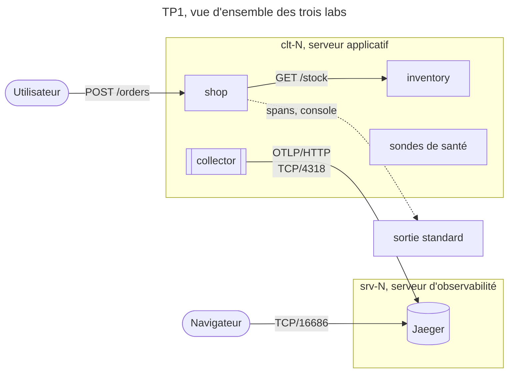

# Lab TP1 : Socle, premier **collector** et processors

Le TP1 se déroule en trois labs, qui s'enchaînent sur les mêmes machines :

- [TP1A : Voir la valeur](Lab_TP01A_Voir_la_valeur.md) : la télémétrie d'une application s'affiche dans la console, sans **collector** ni backend. Vous lisez et analysez les spans en ligne de commande.
- [TP1B : Un **collector**, de l'application vers Jaeger](Lab_TP01B_Collector_vers_Jaeger.md) : un **collector** basique reçoit les traces de l'application et les envoie à Jaeger, sur une autre machine. Vous diagnostiquez à distance, depuis le navigateur.
- [TP1C : Affiner le pipeline](Lab_TP01C_Affiner_le_pipeline.md) : Jaeger montre du bruit. Vous le retirez avec les processors `filter`, `transform` et le langage OTTL, avec un avant et un après visibles.

# Objectifs

À la fin du TP1, vous saurez :

- lire la télémétrie d'une application instrumentée, retrouver un span racine, ses enfants, une panne et une lenteur, d'abord dans la console puis dans l'interface de Jaeger ;
- écrire la configuration d'un **collector** : un receiver OTLP, des exporters, et un pipeline de traces ;
- diagnostiquer une application à distance, depuis un serveur d'observabilité, sans ouvrir de session sur le serveur applicatif ;
- ajouter les processors `memory_limiter`, `batch` et `resource`, et expliquer pourquoi leur ordre compte ;
- supprimer des spans avec le processor `filter`, puis masquer et normaliser des attributs avec le processor `transform` et le langage OTTL.

# Contenu

- [Environnement](#environnement)
- [Les trois labs](#les-trois-labs)
- [Le signal traces](#le-signal-traces)

# Détail

## Environnement

Le TP1 se déroule sur deux machines : `clt-N` et `srv-N`, où N est votre numéro de participant.

`clt-N` joue le rôle du serveur applicatif : c'est là que tournent l'application et le **collector**. `srv-N` joue le rôle du serveur d'observabilité : c'est là que tourne Jaeger. Cette répartition est celle de tout le TP1, et c'est elle qui permet de diagnostiquer l'application sans se connecter à sa machine.

Vous travaillez depuis le terminal web de `clt-N`, dans `/root`. Le dépôt des labs y est déjà cloné, dans `/root/opentelemetry-labs`. Les commandes destinées à `srv-N` passent par SSH depuis `clt-N` : la clé de `root` y donne accès sans mot de passe.

Un formulaire demande un nom d'utilisateur et le mot de passe communiqué par l'animateur. Vous pouvez copier-coller entre votre poste et le terminal web : Ctrl+Maj+C et Ctrl+Maj+V dans Firefox, Ctrl+Shift+C et Ctrl+Shift+V dans Chrome, ou le clic droit selon le navigateur.

### Variables d'environnement

La machine est déjà configurée avec des variables d'environnement utilisées par tous les labs, disponibles dans chaque terminal :

```bash
echo $LAB_ID $CLT_HOST $SRV_HOST
```

On obtient (N est votre numéro de participant) :

```text
N clt-N.<domaine> srv-N.<domaine>
```

- `LAB_ID` : votre numéro de participant ;
- `CLT_HOST` : le nom de la machine cliente, `clt-N.<domaine>` ;
- `SRV_HOST` : le nom de la machine serveur, `srv-N.<domaine>`.

### Mise en place

Le TP1 se prépare lui-même : rien ne doit rester d'un autre lab sur les machines.

Récupérez les fichiers fournis depuis le clone des labs, dans un dossier de travail :

```bash
rm -rf ~/tp01
mkdir -p ~/tp01
cp -r ~/opentelemetry-labs/config/tp01/. ~/tp01/
cd ~/tp01
ls
```

On obtient :

```text
app  check.sh  compose-srv.yaml  compose.yaml  order.sh  tg.sh
```

Construisez l'image de l'application et récupérez les images des outils. Les versions sont épinglées, les téléchargements ne se reproduiront pas en séance :

```bash
docker compose build
docker pull ghcr.io/open-telemetry/opentelemetry-collector-releases/opentelemetry-collector-contrib:0.165.0
docker pull ghcr.io/open-telemetry/opentelemetry-collector-contrib/telemetrygen:v0.165.0
docker pull curlimages/curl:8.11.0
```

Récupérez l'image de Jaeger sur la machine serveur, où elle sera démarrée [au TP1B](Lab_TP01B_Collector_vers_Jaeger.md) :

```bash
ssh root@$SRV_HOST 'docker pull jaegertracing/jaeger:2.23.0'
```

Vérifiez que la connexion SSH vers `srv-N` fonctionne sans mot de passe :

```bash
ssh root@$SRV_HOST hostname
```

On obtient le nom de la machine serveur :

```text
srv-N
```

Aucun service n'est démarré à ce stade : chaque lab démarre ce dont il a besoin.

### Versions utilisées dans ce TP

| Composant | Version |
|---|---|
| **collector** OpenTelemetry (distribution `otelcol-contrib`) | 0.165.0 |
| telemetrygen | v0.165.0 |
| Jaeger | 2.23.0 |
| curl (image des sondes de santé) | 8.11.0 |
| Application (image `python:3.13.18-slim`, Flask 3.1.3) | SDK OpenTelemetry 1.45.2 |

> [!TIP]
>
> Le tag de l'image du **collector** est `0.165.0` alors que celui de `telemetrygen` est `v0.165.0` (avec le `v`).

## Les trois labs



Le chemin des données évolue au fil des labs. En 1A, les spans sortent sur la console des conteneurs, et le schéma se réduit à l'application. En 1B, le **collector** apparaît à côté de l'application et envoie vers Jaeger, sur `srv-N`. En 1C, le pipeline du **collector** se remplit de processors, qui s'exécutent tous sur `clt-N`, avant l'envoi : les données partent déjà traitées vers le serveur d'observabilité.

## Le signal traces

Ce TP ne traite que le signal traces. Les métriques et les logs d'application arrivent plus tard dans la formation : chaque lab se concentre sur un sujet, et les trois signaux n'ont rien à gagner à être vus en même temps.

Le backend, Jaeger, ne sert qu'à montrer les résultats : il est fourni, tout-en-un, avec un stockage en mémoire. Vous n'écrivez aucune configuration de backend dans ce TP.

Commencez par [le TP1A](Lab_TP01A_Voir_la_valeur.md).
