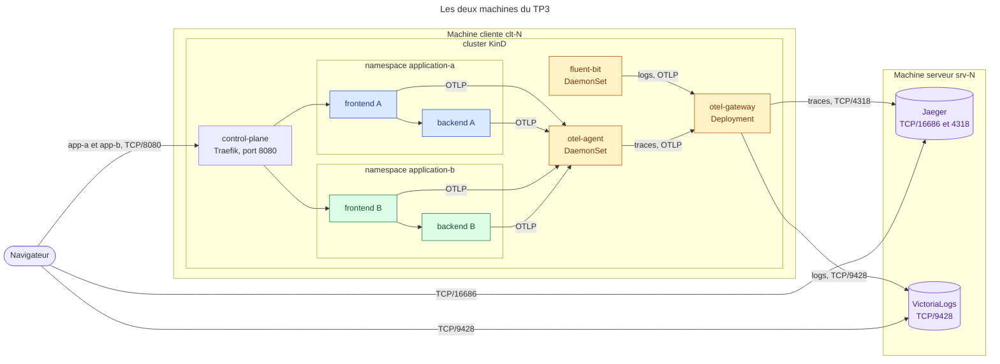
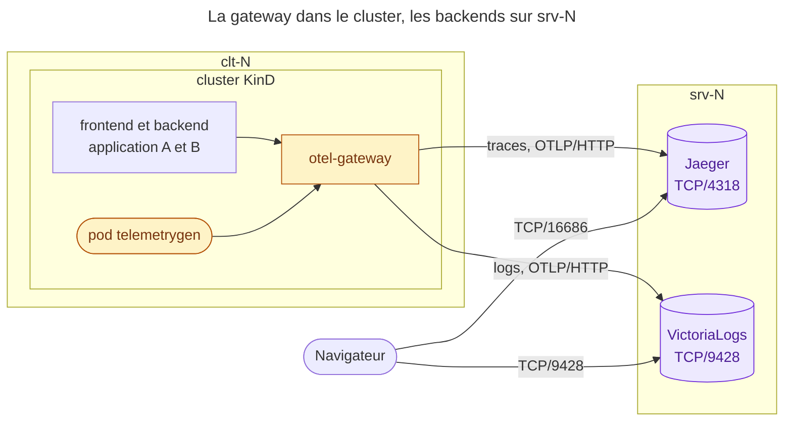
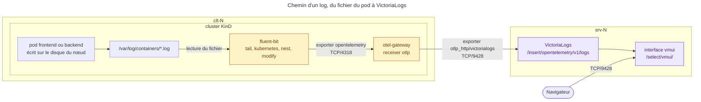
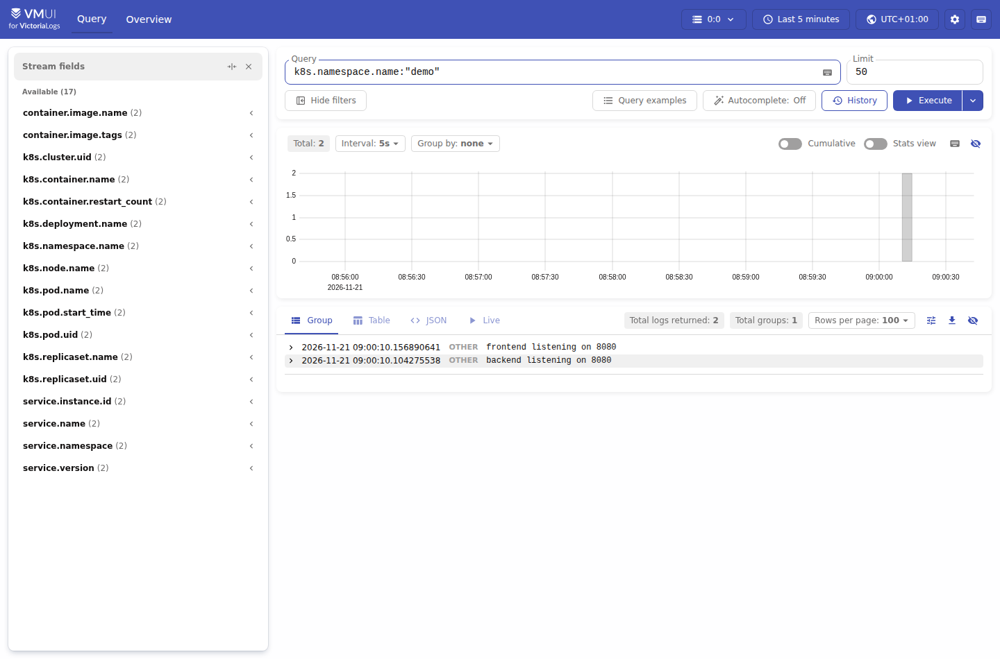
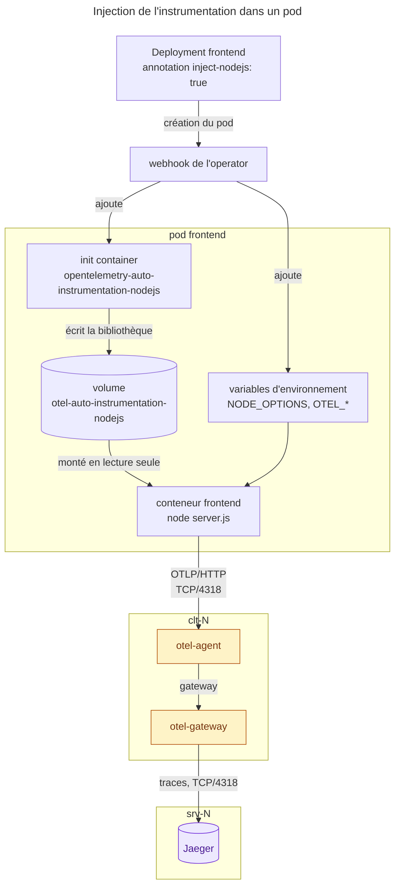
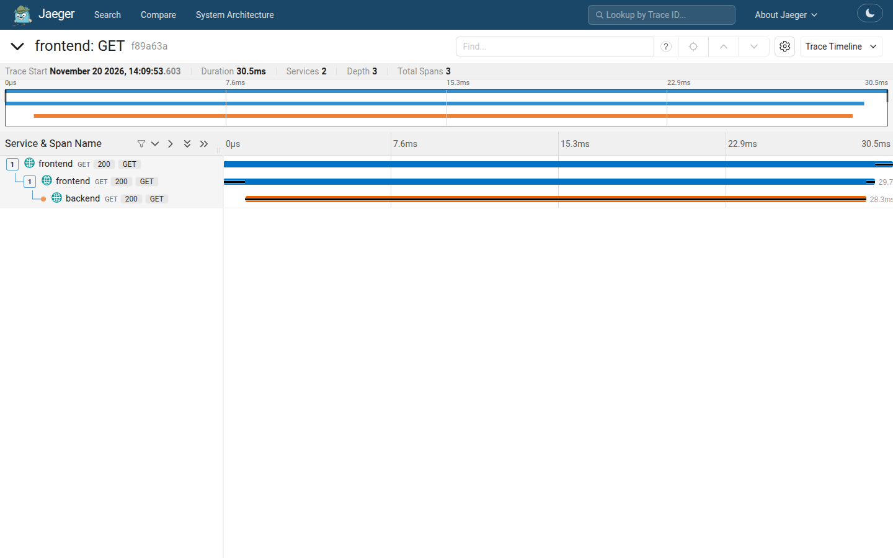

# Lab TP3 : **collector** sur Kubernetes, **gateway**, **agent** et **operator**

# Objectifs

À la fin du lab, vous saurez :

- déployer un **collector** en mode **gateway** puis en mode **agent** (DaemonSet) avec le chart Helm officiel, et adapter sa configuration par un fichier de valeurs ;
- expliquer comment le chart fusionne votre configuration avec ses valeurs par défaut et ce que fait un preset ;
- placer les backends hors du cluster et router vers eux les traces et les logs depuis la **gateway** ;
- collecter les logs des pods avec Fluent Bit sur les nœuds et les interroger en LogsQL dans VictoriaLogs ;
- installer l'OpenTelemetry **operator**, auto-instrumenter un déploiement par une annotation et suivre une trace de bout en bout dans Jaeger.

# Contenu

- [Environnement](#environnement)
- [1. Préparer le cluster et les applications](#1-préparer-le-cluster-et-les-applications)
- [2. Les backends sur srv-N et la **gateway**](#2-les-backends-sur-srv-n-et-la-gateway)
- [3. Le **collector** en mode **agent**](#3-le-collector-en-mode-agent)
- [4. Les logs des pods avec Fluent Bit](#4-les-logs-des-pods-avec-fluent-bit)
- [5. L'**operator** et l'auto-instrumentation](#5-loperator-et-lauto-instrumentation)
- [Cleanup](#cleanup)
- [Extra](#extra)

# Détail

## Environnement

Ce lab se déroule sur deux machines : `clt-N`, la machine cliente qui héberge un cluster Kubernetes local créé avec KinD (un nœud control-plane et trois workers), et `srv-N`, la machine serveur qui héberge les backends, Jaeger et VictoriaLogs.

Vous travaillez depuis le terminal web de `clt-N`, dans `/root`, et le dépôt des labs y est déjà cloné dans `/root/opentelemetry-labs`. Les commandes destinées à `srv-N` passent par SSH depuis `clt-N` : la clé de `root` y donne accès sans mot de passe.

Le [TP1](Lab_TP01_Socle.md) est conseillé : il présente les **receiver**, **processor** et **exporter** du **collector**, qui ne sont pas réexpliqués ici.

Versions utilisées dans ce lab :

| Composant | Version |
|---|---|
| Gateway API | v1.7.0 |
| Traefik (chart / image) | 42.4.1 / 3.7.19 |
| Chart Helm `opentelemetry-collector` | 0.179.1 |
| Image du **collector** (distribution `otelcol-contrib`) | 0.163.2 (version du chart) |
| Chart Helm `opentelemetry-operator` | 0.129.1 |
| Image de l'**operator** | 0.162.0 |
| Image d'auto-instrumentation Node.js | 0.82.0-1 |
| Chart Helm `fluent-bit` | 0.58.3 |
| Image Fluent Bit | 5.1.3 |
| Jaeger | 2.23.0 |
| VictoriaLogs (stockage et interface des logs) | v1.54.0 |
| Node.js (application de démonstration) | 22.23.5 |
| telemetrygen | v0.165.0 |

Les applications passent par la Gateway API du cluster, publiée sur le port `TCP/8080` de la machine `clt-N` :

- application A : `http://app-a.$INGRESS_HOST:8080` ;
- application B : `http://app-b.$INGRESS_HOST:8080`.

Les interfaces des backends sont servies directement par `srv-N` :

- Jaeger : `http://$SRV_HOST:16686` ;
- VictoriaLogs : `http://$SRV_HOST:9428`.

`INGRESS_HOST` est le nom qui pointe vers `clt-N` (`echo $INGRESS_HOST`), `SRV_HOST` celui de `srv-N` (`echo $SRV_HOST`).

## 1. Préparer le cluster et les applications

Les deux machines jouent un rôle distinct : `clt-N` porte le cluster et ce que l'on observe, `srv-N` porte les backends. Le schéma suivant montre l'ensemble du dispositif, y compris les briques de télémétrie installées dans les parties suivantes. Les couleurs séparent les éléments : en bleu l'application A, en vert l'application B, en ambre les briques de télémétrie, en violet les backends :



Le cluster se traverse de bout en bout : la Gateway API reçoit le trafic web du navigateur, les pods des deux applications produisent la télémétrie, et les deux **collector** la collectent avant de l'envoyer aux backends de `srv-N`. Un **agent** par nœud reçoit les traces des applications ; Fluent Bit, lui aussi un par nœud, lit les fichiers de logs ; la **gateway** centralise l'export.

### Créer le cluster

Copiez les fichiers du TP dans un dossier de travail :

```bash
mkdir -p ~/tp03
cp -r ~/opentelemetry-labs/config/tp03/. ~/tp03/
cd ~/tp03
ls
```

On obtient :

```text
app-a.yaml  app-b.yaml  compose.yaml  helpers.sh  namespaces.yaml
```

Le cluster, lui, est commun à tous les TP Kubernetes : sa configuration et son script de lancement sont dans `config/cluster/` du dépôt, au même endroit pour chaque TP. Affichez la configuration :

```bash
cat ~/opentelemetry-labs/config/cluster/kind-config.yaml
```

```yaml
kind: Cluster
apiVersion: kind.x-k8s.io/v1alpha4
# Nom unique, commun à tous les TP Kubernetes : une machine n'héberge
# qu'un seul cluster, et cluster-create.sh supprime le précédent.
name: cluster
nodes:
  - role: control-plane
    extraPortMappings:
      # Port 80 du nœud, publié sur la machine en 8080 : c'est par là
      # qu'entre le trafic du navigateur vers la Gateway API.
      - containerPort: 80
        hostPort: 8080
        protocol: TCP
  - role: worker
  - role: worker
  - role: worker
```

Chaque bloc de ce fichier a un rôle précis :

- `kind: Cluster` et `apiVersion` : le format attendu par `kind`, qui reprend la convention de versionnage des manifestes Kubernetes ;
- `nodes` : la liste des nœuds. Chaque ligne `- role: worker` ajoute un worker ; trois lignes donnent trois workers ;
- `extraPortMappings` : le port 80 du conteneur control-plane est publié sur la machine `clt-N` en 8080. C'est par là qu'entrera le trafic du navigateur. Les ports 80 et 443 de la machine servent au terminal web.

**NB** : `apiVersion: kind.x-k8s.io/v1alpha4` n'a pas de version stable. Le projet `kind` a repris la convention de Kubernetes pour versionner son fichier de configuration, mais n'a jamais promu cette API au-delà de sa première version alpha : `v1alpha4` est la seule acceptée par les versions récentes, et son format n'a pas changé depuis 2020. L'étiquette `alpha` ne signifie donc pas que le format est instable, seulement qu'il n'offre aucune garantie de compatibilité à long terme : une future version de `kind` peut introduire `v1alpha5`, et c'est pourquoi la version figure explicitement dans le fichier, comme dans un manifeste Kubernetes.

Le cluster porte toujours le nom `cluster`, quel que soit le TP : chaque TP Kubernetes le recrée à l'identique. Affichez le script de lancement, puis exécutez-le :

```bash
cat ~/opentelemetry-labs/config/cluster/cluster-create.sh
bash ~/opentelemetry-labs/config/cluster/cluster-create.sh
```

Le script tient en trois étapes : `kind get clusters` liste ce qui tourne, `kind delete cluster --name <nom>` supprime chaque cluster trouvé, et `kind create cluster --config kind-config.yaml` crée le nouveau avec le fichier ci-dessus, lu dans le même dossier. Il supprime tous les clusters présents, et pas seulement celui nommé `cluster` : un cluster laissé sous un autre nom occuperait le port 8080 et ferait échouer la création.

**Attention** : le script efface les clusters présents, releases Helm, espaces de noms et données comprises. Un cluster neuf se reconstruit en rejouant le TP depuis le début.

On obtient quatre nœuds `Ready` :

```text
NAME                    STATUS   ROLES           AGE   VERSION
cluster-control-plane   Ready    control-plane   2m    v1.37.0
cluster-worker          Ready    <none>          1m    v1.37.0
cluster-worker2         Ready    <none>          1m    v1.37.0
cluster-worker3         Ready    <none>          1m    v1.37.0
```

Pour supprimer le cluster à la main : `kind get clusters` pour voir ce qui tourne, puis `kind delete cluster --name cluster`.

**NB** : KinD préfixe le nom de chaque nœud avec celui du cluster, fixé ici par la ligne `name: cluster` : les nœuds s'appellent donc `cluster-control-plane`, `cluster-worker`, `cluster-worker2` et `cluster-worker3`. Sans cette option, le cluster prendrait le nom par défaut `kind` et les nœuds s'appelleraient `kind-control-plane`, `kind-worker`, etc. Retenez le nom du nœud control-plane : c'est lui qui détient le port publié, et le fichier de valeurs de Traefik le cite.

### Installer la Gateway API

Le cluster n'expose rien par défaut. Pendant des années, on a installé un contrôleur d'Ingress, et l'API `Ingress` désignait le point d'entrée HTTP avec un seul objet, complété par des annotations propres à chaque produit. Cette API s'achève : l'Ingress NGINX historique n'est plus maintenu au-delà de mars 2026, sans correctif de sécurité ensuite.

Son successeur est la **Gateway API**, un standard porté par le groupe de travail réseau de Kubernetes. Trois caractéristiques le distinguent de l'Ingress :

- il est défini comme une famille de types communs (`GatewayClass`, `Gateway`, `HTTPRoute`, `GRPCRoute`, `TLSRoute`...) que plusieurs implémentations concurrentes prennent en charge, Traefik, Envoy Gateway, NGINX Gateway Fabric, Cilium et Istio notamment : une route écrite pour la Gateway API n'est pas liée à un produit ;
- il sépare les rôles : l'exploitant déclare la `Gateway`, c'est-à-dire le point d'entrée et son port, et chaque équipe applicative déclare ses `HTTPRoute` dans son propre espace de noms ;
- il étend le routage au-delà du HTTP (gRPC, TCP, TLS) au lieu de le limiter au trafic web.

Dans ce TP, la Gateway API reçoit le trafic HTTP des deux applications. Elle ne transporte pas la télémétrie : le mot **gateway** employé ensuite, en gras, désigne un rôle d'OpenTelemetry, et [la partie 2](#2-les-backends-sur-srv-n-et-la-gateway) revient sur cette distinction.

La Gateway API se compose de deux objets principaux :

- une ressource `Gateway`, qui déclare un point d'entrée : un port, un protocole, et quelles routes sont acceptées ;
- une ressource `HTTPRoute`, qui décrit le routage : pour quel nom d'hôte, vers quel Service.

L'API ne fait rien par elle-même : il faut une implémentation. Vous utilisez Traefik, qui sait tourner en DaemonSet et occuper directement le port 80 des nœuds, ce qui se combine bien avec le port publié par KinD.

Installez d'abord les types de ressources de la Gateway API. Les implémentations ne les fournissent pas : sans elles, toute installation de `Gateway` échoue sur un type inconnu.

```bash
kubectl apply -f https://github.com/kubernetes-sigs/gateway-api/releases/download/v1.7.0/standard-install.yaml
kubectl get crd | grep -c gateway.networking.k8s.io
```

On obtient `10` : le standard comprend les types `GatewayClass`, `Gateway`, `HTTPRoute`, `GRPCRoute`, `TCPRoute`, `TLSRoute`, `UDPRoute` et quelques autres.

Installez ensuite Traefik, configuré par un fichier de valeurs :

```bash
helm repo add traefik https://traefik.github.io/charts
helm repo update
cat > traefik-values.yaml <<'EOF'
deployment:
  kind: DaemonSet
ports:
  web:
    hostPort: 80
providers:
  kubernetesGateway:
    enabled: true
gateway:
  enabled: true
  listeners:
    web:
      namespacePolicy:
        from: All
tolerations:
  - key: node-role.kubernetes.io/control-plane
    operator: Exists
    effect: NoSchedule
EOF
helm install traefik traefik/traefik -n traefik --create-namespace \
  -f traefik-values.yaml --wait
```

**NB** : le chart affiche un rappel sur les CRD Gateway API, alors qu'elles viennent d'être installées. C'est un message du chart, sans conséquence ici.

Chaque réglage a son rôle :

- `deployment.kind: DaemonSet` : un pod par nœud, comme une brique d'infrastructure ;
- `ports.web.hostPort: 80` : le pod prend le port 80 du nœud directement, dans le conteneur. Côté machine, ce port 80 est celui que KinD publie sur `TCP/8080` ;
- `providers.kubernetesGateway.enabled` : Traefik lit les ressources `Gateway` et `HTTPRoute` ;
- `gateway.enabled` : le chart crée lui-même une ressource `Gateway` et sa `GatewayClass`, au lieu de vous demander de les écrire ;
- `namespacePolicy.from: All` : par défaut, une `Gateway` n'accepte que les routes de son propre espace de noms. Sans ce réglage, les routes de `application-a` et d'`application-b` seraient ignorées ;
- `tolerations` : le nœud control-plane porte une interdiction (`taint`) qui écarte les pods ordinaires. Or c'est lui qui détient le port publié vers la machine : le pod Traefik doit donc y être toléré.

Vérifiez le résultat :

```bash
kubectl -n traefik get pods -o wide
kubectl get gatewayclass,gateway -n traefik
```

Le DaemonSet a quatre pods, dont un sur `cluster-control-plane` :

```text
NAME            READY   STATUS    RESTARTS   AGE   NODE
traefik-42l42   1/1     Running   0          19s   cluster-control-plane
traefik-85pkg   1/1     Running   0          19s   cluster-worker
traefik-khs6m   1/1     Running   0          19s   cluster-worker3
traefik-rl52k   1/1     Running   0          19s   cluster-worker2
```

Le chart a créé la `GatewayClass traefik` et la `Gateway traefik-gateway` :

```text
NAME                                             CONTROLLER                      ACCEPTED   AGE
gatewayclass.gateway.networking.k8s.io/traefik   traefik.io/gateway-controller   True       30m

NAME                                                CLASS     ADDRESS   PROGRAMMED   AGE
gateway.gateway.networking.k8s.io/traefik-gateway   traefik             True         30m
```

**NB** : les autres implémentations (NGINX Gateway Fabric, Envoy Gateway) exposent leur plan de données derrière un Service, de type `LoadBalancer` ou `NodePort`, et non par un `hostPort`. Avec KinD, cela demande en plus une adresse de type LoadBalancer (MetalLB) ou un port de nœud fixé puis publié. C'est la raison du choix de Traefik ici.

### Comprendre `INGRESS_HOST`

Une `HTTPRoute` route les requêtes selon le nom d'hôte demandé : la route de l'application A ne répond que si la requête porte l'en-tête `Host: app-a.<INGRESS_HOST>`, celle de l'application B seulement pour `app-b.<INGRESS_HOST>`. Une même adresse IP sert ainsi plusieurs services, séparés par le nom.

Comme le cluster tourne sur `clt-N`, `INGRESS_HOST` doit être un nom qui pointe vers cette machine depuis votre navigateur. Le plus simple est le service `sslip.io`, qui transforme une adresse IP en nom : `178-62-255-117.sslip.io` pointe vers `178.62.255.117`. La fonction d'aide le calcule à partir de l'adresse publique de la machine :

```bash
source helpers.sh
echo $INGRESS_HOST $SRV_HOST
```

On obtient deux noms de la forme :

```text
178-62-255-117.sslip.io srv-0.monlab.top
```

Les fonctions `appA` et `appB` de `helpers.sh` appellent la `Gateway` par `http://localhost:8080` avec le bon en-tête `Host`, ce qui évite de dépendre de la résolution DNS de sslip.io. Les fonctions `jaeger` et `vlogs`, elles, interrogent les backends de `srv-N` sur `$SRV_HOST`. Rechargez ces fonctions avec `source ~/tp03/helpers.sh` dans chaque nouveau terminal.

### Déployer les deux applications

Le dossier contient trois manifestes Kubernetes : `namespaces.yaml` (les espaces de noms `observability`, `application-a` et `application-b`), `app-a.yaml` et `app-b.yaml`.

Les deux applications sont volontairement identiques : même image, même code, mêmes deux services `frontend` et `backend`. Seuls changent l'espace de noms et le nom d'hôte. C'est la situation d'une plateforme qui héberge plusieurs équipes, et c'est ce qui permettra de vérifier que le namespace voyage bien avec les données.

Chaque application est écrite en JavaScript et tient dans un ConfigMap : les pods l'exécutent avec l'image `node:22.23.5-slim`, sans aucune bibliothèque OpenTelemetry dans un premier temps. Chaque service écoute sur le port `8080` dans son pod, derrière un Service Kubernetes sur le port 80. Le frontend journalise chaque requête reçue (`console.log`) et appelle le backend sur les chemins qui commencent par `/api`.

Les deux manifestes applicatifs déclarent une `HTTPRoute` et contiennent le texte `INGRESS_HOST`, que `sed` remplace par votre nom avant l'envoi au cluster :

```bash
kubectl apply -f namespaces.yaml
sed "s/INGRESS_HOST/$INGRESS_HOST/g" app-a.yaml | kubectl apply -f -
sed "s/INGRESS_HOST/$INGRESS_HOST/g" app-b.yaml | kubectl apply -f -
kubectl -n application-a rollout status deployment/frontend deployment/backend
kubectl -n application-b rollout status deployment/frontend deployment/backend
```

Regardez où sont les pods ; ils se répartissent sur les workers, pas sur le control-plane, et les deux applications cohabitent :

```bash
kubectl -n application-a get pods -o wide
kubectl -n application-b get pods -o wide
```

On obtient par exemple :

```text
NAME                        READY   STATUS    RESTARTS   AGE   IP           NODE
backend-6bc7bd9b8d-4ftph    1/1     Running   0          8s    10.244.2.3   cluster-worker
frontend-7cd9b8f4d7-dwpp6   1/1     Running   0          8s    10.244.3.3   cluster-worker2
```

Les mêmes noms de pods apparaissent dans `application-a` et dans `application-b`, avec des adresses IP différentes : deux objets Kubernetes distincts, dans deux espaces de noms distincts.

Contrôlez que les deux applications répondent, à travers la Gateway API :

```bash
curl -s -H "Host: app-a.$INGRESS_HOST" http://localhost:8080/api/orders
curl -s -H "Host: app-b.$INGRESS_HOST" http://localhost:8080/api/orders
```

Les deux commandes affichent la même réponse JSON, une fois par application :

```text
{"from":"frontend","backend":{"from":"backend","path":"/api/orders"}}
```

Ce sont exactement ces deux `curl` que les fonctions `appA` et `appB` de `helpers.sh` exécutent ; la suite du lab les emploie pour abréger. Rien ne collecte encore cette activité : les backends arrivent [à la partie 2](#2-les-backends-sur-srv-n-et-la-gateway), et l'instrumentation [à la partie 5](#5-loperator-et-lauto-instrumentation).

## 2. Les backends sur srv-N et la **gateway**

Dans une installation réelle, les backends ne vivent pas dans le cluster qu'ils observent : ils collectent les données de plusieurs clusters et survivent à leur recréation. Vous les installez donc sur `srv-N`, avec Docker Compose, et le cluster les joint par le réseau. Le schéma suivant montre ce chemin, avec la **gateway** dans le cluster et les deux backends sur la machine serveur :



**NB** : le mot **gateway** désigne ici un rôle du monde OpenTelemetry, à ne pas confondre avec la ressource `Gateway` de Kubernetes installée [à la partie 1](#1-préparer-le-cluster-et-les-applications), qui est le point d'entrée HTTP du cluster. La **gateway** OpenTelemetry reçoit de la télémétrie, la `Gateway` de la Gateway API reçoit du trafic web.

### Démarrer les backends

Le fichier `compose.yaml` du dossier décrit deux services : Jaeger, qui reçoit les traces en OTLP/HTTP sur `TCP/4318` et sert son interface sur `TCP/16686`, et VictoriaLogs, qui reçoit les logs sur `TCP/9428` et sert à la fois l'ingestion, la requête et son interface web. Affichez-le :

```bash
cat compose.yaml
```

Le dépôt des labs est aussi cloné sur `srv-N` : copiez le fichier sur la machine serveur, puis démarrez les deux conteneurs :

```bash
ssh root@$SRV_HOST 'mkdir -p ~/tp03 && cp /root/opentelemetry-labs/config/tp03/compose.yaml ~/tp03/'
ssh root@$SRV_HOST 'cd ~/tp03 && docker compose up -d'
ssh root@$SRV_HOST 'cd ~/tp03 && docker compose ps --format "{{.Service}} {{.State}}"'
```

On obtient :

```text
jaeger running
victoria-logs running
```

Vérifiez que chaque interface répond :

```bash
curl -s -o /dev/null -w '%{http_code}\n' http://$SRV_HOST:16686/
curl -s -o /dev/null -w '%{http_code}\n' http://$SRV_HOST:9428/health
```

On obtient `200` deux fois. Jaeger ne contient encore aucune trace :

```bash
curl -s http://$SRV_HOST:16686/api/v3/services
```

```text
{"services":[]}
```

Ouvrez maintenant Jaeger dans le navigateur, sur `http://$SRV_HOST:16686` : le sélecteur de service ne propose aucun service et le bouton Find Traces ne renvoie rien. C'est l'état de départ du TP : les parties suivantes font apparaître `frontend` et `backend` au fur et à mesure de l'instrumentation.


**NB** : Jaeger stocke les traces en mémoire, et VictoriaLogs dans le volume Docker `vlogs`, avec une rétention d'un jour. Aucun des deux n'a d'authentification : ce sont des backends de démonstration, joignables sur les ports publiés de la machine serveur. En production, ils seraient derrière TLS et sur le réseau privé. Dans ce lab, la **gateway** les joint par leur nom public : depuis un pod du cluster, la connexion sort par le réseau Docker de `clt-N`, qui la traduit (NAT), puis revient par `srv-N`.

### Créer la **gateway**

Une **gateway** est un **collector** central, déployé comme un Deployment, qui reçoit les données de plusieurs sources et les envoie aux backends. Vous la déployez avec le chart Helm officiel, puis vous lui ferez recevoir les traces [à la partie 3](#3-le-collector-en-mode-agent) et les logs [à la partie 4](#4-les-logs-des-pods-avec-fluent-bit).

Ajoutez le dépôt de charts :

```bash
helm repo add open-telemetry https://opentelemetry.github.io/opentelemetry-helm-charts
helm repo update
```

Le chart se configure par un fichier de valeurs. Le chart n'impose pas d'image par défaut : il faut indiquer la distribution `contrib` et le nom de son exécutable.

La configuration du **collector** se place sous la clé `config:` de ce fichier. Le chart la fusionne avec sa configuration par défaut : les dictionnaires sont fusionnés, les listes sont remplacées.

Créez le fichier complet. Il contient deux exporters et deux pipelines :

- `otlp_http/jaeger`, vers `http://<srv-N>:4318`, pour les traces ;
- `otlp_http/victorialogs`, vers `http://<srv-N>:9428/insert/opentelemetry/v1/logs`, pour les logs ;
- un pipeline `traces` et un pipeline `logs`, chacun avec le receiver `otlp` et les processors `memory_limiter` puis `batch`.

Le délimiteur `EOF` n'est pas entre guillemets ici, volontairement : le shell remplace `$SRV_HOST` par le nom de votre machine serveur pendant la création du fichier.

```bash
cat > gateway-values.yaml <<EOF
mode: deployment
fullnameOverride: otel-gateway
replicaCount: 1
image:
  repository: ghcr.io/open-telemetry/opentelemetry-collector-releases/opentelemetry-collector-contrib
  tag: "0.163.2"
command:
  name: otelcol-contrib
resources:
  limits:
    cpu: 250m
    memory: 256Mi
config:
  exporters:
    otlp_http/jaeger:
      endpoint: http://$SRV_HOST:4318
    otlp_http/victorialogs:
      logs_endpoint: http://$SRV_HOST:9428/insert/opentelemetry/v1/logs
  service:
    pipelines:
      traces:
        receivers: [otlp]
        processors: [memory_limiter, batch]
        exporters: [otlp_http/jaeger]
      logs:
        receivers: [otlp]
        processors: [memory_limiter, batch]
        exporters: [otlp_http/victorialogs]
EOF
```

Avant d'installer, regardez ce que le chart génère à partir de vos valeurs :

```bash
helm template otel-gateway open-telemetry/opentelemetry-collector --version 0.179.1 \
  -n observability -f gateway-values.yaml | grep -B2 -A60 'relay:'
```

Repérez ce que vous n'avez pas écrit : l'extension `health_check`, les receivers par défaut (`zipkin`, `jaeger`...), et le pipeline `metrics`. C'est la fusion du chart avec ses propres valeurs. Les pipelines `traces` et `logs`, eux, viennent de votre fichier : vos listes remplacent celles du chart.

Installez ensuite la **gateway** :

```bash
helm upgrade --install otel-gateway open-telemetry/opentelemetry-collector \
  --version 0.179.1 -n observability -f gateway-values.yaml --wait
```

Envoyez cinq traces de test depuis un pod temporaire, avec `telemetrygen` :

```bash
kubectl -n application-a run tg-gateway --restart=Never --rm -i \
  --image=ghcr.io/open-telemetry/opentelemetry-collector-contrib/telemetrygen:v0.165.0 -- \
  traces --otlp-endpoint otel-gateway.observability.svc.cluster.local:4317 \
  --otlp-insecure --rate 10 --traces 5 --service k8s-gateway
```

Contrôlez le pod et le nombre de traces reçues par Jaeger, sur `srv-N` :

```bash
kubectl -n observability get pods -l app.kubernetes.io/instance=otel-gateway
jaeger "/api/v3/traces?query.service_name=k8s-gateway&query.startTimeMin=$(date -u -d '10 minutes ago' +%Y-%m-%dT%H:%M:%SZ)&query.startTimeMax=$(date -u -d '+1 minute' +%Y-%m-%dT%H:%M:%SZ)" \
  | jq '[.result.resourceSpans[].scopeSpans[].spans[].traceId] | unique | length'
```

La première commande affiche un pod `otel-gateway-...` à l'état `Running`, la seconde affiche :

```text
5
```

Les traces générées dans le cluster sont donc arrivées dans un backend extérieur, sans aucune publication de port sur le cluster : c'est la **gateway** qui sort.

**NB** : Jaeger 2.x n'a plus l'API v1 (`/api/traces`, `/api/services`) : seule l'API v3 (`/api/v3/...`) répond, et sa recherche de traces exige une fenêtre temporelle explicite (`startTimeMin` et `startTimeMax`).

## 3. Le **collector** en mode **agent**

Un **agent** est un **collector** déployé comme un DaemonSet : un pod par nœud, proche des applications. Il enrichit les données avec les métadonnées Kubernetes, puis les transmet à la **gateway OpenTelemetry**, c'est-à-dire au **collector** central installé [à la partie 2](#2-les-backends-sur-srv-n-et-la-gateway). Ce n'est pas la `Gateway` de la Gateway API de [la partie 1](#1-préparer-le-cluster-et-les-applications), qui route le trafic web : l'**agent** ne parle qu'OTLP, vers un autre **collector**.

Le processor `k8s_attributes` interroge l'API Kubernetes pour retrouver, à partir de l'adresse IP du pod émetteur, son nom, son espace de noms, son déploiement et son nœud.

Deux réglages du fichier de valeurs méritent une explication. Le preset `kubernetesAttributes` ajoute au chart le processor `k8s_attributes` et les droits RBAC dont il a besoin pour lire l'API Kubernetes. Le réglage `service.enabled` crée un Service, que le chart ne crée pas par défaut pour un DaemonSet : en mode **agent**, ce Service est configuré avec `internalTrafficPolicy: Local`, de sorte qu'une application atteint toujours l'**agent** de son propre nœud.

L'**agent** ne collecte ici que les traces. Les logs des pods sont lus par Fluent Bit, [à la partie 4](#4-les-logs-des-pods-avec-fluent-bit), et partent directement à la **gateway**.

Listez vous-même `k8s_attributes` dans le pipeline : sans cela, le preset l'ajoute en première position, avant `memory_limiter`.

```bash
cat > agent-values.yaml <<'EOF'
mode: daemonset
fullnameOverride: otel-agent
image:
  repository: ghcr.io/open-telemetry/opentelemetry-collector-releases/opentelemetry-collector-contrib
  tag: "0.163.2"
command:
  name: otelcol-contrib
resources:
  limits:
    cpu: 250m
    memory: 256Mi
service:
  enabled: true
presets:
  kubernetesAttributes:
    enabled: true
config:
  exporters:
    otlp_grpc/gateway:
      endpoint: otel-gateway.observability.svc.cluster.local:4317
      tls:
        insecure: true
  service:
    pipelines:
      traces:
        receivers: [otlp]
        processors: [memory_limiter, k8s_attributes, batch]
        exporters: [otlp_grpc/gateway]
EOF
```

Installez l'**agent** :

```bash
helm upgrade --install otel-agent open-telemetry/opentelemetry-collector \
  --version 0.179.1 -n observability -f agent-values.yaml --wait
kubectl -n observability get daemonset otel-agent-agent
```

Le DaemonSet se nomme `otel-agent-agent` : le chart ajoute le suffixe `-agent` en mode daemonset, alors que le Service garde le nom `otel-agent`. Les colonnes `DESIRED` et `READY` sont égales.

Regardez où sont ses pods : un par worker, aucun sur le control-plane, qui garde son interdiction.

```bash
kubectl -n observability get pods -l app.kubernetes.io/instance=otel-agent -o wide
```

```text
NAME                READY   STATUS    RESTARTS   AGE   IP           NODE
otel-agent-agent-…  1/1     Running   0          20s   10.244.1.5   cluster-worker
otel-agent-agent-…  1/1     Running   0          20s   10.244.2.5   cluster-worker2
otel-agent-agent-…  1/1     Running   0          20s   10.244.3.5   cluster-worker3
```

Contrôlez que le compte de service de l'**agent** peut lire les pods de tous les espaces de noms, ce qui est la condition de l'enrichissement :

```bash
kubectl get clusterrolebinding | grep otel-agent
```

```text
NAME         ROLE                    AGE
otel-agent   ClusterRole/otel-agent  20s
```

Envoyez des traces de test à l'**agent**, cette fois, et non à la **gateway** :

```bash
kubectl -n application-a run tg-agent --restart=Never --rm -i \
  --image=ghcr.io/open-telemetry/opentelemetry-collector-contrib/telemetrygen:v0.165.0 -- \
  traces --otlp-endpoint otel-agent.observability.svc.cluster.local:4317 \
  --otlp-insecure --rate 10 --traces 5 --service k8s-agent
```

`telemetrygen` ne connaît pas Kubernetes : il produit des spans avec le strict minimum, sans savoir dans quel pod il s'exécute. C'est le processor `k8s_attributes` de l'**agent** qui complète la ressource de ces spans, en interrogeant l'API Kubernetes à partir de l'adresse IP d'où la connexion est arrivée. Les attributs n'existaient donc pas dans les données émises, et ils apparaissent grâce à l'**agent** :

```bash
jaeger "/api/v3/traces?query.service_name=k8s-agent&query.startTimeMin=$(date -u -d '10 minutes ago' +%Y-%m-%dT%H:%M:%SZ)&query.startTimeMax=$(date -u -d '+1 minute' +%Y-%m-%dT%H:%M:%SZ)" \
  | jq -r '[.result.resourceSpans[].resource.attributes[] | select(.key | startswith("k8s.")) | "\(.key)=\(.value.stringValue)"] | unique | .[]'
```

La commande affiche notamment :

```text
k8s.namespace.name=application-a
k8s.node.name=cluster-worker2
k8s.pod.name=tg-agent
```

Comparez avec les traces `k8s-gateway` envoyées directement à la **gateway** [à la partie 2](#2-les-backends-sur-srv-n-et-la-gateway), qui n'ont pas ces attributs : la même requête, avec `query.service_name=k8s-gateway`, n'affiche aucune ligne `k8s.`. L'enrichissement vient bien de l'**agent**.

## 4. Les logs des pods avec Fluent Bit

Les logs d'un pod ne sont pas dans le pod : le runtime les écrit dans un fichier, sur le disque de son nœud, sous `/var/log/containers/`. Une **gateway** centralisée ne peut pas les lire, puisqu'elle ne voit pas ce disque. Il faut donc un pod par nœud, avec un accès au dossier des nœuds : un DaemonSet.

Deux familles d'outils remplissent ce rôle. Le chart du **collector** propose un preset `logsCollection`, qui monte `/var/log/pods` dans l'**agent** et ajoute un receiver `file_log` capable de lire ces fichiers. Fluent Bit est l'autre réponse, et la plus répandue dans les clusters Kubernetes : c'est un agent de collecte de logs indépendant d'OpenTelemetry, qui parle OTLP depuis sa version 3. Vous retenez Fluent Bit ici, pour deux raisons : il est souvent déjà déployé, et il décharge l'**agent** du travail de lecture des fichiers. La suite du pipeline reste identique, un export OTLP vers la **gateway**.

Le schéma suivant montre le chemin d'un log, du fichier du nœud à VictoriaLogs :



Trois points se lisent sur ce schéma :

- le log est **lu sur le disque du nœud**, par le pod de Fluent Bit qui tourne sur ce nœud : c'est ce qui impose un DaemonSet ;
- Fluent Bit ajoute les métadonnées du conteneur, puis envoie à la **gateway** en OTLP/HTTP, sur le port `4318` du Service ;
- la **gateway** réexporte vers VictoriaLogs, dont l'endpoint d'ingestion est `/insert/opentelemetry/v1/logs` et qui n'accepte que le protobuf. L'interface `vmui` lit ensuite les données stockées.

### Installer Fluent Bit

Le chart officiel de Fluent Bit lit déjà `/var/log/containers/*.log` et applique le filtre `kubernetes`, qui retrouve l'espace de noms, le pod, le conteneur et le nœud à partir du nom du fichier. Il reste à renommer ces champs au format des conventions OpenTelemetry (`k8s.*`) et à déclarer l'export OTLP.

Créez le fichier de valeurs :

```bash
helm repo add fluent https://fluent.github.io/helm-charts
helm repo update
cat > fluent-bit-values.yaml <<'EOF'
kind: DaemonSet
image:
  repository: cr.fluentbit.io/fluent/fluent-bit
  tag: "5.1.3"
config:
  filters: |
    [FILTER]
        Name kubernetes
        Match kube.*
        Merge_Log On
        Keep_Log On
        K8S-Logging.Parser On
        K8S-Logging.Exclude On

    [FILTER]
        Name nest
        Match kube.*
        Operation lift
        Nested_under kubernetes
        Add_prefix kubernetes.

    [FILTER]
        Name modify
        Match kube.*
        Rename kubernetes.namespace_name k8s.namespace.name
        Rename kubernetes.pod_name k8s.pod.name
        Rename kubernetes.container_name k8s.container.name
        Rename kubernetes.host k8s.node.name

  outputs: |
    [OUTPUT]
        Name opentelemetry
        Match kube.*
        Host otel-gateway.observability.svc.cluster.local
        Port 4318
        Tls Off
        logs_uri /v1/logs
        logs_body_key log
        logs_body_key_attributes true
EOF
```

Les filtres s'enchaînent dans cet ordre :

- `kubernetes` ajoute un dictionnaire `kubernetes` au message, avec les métadonnées du conteneur ;
- `nest` fait remonter les clés de ce dictionnaire à la racine du message, préfixées par `kubernetes.` : Fluent Bit ne sait renommer que des clés de premier niveau ;
- `modify` renomme ces clés au format `k8s.*` attendu par la suite du pipeline.

Dans l'output, `logs_body_key log` place la ligne applicative dans le corps de l'enregistrement OTLP, ce qui donne un message lisible dans VictoriaLogs, et `logs_body_key_attributes true` conserve les autres champs comme attributs.

Installez Fluent Bit :

```bash
helm upgrade --install fluent-bit fluent/fluent-bit --version 0.58.3 \
  -n observability -f fluent-bit-values.yaml --wait
kubectl -n observability get pods -l app.kubernetes.io/name=fluent-bit -o wide
```

Le DaemonSet a un pod par worker :

```text
NAME              READY   STATUS    RESTARTS   AGE   IP           NODE
fluent-bit-2xk7q  1/1     Running   0          25s   10.244.1.6   cluster-worker
fluent-bit-9dvsm  1/1     Running   0          25s   10.244.2.6   cluster-worker2
fluent-bit-hw4lp  1/1     Running   0          25s   10.244.3.6   cluster-worker3
```

**NB** : l'input `tail` du chart ne relit pas les fichiers depuis le début (`Read_From_Head` n'est pas activé) : Fluent Bit ne collecte que les lignes écrites après son démarrage. Les lignes de démarrage des pods, écrites [à la partie 1](#1-préparer-le-cluster-et-les-applications), ne seront pas récupérées. C'est le comportement attendu, et non une panne : la suite génère du trafic neuf.

### Générer du trafic et interroger VictoriaLogs

Le frontend journalise chaque requête. Générez du trafic dans les deux applications, avec les deux `curl` du début, bouclés :

```bash
for i in $(seq 10); do
  curl -s -o /dev/null -H "Host: app-a.$INGRESS_HOST" http://localhost:8080/api/orders
done
for i in $(seq 10); do
  curl -s -o /dev/null -H "Host: app-b.$INGRESS_HOST" http://localhost:8080/api/orders
done
```

Interrogez ensuite VictoriaLogs par son API, sans passer par l'interface, pour vérifier que les logs sont bien arrivés. Le champ `_msg` contient le message, et les attributs Kubernetes sont devenus des champs à part entière :

```bash
vlogs '/select/logsql/query?query=k8s.namespace.name%3A*&limit=3'
```

On obtient des lignes JSON, une par entrée de log :

```json
{"_msg":"GET /api/orders","_time":"2026-11-21T18:16:01Z","k8s.container.name":"frontend","k8s.namespace.name":"application-a","k8s.node.name":"cluster-worker","k8s.pod.name":"frontend-7cd9b8f4d7-dwpp6",...}
{"_msg":"GET /api/orders","_time":"2026-11-21T18:16:02Z","k8s.container.name":"frontend","k8s.namespace.name":"application-b","k8s.node.name":"cluster-worker2","k8s.pod.name":"frontend-84d7c6f9b5-xl2mq",...}
```

Trois champs méritent l'attention : `_msg`, qui porte la ligne applicative, `_time`, et les champs `k8s.*` posés par Fluent Bit. Ce sont des attributs de l'enregistrement de log, et non des étiquettes de flux : VictoriaLogs les indexe de la même façon, sans imposer de liste d'étiquettes à configurer.

Ouvrez maintenant l'interface dans le navigateur, sur `http://$SRV_HOST:9428`. Elle s'appelle `vmui` et sert à la fois à écrire les requêtes et à lire les résultats, avec trois modes d'affichage (`Group`, `Table`, `JSON`).



La colonne de gauche liste les champs disponibles, avec le nombre de valeurs distinctes : ce sont les attributs posés par Fluent Bit, ce qui permet de construire les requêtes sans les deviner.

Dans le champ de requête, saisissez successivement les requêtes suivantes. Le langage s'appelle **LogsQL** ; il s'écrit comme une suite de filtres sur des champs, séparés par des espaces, et les valeurs contenant des caractères spéciaux vont entre guillemets.

Tous les logs de l'application A :

```text
k8s.namespace.name:"application-a"
```

Pour vérifier que le namespace distingue bien les deux applications, restreignez la requête aux deux namespaces d'application, puis demandez le décompte par namespace et par conteneur :

```text
k8s.namespace.name:in("application-a","application-b") | stats by (k8s.namespace.name, k8s.container.name) count() as lignes
```

```json
{"k8s.namespace.name":"application-a","k8s.container.name":"backend","lignes":"10"}
{"k8s.namespace.name":"application-a","k8s.container.name":"frontend","lignes":"10"}
{"k8s.namespace.name":"application-b","k8s.container.name":"backend","lignes":"10"}
{"k8s.namespace.name":"application-b","k8s.container.name":"frontend","lignes":"10"}
```

Quatre lignes, une par couple application et conteneur, avec des volumes comparables : les deux applications produisent les mêmes messages, et le seul champ qui les sépare est `k8s.namespace.name`. C'est l'attribut que Fluent Bit a ajouté, et sans lui les deux jeux de lignes seraient indiscernables.

**NB** : la fonction `in(...)` évite d'écrire deux requêtes ; `k8s.namespace.name:application-*` fonctionne aussi, avec un filtre par préfixe.

Uniquement les logs du conteneur `frontend` de l'application A :

```text
k8s.namespace.name:"application-a" k8s.container.name:"frontend"
```

Les logs de l'application B qui contiennent le mot `orders` :

```text
k8s.namespace.name:"application-b" _msg:"orders"
```

Les logs d'un seul pod, en filtrant sur son nom, tel qu'il apparaît dans la sortie de `kubectl get pods` :

```text
k8s.pod.name:"frontend-84d7c6f9b5-xl2mq"
```

Le nombre de lignes par conteneur et par application, trié du plus bavard au moins bavard :

```text
k8s.namespace.name:* | stats by (k8s.namespace.name, k8s.container.name) count() as lignes | sort by (lignes desc)
```

Les erreurs des cinq dernières minutes, avec le filtre temporel :

```text
_time:5m k8s.namespace.name:* severity_text:"ERROR"
```

Cette dernière requête ne renvoie rien, et c'est normal : Fluent Bit ne devine pas le niveau de sévérité d'une ligne de texte brut, il transmet `severity_text` avec la valeur `Unspecified`. Le filtre temporel, lui, fonctionne : `_time:5m` restreint la recherche aux cinq dernières minutes.

**NB** : LogsQL et LogQL, le langage de Loki, se ressemblent par leurs filtres, mais ne cherchent pas au même endroit. En LogQL, on part d'un sélecteur d'étiquettes, comme `{service_name="shop"}`, puis on filtre le texte avec `|=` pour une chaîne et `|~` pour une expression régulière. En LogsQL, un mot seul ne cherche que dans le message : `orders` trouve les lignes dont `_msg` contient ce mot, mais ne fouille pas les attributs, et il faut les nommer pour les interroger, comme `k8s.pod.name:"..."`. LogQL est employé [au TP7](Lab_TP07_Instrumentation_Manuelle.md), avec Loki et Grafana.

Comparez enfin ce que vous voyez avec [la partie 3](#3-le-collector-en-mode-agent) : les traces portaient `k8s.pod.name`, les logs portent le même champ, avec la même valeur. C'est ce qui permet, dans un outil qui gère les deux signaux, de passer d'une ligne de log au pod qui l'a produite, puis à ses traces. [Le TP7](Lab_TP07_Instrumentation_Manuelle.md) montre ce lien dans Grafana ; ici, vous l'observez à la main, ce qui rend le mécanisme plus visible.

**NB** : à ce stade, le namespace est présent dans les logs, mais les applications ne sont pas encore instrumentées : il n'y a donc pas de traces. [La partie 5](#5-loperator-et-lauto-instrumentation) vérifie que le même attribut apparaît aussi sur les traces, cette fois posé par l'**operator** et par le SDK.

## 5. L'**operator** et l'auto-instrumentation

L'OpenTelemetry **operator** injecte un **agent** d'instrumentation dans les pods qui portent une annotation, au moment de leur création, sans modifier l'image de l'application.

Pour Node.js, il ajoute un **init container** qui copie la bibliothèque d'instrumentation dans un volume partagé du pod, et il définit les variables d'environnement qui l'activent.

Le schéma suivant montre ce qui se passe au moment de la création d'un pod :



L'init container s'exécute avant l'application, écrit la bibliothèque dans le volume puis se termine. Le conteneur de l'application démarre ensuite avec `NODE_OPTIONS=--require /otel-auto-instrumentation-nodejs/autoinstrumentation.js` : Node charge la bibliothèque au démarrage, sans que l'image ni le code ne changent.

Installez d'abord l'**operator**. Le chart propose par défaut d'utiliser cert-manager pour les certificats de son webhook, ce qui n'est pas installé ici : les deux options `admissionWebhooks` demandent au chart de générer lui-même un certificat. L'attente `--wait` rend la main lorsque les pods de l'**operator** sont prêts.

```bash
helm upgrade --install operator open-telemetry/opentelemetry-operator \
  --version 0.129.1 -n opentelemetry-operator-system --create-namespace \
  --set admissionWebhooks.certManager.enabled=false \
  --set admissionWebhooks.autoGenerateCert.enabled=true \
  --set manager.image.tag=0.162.0 --wait
```

Une fois l'**operator** installé, contrôlez ce qu'il a ajouté au cluster. Un **operator** étend l'API Kubernetes par des types de ressources (`CustomResourceDefinition`, ou CRD) : ici `Instrumentation` et `OpenTelemetryCollector`.

```bash
kubectl get crd | grep opentelemetry.io
```

On obtient :

```text
instrumentations.opentelemetry.io          Namespaced   v1alpha1(storage)           2026-11-20T12:35:39Z
opampbridges.opentelemetry.io              Namespaced   v1alpha1(storage)           2026-11-20T12:35:39Z
opentelemetrycollectors.opentelemetry.io   Namespaced   v1alpha1,v1beta1(storage)   2026-11-20T12:35:40Z
targetallocators.opentelemetry.io          Namespaced   v1alpha1(storage)           2026-11-20T12:35:39Z
```

Tant que l'**operator** n'est pas installé, ces types n'existent pas et `kubectl apply` d'une ressource `Instrumentation` échoue sur un type inconnu. C'est pourquoi l'installation précède la suite de cette partie.

**NB** : n'exécutez pas `helm test` sur ce chart, ses pods de test utilisent une image qui n'est pas épinglée.

**NB** : l'attente `--wait` rend la main dès que le pod de l'**operator** est prêt, mais le webhook qui valide les ressources personnalisées peut mettre quelques secondes de plus à répondre. Si `kubectl apply` d'une `Instrumentation` échoue sur `failed calling webhook ... connection refused`, attendez que le Service du webhook ait une adresse, puis relancez la commande :

```bash
kubectl get endpoints -n opentelemetry-operator-system \
  operator-opentelemetry-operator-webhook
```

Tant que la colonne `ENDPOINTS` est vide, le webhook n'est pas joignable. Comptez quelques secondes, dix au plus.

La ressource `Instrumentation` décrit comment instrumenter : où envoyer les données, quels propagators utiliser, quel échantillonnage appliquer et quelle image d'instrumentation injecter.

L'`Instrumentation` est un objet d'espace de noms : il en faut une par application. Créez la même dans `application-a` et dans `application-b`, avec `sed` plutôt qu'à la main. L'exporter vise l'**agent** en OTLP HTTP (`http://otel-agent.observability.svc.cluster.local:4318`), protocole par défaut du SDK Node.js :

```bash
cat > instrumentation.yaml <<'EOF'
apiVersion: opentelemetry.io/v1alpha1
kind: Instrumentation
metadata:
  name: demo
  namespace: application-a
spec:
  exporter:
    endpoint: http://otel-agent.observability.svc.cluster.local:4318
  propagators:
    - tracecontext
    - baggage
  sampler:
    type: parentbased_traceidratio
    argument: "1"
  nodejs:
    image: ghcr.io/open-telemetry/opentelemetry-operator/autoinstrumentation-nodejs:0.82.0-1
EOF
```

L'argument du sampler est une proportion entre 0 et 1, écrite entre guillemets parce que c'est une chaîne : `"1"` signifie que toutes les traces sont conservées (100 %), `"0.1"` qu'une trace sur dix est échantillonnée. Avec `parentbased_traceidratio`, la décision prise à la racine d'une trace s'applique ensuite à tous ses spans, y compris ceux des services appelés.

Appliquez-la, puis activez l'instrumentation des deux déploiements avec l'annotation `instrumentation.opentelemetry.io/inject-nodejs: "true"`.

L'annotation doit se trouver sur le modèle de pod, et non sur le Deployment : `kubectl patch` la place au bon endroit et déclenche le remplacement des pods.

```bash
kubectl apply -f instrumentation.yaml
sed "s/namespace: application-a/namespace: application-b/" instrumentation.yaml | kubectl apply -f -
for ns in application-a application-b; do
  for d in frontend backend; do
    kubectl -n $ns patch deployment $d -p \
      '{"spec":{"template":{"metadata":{"annotations":{"instrumentation.opentelemetry.io/inject-nodejs":"true"}}}}}'
  done
done
for ns in application-a application-b; do
  kubectl -n $ns rollout status deployment/frontend deployment/backend
done
```

Chaque `Instrumentation` doit exister avant la création des pods de son espace de noms : l'**operator** ne modifie pas un pod déjà démarré.

Générez du trafic :

```bash
for i in $(seq 10); do
  curl -s -o /dev/null -H "Host: app-a.$INGRESS_HOST" http://localhost:8080/api/orders
done
for i in $(seq 10); do
  curl -s -o /dev/null -H "Host: app-b.$INGRESS_HOST" http://localhost:8080/api/orders
done
```

Les pods contiennent maintenant un **init container** que vos manifestes ne déclarent pas :

```bash
for ns in application-a application-b; do
  echo -n "$ns : "
  kubectl -n $ns get pod -l app=frontend -o jsonpath='{.items[*].spec.initContainers[*].name}{"\n"}'
done
```

On obtient :

```text
application-a : opentelemetry-auto-instrumentation-nodejs
application-b : opentelemetry-auto-instrumentation-nodejs
```

Les variables d'environnement ajoutées au conteneur de l'application disent tout du mécanisme :

```bash
kubectl -n application-a get pod -l app=frontend \
  -o jsonpath='{range .items[*].spec.containers[0].env[*]}{.name}={.value}{"\n"}{end}' | grep OTEL_
```

```text
OTEL_METRICS_EXPORTER=otlp
OTEL_SERVICE_NAME=frontend
OTEL_EXPORTER_OTLP_ENDPOINT=http://otel-agent.observability.svc.cluster.local:4318
OTEL_PROPAGATORS=tracecontext,baggage
OTEL_TRACES_SAMPLER=parentbased_traceidratio
OTEL_TRACES_SAMPLER_ARG=1
OTEL_RESOURCE_ATTRIBUTES=k8s.container.name=frontend,k8s.deployment.name=frontend,...
```

Dans Jaeger, les services `frontend` et `backend` sont apparus. Mais attention : les deux applications portent les mêmes noms de service. Ce qui les distingue est le namespace, dans les attributs de ressource :

```bash
jaeger '/api/v3/services' | jq -c '.services'
jaeger "/api/v3/traces?query.service_name=frontend&query.startTimeMin=$(date -u -d '10 minutes ago' +%Y-%m-%dT%H:%M:%SZ)&query.startTimeMax=$(date -u -d '+1 minute' +%Y-%m-%dT%H:%M:%SZ)" \
  | jq -r '[.result.resourceSpans[].resource.attributes[] | select(.key=="k8s.namespace.name") | .value.stringValue] | unique | .[]' | sort
```

La première commande contient `frontend` et `backend`, la seconde affiche les deux namespaces :

```text
application-a
application-b
```

C'est le résultat à retenir de ce TP : un même nom de service dans deux environnements doit rester discernable, et c'est le namespace qui le permet. Sans cet attribut, une trace de préproduction et une trace de production seraient impossibles à séparer dans le backend.

Une même trace traverse donc les deux services. Ouvrez-la dans l'interface de Jaeger (`http://$SRV_HOST:16686`), service `frontend`, puis cliquez sur une trace : vous voyez le span serveur du frontend, le span client de son appel au backend, puis le span serveur du backend. Le lien entre les deux services repose sur le propagator `tracecontext`, qui transporte l'identifiant de trace et celui du span parent d'un service à l'autre.



Regardez enfin les attributs de ressource de cette trace, tous préfixés par `k8s.` :

```bash
jaeger "/api/v3/traces?query.service_name=frontend&query.startTimeMin=$(date -u -d '10 minutes ago' +%Y-%m-%dT%H:%M:%SZ)&query.startTimeMax=$(date -u -d '+1 minute' +%Y-%m-%dT%H:%M:%SZ)" \
  | jq -r '[.result.resourceSpans[].resource.attributes[] | select(.key|startswith("k8s.")) | "\(.key)=\(.value.stringValue)"] | unique | .[]' | sort
```

```text
k8s.container.name=backend
k8s.container.name=frontend
k8s.deployment.name=backend
k8s.deployment.name=frontend
k8s.namespace.name=application-a
k8s.namespace.name=application-b
k8s.node.name=cluster-worker
```

Ces attributs viennent de deux sources complémentaires : l'**agent** les ajoute par le processor `k8s_attributes` pour les données qu'il reçoit, et l'**operator** les injecte dans `OTEL_RESOURCE_ATTRIBUTES` au moment de la création du pod, avec `k8s.container.name` et `k8s.deployment.name`. Le namespace, lui, apparaît dans les deux chemins, ce qui explique qu'il soit présent même sur un pod instrumenté avant l'**agent**.

Le troisième signal, les métriques, n'est pas exporté dans ce TP : il n'y a pas de backend de métriques sur `srv-N`, et le pipeline `metrics` du chart reste sur l'exporter `debug`. L'attribut y serait identique, puisque les métriques du SDK portent la même ressource que les traces. C'est [le TP1](Lab_TP01_Socle.md), avec Prometheus, qui montre ce signal de bout en bout.

Le résultat à retenir est donc celui-ci : `k8s.namespace.name` accompagne les logs et les traces, et il est posé de la même façon pour toutes les applications du cluster. C'est ce qui rend possible la question « cette ligne appartient-elle à l'application A ou à l'application B ? », alors que les deux portent les mêmes noms de service.

**NB** : si les pods redémarrent mais qu'aucune trace n'apparaît, vérifiez que l'init container est présent (`kubectl -n application-a describe pod -l app=frontend`). S'il manque, l'annotation n'est pas sur le modèle de pod ou l'`Instrumentation` a été créée après les pods : dans ce second cas, redémarrez-les avec `kubectl -n application-a rollout restart deployment/frontend`.

## Cleanup

Supprimez les releases Helm et les espaces de noms du lab :

```bash
helm uninstall fluent-bit otel-agent otel-gateway -n observability
helm uninstall operator -n opentelemetry-operator-system
kubectl delete namespace application-a application-b observability opentelemetry-operator-system
```

Supprimez ensuite le cluster, qui rend la mémoire et libère le port `TCP/8080` de `clt-N` :

```bash
kind delete cluster --name cluster
kind get clusters
```

La seconde commande n'affiche plus rien : plus aucun cluster ne tourne sur la machine.

Arrêtez enfin les backends de `srv-N` et supprimez le volume de VictoriaLogs :

```bash
ssh root@$SRV_HOST 'cd ~/tp03 && docker compose down -v && rm compose.yaml'
ssh root@$SRV_HOST 'docker compose ls'
```

La seconde commande n'affiche aucune ligne : plus aucun conteneur du TP ne tourne sur la machine serveur.

**NB** : le cluster ne se conserve pas d'un TP à l'autre. Un TP qui a besoin de Kubernetes le recrée avec `config/cluster/cluster-create.sh`, qui le reconstruit à l'identique et supprime au passage tout cluster existant.

## Extra

À vous de jouer, si le temps le permet. Chaque exercice est guidé pas à pas ; les commandes se suivent.

### 1. Ajouter un attribut de ressource à l'instrumentation

La ressource `Instrumentation` accepte des attributs ajoutés à toutes les données des pods instrumentés, dans `spec.resource.resourceAttributes`. Ajoutons l'environnement de déploiement :

```bash
kubectl -n application-a patch instrumentation demo --type merge -p \
  '{"spec":{"resource":{"resourceAttributes":{"deployment.environment.name":"tp3"}}}}'
```

Ces attributs sont posés à la création du pod : redémarrez les déploiements pour que les nouveaux pods en héritent.

```bash
kubectl -n application-a rollout restart deployment/frontend deployment/backend
kubectl -n application-a rollout status deployment/frontend
```

Contrôlez la variable d'environnement injectée :

```bash
kubectl -n application-a get pods -l app=frontend \
  -o jsonpath='{range .items[*].spec.containers[0].env[?(@.name=="OTEL_RESOURCE_ATTRIBUTES")]}{.value}{"\n"}{end}'
```

Elle commence maintenant par `deployment.environment.name=tp3,` suivi des attributs `k8s.*` ajoutés par l'**operator**. Générez du trafic et retrouvez l'attribut dans la ressource des traces, dans Jaeger :

```bash
for i in $(seq 10); do
  curl -s -o /dev/null -H "Host: app-a.$INGRESS_HOST" http://localhost:8080/api/orders
done
jaeger "/api/v3/traces?query.service_name=frontend&query.startTimeMin=$(date -u -d '10 minutes ago' +%Y-%m-%dT%H:%M:%SZ)&query.startTimeMax=$(date -u -d '+1 minute' +%Y-%m-%dT%H:%M:%SZ)" \
  | jq -r '[.result.resourceSpans[].resource.attributes[] | select(.key=="deployment.environment.name") | .value.stringValue] | unique | .[]'
```

La commande affiche :

```text
tp3
```

### 2. Déployer un **collector** avec la ressource `OpenTelemetryCollector`

L'**operator** sait aussi déployer un **collector** : au lieu d'écrire un fichier de valeurs Helm, on décrit un objet `OpenTelemetryCollector`, et l'**operator** crée le Deployment, le Service et la configuration.

```bash
cat > otelcol-cr.yaml <<'EOF'
apiVersion: opentelemetry.io/v1beta1
kind: OpenTelemetryCollector
metadata:
  name: otelcol-cr
  namespace: observability
spec:
  mode: deployment
  config:
    receivers:
      otlp:
        protocols:
          grpc:
            endpoint: 0.0.0.0:4317
          http:
            endpoint: 0.0.0.0:4318
    processors:
      batch:
        timeout: 2s
    exporters:
      debug:
        verbosity: basic
    service:
      pipelines:
        traces:
          receivers: [otlp]
          processors: [batch]
          exporters: [debug]
EOF
kubectl apply -f otelcol-cr.yaml
kubectl -n observability get opentelemetrycollectors
```

L'objet apparaît, prêt :

```text
NAME        MODE         VERSION   READY   AGE   IMAGE
otelcol-cr  deployment   0.162.0   1/1     25s   ghcr.io/open-telemetry/opentelemetry-collector-releases/opentelemetry-collector-k8s:0.162.0
```

Regardez ce que l'**operator** a créé : un Deployment, deux Services et un Service de supervision.

```bash
kubectl -n observability get pods,svc | grep otelcol-cr
```

L'image par défaut est la distribution `k8s`, plus légère que `contrib` ; pour utiliser une autre distribution, ajoutez `image:` dans `spec`.

Les deux approches coexistent dans les installations réelles. Le chart Helm est la plus répandue, parce qu'il est la seule voie quand l'**operator** n'est pas installé, et parce que la documentation OpenTelemetry l'a longtemps montrée en premier ; il reste aussi le choix par défaut des plateformes qui livrent des charts à leurs équipes. La ressource `OpenTelemetryCollector` suppose l'**operator** en place, ce qui est fréquent dès qu'il sert à l'auto-instrumentation : elle décrit alors le **collector** comme n'importe quel autre objet Kubernetes.

En GitOps, avec Argo CD ou Flux, les deux fonctionnent : Argo CD sait rendre un chart Helm depuis un dépôt, et les deux outils appliquent une ressource `OpenTelemetryCollector` comme un Deployment. La ressource a l'avantage de supprimer une couche : l'objet versionné dans le dépôt Git est la ressource elle-même, sans fichier de valeurs ni rendu intermédiaire, et l'**operator** réconcilie les changements de la même façon pour tous les clusters. Le chart garde l'avantage de l'indépendance vis-à-vis de l'**operator**, et d'un rendu figé que l'on relit dans la revue, au même titre que les autres manifestes.

**Rappel** : les deux exercices laissent des objets derrière eux, le `collector` `otelcol-cr` et l'`Instrumentation` modifiée. Reprenez le [Cleanup](#cleanup) en entier avant de quitter la machine.
