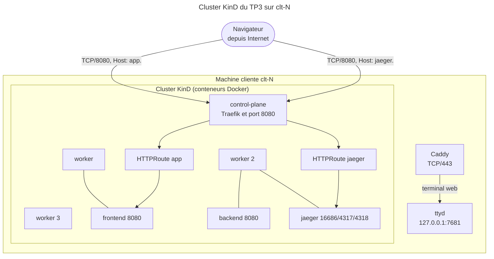
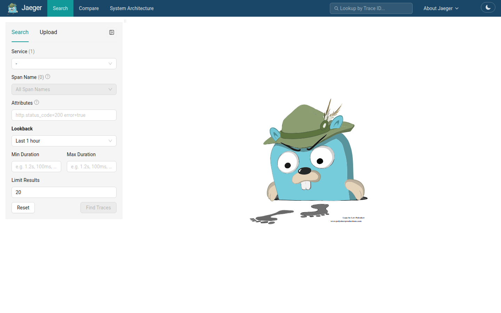
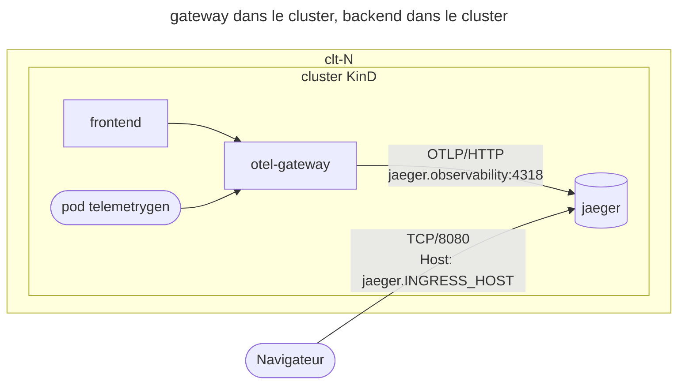
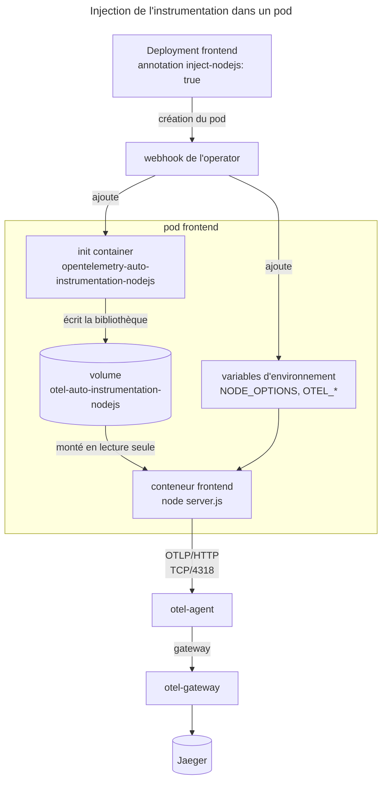

# Lab TP3 : **collector** sur Kubernetes, **gateway**, **agent** et **operator**

# Objectifs

À la fin du lab, vous saurez :

- déployer un **collector** en mode **gateway** puis en mode **agent** (DaemonSet) avec le chart Helm officiel, et adapter sa configuration par un fichier de valeurs ;
- expliquer comment le chart fusionne votre configuration avec ses valeurs par défaut et ce que fait un preset ;
- enrichir les traces avec les métadonnées Kubernetes grâce au processor `k8s_attributes` ;
- installer l'OpenTelemetry **operator** et décrire une auto-instrumentation avec une ressource `Instrumentation` ;
- activer l'instrumentation d'un déploiement par une annotation et retrouver la trace de bout en bout dans Jaeger.

# Contenu

- [Environnement](#environnement)
- [1. Préparer le cluster](#1-préparer-le-cluster)
- [2. Le **collector** en mode **gateway**](#2-le-collector-en-mode-gateway)
- [3. Le **collector** en mode **agent**](#3-le-collector-en-mode-agent)
- [4. L'**operator** et l'auto-instrumentation](#4-loperator-et-lauto-instrumentation)
- [Cleanup](#cleanup)
- [Extra](#extra)

# Détail

## Environnement

Ce lab se déroule sur la machine cliente `clt-N` (N est votre numéro de participant), qui héberge un cluster Kubernetes local créé avec KinD : un nœud control-plane et un worker.

Vous travaillez depuis le terminal web de cette machine, dans `/root`, et le dépôt des labs y est déjà cloné dans `/root/opentelemetry-labs`.

Le TP1 est conseillé : il présente les **receiver**, **processor** et **exporter** du **collector**, qui ne sont pas réexpliqués ici.

Versions utilisées dans ce lab :

| Composant | Version |
|---|---|
| Gateway API | v1.7.0 |
| Traefik (chart / image) | 42.4.1 / 3.7.19 |
| Chart Helm `opentelemetry-collector` | 0.179.1 |
| Image du **collector** (distribution `otelcol-contrib`) | 0.163.2 (version du chart) |
| Chart Helm `opentelemetry-operator` | 0.129.1 |
| Image de l'**operator** | 0.162.0 |
| Image d'auto-instrumentation Node.js | 0.82.0-1 |
| Jaeger | 2.23.0 |
| Node.js (application de démonstration) | 22.23.5 |
| telemetrygen | v0.165.0 |

Les interfaces web passent par la Gateway API du cluster, publiée sur le port `TCP/8080` de la machine `clt-N` :

- Jaeger : `http://jaeger.$INGRESS_HOST:8080` ;
- application : `http://app.$INGRESS_HOST:8080`.

La variable `INGRESS_HOST` contient le nom qui pointe vers la machine (`echo $INGRESS_HOST`).

## 1. Préparer le cluster

Vous travaillez sur la machine cliente `clt-N`, dans le terminal web, sous `/root`. Le cluster Kubernetes n'est pas une machine à part : c'est un **cluster KinD**, c'est-à-dire des conteneurs Docker qui jouent le rôle de nœuds, tous sur `clt-N`.

Le schéma suivant montre l'ensemble : votre navigateur arrive par Internet sur `clt-N`, Caddy publie le terminal web sur `TCP/443`, et le cluster publie sa Gateway API sur `TCP/8080` de la même machine. À l'intérieur, le nœud control-plane porte Traefik, l'implémentation de la Gateway API qui reçoit ce port, et les workers portent les pods de l'application et de Jaeger :



Le cluster a un nœud control-plane et trois workers : les pods de l'application se répartissent sur les workers, ce qui rend visible la différence entre un pod et une machine.

### Créer le cluster

Copiez les fichiers du TP dans un dossier de travail :

```bash
mkdir -p ~/tp03
cp -r ~/opentelemetry-labs/config/tp03/. ~/tp03/
cd ~/tp03
```

Le cluster, lui, est commun à tous les TP Kubernetes : sa configuration et son script de lancement sont dans `config/cluster/` du dépôt, au même endroit pour chaque TP. Affichez la configuration :

```bash
cat ~/opentelemetry-labs/config/cluster/kind-config.yaml
```

```yaml
kind: Cluster
apiVersion: kind.x-k8s.io/v1alpha4
# Nom unique, commun à tous les TP Kubernetes : une machine n'héberge
# qu'un seul cluster, et cluster-create.sh supprime le précédent.
name: cluster
nodes:
  - role: control-plane
    extraPortMappings:
      # Port 80 du nœud, publié sur la machine en 8080 : c'est par là
      # qu'entre le trafic du navigateur vers la Gateway API.
      - containerPort: 80
        hostPort: 8080
        protocol: TCP
  - role: worker
  - role: worker
  - role: worker
```

Chaque bloc de ce fichier a un rôle précis :

- `kind: Cluster` et `apiVersion` : le format attendu par `kind`, identique à celui des manifestes Kubernetes ;
- `nodes` : la liste des nœuds. Chaque ligne `- role: worker` ajoute un worker ; trois lignes donnent trois workers ;
- `extraPortMappings` : le port 80 du conteneur control-plane est publié sur la machine `clt-N` en 8080. C'est par là qu'entrera le trafic du navigateur. Les ports 80 et 443 de la machine sont déjà pris par Caddy, qui publie le terminal web.

Le cluster porte toujours le nom `cluster`, quel que soit le TP : une machine n'en héberge qu'un, et les TP Kubernetes suivants réutilisent le même. Affichez le script de lancement, puis exécutez-le :

```bash
cat ~/opentelemetry-labs/config/cluster/cluster-create.sh
bash ~/opentelemetry-labs/config/cluster/cluster-create.sh
```

Le script tient en trois étapes : `kind get clusters` liste ce qui tourne, `kind delete cluster --name <nom>` supprime chaque cluster trouvé, et `kind create cluster --config kind-config.yaml` crée le nouveau avec le fichier ci-dessus, lu dans le même dossier. Il supprime tous les clusters présents, et pas seulement celui nommé `cluster` : un cluster laissé sous un autre nom occuperait le port 8080 et ferait échouer la création.

**Attention** : le script efface les clusters présents, releases Helm, espaces de noms et données comprises. Un cluster neuf se reconstruit en rejouant le TP depuis le début.

On obtient quatre nœuds `Ready` :

```text
NAME                    STATUS   ROLES           AGE   VERSION
cluster-control-plane   Ready    control-plane   2m    v1.37.0
cluster-worker          Ready    <none>          1m    v1.37.0
cluster-worker2         Ready    <none>          1m    v1.37.0
cluster-worker3         Ready    <none>          1m    v1.37.0
```

**NB** : une machine n'héberge qu'un seul cluster à la fois. Le port 8080 publié vers la machine est unique, et chaque nœud consomme de la mémoire et des ressources système (les instances `inotify`) ; un second cluster échoue au démarrage ou déstabilise le premier. C'est pourquoi tous les TP Kubernetes utilisent le même nom de cluster, et pourquoi `kind` refuse d'en créer un deuxième avec ce nom :

```text
ERROR: failed to create cluster: node(s) already exist for a cluster with the name "cluster"
```

Pour supprimer le cluster à la main : `kind get clusters` pour voir ce qui tourne, puis `kind delete cluster --name cluster`.

**NB** : KinD préfixe le nom de chaque nœud avec celui du cluster, fixé ici par la ligne `name: cluster` : les nœuds s'appellent donc `cluster-control-plane`, `cluster-worker`, `cluster-worker2` et `cluster-worker3`. Sans cette option, le cluster prendrait le nom par défaut `kind` et les nœuds s'appelleraient `kind-control-plane`, `kind-worker`, etc. Retenez le nom du nœud control-plane : c'est lui qui détient le port publié, et le fichier de valeurs de Traefik le cite.

### Installer la Gateway API

Le cluster n'expose rien par défaut. Jusqu'en 2025, on installait un contrôleur d'Ingress ; cette API est en fin de vie : l'Ingress NGINX historique n'est plus maintenu que jusqu'en mars 2026, sans correctif de sécurité ensuite. Son successeur est la **Gateway API**, une API de routage conçue dès le départ par plusieurs implémentations.

La Gateway API se compose de deux objets principaux :

- une ressource `Gateway`, qui déclare un point d'entrée : un port, un protocole, et quelles routes sont acceptées ;
- une ressource `HTTPRoute`, qui décrit le routage : pour quel nom d'hôte, vers quel Service.

L'API ne fait rien par elle-même : il faut une implémentation. Nous utilisons Traefik, qui sait tourner en DaemonSet et occuper directement le port 80 des nœuds, ce qui se combine bien avec le port publié par KinD.

Installez d'abord les types de ressources de la Gateway API. Les implémentations ne les fournissent pas : sans elles, toute installation de `Gateway` échoue sur un type inconnu.

```bash
kubectl apply -f https://github.com/kubernetes-sigs/gateway-api/releases/download/v1.7.0/standard-install.yaml
kubectl get crd | grep -c gateway.networking.k8s.io
```

On obtient `10` : le standard comprend les types `GatewayClass`, `Gateway`, `HTTPRoute`, `GRPCRoute`, `TCPRoute`, `TLSRoute`, `UDPRoute` et quelques autres.

Installez ensuite Traefik, configuré par un fichier de valeurs :

```bash
helm repo add traefik https://traefik.github.io/charts
helm repo update
cat > traefik-values.yaml <<'EOF'
deployment:
  kind: DaemonSet
ports:
  web:
    hostPort: 80
providers:
  kubernetesGateway:
    enabled: true
gateway:
  enabled: true
  listeners:
    web:
      namespacePolicy:
        from: All
tolerations:
  - key: node-role.kubernetes.io/control-plane
    operator: Exists
    effect: NoSchedule
EOF
helm install traefik traefik/traefik -n traefik --create-namespace \
  -f traefik-values.yaml --wait
```

**NB** : le chart affiche un rappel sur les CRD Gateway API, alors qu'elles viennent d'être installées. C'est un message du chart, sans conséquence ici.

Chaque réglage a son rôle :

- `deployment.kind: DaemonSet` : un pod par nœud, comme une brique d'infrastructure ;
- `ports.web.hostPort: 80` : le pod prend le port 80 du nœud directement, dans le conteneur. Côté machine, ce port 80 est celui que KinD publie sur `TCP/8080` ;
- `providers.kubernetesGateway.enabled` : Traefik lit les ressources `Gateway` et `HTTPRoute` ;
- `gateway.enabled` : le chart crée lui-même une ressource `Gateway` et sa `GatewayClass`, au lieu de vous demander de les écrire ;
- `namespacePolicy.from: All` : par défaut, une `Gateway` n'accepte que les routes de son propre espace de noms. Sans ce réglage, les routes de `demo` et d'`observability` seraient ignorées ;
- `tolerations` : le nœud control-plane porte une interdiction (`taint`) qui écarte les pods ordinaires. Or c'est lui qui détient le port publié vers la machine : le pod Traefik doit donc y être toléré.

Vérifiez le résultat :

```bash
kubectl -n traefik get pods -o wide
kubectl get gatewayclass,gateway -n traefik
```

Le DaemonSet a quatre pods, dont un sur `cluster-control-plane` :

```text
NAME            READY   STATUS    RESTARTS   AGE   NODE
traefik-42l42   1/1     Running   0          19s   cluster-control-plane
traefik-85pkg   1/1     Running   0          19s   cluster-worker
traefik-khs6m   1/1     Running   0          19s   cluster-worker3
traefik-rl52k   1/1     Running   0          19s   cluster-worker2
```

Le chart a créé la `GatewayClass traefik` et la `Gateway traefik-gateway` :

```text
NAME                                             CONTROLLER                      ACCEPTED   AGE
gatewayclass.gateway.networking.k8s.io/traefik   traefik.io/gateway-controller   True       30m

NAME                                                CLASS     ADDRESS   PROGRAMMED   AGE
gateway.gateway.networking.k8s.io/traefik-gateway   traefik             True         30m
```

**NB** : les autres implémentations (NGINX Gateway Fabric, Envoy Gateway) exposent leur plan de données derrière un Service, de type `LoadBalancer` ou `NodePort`, et non par un `hostPort`. Avec KinD, cela demande en plus une adresse de type LoadBalancer (MetalLB) ou un port de nœud fixé puis publié. C'est la raison du choix de Traefik ici.

### Comprendre `INGRESS_HOST`

Une `HTTPRoute` route les requêtes selon le nom d'hôte demandé : la route de l'application ne répond que si la requête porte l'en-tête `Host: app.<INGRESS_HOST>`, et celle de Jaeger seulement pour `Host: jaeger.<INGRESS_HOST>`. Une même adresse IP sert ainsi plusieurs services, séparés par le nom.

Comme le cluster tourne sur `clt-N`, `INGRESS_HOST` doit être un nom qui pointe vers cette machine depuis votre navigateur. Le plus simple est le service `sslip.io`, qui transforme une adresse IP en nom : `178-62-255-117.sslip.io` pointe vers `178.62.255.117`. La fonction d'aide le calcule à partir de l'adresse publique de la machine :

```bash
source helpers.sh
echo $INGRESS_HOST
```

On obtient un nom de la forme :

```text
178-62-255-117.sslip.io
```

Les fonctions `app` et `jaeger` de `helpers.sh` s'en servent pour appeler la `Gateway` par `http://localhost:8080` avec le bon en-tête `Host`, ce qui évite de dépendre de la résolution DNS. Rechargez-les avec `source ~/tp03/helpers.sh` dans chaque nouveau terminal.

### Déployer l'application et Jaeger

Le dossier contient trois manifestes : `namespaces.yaml` (les espaces de noms `observability` et `demo`), `jaeger.yaml` (Jaeger avec stockage en mémoire) et `demo-app.yaml` (une application Node.js en deux services).

L'application est écrite en JavaScript et tient dans un ConfigMap : les pods l'exécutent avec l'image `node:22.23.5-slim`, sans aucune bibliothèque OpenTelemetry dans un premier temps. Chaque service écoute sur le port `8080` dans son pod, derrière un Service Kubernetes sur le port 80.

Les deux manifestes qui déclarent une `HTTPRoute` contiennent le texte `INGRESS_HOST`, que `sed` remplace par votre nom avant l'envoi au cluster :

```bash
kubectl apply -f namespaces.yaml
sed "s/INGRESS_HOST/$INGRESS_HOST/g" jaeger.yaml | kubectl apply -f -
sed "s/INGRESS_HOST/$INGRESS_HOST/g" demo-app.yaml | kubectl apply -f -
kubectl -n observability rollout status deployment/jaeger
kubectl -n demo rollout status deployment/frontend deployment/backend
```

Regardez où sont les pods ; ils se répartissent sur les workers, pas sur le control-plane :

```bash
kubectl -n demo get pods -o wide
kubectl -n observability get pods -o wide
```

On obtient par exemple :

```text
NAME                       READY   STATUS    RESTARTS   AGE   IP           NODE
backend-6bc7bd9b8d-4ftph    1/1     Running   0          8s    10.244.2.3   cluster-worker
frontend-7cd9b8f4d7-dwpp6   1/1     Running   0          8s    10.244.3.3   cluster-worker2
```

Contrôlez que l'application répond et que Jaeger est vide :

```bash
app /api/orders
jaeger /api/v3/services
```

La première commande affiche une réponse JSON du frontend qui contient celle du backend :

```text
{"from":"frontend","backend":{"from":"backend","path":"/api/orders"}}
```

La seconde affiche un objet dont la liste `services` est vide, ou ne contient que `jaeger` selon que le service interne a déjà eu le temps de s'enregistrer : Jaeger répond, mais ne contient encore aucune trace de votre application, car elle n'est pas instrumentée.

La manipulation attendue tient en deux temps. Dans le terminal, les deux commandes ci-dessus. Dans le navigateur ensuite, ouvrez `http://jaeger.$INGRESS_HOST:8080` : sur la page Search, le sélecteur de service ne propose aucun de vos services et le bouton Find Traces ne renvoie rien. C'est l'état de départ du TP : les parties suivantes font apparaître `frontend` et `backend` au fur et à mesure de l'instrumentation.



## 2. Le **collector** en mode **gateway**

Rappelons où se trouve chaque chose. Vous êtes toujours sur `clt-N`, seul poste depuis lequel vous travaillez : c'est là que tournent Docker, le cluster KinD et donc tous les pods. La **gateway** que vous allez installer sera un pod de l'espace de noms `observability`, sur l'un des workers. Jaeger, le backend, tourne pour l'instant dans le même cluster, dans le même espace de noms.



**NB** : le mot **gateway** désigne ici un rôle du monde OpenTelemetry, à ne pas confondre avec la ressource `Gateway` de Kubernetes installée en partie 1, qui est le point d'entrée HTTP du cluster. La première reçoit de la télémétrie, la seconde reçoit du trafic web.

Une **gateway** est un **collector** central, déployé comme un Deployment, qui reçoit les données de plusieurs sources et les envoie au backend. Vous allez la déployer avec le chart Helm officiel.

Ajoutez le dépôt de charts :

```bash
helm repo add open-telemetry https://open-telemetry.github.io/opentelemetry-helm-charts
helm repo update
```

Le chart se configure par un fichier de valeurs. Le chart n'impose pas d'image par défaut : il faut indiquer la distribution `contrib` et le nom de son exécutable.

La configuration du **collector** se place sous la clé `config:` de ce fichier. Le chart la fusionne avec sa configuration par défaut : les dictionnaires sont fusionnés, les listes sont remplacées.

Créez le fichier complet, avec l'exporter `otlp_grpc/jaeger` vers `jaeger.observability.svc.cluster.local` (port `TCP/4317`, sans TLS) et un pipeline `traces` qui relie le receiver `otlp`, les processors `memory_limiter` puis `batch`, et cet exporter :

```bash
cat > gateway-values.yaml <<'EOF'
mode: deployment
fullnameOverride: otel-gateway
replicaCount: 1
image:
  repository: ghcr.io/open-telemetry/opentelemetry-collector-releases/opentelemetry-collector-contrib
  tag: "0.163.2"
command:
  name: otelcol-contrib
resources:
  limits:
    cpu: 250m
    memory: 256Mi
config:
  exporters:
    otlp_grpc/jaeger:
      endpoint: jaeger.observability.svc.cluster.local:4317
      tls:
        insecure: true
  service:
    pipelines:
      traces:
        receivers: [otlp]
        processors: [memory_limiter, batch]
        exporters: [otlp_grpc/jaeger]
EOF
```

Avant d'installer, regardez ce que le chart génère à partir de vos valeurs :

```bash
helm template otel-gateway open-telemetry/opentelemetry-collector --version 0.179.1 \
  -n observability -f gateway-values.yaml | grep -B2 -A60 'relay:'
```

Repérez ce que vous n'avez pas écrit : l'extension `health_check`, les receivers par défaut, et les pipelines `metrics` et `logs`. C'est la fusion du chart avec ses propres valeurs.

Installez ensuite la **gateway** :

```bash
helm upgrade --install otel-gateway open-telemetry/opentelemetry-collector \
  --version 0.179.1 -n observability -f gateway-values.yaml --wait
```

Envoyez cinq traces de test depuis un pod temporaire, avec `telemetrygen` :

```bash
kubectl -n demo run tg-gateway --restart=Never --rm -i \
  --image=ghcr.io/open-telemetry/opentelemetry-collector-contrib/telemetrygen:v0.165.0 -- \
  traces --otlp-endpoint otel-gateway.observability.svc.cluster.local:4317 \
  --otlp-insecure --rate 10 --traces 5 --service k8s-gateway
```

Contrôlez le pod et le nombre de traces reçues par Jaeger :

```bash
kubectl -n observability get pods -l app.kubernetes.io/instance=otel-gateway
jaeger "/api/v3/traces?query.service_name=k8s-gateway&query.startTimeMin=$(date -u -d '10 minutes ago' +%Y-%m-%dT%H:%M:%SZ)&query.startTimeMax=$(date -u -d '+1 minute' +%Y-%m-%dT%H:%M:%SZ)" \
  | jq '[.result.resourceSpans[].scopeSpans[].spans[].traceId] | unique | length'
```

La première commande affiche un pod `otel-gateway-...` à l'état `Running`, la seconde affiche :

```text
5
```

**NB** : Jaeger 2.x n'a plus l'API v1 (`/api/traces`, `/api/services`) : seule l'API v3 (`/api/v3/...`) répond, et sa recherche de traces exige une fenêtre temporelle explicite (`startTimeMin` et `startTimeMax`).

## 3. Le **collector** en mode **agent**

Un **agent** est un **collector** déployé comme un DaemonSet : un pod par nœud, proche des applications. Il enrichit les données avec les métadonnées Kubernetes puis les transmet à la **gateway**.

Le processor `k8s_attributes` interroge l'API Kubernetes pour retrouver, à partir de l'adresse IP du pod émetteur, son nom, son espace de noms, son déploiement et son nœud.

Deux réglages du fichier de valeurs méritent une explication. Le preset `kubernetesAttributes` ajoute au chart le processor `k8s_attributes` et les droits RBAC dont il a besoin pour lire l'API Kubernetes. Le réglage `service.enabled` crée un Service, que le chart ne crée pas par défaut pour un DaemonSet : en mode **agent**, ce Service est configuré avec `internalTrafficPolicy: Local`, de sorte qu'une application atteint toujours l'**agent** de son propre nœud.

Listez vous-même `k8s_attributes` dans le pipeline : sans cela, le preset l'ajoute en première position, avant `memory_limiter`.

```bash
cat > agent-values.yaml <<'EOF'
mode: daemonset
fullnameOverride: otel-agent
image:
  repository: ghcr.io/open-telemetry/opentelemetry-collector-releases/opentelemetry-collector-contrib
  tag: "0.163.2"
command:
  name: otelcol-contrib
resources:
  limits:
    cpu: 250m
    memory: 256Mi
service:
  enabled: true
presets:
  kubernetesAttributes:
    enabled: true
config:
  exporters:
    otlp_grpc/gateway:
      endpoint: otel-gateway.observability.svc.cluster.local:4317
      tls:
        insecure: true
  service:
    pipelines:
      traces:
        receivers: [otlp]
        processors: [memory_limiter, k8s_attributes, batch]
        exporters: [otlp_grpc/gateway]
EOF
```

Installez l'**agent** :

```bash
helm upgrade --install otel-agent open-telemetry/opentelemetry-collector \
  --version 0.179.1 -n observability -f agent-values.yaml --wait
kubectl -n observability get daemonset otel-agent-agent
```

Le DaemonSet se nomme `otel-agent-agent` : le chart ajoute le suffixe `-agent` en mode daemonset, alors que le Service garde le nom `otel-agent`. Les colonnes `DESIRED` et `READY` sont égales.

Envoyez des traces de test à l'**agent**, cette fois, et non à la **gateway** :

```bash
kubectl -n demo run tg-agent --restart=Never --rm -i \
  --image=ghcr.io/open-telemetry/opentelemetry-collector-contrib/telemetrygen:v0.165.0 -- \
  traces --otlp-endpoint otel-agent.observability.svc.cluster.local:4317 \
  --otlp-insecure --rate 10 --traces 5 --service k8s-agent
```

Les traces portent maintenant des attributs Kubernetes que `telemetrygen` ne connaît pas :

```bash
jaeger "/api/v3/traces?query.service_name=k8s-agent&query.startTimeMin=$(date -u -d '10 minutes ago' +%Y-%m-%dT%H:%M:%SZ)&query.startTimeMax=$(date -u -d '+1 minute' +%Y-%m-%dT%H:%M:%SZ)" \
  | jq -r '[.result.resourceSpans[].resource.attributes[] | select(.key | startswith("k8s.")) | "\(.key)=\(.value.stringValue)"] | unique | .[]'
```

La commande affiche notamment :

```text
k8s.namespace.name=demo
k8s.node.name=cluster-worker2
k8s.pod.name=tg-agent
```

Comparez avec les traces `k8s-gateway` de la partie 2, qui n'ont pas ces attributs : l'enrichissement vient de l'**agent**.

### Mettre le backend hors du cluster

Jusqu'ici, Jaeger tourne dans le cluster, à côté de la **gateway**. Dans une vraie installation, le backend est ailleurs : il collecte les données de plusieurs clusters et survit à leur recréation. Le TP1 a justement installé une stack (**collector**, Jaeger, Prometheus, Grafana) sur `srv-N` ; on peut s'en servir comme backend.

Est-ce que cela passe par la `Gateway`, des ports publiés ou des règles `iptables` ? Seulement dans un sens. Un pod peut **sortir** librement : ses paquets passent par le réseau Docker de `clt-N`, qui les traduit (NAT) puis par le VPC DigitalOcean. Depuis un pod du cluster, joindre `srv-N` sur son adresse privée fonctionne donc sans aucune règle supplémentaire, comme le montre l'essai ci-dessous (la stack du TP1 doit tourner sur `srv-N`) :

```bash
kubectl -n demo run nettest --restart=Never --image=curlimages/curl:8.11.0 --command -- sleep 120
kubectl -n demo wait --for=condition=Ready pod/nettest --timeout=120s
kubectl -n demo exec nettest -- curl -s -o /dev/null -w '%{http_code}\n' \
  -X POST http://10.20.0.3:4318/v1/traces -H 'Content-Type: application/json' -d '{}'
kubectl -n demo delete pod nettest
```

On obtient `200` : le pod a joint le **collector** de `srv-N` sur `TCP/4318`, sur le réseau privé du VPC.

L'inverse, faire **entrer** du trafic depuis Internet vers un service du cluster, demande en revanche une publication de port : c'est exactement ce que fait `extraPortMappings` pour la `Gateway`, en publiant le port 80 du control-plane sur `TCP/8080` de `clt-N`. `iptables` n'est à écrire à la main dans aucun des deux cas : Docker et KinD posent les règles de NAT, et un `NodePort` suffit lorsqu'on veut exposer un service sur la machine sans passer par la `Gateway`.

Pour brancher la **gateway** sur le backend externe, remplacez l'endpoint de l'exporter dans `gateway-values.yaml` par l'adresse privée de `srv-N` (obtenue avec `getent hosts $SRV_HOST`), par exemple :

```yaml
  exporters:
    otlp_http/backend:
      endpoint: http://10.20.0.3:4318
```

puis `helm upgrade --install` avec le nouveau fichier de valeurs. Les traces apparaissent alors dans le Jaeger de `srv-N`, consultable sur `http://$SRV_HOST:16686`.

## 4. L'**operator** et l'auto-instrumentation

L'OpenTelemetry **operator** injecte un **agent** d'instrumentation dans les pods qui portent une annotation, au moment de leur création, sans modifier l'image de l'application.

Pour Node.js, il ajoute un **init container** qui copie la bibliothèque d'instrumentation dans un volume partagé du pod, et il définit les variables d'environnement qui l'activent.

Le schéma suivant montre ce qui se passe au moment de la création d'un pod :



L'init container s'exécute avant l'application, écrit la bibliothèque dans le volume puis se termine. Le conteneur de l'application démarre ensuite avec `NODE_OPTIONS=--require /otel-auto-instrumentation-nodejs/autoinstrumentation.js` : Node charge la bibliothèque au démarrage, sans que l'image ni le code ne changent.

Installez d'abord l'**operator**. Le chart propose par défaut d'utiliser cert-manager pour les certificats de son webhook, ce qui n'est pas installé ici : les deux options `admissionWebhooks` demandent au chart de générer lui-même un certificat. L'attente `--wait` rend la main lorsque les pods de l'**operator** sont prêts.

```bash
helm upgrade --install operator open-telemetry/opentelemetry-operator \
  --version 0.129.1 -n opentelemetry-operator-system --create-namespace \
  --set admissionWebhooks.certManager.enabled=false \
  --set admissionWebhooks.autoGenerateCert.enabled=true \
  --set manager.image.tag=0.162.0 --wait
```

Une fois l'**operator** installé, contrôlez ce qu'il a ajouté au cluster. Un **operator** étend l'API Kubernetes par des types de ressources (`CustomResourceDefinition`, ou CRD) : ici `Instrumentation` et `OpenTelemetryCollector`.

```bash
kubectl get crd | grep opentelemetry.io
```

On obtient :

```text
instrumentations.opentelemetry.io          Namespaced   v1alpha1(storage)           2026-11-20T12:35:39Z
opampbridges.opentelemetry.io              Namespaced   v1alpha1(storage)           2026-11-20T12:35:39Z
opentelemetrycollectors.opentelemetry.io   Namespaced   v1alpha1,v1beta1(storage)   2026-11-20T12:35:40Z
targetallocators.opentelemetry.io          Namespaced   v1alpha1(storage)           2026-11-20T12:35:39Z
```

Tant que l'**operator** n'est pas installé, ces types n'existent pas et `kubectl apply` d'une ressource `Instrumentation` échoue sur un type inconnu. C'est pourquoi l'installation précède la suite de cette partie.

**NB** : n'exécutez pas `helm test` sur ce chart, ses pods de test utilisent une image qui n'est pas épinglée.

La ressource `Instrumentation` décrit comment instrumenter : où envoyer les données, quels propagators utiliser, quel échantillonnage appliquer et quelle image d'instrumentation injecter.

Créez-la dans l'espace de noms `demo`. L'exporter vise l'**agent** en OTLP HTTP (`http://otel-agent.observability.svc.cluster.local:4318`), protocole par défaut du SDK Node.js :

```bash
cat > instrumentation.yaml <<'EOF'
apiVersion: opentelemetry.io/v1alpha1
kind: Instrumentation
metadata:
  name: demo
  namespace: demo
spec:
  exporter:
    endpoint: http://otel-agent.observability.svc.cluster.local:4318
  propagators:
    - tracecontext
    - baggage
  sampler:
    type: parentbased_traceidratio
    argument: "1"
  nodejs:
    image: ghcr.io/open-telemetry/opentelemetry-operator/autoinstrumentation-nodejs:0.82.0-1
EOF
```

L'argument du sampler est une proportion entre 0 et 1, écrite entre guillemets parce que c'est une chaîne : `"1"` signifie que toutes les traces sont conservées (100 %), `"0.1"` qu'une trace sur dix est échantillonnée. Avec `parentbased_traceidratio`, la décision prise à la racine d'une trace s'applique ensuite à tous ses spans, y compris ceux des services appelés.

Appliquez-la, puis activez l'instrumentation des deux déploiements avec l'annotation `instrumentation.opentelemetry.io/inject-nodejs: "true"`.

L'annotation doit se trouver sur le modèle de pod, et non sur le Deployment : `kubectl patch` la place au bon endroit et déclenche le remplacement des pods.

```bash
kubectl apply -f instrumentation.yaml
for d in frontend backend; do
  kubectl -n demo patch deployment $d -p \
    '{"spec":{"template":{"metadata":{"annotations":{"instrumentation.opentelemetry.io/inject-nodejs":"true"}}}}}'
done
kubectl -n demo rollout status deployment/frontend deployment/backend
```

L'`Instrumentation` doit exister avant la création des pods : l'**operator** ne modifie pas un pod déjà démarré.

Générez du trafic :

```bash
for i in $(seq 20); do app /api/orders > /dev/null; done
```

Les pods contiennent maintenant un **init container** que vos manifestes ne déclarent pas :

```bash
kubectl -n demo get pod -l app=frontend -o jsonpath='{.items[*].spec.initContainers[*].name}{"\n"}'
```

On obtient :

```text
opentelemetry-auto-instrumentation-nodejs
```

Les variables d'environnement ajoutées au conteneur de l'application disent tout du mécanisme :

```bash
kubectl -n demo get pod -l app=frontend \
  -o jsonpath='{range .items[*].spec.containers[0].env[*]}{.name}={.value}{"\n"}{end}' | grep OTEL_
```

```text
OTEL_METRICS_EXPORTER=otlp
OTEL_SERVICE_NAME=frontend
OTEL_EXPORTER_OTLP_ENDPOINT=http://otel-agent.observability.svc.cluster.local:4318
OTEL_PROPAGATORS=tracecontext,baggage
OTEL_TRACES_SAMPLER=parentbased_traceidratio
OTEL_TRACES_SAMPLER_ARG=1
OTEL_RESOURCE_ATTRIBUTES=k8s.container.name=frontend,k8s.deployment.name=frontend,...
```

Dans Jaeger, les services `frontend` et `backend` sont apparus :

```bash
jaeger '/api/v3/services' | jq -c '.services'
jaeger "/api/v3/traces?query.service_name=frontend&query.startTimeMin=$(date -u -d '10 minutes ago' +%Y-%m-%dT%H:%M:%SZ)&query.startTimeMax=$(date -u -d '+1 minute' +%Y-%m-%dT%H:%M:%SZ)" \
  | jq -r '[.result.resourceSpans[].resource.attributes[] | select(.key=="service.name") | .value.stringValue] | unique | .[]'
```

La première commande contient `frontend` et `backend`, la seconde affiche :

```text
"backend"
"frontend"
```

Une même trace traverse donc les deux services. Ouvrez-la dans l'interface de Jaeger (`http://jaeger.$INGRESS_HOST:8080`) : vous voyez le span serveur du frontend, le span client de son appel au backend, puis le span serveur du backend. Le lien entre les deux services repose sur le propagator `tracecontext`.

Regardez enfin les attributs de ressource de cette trace : `k8s.pod.name`, `k8s.namespace.name` et `k8s.node.name` y figurent, ajoutés par l'**agent**.

**NB** : si les pods redémarrent mais qu'aucune trace n'apparaît, vérifiez que l'init container est présent (`kubectl -n demo describe pod -l app=frontend`). S'il manque, l'annotation n'est pas sur le modèle de pod ou l'`Instrumentation` a été créée après les pods : dans ce second cas, redémarrez-les avec `kubectl -n demo rollout restart deployment/frontend`.

## Cleanup

Supprimez les releases Helm et les espaces de noms du lab :

```bash
helm uninstall otel-agent otel-gateway -n observability
helm uninstall operator -n opentelemetry-operator-system
kubectl delete namespace demo observability opentelemetry-operator-system
```

Le cluster KinD lui-même peut être conservé : il sert aux TP suivants.

## Extra

À vous de jouer, si le temps le permet. Chaque exercice est guidé pas à pas ; les commandes se suivent.

### 1. Collecter les logs des conteneurs

Le chart de l'**agent** propose un preset `logsCollection` : il ajoute un receiver `file_log` qui lit les fichiers de `/var/log/pods`, monte ce dossier dans le pod, et complète le pipeline `logs`.

Mettez à jour l'**agent** en activant ce preset :

```bash
helm upgrade --install otel-agent open-telemetry/opentelemetry-collector \
  --version 0.179.1 -n observability -f agent-values.yaml \
  --set presets.logsCollection.enabled=true --wait
```

Vérifiez que le volume est bien monté dans les pods de l'**agent** :

```bash
kubectl -n observability get pods -l app.kubernetes.io/instance=otel-agent \
  -o jsonpath='{.items[0].spec.containers[0].volumeMounts[*].mountPath}{"\n"}'
```

La liste contient `/var/log/pods`. Regardez ensuite la configuration générée par le chart :

```bash
kubectl -n observability get configmap otel-agent-agent \
  -o jsonpath='{.data.relay}' | sed -n '/logs:/,/metrics:/p'
```

Le pipeline `logs` reçoit maintenant deux receivers, `otlp` et `file_log`, et exporte vers `debug` :

```text
        logs:
          exporters:
          - debug
          processors:
          - k8s_attributes
          - memory_limiter
          - batch
          receivers:
          - otlp
          - file_log
```

Les enregistrements collectés apparaissent dans les logs du pod de l'**agent** :

```bash
kubectl -n observability logs daemonset/otel-agent-agent --tail=5
```

Revenez à la configuration de départ sans le preset :

```bash
helm upgrade --install otel-agent open-telemetry/opentelemetry-collector \
  --version 0.179.1 -n observability -f agent-values.yaml --wait
```

### 2. Ajouter un attribut de ressource à l'instrumentation

La ressource `Instrumentation` accepte des attributs ajoutés à toutes les données des pods instrumentés, dans `spec.resource.resourceAttributes`. Ajoutons l'environnement de déploiement :

```bash
kubectl -n demo patch instrumentation demo --type merge -p \
  '{"spec":{"resource":{"resourceAttributes":{"deployment.environment.name":"tp3"}}}}'
```

Ces attributs sont posés à la création du pod : redémarrez les déploiements pour que les nouveaux pods en héritent.

```bash
kubectl -n demo rollout restart deployment/frontend deployment/backend
kubectl -n demo rollout status deployment/frontend
```

Contrôlez la variable d'environnement injectée :

```bash
kubectl -n demo get pods -l app=frontend \
  -o jsonpath='{range .items[*].spec.containers[0].env[?(@.name=="OTEL_RESOURCE_ATTRIBUTES")]}{.value}{"\n"}{end}'
```

Elle commence maintenant par `deployment.environment.name=tp3,` suivi des attributs `k8s.*` ajoutés par l'**operator**. Générez du trafic (`for i in $(seq 10); do app /api/orders > /dev/null; done`) et retrouvez l'attribut dans la ressource des traces, dans Jaeger.

### 3. Déployer un **collector** avec la ressource `OpenTelemetryCollector`

L'**operator** sait aussi déployer un **collector** : au lieu d'écrire un fichier de valeurs Helm, on décrit un objet `OpenTelemetryCollector`, et l'**operator** crée le Deployment, le Service et la configuration.

```bash
cat > otelcol-cr.yaml <<'EOF'
apiVersion: opentelemetry.io/v1beta1
kind: OpenTelemetryCollector
metadata:
  name: otelcol-cr
  namespace: observability
spec:
  mode: deployment
  config:
    receivers:
      otlp:
        protocols:
          grpc:
            endpoint: 0.0.0.0:4317
          http:
            endpoint: 0.0.0.0:4318
    processors:
      batch:
        timeout: 2s
    exporters:
      debug:
        verbosity: basic
    service:
      pipelines:
        traces:
          receivers: [otlp]
          processors: [batch]
          exporters: [debug]
EOF
kubectl apply -f otelcol-cr.yaml
kubectl -n observability get opentelemetrycollectors
```

L'objet apparaît, prêt :

```text
NAME        MODE         VERSION   READY   AGE   IMAGE
otelcol-cr  deployment   0.162.0   1/1     25s   ghcr.io/open-telemetry/opentelemetry-collector-releases/opentelemetry-collector-k8s:0.162.0
```

Regardez ce que l'**operator** a créé : un Deployment, deux Services et un Service de supervision.

```bash
kubectl -n observability get pods,svc | grep otelcol-cr
```

L'image par défaut est la distribution `k8s`, plus légère que `contrib` ; pour utiliser une autre distribution, ajoutez `image:` dans `spec`. Comparez enfin les deux approches : avec Helm, la configuration est rendue par le chart et versionnée dans un fichier de valeurs ; avec l'**operator**, elle est portée par un objet Kubernetes, visible avec `kubectl get` et modifiable comme n'importe quelle ressource.

### 4. Placer le backend hors du cluster

Reprenez l'encadré de [la partie 3](#3-le-collector-en-mode-agent) : pointez l'exporter de la **gateway** vers le **collector** du TP1 installé sur `srv-N`, puis vérifiez que les traces arrivent dans le Jaeger de `srv-N`, sur `http://$SRV_HOST:16686`.
