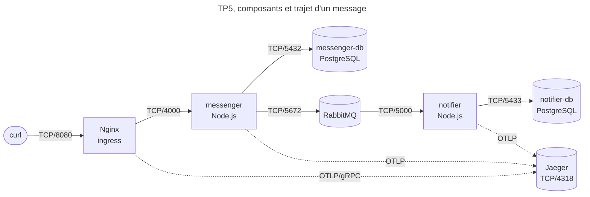

# Lab TP5 : Node.js et Nginx, une trace de bout en bout

# Objectifs

À la fin du lab, vous saurez :

- démarrer une application de microservices (deux services Node.js, RabbitMQ, PostgreSQL, Nginx) et suivre un message de bout en bout, sans télémétrie ;
- auto-instrumenter un service Node.js avec le SDK OpenTelemetry et exporter ses spans en OTLP vers Jaeger ;
- nommer le service par une ressource et lire un waterfall dans Jaeger ;
- propager le contexte à travers RabbitMQ et obtenir une trace qui traverse les deux services ;
- instrumenter Nginx avec le module OpenTelemetry et faire apparaître le span racine du proxy ;
- repérer une donnée sensible ajoutée à un span et la masquer dans le **collector**.

# Contenu

- [Environnement](#environnement)
- [1. La pile et le parcours d'un message](#1-la-pile-et-le-parcours-dun-message)
- [2. Auto-instrumenter messenger](#2-auto-instrumenter-messenger)
- [3. Nommer le service et lire le waterfall](#3-nommer-le-service-et-lire-le-waterfall)
- [4. Instrumenter notifier](#4-instrumenter-notifier)
- [5. Nginx devant l'application](#5-nginx-devant-lapplication)
- [6. Données applicatives et masquage](#6-données-applicatives-et-masquage)
- [Cleanup](#cleanup)
- [Extra](#extra)

# Détail

## Environnement

Ce lab se déroule sur la machine cliente `clt-N`, qui porte les deux services Node.js, la base PostgreSQL, RabbitMQ, Nginx et Jaeger. Toutes les commandes se lancent depuis le terminal web de `clt-N`, dans `/root`.

Le TP1 est conseillé : il présente les **receiver**, **processor** et **exporter** du **collector**, utilisés à la partie 6.

L'application est celle de l'architecture de démonstration Microservices March, distribuée par NGINX. Elle n'est pas recopiée dans le dépôt des labs : vous la clonez à des commits précis, indiqués dans la partie 1.

Versions utilisées dans ce lab :

| Composant | Version |
|---|---|
| Node.js (installé par asdf pendant le TP) | v22.23.5 |
| npm | 10.9.9 |
| asdf | v0.16.7 |
| `@opentelemetry/sdk-node` | 0.301.2 |
| `@opentelemetry/auto-instrumentations-node` | 0.83.1 |
| `@opentelemetry/exporter-trace-otlp-proto` | 0.301.2 |
| `@opentelemetry/resources` | 3.1.1 |
| `@opentelemetry/semantic-conventions` | 1.45.0 |
| Jaeger | 2.23.0 |
| RabbitMQ | 3.11.4-management-alpine |
| PostgreSQL | 15 |
| Nginx | 1.23.1 |
| Module OpenTelemetry pour Nginx | webserver/v1.0.3 |
| **collector** OpenTelemetry (partie 6) | 0.165.0 |

Les interfaces web passent par les ports ouverts de `clt-N` : Jaeger sur `http://$CLT_HOST:16686`, l'application sur `http://$CLT_HOST:8080`.

**NB** : l'auto-instrumentation Node.js actuelle exige Node.js 22.15 ou plus. Les versions indiquées ci-dessus sont celles de ce lab, épinglées pour que le comportement ne change pas d'une session à l'autre.

## 1. La pile et le parcours d'un message

L'application se compose de deux services Node.js qui communiquent par RabbitMQ, de deux bases PostgreSQL et d'un proxy Nginx. Le schéma suivant montre les composants sur `clt-N` et le trajet d'un message :



Le message suit ces étapes : une requête HTTP arrive sur `messenger`, qui écrit dans sa base et publie un événement dans RabbitMQ ; `notifier` consomme l'événement, écrit dans sa propre base et simule l'envoi d'un SMS. Sans télémétrie, il faut lire les logs de deux processus dans deux terminaux.

Installez d'abord Node.js, avec le gestionnaire de versions `asdf`, comme pour l'application d'origine : la machine ne fournit pas de Node.js, et il faut une version récente pour l'auto-instrumentation actuelle. Le paquet distribué par Ubuntu est trop ancien.

```bash
git clone https://github.com/asdf-vm/asdf.git /root/.asdf --branch v0.16.7
. /root/.asdf/asdf.sh
asdf plugin add nodejs https://github.com/asdf-vm/asdf-nodejs.git
asdf install nodejs 22.23.5
asdf global nodejs 22.23.5
```

`asdf` télécharge la version demandée et la rend disponible par des raccourcis (`shims`) placés en tête du `PATH`. Rendez ce `PATH` permanent, pour que les terminaux suivants, et les commandes lancées par les outils, retrouvent Node.js :

```bash
echo '. /root/.asdf/asdf.sh' >> /root/.bashrc
cat > /etc/profile.d/asdf.sh <<'EOF'
. /root/.asdf/asdf.sh
EOF
```

Vérifiez dans un nouveau terminal, puis contrôlez les versions :

```bash
which node
node --version
npm --version
cat /root/.tool-versions
```

```text
/root/.asdf/shims/node
v22.23.5
10.9.9
nodejs 22.23.5
```

**NB** : la version est fixée dans `/root/.tool-versions`, le fichier que `asdf` lit. Les dépôts de l'application en contiennent un qui demande Node.js 19.3.0, version qui n'est plus maintenue et que l'auto-instrumentation actuelle refuse : c'est pour cela que la version est fixée au niveau de la machine, avant le clone.

**NB** : pourquoi Node.js 22 plutôt qu'une version plus récente ? Le plancher vient de l'auto-instrumentation, pas de l'application. Les paquets OpenTelemetry actuels exigent Node.js 22.15 ou plus : les versions 18 et 20 ne sont plus prises en charge, et l'injection des bibliothèques n'y est plus garantie. Les versions 22 et 24 sont des versions LTS et conviennent. En revanche les versions impaires (23, 25) ne sont pas LTS, et l'injection, qui s'appuie sur des mécanismes internes de Node (`require-in-the-middle`, `import-in-the-middle`, `diagnostics_channel`), y est prise en charge avec du retard. Une version 22 LTS est donc le choix sûr pour un environnement de formation.

Clonez les trois dépôts, chacun à un commit précis :

```bash
mkdir -p ~/tp05
cd ~/tp05
git clone https://github.com/pragmatic-fermat/messenger
git clone https://github.com/pragmatic-fermat/notifier
git clone https://github.com/pragmatic-fermat/platform
git -C messenger checkout d20437aa3873
git -C notifier checkout 0c27d64993be
git -C platform checkout 56aa89e35eff
```

Écrivez le fichier Compose qui démarre l'infrastructure et le proxy. Il reprend celui du dépôt `platform`, avec deux différences : les services Node.js n'y figurent pas, vous les lancerez vous-mêmes dans des terminaux, et Jaeger est la version 2.

```bash
cd ~/tp05
cat > compose.yaml <<'EOF'
---
services:

  ingress:
    build: ./platform/ingress
    container_name: ingress
    extra_hosts:
      - "host.docker.internal:host-gateway"
    environment:
      - NGINX_UPSTREAM=host.docker.internal
    ports:
      - 8080:80
    networks:
      - mm_network

  rabbitmq:
    image: rabbitmq:3.11.4-management-alpine
    container_name: rabbitmq
    hostname: microservices_march
    ports:
      - 5672:5672
      - 15672:15672
    networks:
      - mm_network

  jaeger:
    image: jaegertracing/jaeger:2.23.0
    container_name: jaeger
    ports:
      - "16686:16686"
      - "4317:4317"
      - "4318:4318"
    networks:
      - mm_network

  messenger-db:
    image: postgres:15
    container_name: messenger-db
    environment:
      POSTGRES_USER: postgres
      POSTGRES_PASSWORD: postgres
      POSTGRES_DB: messenger
      PGDATA: /var/lib/postgresql/data/pgdata
    ports:
      - 5432:5432
    volumes:
      - messenger-db-data:/var/lib/postgresql/data/pgdata
    networks:
      - mm_network

  notifier-db:
    image: postgres:15
    container_name: notifier-db
    environment:
      POSTGRES_USER: postgres
      POSTGRES_PASSWORD: postgres
      POSTGRES_DB: notifier
      PGDATA: /var/lib/postgresql/data/pgdata
      PGPORT: 5433
    ports:
      - 5433:5433
    volumes:
      - notifier-db-data:/var/lib/postgresql/data/pgdata
    networks:
      - mm_network

volumes:
  messenger-db-data:
  notifier-db-data:

networks:
  mm_network:
    name: mm_network
    driver: bridge
EOF
docker compose -f compose.yaml up -d --build
```

Démarrez l'infrastructure, puis vérifiez l'état des conteneurs :

```bash
docker compose -f compose.yaml ps --format 'table {{.Name}}\t{{.Status}}'
```

```text
NAME             STATUS
ingress          Up
jaeger           Up
messenger-db     Up
notifier-db      Up
rabbitmq         Up
```

Installez les dépendances des deux applications :

```bash
cd ~/tp05/messenger/app && npm install
cd ~/tp05/notifier/app && npm install
```

Initialisez les deux bases. Chaque service crée sa base, son schéma et un jeu de données de démonstration :

```bash
cd ~/tp05/messenger/app && npm run refresh-db
cd ~/tp05/notifier/app && npm run refresh-db
```

Lancez le notifier dans un premier terminal, dans `~/tp05/notifier/app` :

```bash
cd ~/tp05/notifier/app
node index.mjs
```

```text
listening on port 5000
```

Lancez le messenger dans un second terminal, dans `~/tp05/messenger/app` :

```bash
cd ~/tp05/messenger/app
node index.mjs
```

```text
messenger_service listening on port 4000
```

Depuis un troisième terminal, créez une conversation et envoyez un message :

```bash
curl -s -X POST -H 'Content-Type: application/json' \
  -d '{"participant_ids": [1, 2]}' \
  http://localhost:8080/conversations
```

```json
{"conversation_id":1,"participant_ids":[1,2]}
```

```bash
curl -s -X POST -H 'User-Id: 1' -H 'Content-Type: application/json' \
  -d '{"content": "This is the first message"}' \
  http://localhost:8080/conversations/1/messages
```

Dans le terminal du notifier, l'événement est arrivé :

```text
Received new_message:  {"type":"new_message","channel_id":1,"user_id":1,"index":1,"participant_ids":[1,2]}
Sending notification of new message via sms to 12027621401
```

Vous avez donc un parcours complet, mais réparti entre des logs. Aucune trace n'existe encore.

**NB** : les deux requêtes passent par Nginx sur `TCP/8080`, qui les renvoie au messenger sur `TCP/4000`. C'est ce proxy que vous instrumenterez à la partie 5.

## 2. Auto-instrumenter messenger

Arrêtez le messenger dans son terminal (Ctrl+C), puis installez les paquets d'instrumentation à version exacte :

```bash
cd ~/tp05/messenger/app
npm install --save-exact \
  @opentelemetry/sdk-node@0.301.2 \
  @opentelemetry/auto-instrumentations-node@0.83.1 \
  @opentelemetry/exporter-trace-otlp-proto@0.301.2 \
  @opentelemetry/resources@3.1.1
```

Le fichier `tracing.mjs` crée un SDK, lui donne l'exporteur OTLP et la liste des instrumentations automatiques. Il se charge avant l'application, avec l'option `--import` de Node.js.

```bash
cat > tracing.mjs <<'EOF'
import { NodeSDK } from "@opentelemetry/sdk-node";
import { getNodeAutoInstrumentations } from "@opentelemetry/auto-instrumentations-node";
import { OTLPTraceExporter } from "@opentelemetry/exporter-trace-otlp-proto";
import { resourceFromAttributes } from "@opentelemetry/resources";

const sdk = new NodeSDK({
  resource: resourceFromAttributes({
    "service.name": "messenger",
  }),
  traceExporter: new OTLPTraceExporter({
    url: "http://localhost:4318/v1/traces",
  }),
  instrumentations: [getNodeAutoInstrumentations()],
});

sdk.start();
```

Relancez le messenger avec le fichier d'instrumentation :

```bash
node --import ./tracing.mjs index.mjs
```

Rejouez une requête, puis regardez Jaeger dans votre navigateur, sur `http://$CLT_HOST:16686` : le service `messenger` apparaît, avec une trace par requête HTTP.

**NB** : l'exporteur pointe vers `http://localhost:4318/v1/traces`, le port OTLP/HTTP de Jaeger. Le contexte est chargé avant le module de l'application : c'est le rôle de `--import`. L'ordre est important, un `import` placé dans `index.mjs` serait trop tardif pour intercepter les bibliothèques.

**NB** : les instrumentations automatiques couvrent HTTP, Express et PostgreSQL. RabbitMQ n'est pas couvert par l'auto-instrumentation : vous verrez à la partie 4 ce que cela implique pour le lien entre les deux services.

## 3. Nommer le service et lire le waterfall

Le nom du service vient de la ressource. Sans elle, Jaeger affiche `unknown_service:node`, ce qui rend la lecture impossible.

Modifiez la ressource pour y ajouter l'environnement et le numéro de participant, et gardez la même structure que dans les autres TP :

```bash
cd ~/tp05/messenger/app
cat > tracing.mjs <<'EOF'
import { NodeSDK } from "@opentelemetry/sdk-node";
import { getNodeAutoInstrumentations } from "@opentelemetry/auto-instrumentations-node";
import { OTLPTraceExporter } from "@opentelemetry/exporter-trace-otlp-proto";
import { resourceFromAttributes } from "@opentelemetry/resources";

const sdk = new NodeSDK({
  resource: resourceFromAttributes({
    "service.name": "messenger",
    "deployment.environment.name": "tp5",
    "lab.id": process.env.LAB_ID ?? "0",
  }),
  traceExporter: new OTLPTraceExporter({
    url: "http://localhost:4318/v1/traces",
  }),
  instrumentations: [getNodeAutoInstrumentations()],
});

sdk.start();
```

Relancez le messenger :

```bash
node --import ./tracing.mjs index.mjs
```

Envoyez une requête, puis ouvrez la trace dans Jaeger et dépliez-la. Vous voyez les spans produits par les bibliothèques : le span serveur de la requête HTTP entrante, un span client vers PostgreSQL, et des spans internes de Express.

```bash
curl -s http://localhost:8080/health
```

**NB** : `LAB_ID` est une variable d'environnement de la machine, définie par le terminal web. Contrôlez avec `echo $LAB_ID` : sa valeur apparaît dans les attributs de la ressource, ce qui permet de trier les traces d'un participant parmi celles des autres.

## 4. Instrumenter notifier

Le notifier consomme RabbitMQ : il n'a pas de requête HTTP entrante. Son span racine est donc créé par le client RabbitMQ, et le lien avec le messenger dépend de la propagation du contexte dans les en-têtes du message.

Arrêtez le notifier (Ctrl+C), puis installez les mêmes paquets :

```bash
cd ~/tp05/notifier/app
npm install --save-exact \
  @opentelemetry/sdk-node@0.301.2 \
  @opentelemetry/auto-instrumentations-node@0.83.1 \
  @opentelemetry/exporter-trace-otlp-proto@0.301.2 \
  @opentelemetry/resources@3.1.1
```

Créez son fichier d'instrumentation, avec son propre nom de service :

```bash
cat > tracing.mjs <<'EOF'
import { NodeSDK } from "@opentelemetry/sdk-node";
import { getNodeAutoInstrumentations } from "@opentelemetry/auto-instrumentations-node";
import { OTLPTraceExporter } from "@opentelemetry/exporter-trace-otlp-proto";
import { resourceFromAttributes } from "@opentelemetry/resources";

const sdk = new NodeSDK({
  resource: resourceFromAttributes({
    "service.name": "notifier",
    "deployment.environment.name": "tp5",
    "lab.id": process.env.LAB_ID ?? "0",
  }),
  traceExporter: new OTLPTraceExporter({
    url: "http://localhost:4318/v1/traces",
  }),
  instrumentations: [getNodeAutoInstrumentations()],
});

sdk.start();
```

Relancez le notifier :

```bash
node --import ./tracing.mjs index.mjs
```

Envoyez un nouveau message, puis observez Jaeger : le service `notifier` apparaît, mais dans une trace **séparée** de celle du messenger.

```bash
curl -s -X POST -H 'User-Id: 1' -H 'Content-Type: application/json' \
  -d '{"content": "Second message"}' \
  http://localhost:8080/conversations/1/messages
```

**NB** : c'est le résultat attendu avec l'auto-instrumentation seule. `amqplib` n'est pas instrumenté nativement, donc l'en-tête qui porte le contexte de trace n'est pas posé à la publication, et le consommateur ne peut pas rattacher ses spans à la trace d'origine. Le lien entre les deux services demande une instrumentation manuelle du producteur et du consommateur : c'est l'objet du TP7. Retenez pour l'instant que deux traces séparées signifient une propagation manquante, pas une collecte en panne.

## 5. Nginx devant l'application

Jusqu'ici, les traces commencent au messenger. Nginx, le point d'entrée réel, est invisible. Le module OpenTelemetry pour Nginx ajoute un span par requête et possède le contexte de trace, à condition qu'il propage les en-têtes vers l'amont.

Remplacez le `Dockerfile` du proxy par une version qui installe le module :

```bash
cd ~/tp05/platform/ingress
cat > Dockerfile <<'EOF'
FROM nginx:1.23.1

ENV NGINX_UPSTREAM=localhost

ARG OPENTELEMETRY_CPP_VERSION=1.0.3

ENV LD_LIBRARY_PATH=$LD_LIBRARY_PATH:/opt/opentelemetry-webserver-sdk/sdk_lib/lib

ADD https://github.com/open-telemetry/opentelemetry-cpp-contrib/releases/download/webserver%2Fv${OPENTELEMETRY_CPP_VERSION}/opentelemetry-webserver-sdk-x64-linux.tgz /tmp

RUN apt-get update \
  && apt-get install -y --no-install-recommends ca-certificates unzip \
  && tar xvfz /tmp/opentelemetry-webserver-sdk-x64-linux.tgz -C /opt \
  && rm -rf /tmp/opentelemetry-webserver-sdk-x64-linux.tgz \
  && /opt/opentelemetry-webserver-sdk/install.sh \
  && echo "load_module /opt/opentelemetry-webserver-sdk/WebServerModule/Nginx/1.23.1/ngx_http_opentelemetry_module.so;\n$(cat /etc/nginx/nginx.conf)" > /etc/nginx/nginx.conf

COPY default.conf.template /etc/nginx/templates/default.conf.template
COPY opentelemetry_module.conf /etc/nginx/conf.d/opentelemetry_module.conf

EXPOSE 80
```

Écrivez la configuration du module. L'exporteur OTLP pointe vers Jaeger par son nom de conteneur, sur le réseau Compose :

```bash
cd ~/tp05/platform/ingress
cat > opentelemetry_module.conf <<'EOF'
NginxModuleEnabled ON;
NginxModuleOtelSpanExporter otlp;
NginxModuleOtelExporterEndpoint jaeger:4317;
NginxModuleServiceName messenger-lb;
NginxModuleServiceNamespace MicroservicesMarchDemoArchitecture;
NginxModuleServiceInstanceId DemoInstanceId;
NginxModuleResolveBackends ON;
NginxModuleTraceAsError ON;
EOF
```

Reconstruisez et relancez le proxy, puis rejouez une requête :

```bash
cd ~/tp05
docker compose -f compose.yaml up -d --build ingress
curl -s http://localhost:8080/health
```

Dans Jaeger, un nouveau service `messenger-lb` apparaît. Ouvrez une trace : le span de Nginx est la racine, il porte l'en-tête propagé vers le messenger, et les spans du messenger s'y rattachent.

**NB** : `NginxModuleResolveBackends ON` demande au module de résoudre le nom de l'amont et d'injecter le contexte. Sans cette ligne, Nginx produit un span isolé et le lien avec le messenger est perdu, exactement comme pour RabbitMQ à la partie 4.

## 6. Données applicatives et masquage

Les développeurs demandent à voir le contenu des messages dans les traces. C'est une mauvaise idée sur des données réelles, mais l'exercice est instructif : vous allez l'ajouter, constater le résultat, puis le masquer proprement.

Créez un petit module qui ajoute un événement au span courant, avec le corps de la requête :

```bash
cd ~/tp05/messenger/app
cat > request-logger.mjs <<'EOF'
import { trace, SpanStatusCode } from "@opentelemetry/api";

export function logRequestBody(req) {
  const span = trace.getActiveSpan();
  if (!span || !req.body) {
    return;
  }
  span.addEvent("request.body", { "http.request.body": JSON.stringify(req.body) });
  span.setStatus({ code: SpanStatusCode.OK });
}
EOF
```

Branchez-le sur le routeur de l'application, par un middleware qui s'exécute sur toutes les requêtes :

```bash
cd ~/tp05/messenger/app
sed -i '14a import { logRequestBody } from "./request-logger.mjs";' index.mjs
sed -i '0,/^const router = Router();$/s//const router = Router();\nrouter.use((req, _res, next) => {\n  logRequestBody(req);\n  next();\n});/' index.mjs
grep -n "logRequestBody" index.mjs
```

```text
15:import { logRequestBody } from "./request-logger.mjs";
24:  logRequestBody(req);
```

Arrêtez le messenger s'il tourne, relancez-le avec l'instrumentation, et envoyez un message qui contient une donnée personnelle :

```bash
node --import ./tracing.mjs index.mjs
```

```bash
curl -s -X POST -H 'User-Id: 1' -H 'Content-Type: application/json' \
  -d '{"content": "Appelez-moi au 0612345678"}' \
  http://localhost:8080/conversations/1/messages
```

Dans Jaeger, l'événement `request.body` du dernier span contient le numéro en clair :

```json
{"content": "Appelez-moi au 0612345678"}
```

Le masquage ne se fait pas dans le code applicatif, mais dans le **collector** : les applications envoient la donnée brute, et la politique de rétention s'applique au point de passage. Écrivez d'abord sa configuration, un **collector** qui reçoit en OTLP sur `TCP/4319`, masque, puis transmet à Jaeger :

```bash
cd ~/tp05
cat > otelcol.yaml <<'EOF'
receivers:
  otlp:
    protocols:
      http:
        endpoint: 0.0.0.0:4319

processors:
  transform/redact:
    trace_statements:
      - context: spanevent
        statements:
          - replace_pattern(attributes["http.request.body"], "0[1-9]([ .-]?[0-9]{2}){4}", "[numero masque]")
  batch:
    timeout: 2s

exporters:
  otlp_http/jaeger:
    endpoint: http://jaeger:4318
    tls:
      insecure: true

service:
  pipelines:
    traces:
      receivers: [otlp]
      processors: [transform/redact, batch]
      exporters: [otlp_http/jaeger]
EOF
docker run -d --name otelcol --network mm_network \
  -p 4319:4319 \
  -v /root/tp05/otelcol.yaml:/etc/otelcol-contrib/config.yaml:ro \
  ghcr.io/open-telemetry/opentelemetry-collector-releases/opentelemetry-collector-contrib:0.165.0
sleep 5
docker logs otelcol --tail 3
```

Faites pointer le messenger vers le **collector** au lieu de Jaeger, puis rejouez la requête :

```bash
cd ~/tp05/messenger/app
sed -i 's|http://localhost:4318/v1/traces|http://localhost:4319/v1/traces|' tracing.mjs
pkill -f "index.mjs" || true
node --import ./tracing.mjs index.mjs
```

```bash
curl -s -X POST -H 'User-Id: 1' -H 'Content-Type: application/json' \
  -d '{"content": "Appelez-moi au 0612345678"}' \
  http://localhost:8080/conversations/1/messages
```

Dans Jaeger, l'événement affiche désormais :

```json
{"content": "Appelez-moi au [numero masque]"}
```

**NB** : le masquage par le **collector** protège le stockage et l'accès aux traces, pas les logs applicatifs. Une donnée personnelle ne doit pas être écrite dans un span à la source : la bonne pratique est de ne jamais l'y mettre, et le masquage au **collector** n'est qu'un filet de sécurité.

## Cleanup

Arrêtez les deux services Node.js (Ctrl+C dans leurs terminaux), puis supprimez les conteneurs et les volumes :

```bash
docker rm -f otelcol 2>/dev/null
cd ~/tp05
docker compose -f compose.yaml down -v
```

Le dossier `~/tp05` peut être conservé : les dépôts clonés et les fichiers `tracing.mjs` servent au TP7.

## Extra

À vous de jouer, si le temps le permet.

- Remplacez les valeurs écrites en dur dans `tracing.mjs` par les variables d'environnement standard (`OTEL_SERVICE_NAME`, `OTEL_EXPORTER_OTLP_ENDPOINT`, `OTEL_RESOURCE_ATTRIBUTES`) et comparez les deux approches : configuration par le code ou par l'environnement, laquelle est plus adaptée à un déploiement conteneurisé ?
- Ajoutez un attribut `messaging.system` et `messaging.destination.name` sur l'événement publié dans RabbitMQ, puis vérifiez qu'il apparaît dans Jaeger.
- Comptez les spans produits pour une seule requête, avec et sans Nginx instrumenté, et expliquez la différence dans le waterfall.
