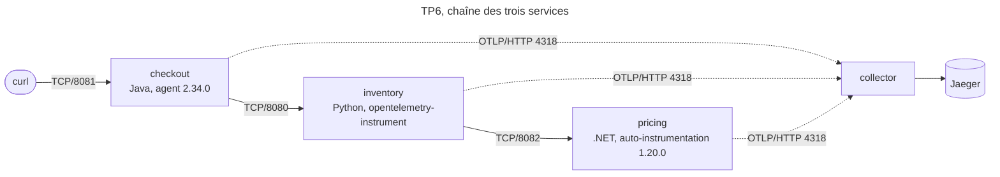

# Lab TP6 : Java, Python et .NET, auto-instrumentation sur Linux

# Objectifs

À la fin du lab, vous saurez :

- activer l'auto-instrumentation d'une application Java avec l'**agent** Java, sans modifier son code ;
- faire de même pour une application Python avec `opentelemetry-instrument` ;
- faire de même pour une application .NET sur Linux ;
- régler les trois uniquement par des variables `OTEL_*` (nom de service, adresse du **collector**, attributs de ressource) ;
- obtenir une trace unique qui traverse les trois services et comparer ce que chaque **agent** produit.

# Contenu

- [Environnement](#environnement)
- [1. Applications de départ et backends](#1-applications-de-départ-et-backends)
- [2. Java](#2-java)
- [3. Python](#3-python)
- [4. .NET](#4-net)
- [5. Trace multi-langages et comparaison](#5-trace-multi-langages-et-comparaison)
- [Cleanup](#cleanup)
- [Extra](#extra)

# Détail

## Environnement

Le lab se déroule sur deux machines : `srv-N` héberge les trois applications et leurs **agents**, `clt-N` porte le **collector** et Jaeger, qui reçoivent les données. Vous travaillez depuis le terminal de `clt-N`, et les commandes destinées au serveur passent par SSH.

Prérequis : TP1 recommandé. La stack du TP1 (Jaeger et un **collector** qui reçoit en OTLP) doit tourner sur `clt-N`.

Les trois applications sont fournies dans le dépôt et recopiées sur `srv-N`. Chacune est volontairement minimale : un endpoint HTTP, un appel au service suivant, aucune bibliothèque OpenTelemetry.

Versions utilisées dans ce lab :

| Composant | Version |
|---|---|
| **agent** Java (`opentelemetry-javaagent`) | 2.34.0 |
| SDK Python (`opentelemetry-distro`) | 0.66b2 |
| Exporter OTLP Python (`opentelemetry-exporter-otlp-proto-http`) | 1.45.2 |
| Flask | 3.1.3 |
| requests | 2.34.2 |
| Auto-instrumentation .NET | 1.20.0 |
| OpenJDK | 21 (paquet `openjdk-21-jre-headless`) |
| .NET | 8.0 (runtime ASP.NET Core) |
| Jaeger | 2.23.0 |

Le schéma suivant montre la chaîne : une requête entre par le service Java, qui appelle le service Python, qui appelle le service .NET. Les trois **agents** envoient au même **collector**.



## 1. Applications de départ et backends

Vérifiez d'abord que la stack du TP1 répond sur `clt-N` :

```bash
curl -s http://localhost:16686/api/v3/services
curl -s -o /dev/null -w 'collector OTLP : %{http_code}\n' \
  -X POST http://localhost:4318/v1/traces -H 'Content-Type: application/json' -d '{}'
```

```text
{"services":["jaeger"]}
collector OTLP : 200
```

Recopiez les trois applications sur le serveur :

```bash
ssh $SRV_HOST 'mkdir -p ~/tp06'
scp -r ~/opentelemetry-labs/config/tp06/. $SRV_HOST:~/tp06/
ssh $SRV_HOST 'ls ~/tp06'
```

```text
checkout.java  inventory.py  pricing
```

`pricing` est un projet .NET (`pricing.csproj` et `Program.cs`), compilé à la partie 4.

Les trois applications s'appellent en cascade. Voici leur comportement, pour comprendre les traces que vous verrez ensuite :

- `checkout` (Java, `TCP/8081`) répond à `GET /order` et appelle `inventory` ;
- `inventory` (Python, `TCP/8080`) répond à `GET /stock` et appelle `pricing` ;
- `pricing` (.NET, `TCP/8082`) répond à `GET /price` et ne dépend de rien.

Sans instrumentation, une requête produit trois lignes de log séparées et aucune trace.

## 2. Java

Installez un JRE et l'**agent** Java sur le serveur :

```bash
ssh $SRV_HOST 'apt-get update -qq && apt-get install -y -qq openjdk-21-jre-headless'
ssh $SRV_HOST 'mkdir -p ~/tp06/java && cd ~/tp06/java && \
  curl -fsSL -o opentelemetry-javaagent.jar \
  https://github.com/open-telemetry/opentelemetry-java-instrumentation/releases/download/v2.34.0/opentelemetry-javaagent.jar'
ssh $SRV_HOST 'java -version 2>&1 | head -1'
```

```text
openjdk version "21.0.x"
```

L'**agent** Java se fixe à la machine virtuelle au démarrage, par l'option `-javaagent`. Aucune ligne de code ne change. Lancez le service avec les variables `OTEL_*` :

```bash
ssh $SRV_HOST 'cd ~/tp06 && \
  OTEL_SERVICE_NAME=checkout \
  OTEL_EXPORTER_OTLP_ENDPOINT=http://'"$CLT_HOST"':4318 \
  OTEL_EXPORTER_OTLP_PROTOCOL=http/protobuf \
  OTEL_RESOURCE_ATTRIBUTES=deployment.environment.name=tp6,lab.id='"$LAB_ID"' \
  nohup java -javaagent:./java/opentelemetry-javaagent.jar -cp . checkout.java \
  > /tmp/checkout.log 2>&1 &'
sleep 4
ssh $SRV_HOST 'tail -2 /tmp/checkout.log'
```

```text
checkout listening on 8081
```

**NB** : `-javaagent` doit précéder `-cp`. L'**agent** instrumente les bibliothèques du JDK et les clients HTTP sans qu'on les déclare, ce qui explique que le span client vers `inventory` apparaîtra sans code dédié.

Appelez le service et vérifiez qu'il répond, puis regardez Jaeger :

```bash
curl -s http://$SRV_HOST:8081/order
sleep 5
curl -s "http://localhost:16686/api/v3/services" | jq -c '.services'
```

```json
{"orders":"1 mug","inventory":{"sku":"1 mug","price":{"currency":"EUR","amount":12.5}}}
{"services":["checkout","jaeger"]}
```

Le service `checkout` est arrivé. Sa trace contient pour l'instant deux spans : le span serveur de la requête et le span client vers `inventory`, qui échoue puisque le service Python n'est pas encore lancé.

## 3. Python

Installez les paquets Python à version exacte, dans un environnement virtuel pour ne pas toucher au système :

```bash
ssh $SRV_HOST 'apt-get install -y -qq python3-venv'
ssh $SRV_HOST 'python3 -m venv ~/tp06/venv && ~/tp06/venv/bin/pip -q install \
  flask==3.1.3 requests==2.34.2 \
  opentelemetry-distro==0.66b2 \
  opentelemetry-exporter-otlp-proto-http==1.45.2'
ssh $SRV_HOST '~/tp06/venv/bin/opentelemetry-bootstrap -a install 2>&1 | tail -3'
```

`opentelemetry-bootstrap -a install` installe les instrumentations correspondant aux bibliothèques présentes : ici `flask` et `requests`.

Lancez le service avec la commande `opentelemetry-instrument`, qui charge l'**agent** avant le code de l'application :

```bash
ssh $SRV_HOST 'cd ~/tp06 && \
  OTEL_SERVICE_NAME=inventory \
  OTEL_EXPORTER_OTLP_ENDPOINT=http://'"$CLT_HOST"':4318 \
  OTEL_EXPORTER_OTLP_PROTOCOL=http/protobuf \
  OTEL_RESOURCE_ATTRIBUTES=deployment.environment.name=tp6,lab.id='"$LAB_ID"' \
  nohup ~/tp06/venv/bin/opentelemetry-instrument \
  ~/tp06/venv/bin/python inventory.py > /tmp/inventory.log 2>&1 &'
sleep 4
ssh $SRV_HOST 'tail -2 /tmp/inventory.log'
```

```text
inventory listening on 8080
```

**NB** : en Python, il n'y a pas d'option de JVM ni de variable `NODE_OPTIONS`. L'**agent** est un point d'entrée : `opentelemetry-instrument` remplace `python` et pose les hooks avant l'import de l'application. L'ordre est donc inversé par rapport à Java.

Appelez la chaîne depuis `clt-N` :

```bash
curl -s http://$SRV_HOST:8081/order
sleep 5
curl -s "http://localhost:16686/api/v3/services" | jq -c '.services'
```

```json
{"orders":"1 mug","inventory":{"sku":"1 mug","price":null}}
{"services":["checkout","inventory","jaeger"]}
```

`inventory` apparaît, et son appel vers `pricing` échoue encore : le service .NET n'existe pas.

## 4. .NET

Installez le SDK .NET 8, puis compilez le service. Le SDK suffit pour le runtime et pour la compilation, et évite de livrer un binaire dans le dépôt :

```bash
ssh $SRV_HOST 'curl -fsSL https://dot.net/v1/dotnet-install.sh -o /tmp/dotnet-install.sh && \
  bash /tmp/dotnet-install.sh --channel 8.0 --install-dir /usr/share/dotnet && \
  ln -sf /usr/share/dotnet/dotnet /usr/local/bin/dotnet'
ssh $SRV_HOST 'export DOTNET_CLI_TELEMETRY_OPTOUT=1 DOTNET_NOLOGO=1; \
  cd ~/tp06/pricing && dotnet publish -c Release -o out 2>&1 | tail -3'
ssh $SRV_HOST 'ls ~/tp06/pricing/out/pricing.dll'
```

```text
/root/tp06/pricing/out/pricing.dll
```

L'auto-instrumentation .NET n'est pas un paquet applicatif : c'est un ensemble de bibliothèques natives chargées par le profileur CLR, plus un script qui exporte les variables nécessaires. Téléchargez-la à version épinglée :

```bash
ssh $SRV_HOST 'mkdir -p ~/tp06/dotnet && cd ~/tp06/dotnet && \
  curl -fsSL -o oi.tar.gz \
  https://github.com/open-telemetry/opentelemetry-dotnet-instrumentation/releases/download/v1.20.0/opentelemetry-dotnet-instrumentation-linux-glibc-x64.zip'
ssh $SRV_HOST 'cd ~/tp06/dotnet && unzip -q oi.tar.gz && ls'
```

```text
LICENSE  OpenTelemetry.AutoInstrumentation.Native.so  net8.0  ...
```

Démarrez le service par le script d'environnement fourni, qui positionne les variables du profileur :

```bash
ssh $SRV_HOST 'cd ~/tp06 && \
  OTEL_SERVICE_NAME=pricing \
  OTEL_EXPORTER_OTLP_ENDPOINT=http://'"$CLT_HOST"':4318 \
  OTEL_EXPORTER_OTLP_PROTOCOL=http/protobuf \
  OTEL_RESOURCE_ATTRIBUTES=deployment.environment.name=tp6,lab.id='"$LAB_ID"' \
  nohup sh ~/tp06/dotnet/instrument.sh dotnet ~/tp06/pricing/out/pricing.dll \
  > /tmp/pricing.log 2>&1 &'
sleep 5
ssh $SRV_HOST 'tail -3 /tmp/pricing.log'
```

```text
pricing listening on 8082
```

**NB** : sur .NET, l'activation passe par le profileur CLR (`CORECLR_ENABLE_PROFILING`, `CORECLR_PROFILER`), que le script `instrument.sh` exporte. C'est la mécanique la plus intrusive des trois, et la seule qui demande un script fourni par le projet.

Vérifiez la chaîne complète :

```bash
curl -s http://$SRV_HOST:8081/order
sleep 5
curl -s "http://localhost:16686/api/v3/services" | jq -c '.services'
```

```json
{"orders":"1 mug","inventory":{"sku":"1 mug","price":{"currency":"EUR","amount":12.5}}}
{"services":["checkout","inventory","jaeger","pricing"]}
```

## 5. Trace multi-langages et comparaison

Envoyez quelques requêtes, puis ouvrez Jaeger et cherchez le service `checkout`. Une requête produit une trace unique à travers les trois langages, grâce au propagator W3C `tracecontext`, actif par défaut dans les trois **agents**.

```bash
for i in $(seq 5); do curl -s http://$SRV_HOST:8081/order > /dev/null; done
sleep 5
curl -s "http://localhost:16686/api/v3/traces?query.service_name=checkout&query.startTimeMin=$(date -u -d '10 minutes ago' +%Y-%m-%dT%H:%M:%SZ)&query.startTimeMax=$(date -u -d '+1 minute' +%Y-%m-%dT%H:%M:%SZ)" \
  | jq -r '[.result.resourceSpans[].scopeSpans[].spans[] | "\(.kind) \(.name)"] | unique | .[]' | sort
```

```text
1 GET
2 GET /order
2 GET /stock
3 GET
```

Les kinds se lisent ainsi : `2` est un span serveur, `3` un span client. Vous voyez donc le span serveur de `checkout`, son client vers `inventory`, le serveur et le client de `inventory`, et le serveur de `pricing`.

Comparez maintenant les attributs produits par chaque **agent** :

```bash
curl -s "http://localhost:16686/api/v3/traces?query.service_name=checkout&query.startTimeMin=$(date -u -d '10 minutes ago' +%Y-%m-%dT%H:%M:%SZ)&query.startTimeMax=$(date -u -d '+1 minute' +%Y-%m-%dT%H:%M:%SZ)" \
  | jq -r '[.result.resourceSpans[].resource.attributes[] | "\(.key)=\(.value.stringValue // .value.intValue)"] | unique | .[]' | sort | grep -E "telemetry|service.name|deployment"
```

```text
deployment.environment.name=tp6
service.name=checkout
telemetry.sdk.language=java
telemetry.sdk.name=opentelemetry
telemetry.sdk.version=...
```

Trois différences valent la discussion en séance :

- **`telemetry.sdk.language`** vaut `java`, `python` ou `dotnet` selon le service, et c'est le seul attribut qui trahit le langage : le reste de la trace est homogène ;
- **les noms de spans** varient : Java produit `GET /order`, Python `GET /stock`, .NET `GET /price`, parce que chaque instrumentation applique sa propre convention de nommage ;
- **les métriques de runtime** ne sont pas identiques : Java expose la mémoire de la JVM, Python le compteur du ramasse-miettes, .NET le pool de threads. Elles arriveraient dans Prometheus, comme au TP1, si le pipeline `metrics` était exporté.

**NB** : la propagation entre langages ne demande aucune configuration supplémentaire parce que les trois **agents** utilisent `tracecontext` par défaut. Si un service n'apparaissait pas dans la trace, la première vérification est l'en-tête `traceparent` sur l'appel sortant, et la seconde le propagator configuré par `OTEL_PROPAGATORS`.

## Cleanup

Arrêtez les trois services sur le serveur, puis supprimez les fichiers installés :

```bash
ssh $SRV_HOST 'pkill -f checkout.java; pkill -f inventory.py; pkill -f pricing.dll'
ssh $SRV_HOST 'rm -rf ~/tp06 /usr/share/dotnet /usr/local/bin/dotnet'
ssh $SRV_HOST 'apt-get purge -y openjdk-21-jre-headless python3-venv'
```

Les services étaient lancés en `nohup`, sans service systemd : `pkill` suffit, et la vérification suivante ne doit plus rien renvoyer :

```bash
ssh $SRV_HOST 'pgrep -af "checkout.java|inventory.py|pricing.dll" || echo "aucun service"'
```

```text
aucun service
```

La stack du TP1 sur `clt-N` reste en place : elle sert au TP suivant.

## Extra

À vous de jouer, si le temps le permet.

- Désactivez une instrumentation précise par variable d'environnement, par exemple `OTEL_PYTHON_DISABLED_INSTRUMENTATIONS=requests`, et observez la disparition du span client.
- Excluez un endpoint du traçage avec `OTEL_PYTHON_FLASK_EXCLUDED_URLS=/health`.
- Ajoutez un attribut de ressource propre à chaque service depuis la ligne de commande, et vérifiez qu'il apparaît dans Jaeger.
