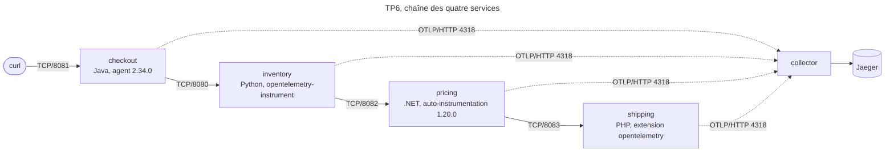
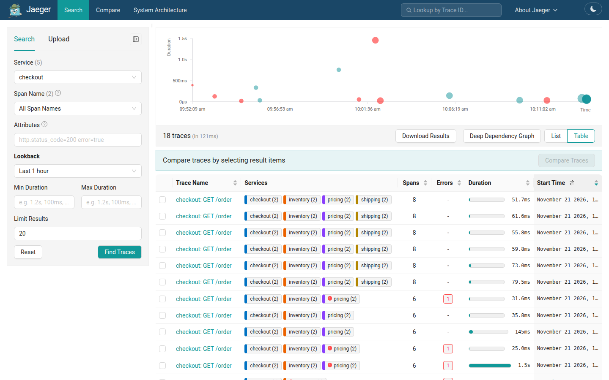
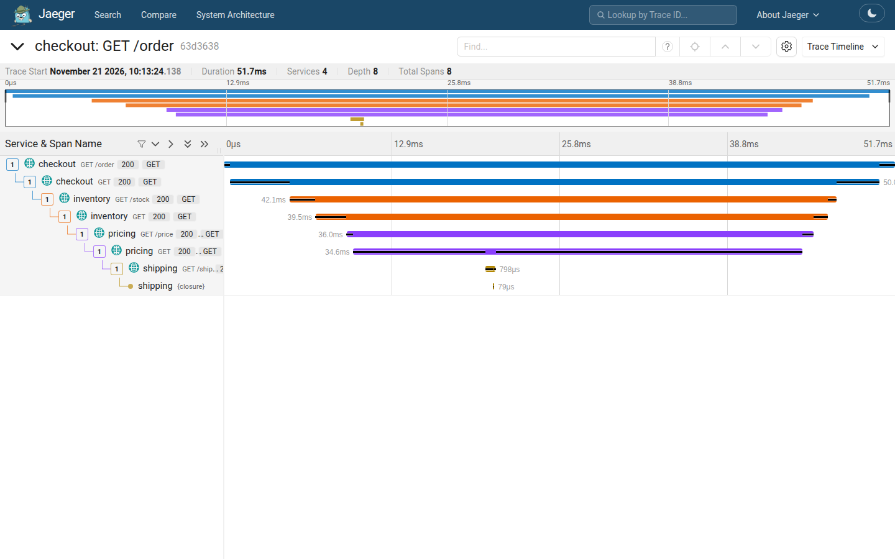

# Lab TP6 : Java, Python, .NET et PHP, auto-instrumentation sur Linux

# Objectifs

À la fin du lab, vous saurez :

- activer l'auto-instrumentation d'une application Java avec l'**agent** Java, sans modifier son code ;
- faire de même pour une application Python avec `opentelemetry-instrument` ;
- faire de même pour une application .NET sur Linux ;
- faire de même pour une application PHP, avec l'extension `opentelemetry` et les paquets Composer ;
- régler les quatre uniquement par des variables `OTEL_*` (nom de service, adresse du **collector**, attributs de ressource) ;
- obtenir une trace unique qui traverse les quatre services et comparer ce que chaque **agent** produit.

# Contenu

- [Environnement](#environnement)
- [1. Applications de départ et backends](#1-applications-de-départ-et-backends)
- [2. Java](#2-java)
- [3. Python](#3-python)
- [4. .NET](#4-net)
- [5. PHP](#5-php)
- [6. Trace multi-langages et comparaison](#6-trace-multi-langages-et-comparaison)
- [Cleanup](#cleanup)
- [Extra](#extra)

# Détail

## Environnement

Le lab se déroule sur deux machines : `srv-N` héberge les quatre applications et leurs **agents**, `clt-N` porte le **collector** et Jaeger, qui reçoivent les données. Vous travaillez depuis le terminal de `clt-N`, et les commandes destinées au serveur passent par SSH.

Prérequis : aucun TP préalable. Ce lab crée ses propres backends à la partie 1 : un Jaeger et un **collector** qui reçoit en OTLP, sur `clt-N`. Les machines sont reconstruites par cloud-init : partez du principe qu'aucun service d'un TP précédent ne tourne encore, et que les ports 16686 et 4318 doivent être libres.

Les quatre applications sont fournies dans le dépôt et recopiées sur `srv-N`. Chacune est volontairement minimale : un endpoint HTTP, un appel au service suivant, aucune bibliothèque OpenTelemetry.

Versions utilisées dans ce lab :

| Composant | Version |
|---|---|
| **agent** Java (`opentelemetry-javaagent`) | 2.34.0 |
| SDK Python (`opentelemetry-distro`) | 0.66b2 |
| Exporter OTLP Python (`opentelemetry-exporter-otlp-proto-http`) | 1.45.2 |
| Flask | 3.1.3 |
| requests | 2.34.2 |
| .NET | 10.0 (runtime ASP.NET Core) |
| Auto-instrumentation .NET | 1.20.0 (supporte .NET 10 et 11, abandonne .NET 8 et 9) |
| Extension PECL `opentelemetry` | 1.1.0 |
| SDK PHP (`open-telemetry/sdk`) | 1.7 |
| Exporter OTLP PHP (`open-telemetry/exporter-otlp`) | 1.2 |
| Slim (`slim/slim`) | 4.14 |
| OpenJDK | 21 (paquet `openjdk-21-jdk-headless`) |
| PHP | 8.3 (paquet `php8.3-cli`) |
| Jaeger | 2.23.0 |

Le schéma suivant montre la chaîne : une requête entre par le service Java, qui appelle le service Python, qui appelle le service .NET, qui appelle le service PHP. Les quatre **agents** envoient au même **collector**.



## 1. Applications de départ et backends

Les backends de ce lab tiennent dans un fichier `compose.yaml` : un Jaeger et un **collector** qui reçoit en OTLP/HTTP. Créez le dossier et la stack sur `clt-N` :

```bash
mkdir -p ~/tp06/otelcol
cd ~/tp06

cat > compose.yaml <<'EOF'
name: tp06

services:
  jaeger:
    image: jaegertracing/jaeger:2.23.0
    ports:
      - "16686:16686"
    restart: unless-stopped

  otelcol:
    image: ghcr.io/open-telemetry/opentelemetry-collector-releases/opentelemetry-collector-contrib:0.165.0
    command:
      - --config=/etc/otelcol/receivers.yaml
      - --config=/etc/otelcol/exporters.yaml
      - --config=/etc/otelcol/service.yaml
    volumes:
      - ./otelcol:/etc/otelcol:ro
    ports:
      - "4318:4318"
    depends_on:
      - jaeger
    restart: unless-stopped
EOF

cat > otelcol/receivers.yaml <<'EOF'
receivers:
  otlp:
    protocols:
      http:
        endpoint: 0.0.0.0:4318
EOF

cat > otelcol/exporters.yaml <<'EOF'
exporters:
  otlp_http/jaeger:
    endpoint: http://jaeger:4318
EOF

cat > otelcol/service.yaml <<'EOF'
service:
  pipelines:
    traces:
      receivers: [otlp]
      exporters: [otlp_http/jaeger]
EOF

docker compose up -d
docker compose ps --format '{{.Service}} {{.State}}'
```

```text
jaeger running
otelcol running
```

Vérifiez que les deux backends répondent :

```bash
curl -s http://localhost:16686/api/v3/services
curl -s -o /dev/null -w 'collector OTLP : %{http_code}\n' \
  -X POST http://localhost:4318/v1/traces -H 'Content-Type: application/json' -d '{}'
```

```text
{"services":["jaeger"]}
collector OTLP : 200
```

**NB** : ce TP n'utilise que le signal traces, et sans processor : la configuration du **collector** tient en trois fichiers. Le TP1 détaille les quatre sections, les processors et le fan-out ; ce lab reprend la même logique en version minimale.

**NB** : si l'API renvoie `{"services":[]}` tout de suite après le démarrage, attendez quelques secondes et réinterrogez : Jaeger enregistre le service `jaeger` lui-même une fois sa télémétrie interne démarrée.

Recopiez les quatre applications sur le serveur :

```bash
ssh $SRV_HOST 'mkdir -p ~/tp06'
scp -r ~/opentelemetry-labs/config/tp06/. $SRV_HOST:~/tp06/
ssh $SRV_HOST 'ls ~/tp06'
```

```text
checkout.java  inventory.py  pricing  shipping
```

`pricing` est un projet .NET (`pricing.csproj` et `Program.cs`), compilé à la partie 4.

Les quatre applications s'appellent en cascade. Voici leur comportement, pour comprendre les traces que vous verrez ensuite :

- `checkout` (Java, `TCP/8081`) répond à `GET /order` et appelle `inventory` ;
- `inventory` (Python, `TCP/8080`) répond à `GET /stock` et appelle `pricing` ;
- `pricing` (.NET, `TCP/8082`) répond à `GET /price` et appelle `shipping` ;
- `shipping` (PHP, `TCP/8083`) répond à `GET /ship` et ne dépend de rien.

Sans instrumentation, une requête produit quatre lignes de log séparées et aucune trace.

## 2. Java

Installez un JRE et l'**agent** Java sur le serveur :

```bash
ssh $SRV_HOST 'apt-get update -qq && apt-get install -y -qq openjdk-21-jdk-headless'
ssh $SRV_HOST 'mkdir -p ~/tp06/java && cd ~/tp06/java && \
  curl -fsSL -o opentelemetry-javaagent.jar \
  https://github.com/open-telemetry/opentelemetry-java-instrumentation/releases/download/v2.34.0/opentelemetry-javaagent.jar'
ssh $SRV_HOST 'java -version 2>&1 | head -1'
```

```text
openjdk version "21.0.x"
```

L'**agent** Java se fixe à la machine virtuelle au démarrage, par l'option `-javaagent`. Aucune ligne de code ne change. Compilez d'abord le service, puis lancez-le avec les variables `OTEL_*` :

```bash
ssh $SRV_HOST 'cd ~/tp06 && javac checkout.java && ls checkout.class'
```

```text
checkout.class
```

```bash
ssh $SRV_HOST 'cd ~/tp06 && \
  OTEL_SERVICE_NAME=checkout \
  OTEL_EXPORTER_OTLP_ENDPOINT=http://'"$CLT_HOST"':4318 \
  OTEL_EXPORTER_OTLP_PROTOCOL=http/protobuf \
  OTEL_RESOURCE_ATTRIBUTES=deployment.environment.name=tp6,lab.id='"$LAB_ID"' \
  setsid nohup java -javaagent:./java/opentelemetry-javaagent.jar -cp . checkout \
  > /tmp/checkout.log 2>&1 < /dev/null &'
sleep 4
ssh $SRV_HOST 'tail -2 /tmp/checkout.log'
```

```text
checkout listening on 8081
```

**NB** : trois pièges sur ce lancement. D'abord, le mode source-file (`java checkout.java`, qui compile à la volée) ne convient pas : il charge le compilateur en mémoire, l'**agent** détecte un outil JDK et se désactive avec le message `JDK tool detected, agent will not be started`. Ensuite, `-javaagent` doit précéder `-cp` et la classe, l'**agent** devant s'attacher avant le chargement des classes. Enfin, `setsid` détache le service de la session SSH : un service lancé par SSH et détaché avec `nohup` seul peut être tué à la fermeture de la session, ce qui s'est produit avec le service .NET ; `setsid` le rend indépendant de la session tout entière, et `< /dev/null` lui évite de lire le terminal. Les quatre lancements de ce lab suivent le même schéma. L'**agent** instrumente les bibliothèques du JDK et les clients HTTP sans qu'on les déclare, ce qui explique que le span client vers `inventory` apparaîtra sans code dédié.

Appelez le service et vérifiez qu'il répond, puis regardez Jaeger :

```bash
curl -s http://$SRV_HOST:8081/order
sleep 5
curl -s "http://localhost:16686/api/v3/services" | jq -c '.services'
```

```json
{"orders":"1 mug","inventory":{"sku":"1 mug","price":{"currency":"EUR","amount":12.5}}}
{"services":["checkout","jaeger"]}
```

Le service `checkout` est arrivé. Sa trace contient pour l'instant deux spans : le span serveur de la requête et le span client vers `inventory`, qui échoue puisque le service Python n'est pas encore lancé.

## 3. Python

Installez les paquets Python à version exacte, dans un environnement virtuel pour ne pas toucher au système :

```bash
ssh $SRV_HOST 'apt-get install -y -qq python3-venv'
ssh $SRV_HOST 'python3 -m venv ~/tp06/venv && ~/tp06/venv/bin/pip -q install \
  flask==3.1.3 requests==2.34.2 \
  opentelemetry-distro==0.66b2 \
  opentelemetry-exporter-otlp-proto-http==1.45.2'
ssh $SRV_HOST '~/tp06/venv/bin/opentelemetry-bootstrap -a install 2>&1 | tail -3'
```

`opentelemetry-bootstrap -a install` installe les instrumentations correspondant aux bibliothèques présentes : ici `flask` et `requests`.

Lancez le service avec la commande `opentelemetry-instrument`, qui charge l'**agent** avant le code de l'application :

```bash
ssh $SRV_HOST 'cd ~/tp06 && \
  OTEL_SERVICE_NAME=inventory \
  OTEL_EXPORTER_OTLP_ENDPOINT=http://'"$CLT_HOST"':4318 \
  OTEL_EXPORTER_OTLP_PROTOCOL=http/protobuf \
  OTEL_RESOURCE_ATTRIBUTES=deployment.environment.name=tp6,lab.id='"$LAB_ID"' \
  setsid nohup ~/tp06/venv/bin/opentelemetry-instrument \
  ~/tp06/venv/bin/python inventory.py > /tmp/inventory.log 2>&1 < /dev/null &'
sleep 4
ssh $SRV_HOST 'tail -2 /tmp/inventory.log'
```

```text
inventory listening on 8080
```

**NB** : en Python, il n'y a pas d'option de JVM ni de variable `NODE_OPTIONS`. L'**agent** est un point d'entrée : `opentelemetry-instrument` remplace `python` et pose les hooks avant l'import de l'application. L'ordre est donc inversé par rapport à Java.

Appelez la chaîne depuis `clt-N` :

```bash
curl -s http://$SRV_HOST:8081/order
sleep 5
curl -s "http://localhost:16686/api/v3/services" | jq -c '.services'
```

```json
{"orders":"1 mug","inventory":{"sku":"1 mug","price":null}}
{"services":["checkout","inventory","jaeger"]}
```

`inventory` apparaît, et son appel vers `pricing` échoue encore : le service .NET n'existe pas.

## 4. .NET

Installez le SDK .NET 10, puis compilez le service. Le SDK suffit pour le runtime et pour la compilation, et évite de livrer un binaire dans le dépôt :

```bash
ssh $SRV_HOST 'curl -fsSL https://dot.net/v1/dotnet-install.sh -o /tmp/dotnet-install.sh && \
  bash /tmp/dotnet-install.sh --channel 10.0 --install-dir /usr/share/dotnet && \
  ln -sf /usr/share/dotnet/dotnet /usr/local/bin/dotnet'
ssh $SRV_HOST 'export DOTNET_CLI_TELEMETRY_OPTOUT=1 DOTNET_NOLOGO=1; \
  cd ~/tp06/pricing && dotnet publish -c Release -o out 2>&1 | tail -3'
ssh $SRV_HOST 'ls ~/tp06/pricing/out/pricing.dll'
```

```text
/root/tp06/pricing/out/pricing.dll
```

L'auto-instrumentation .NET n'est pas un paquet applicatif : c'est un ensemble de bibliothèques natives chargées par le profileur CLR, plus un script qui exporte les variables nécessaires. Téléchargez-la à version épinglée :

```bash
ssh $SRV_HOST 'apt-get install -y -qq unzip'
ssh $SRV_HOST 'mkdir -p ~/tp06/dotnet && cd ~/tp06/dotnet && \
  curl -fsSL -o oi.tar.gz \
  https://github.com/open-telemetry/opentelemetry-dotnet-instrumentation/releases/download/v1.20.0/opentelemetry-dotnet-instrumentation-linux-glibc-x64.zip'
ssh $SRV_HOST 'cd ~/tp06/dotnet && unzip -q oi.tar.gz && ls'
```

```text
LICENSE  OpenTelemetry.AutoInstrumentation.Native.so  instrument.sh  linux-x64  net  ...
```

**NB** : l'auto-instrumentation 1.20.0 abandonne .NET 8 et 9, arrivés en fin de support, et ne supporte plus que .NET 10 et 11. C'est pourquoi le service cible `net10.0`. Avec une version plus ancienne de l'auto-instrumentation, l'application ne démarrerait pas ou resterait sans spans.

Démarrez le service par le script d'environnement fourni, qui positionne les variables du profileur :

```bash
ssh $SRV_HOST 'cd ~/tp06 && \
  OTEL_SERVICE_NAME=pricing \
  OTEL_EXPORTER_OTLP_ENDPOINT=http://'"$CLT_HOST"':4318 \
  OTEL_EXPORTER_OTLP_PROTOCOL=http/protobuf \
  OTEL_RESOURCE_ATTRIBUTES=deployment.environment.name=tp6,lab.id='"$LAB_ID"' \
  OTEL_DOTNET_AUTO_HOME=~/tp06/dotnet \
  setsid nohup sh ~/tp06/dotnet/instrument.sh dotnet ~/tp06/pricing/out/pricing.dll \
  > /tmp/pricing.log 2>&1 < /dev/null &'
sleep 5
ssh $SRV_HOST 'tail -3 /tmp/pricing.log'
```

```text
      Hosting environment: Production
info: Microsoft.Hosting.Lifetime[0]
      Content root path: /root/tp06
```

**NB** : contrairement aux trois autres services, le service .NET n'affiche pas de message de démarrage explicite : les lignes ci-dessus, écrites par ASP.NET Core, signalent qu'il est prêt. Le port se vérifie par un appel : `curl -s http://$SRV_HOST:8082/price`.

**NB** : sur .NET, l'activation passe par le profileur CLR (`CORECLR_ENABLE_PROFILING`, `CORECLR_PROFILER`), que le script `instrument.sh` exporte. Le script cherche ses fichiers dans `OTEL_DOTNET_AUTO_HOME`, qui vaut par défaut `~/.otel-dotnet-auto` : sans cette variable, il échoue avec `There are no files under the location specified via OTEL_DOTNET_AUTO_HOME`. C'est la mécanique la plus intrusive des quatre, et la seule qui demande un script fourni par le projet.

Vérifiez la chaîne complète :

```bash
curl -s http://$SRV_HOST:8081/order
sleep 5
curl -s "http://localhost:16686/api/v3/services" | jq -c '.services'
```

```json
{"orders":"1 mug","inventory":{"sku":"1 mug","price":{"currency":"EUR","amount":12.5,"shipping":{"error":"HttpRequestException"}}}}
{"services":["checkout","inventory","jaeger","pricing"]}
```

L'appel vers `shipping` échoue encore : le service PHP est l'objet de la partie suivante.

## 5. PHP

Installez PHP, l'extension `opentelemetry` et Composer :

```bash
ssh $SRV_HOST 'apt-get install -y -qq php8.3-cli php8.3-curl php8.3-xml php8.3-mbstring unzip composer php-pear php8.3-dev build-essential'
ssh $SRV_HOST 'pecl install opentelemetry-1.1.0'
ssh $SRV_HOST 'echo "extension=opentelemetry.so" > /etc/php/8.3/cli/conf.d/20-opentelemetry.ini; php -m | grep opentelemetry'
```

```text
opentelemetry
```

**NB** : `pecl` vient du paquet `php-pear`, et la compilation de l'extension demande `php8.3-dev` et la chaîne de compilation (`build-essential`). C'est le point d'installation le plus lourd des quatre langages : l'extension `opentelemetry` de PHP n'est pas un paquet Debian, elle se compile à l'installation.

L'extension seule ne fait rien : elle fournit les points d'accroche, et les paquets Composer décident de ce qui est instrumenté. Installez l'application et ses dépendances :

```bash
ssh $SRV_HOST 'cd ~/tp06/shipping && composer install --no-interaction --no-progress 2>&1 | tail -3'
ssh $SRV_HOST 'ls ~/tp06/shipping/vendor/open-telemetry'
```

```text
api  context  exporter-otlp  gen-otlp-protobuf  opentelemetry-auto-slim  sdk  sem-conv
```

**NB** : l'exporter OTLP en HTTP a besoin d'un client PSR-18 pour envoyer les requêtes. Le `composer.json` fourni contient donc `guzzlehttp/guzzle`. Sans lui, chaque requête lève l'avertissement `No PSR-18 clients found. Make sure to install a package providing "psr/http-client-implementation"`, et aucun span n'est envoyé.

Lancez le service avec les mêmes variables `OTEL_*`, plus celle qui active le chargement automatique :

```bash
ssh $SRV_HOST "cd ~/tp06/shipping && \
  OTEL_PHP_AUTOLOAD_ENABLED=true \
  OTEL_SERVICE_NAME=shipping \
  OTEL_EXPORTER_OTLP_ENDPOINT=http://$CLT_HOST:4318 \
  OTEL_EXPORTER_OTLP_PROTOCOL=http/protobuf \
  OTEL_RESOURCE_ATTRIBUTES=deployment.environment.name=tp6,lab.id=$LAB_ID \
  setsid nohup php -S 0.0.0.0:8083 -t public > /tmp/shipping.log 2>&1 < /dev/null &"
sleep 4
ssh $SRV_HOST 'tail -2 /tmp/shipping.log'
```

```text
[Fri Nov 21 ...] PHP 8.3.x Development Server (http://0.0.0.0:8083) started
```

**NB** : en PHP, l'activation tient à deux éléments, et il faut les deux. L'extension `opentelemetry` fournit les hooks au niveau du moteur, et `OTEL_PHP_AUTOLOAD_ENABLED=true` demande au SDK de s'enregistrer à chaque requête. Sans l'extension, les paquets Composer s'installent mais ne produisent aucun span ; sans la variable, l'extension est chargée mais ne s'enregistre pas.

Vérifiez la chaîne complète, désormais sur quatre langages :

```bash
curl -s http://$SRV_HOST:8081/order
sleep 5
curl -s "http://localhost:16686/api/v3/services" | jq -c '.services'
```

```json
{"orders":"1 mug","inventory":{"sku":"1 mug","price":{"currency":"EUR","amount":12.5,"shipping":{"carrier":"colissimo","eta_days":2}}}}
{"services":["checkout","inventory","jaeger","pricing","shipping"]}
```

**NB** : l'exemple de la documentation PHP est souvent un script unique servi par le serveur intégré. Cela fonctionne pour l'export, mais pas pour l'instrumentation automatique de l'entrée HTTP : il n'y a pas de framework à intercepter. C'est pourquoi le service utilise Slim, dont l'instrumentation est fournie par `opentelemetry-auto-slim`. Pour reprendre l'esprit de l'application PHP de démonstration du lab d'origine, c'est la même mécanique qui s'appliquerait, avec un framework plutôt qu'avec un script nu.

## 6. Trace multi-langages et comparaison

Envoyez quelques requêtes, puis ouvrez Jaeger et cherchez le service `checkout`. Une requête produit une trace unique à travers les quatre langages, grâce au propagateur W3C `tracecontext`, actif par défaut dans les quatre **agents** :



```bash
for i in $(seq 5); do curl -s http://$SRV_HOST:8081/order > /dev/null; done
sleep 5
curl -s "http://localhost:16686/api/v3/traces?query.service_name=checkout&query.startTimeMin=$(date -u -d '10 minutes ago' +%Y-%m-%dT%H:%M:%SZ)&query.startTimeMax=$(date -u -d '+1 minute' +%Y-%m-%dT%H:%M:%SZ)" \
  | jq -r '[.result.resourceSpans[].scopeSpans[].spans[] | "\(.kind) \(.name)"] | unique | .[]' | sort
```

```text
1 {closure}
2 GET /order
2 GET /price
2 GET /ship
2 GET /stock
3 GET
3 GET
3 GET
```

Les kinds se lisent ainsi : `2` est un span serveur, `3` un span client, `1` un span interne. Vous voyez les quatre spans serveur, un par langage, et les trois spans client qui les relient. Le span interne `{closure}` vient de PHP : l'instrumentation de Slim crée un span autour du middleware, et son nom tient à l'implémentation. Une seule trace, quatre services, quatre **agents** différents :



Comparez maintenant les attributs produits par chaque **agent** :

```bash
curl -s "http://localhost:16686/api/v3/traces?query.service_name=checkout&query.startTimeMin=$(date -u -d '10 minutes ago' +%Y-%m-%dT%H:%M:%SZ)&query.startTimeMax=$(date -u -d '+1 minute' +%Y-%m-%dT%H:%M:%SZ)" \
  | jq -r '[.result.resourceSpans[].resource.attributes[] | "\(.key)=\(.value.stringValue // .value.intValue)"] | unique | .[]' | sort | grep -E "telemetry|service.name|deployment"
```

```text
deployment.environment.name=tp6
service.name=checkout
telemetry.sdk.language=java
telemetry.sdk.name=opentelemetry
telemetry.sdk.version=...
```

Trois différences valent la discussion en séance :

- **`telemetry.sdk.language`** vaut `java`, `python`, `dotnet` ou `php` selon le service, et c'est le seul attribut qui trahit le langage : le reste de la trace est homogène ;
- **les noms de spans** varient : Java produit `GET /order`, Python `GET /stock`, .NET `GET /price`, PHP `GET /ship`, parce que chaque instrumentation applique sa propre convention de nommage, et que PHP passe par le middleware PSR-15 de Slim ;
- **les versions de SDK** varient aussi : au moment de la rédaction, `1.68.0` pour l'**agent** Java, `1.45.2` pour le SDK Python, `1.21.0` pour le SDK .NET, `1.17.0` pour le SDK PHP, chacun suivant son propre cycle de publication.

**NB** : la propagation entre langages ne demande aucune configuration supplémentaire parce que les quatre **agents** utilisent `tracecontext` par défaut. Si un service n'apparaissait pas dans la trace, la première vérification est l'en-tête `traceparent` sur l'appel sortant, et la seconde le propagator configuré par `OTEL_PROPAGATORS`.

## Cleanup

Arrêtez les quatre services sur le serveur, puis supprimez les fichiers installés :

```bash
ssh $SRV_HOST 'pkill -f "[c]heckout.java"; pkill -f "[i]nventory.py"; \
  pkill -f "[p]ricing.dll"; pkill -f "[p]hp -S"'
ssh $SRV_HOST 'rm -rf ~/tp06 /usr/share/dotnet /usr/local/bin/dotnet'
ssh $SRV_HOST 'pecl uninstall opentelemetry; rm -f /etc/php/8.3/cli/conf.d/20-opentelemetry.ini'
ssh $SRV_HOST 'apt-get purge -y openjdk-21-jdk-headless python3-venv php8.3-cli php8.3-curl php8.3-xml php8.3-mbstring composer unzip php-pear php8.3-dev build-essential'
```

Les services étaient lancés en `nohup`, sans service systemd : `pkill` suffit. Les motifs sont écrits `[c]heckout.java` plutôt que `checkout.java` : sans les crochets, `pkill -f` tue aussi le shell qui l'exécute, car sa propre ligne de commande contient le motif, et les `pkill` suivants ne s'exécutent jamais. La vérification suivante ne doit plus rien renvoyer :

```bash
ssh $SRV_HOST 'pgrep -af "[c]heckout.java|[i]nventory.py|[p]ricing.dll|[p]hp -S" || echo "aucun service"'
```

```text
aucun service
```

Détruisez aussi la stack du lab sur `clt-N` :

```bash
cd ~/tp06 && docker compose down -v
```

Les ports 16686 et 4318 redeviennent libres :

```bash
ss -ltn | grep -E ':(16686|4318) ' || echo "ports libres"
```

```text
ports libres
```

## Extra

À vous de jouer, si le temps le permet.

- Désactivez une instrumentation précise par variable d'environnement, par exemple `OTEL_PYTHON_DISABLED_INSTRUMENTATIONS=requests`, et observez la disparition du span client.
- Excluez un endpoint du traçage avec `OTEL_PYTHON_FLASK_EXCLUDED_URLS=/health`.
- Ajoutez un attribut de ressource propre à chaque service depuis la ligne de commande, et vérifiez qu'il apparaît dans Jaeger.
